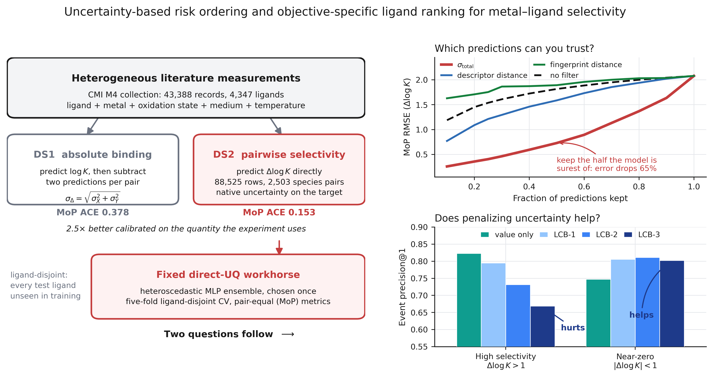
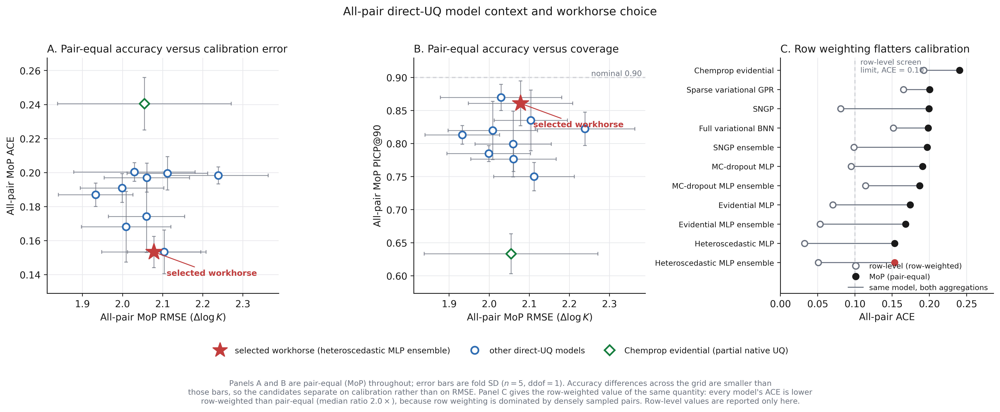
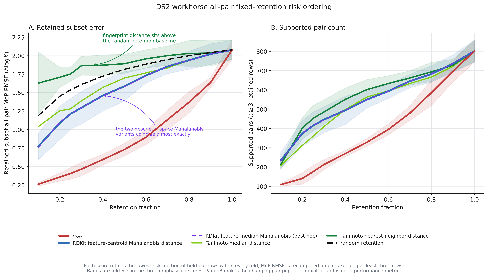
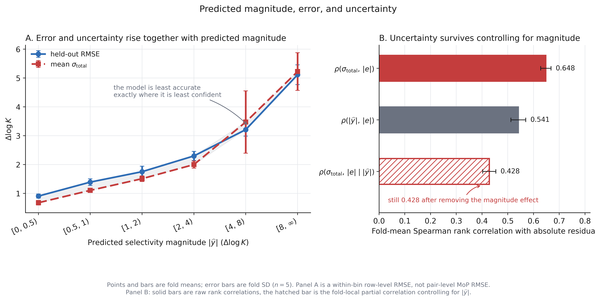
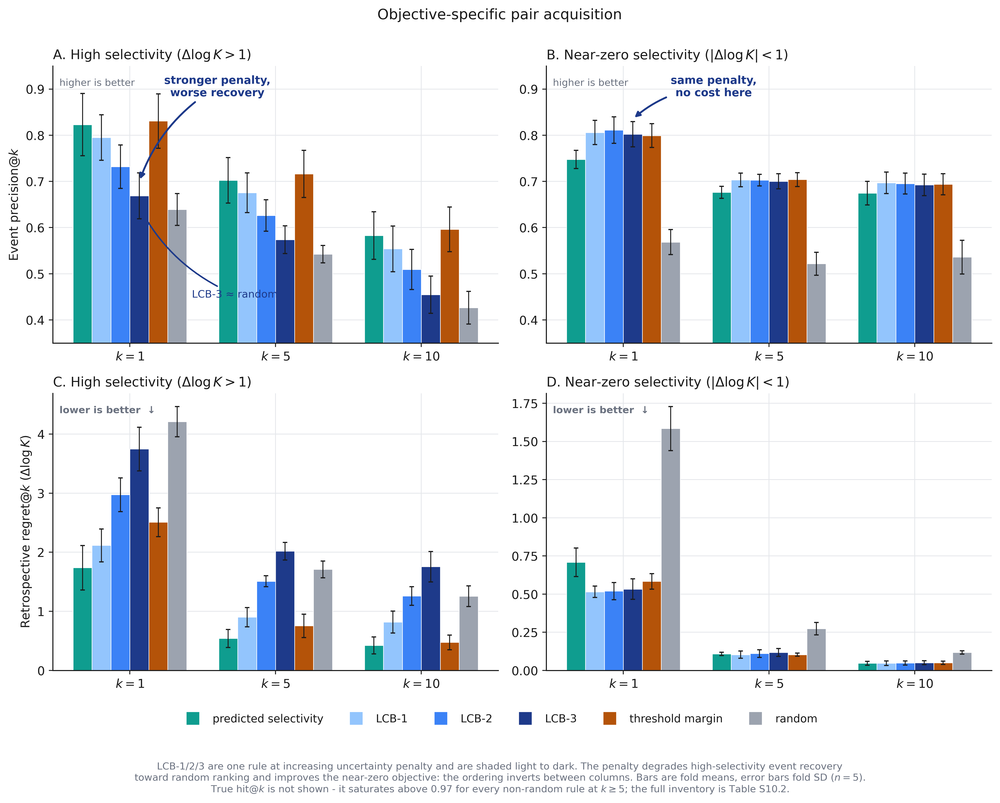

# Uncertainty-Based Risk Ordering and Objective-Specific Ligand Ranking for Metal–Ligand Selectivity

**Figure 0. Graphical abstract.** Metal–ligand selectivity is modeled directly on the pairwise target $\Delta\log K$ rather than reconstructed from two absolute-binding predictions, which attaches the uncertainty estimate to the quantity the experiment consumes and more than halves its calibration error. A single direct-UQ model is then fixed and asked two questions. First, which predictions can be trusted: retaining the half of held-out rows the model is surest of cuts pair-equal error by 65%, whereas the same retention driven by molecular distance recovers little and, for fingerprint distance, does worse than no filter at all. Second, whether penalizing uncertainty improves a shortlist: it does for a near-zero selectivity objective and steadily damages a high-selectivity one, because the candidates such a campaign wants are the ones the model is least sure about. All plotted values are the fold means reported in Figures 2 and 4.

## Abstract

Machine-learning models for metal–ligand selectivity are usually assessed with global regression metrics and molecular-similarity applicability domains, whereas experimental use requires ranking ligands for one competing-metal pair at a time. Using heterogeneous literature measurements from the Critical Materials Institute M4 collection, we model pairwise selectivity ($\Delta\log K$) directly under ligand-disjoint validation, which tests generalization to genuinely unseen ligands, and score it with pair-equal metrics; a heteroscedastic multilayer-perceptron ensemble is fixed in advance as the workhorse and held constant across every downstream analysis. Its predictive uncertainty orders held-out error far more effectively than fingerprint, descriptor-space and learned-representation distances or a pair-support count, and several of those distances show no positive association with held-out error at all. At 50% retention, uncertainty ranking reduces all-pair mean-of-pairs RMSE from $2.078 \pm 0.130$ to $0.730 \pm 0.084$, against $1.586 \pm 0.198$ for the leading registered descriptor-space distance, and it remains predictive of error after controlling for predicted selectivity magnitude. Retrospective pair-specific ranking then shows that the best acquisition rule depends on the experimental objective: threshold-margin ranking gives the highest high-selectivity event recovery at shortlist sizes above one, ranking by predicted selectivity comes closest to the strongest available candidate, and uncertainty-aware ranking is most valuable for near-zero selectivity. Risk ordering calibrated against held-out outcomes is therefore a far better applicability domain than molecular distance alone (fold-mean Spearman $\rho$ with absolute residual $0.648 \pm 0.020$, against $0.250 \pm 0.078$ for the best distance tested).

## 1. Introduction

Machine-learning models for molecular property prediction are often evaluated under data partitions that are substantially easier than the intended deployment problem. In a random row split, closely related molecules, repeated ligand scaffolds, or even the same ligand can occur in both the training and test partitions. The resulting estimate may therefore measure interpolation within a densely sampled chemical neighborhood rather than prediction for a genuinely new chemical structure. This distinction is particularly important for small and heterogeneous chemical datasets, where a limited number of scaffolds or experimental sources can dominate the apparent performance of a model.

The cheminformatics community has responded by developing and adopting evaluation protocols that make structural novelty more explicit. Scaffold splits, similarity- or cluster-based partitions, temporal splits, and applicability-domain analyses are now commonly used alongside random splits to quantify how performance changes as the test set becomes less similar to the training set.1–3 Fingerprint-based Tanimoto similarity is frequently used to characterize this structural relationship because it provides an interpretable, model-independent measure of the nearest training examples.4 However, structural similarity is not equivalent to prediction reliability. Similar molecules can exhibit activity cliffs, condition-dependent behavior, or different measurement noise, whereas dissimilarity may reflect only one component of the factors that determine prediction error.5,6 Consequently, a structural distance should be evaluated as an empirical predictor of held-out error rather than assumed to define a universal applicability-domain boundary.

These issues become more complex when the modeled property depends not only on molecular structure but also on chemical context. A large fraction of early cheminformatics work was formulated as a structure–property problem in which a molecular representation was mapped to a measured endpoint. Many practical chemical tasks, however, are more accurately represented as structure-plus-context problems. The relevant inputs may include assay conditions, solvent or medium, temperature, pH, ionic strength, concentration, protein or cell-line identity, reaction partners, or other variables that determine the chemical environment in which the property is observed. In such settings, the same ligand can have different measured properties under different experimental conditions, and a model based only on molecular structure is not designed to distinguish these cases.

Metal–ligand chemistry provides a particularly clear example of this transition. Properties of a coordination complex depend on the ligand, the metal element, oxidation state, charge, solvent or electrolyte, temperature, and other formulation variables. Recent resources for metal-containing compounds illustrate the increasing use of multimodal chemical records that combine molecular or complex representations with metal identity and biological or experimental context. For example, large-scale transition-metal cytotoxicity resources organize measurements according to both metal-containing compounds and biological test systems,7 while quantum-chemical resources such as tmQM demonstrate the need for representations that explicitly encode metal-containing molecular structures.8 These examples differ in endpoint and data-generation process, but they share an important modeling principle: metal-containing chemistry cannot generally be reduced to an organic ligand fingerprint without loss of relevant information.

Metal–ligand stability prediction provides a particularly important example of this structure-plus-context problem. The behavior of a coordination complex depends not only on ligand structure, but also on the metal identity and oxidation state, charge, solvent or electrolyte, temperature, ionic strength, and other experimental variables. These dependencies are central to metal extraction and selective separation, where rare-earth and other technologically important metals often have similar chemical properties. The practical objective is therefore usually selective rather than absolute binding: identifying ligands that preferentially bind one metal over a competing metal under comparable conditions. Such selectivity is important for solvent extraction, metal recovery, analytical separations, and related applications.

This problem is well suited to machine learning because the experimental search space spans many ligands, metal pairs, and chemical environments, while exhaustive experimental screening is costly. A model that combines ligand structure with metal and condition descriptors could reduce this search space and prioritize candidates for experimental testing. At the same time, metal–ligand stability data provide a demanding test of cheminformatics methodology: literature measurements are heterogeneous, support is uneven across metal pairs, and the intended use is often to rank a small number of candidates rather than to optimize average regression accuracy over the full dataset.

A major contribution in this area was made by the Critical Materials Institute (CMI), whose models for metal–ligand binding were trained on a curated literature collection of protonation and stability constants and released together with their weights and data splits.9 An earlier study from the same group had already used predicted stability constants to investigate ligand design for optimal metal-ion selectivity.10 Together this work combined ligand or complex representations with metal and experimental-condition descriptors, established the feasibility of applying machine learning to heterogeneous metal–ligand stability data, and demonstrated the value of integrating chemical context into the prediction task. Because the CMI models, their training and test files, and their five-fold checkpoints are openly available,9 that benchmark can be audited directly, and we use it below as the reference point for what a published split does and does not measure.

The study also illustrates a broader issue concerning external validation. In this domain, chemical novelty can arise from a new ligand, an underrepresented metal species or pair, a different experimental medium, or a new combination of these factors. A structural-similarity-based external set therefore probes a different form of generalization from a ligand-disjoint, metal-pair-disjoint, or condition-disjoint evaluation. Determining whether an applicability-domain definition reflects the type of novelty encountered in practice is consequently an important part of model assessment. Structural distance remains a useful and interpretable reference, but it may not capture prediction risk caused by sparse metal-pair support, unusual coordination contexts, or variability in the underlying measurements.

Active-learning and sequential-design studies provide a complementary framework for addressing this problem.11 In these workflows, models are used not only to predict properties but also to decide which compounds should be measured next. Uncertainty-quantification (UQ) approaches—including deep ensembles,12 Monte Carlo dropout,13 evidential models,14,15 Gaussian-process models,16,17 and heteroscedastic regression18—attach a risk estimate to individual predictions, and have been benchmarked directly for molecular property prediction.19 These estimates can be used to identify poorly supported candidates, balance exploration and exploitation, or restrict experimental campaigns to predictions with lower expected error. Their practical value, however, should be tested against classical molecular-distance measures and against held-out errors rather than assumed from the form of the uncertainty estimate alone.

For metal extraction, this evaluation should focus on pair-specific selectivity rather than only on bulk regression statistics. A campaign may seek ligands that exceed a high-selectivity threshold, candidates that show little preference between two metals, or the strongest available candidate for a particular pair. These objectives are not interchangeable, and the ranking strategy that best recovers any qualifying ligand may not identify the candidate with the greatest achievable selectivity. Accordingly, the present work investigates direct modeling of metal-pair selectivity, compares uncertainty-based and classical domain-risk measures as predictors of held-out error, and evaluates objective-specific ligand ranking under held-out, prospective-style conditions. The central question is whether these approaches can provide useful control of prediction risk and practical guidance about which ligand predictions are sufficiently reliable to support the next experiment.

## 2. Methods

The analyses below answer different questions and should not be read as one common protocol. Historical CMI reproduction audits the published official assignment. Ligand-disjoint DS1, the absolute-binding dataset, benchmarks $\log K$ prediction. Ligand-disjoint DS2, the pairwise-selectivity dataset, benchmarks direct $\Delta\log K$ prediction. Downstream retention and risk ordering use the fixed DS2 *workhorse*: the single uncertainty-bearing DS2 model chosen before those analyses begin and held constant across them, so that the predictor does not change as the evaluation objective changes. The term denotes that operational role and carries no claim of unique or universal superiority. Pair acquisition is a retrospective held-out ranking simulation. Ad hoc DS1 differencing is a comparator, not the primary DS2 estimand. Feature representations (RDKit tabular descriptors;20 Chemprop directed message-passing neural network, D-MPNN, graphs21,22) are inputs to these datasets; they are not themselves DS1 or DS2.

All modeling used Python 3.11 with RDKit 2023.09.6,20 Chemprop 1.6.1,22 and scikit-learn23 for grouped splitting, feature scaling, and shrinkage covariance estimation.

### 2.1 Literature M4 and task-specific datasets

Literature M4 is the heterogeneous CMI collection of reported metal–ligand binding measurements. We derived two task-specific datasets from the normalized collection: DS1, the absolute-binding dataset for predicting $\log K$, and DS2, the pairwise-selectivity dataset for predicting $\Delta\log K$. DS1 and DS2 are therefore not alternative feature representations of identical rows; they have different targets, example-construction rules, and modeling scopes.

DS1 contains 43,388 records from 4,347 unique ligands, including 32,029 metal-complex records and 11,359 protonation records. DS2 is constructed only from metal-complex records and contains 88,525 ligand-level pairwise rows, 2,503 species-level pairs, and 1,848 unordered element pairs. Protonation records do not enter DS2. The primary DS2 benchmark is the full-data all-pair scope. Dataset composition, feature dimensions, and fold sizes are in Tables S1.1–S1.4.

#### 2.1.1 Normalization and exclusions

Ligand structures, metal identity, oxidation state, and experimental-condition fields were normalized before modeling. The ligand was represented by the largest organic fragment by heavy-atom count, or otherwise the largest non-metal fragment. Predictor fields included ligand charge, complex charge, metal oxidation state, temperature, ionic strength, solvent molecular weight, and solvent density. Electrolyte identity was decoded from solvent molecular weight and density and was used for matching and grouping, but not as a direct DS2 predictor. Records with failed ligand parsing, inconsistent metal identity, missing required condition fields, or unresolved electrolyte identity were quarantined before dataset construction; quarantine is a hard exclusion, not imputation. The quarantine categories and the CMI external-file treatment (398 records, 40 ligands; excluded from DS1/DS2 production modeling) are described in Supplementary Section S1.

#### 2.1.2 DS1 construction

DS1 retains the reported absolute $\log K$ for each normalized measurement. Under the selected `train_with_H` policy, protonation records are retained in the DS1 modeling table, although the headline DS1 accuracy results are reported on held-out metal-complex records. Repeated measurements are not collapsed before DS1 training; therefore, DS1 preserves disagreement among nominally matching literature observations.

#### 2.1.3 DS2 construction

DS2 is formed in two stages. First, metal-complex records are grouped by ligand identity, metal element, metal oxidation state, temperature, ionic strength, and electrolyte identity. Repeated $\log K$ values within each species-and-condition group are replaced by their median. Second, two species-level records are paired when they share the ligand and the required non-metal experimental conditions. The ordered difference between their aggregated values defines the DS2 target:

$$
\Delta\log K(X,Y,L)=\log K(X,L)-\log K(Y,L).
$$

Reversing the metal order reverses the sign:

$$
\Delta\log K(Y,X,L)=-\Delta\log K(X,Y,L).
$$

A species-level pair preserves the element and oxidation state of both metals. Consequently, species-level pairs and unordered element pairs are different units: the 2,503 species-level pairs should not be interpreted as 2,503 unique element pairs. Canonical and reversed high-selectivity directions are therefore separate ranking tasks in the acquisition analysis, even though they arise from the same underlying metal-pair relationship.

#### 2.1.4 Within-condition disagreement

Nominally matching literature measurements can disagree substantially. We treat this disagreement as descriptive internal variability rather than as a separately estimated laboratory-noise variance. Because a replicate-spread analysis is not identifiable under the ligand-disjoint design, no independent experimental-noise variance is estimated. The predictive uncertainty reported below should therefore be interpreted as a composite prediction-risk signal, not as a direct laboratory-noise estimate. The composite reading is used consistently throughout. Numerical within-condition examples are in Supplementary Section S1.

### 2.2 Validation regime

We distinguish the historical CMI assignment from the primary ligand-disjoint evaluation. The historical assignment is reproduced only to characterize the published benchmark and its ligand-overlap structure. The primary study uses five-fold ligand-disjoint grouped cross-validation (GroupKFold), in which all records associated with a ligand are assigned to the same outer fold. Thus, each held-out ligand is unavailable during fitting.

Inner validation is also ligand-disjoint and is drawn only from the outer-training ligands: 15% of the outer-training ligands of each fold are held out by a grouped shuffle split for early stopping. Feature scaling is fit on the outer-training partition of each fold and then applied to validation and test data. Production cross-validation does not use median imputation; records with missing required fields are quarantined before dataset construction rather than filled. Headline values are the mean and standard deviation of the five fold-level summaries ($\mathrm{ddof}=1$); they are not pooled-row estimates unless explicitly labeled otherwise. Concatenated held-out rows, including pooled out-of-fold (OOF) diagnostics, are never a substitute for the fold-level headline.

The historical CMI reproduction uses the published official train, test, and external files and is reported as a separate protocol audit. Its test metrics are based on the published five-fold assignment, whereas the released-weight and from-scratch checks use the open files under the protocols described in Supplementary Section S1.5. These values are not used as ligand-disjoint estimates or in workhorse selection. Software versions, checkpoint loading, external-file missing-value handling, and exact train/test-file estimands remain in that SI subsection.

### 2.3 Primary target and mean-of-pairs metrics

The main prediction target is relative selectivity, $\Delta\log K$, for a metal pair. Because the practical decision is pair-specific and pair support is uneven, the primary evaluation unit is the metal pair rather than the individual record.

A pair is *MoP-eligible* in a given fold when at least three held-out ligand rows are available for it. For each MoP-eligible pair $p$, let $\mathrm{RMSE}_p$ be the root mean squared error (RMSE) calculated over the held-out ligands for that pair. The mean-of-pairs (MoP) RMSE is

$$
\mathrm{MoP\ RMSE}
=
\frac{1}{|\mathcal{P}_{\mathrm{eligible}}|}
\sum_{p\in\mathcal{P}_{\mathrm{eligible}}}
\mathrm{RMSE}_p.
$$

Each eligible pair therefore receives equal weight, regardless of the number of held-out ligands associated with it. By contrast, row-level RMSE weights individual records and consequently gives greater influence to heavily sampled pairs.

The set of MoP-eligible pairs can differ across folds, retention fractions, and risk scores. A model-level all-pair headline is reported only when all five outer folds provide a valid all-pair MoP summary.

Row-level RMSE gives each held-out row equal weight; MoP RMSE gives each supported pair equal weight after pair-level RMSE is calculated. The same distinction applies to the interval diagnostics defined below: row-level PICP and ACE are row-weighted, whereas MoP PICP and ACE are pair-equal. MoP $R^2$ is the mean of within-pair $R^2$ values. It is reported as an auxiliary quantity only, because within a single species-level pair the observed spread of $\Delta\log K$ is often smaller than the prediction error, and that narrow spread drives within-pair $R^2$ strongly negative even for models whose row-level $R^2$ exceeds 0.7; Supplementary Section S4.2 explains why this quantity should not be read as a goodness-of-fit statistic here.

Prediction interval coverage probability (PICP) and average coverage error (ACE) are complementary interval diagnostics and are not interchangeable with accuracy metrics. PICP@90 is the empirical fraction of held-out observations that fall inside the nominal 90% predictive interval. ACE is not a single-level quantity: it is the mean absolute deviation between empirical and nominal coverage across the nine nominal levels $\{0.1,0.2,\ldots,0.9\}$,

$$
\mathrm{ACE}=\frac{1}{9}\sum_{q\in\{0.1,\ldots,0.9\}}\bigl|\,\widehat{C}(q)-q\,\bigr|,
$$

where $\widehat{C}(q)$ is empirical coverage of the nominal $q$ interval. A model can therefore have near-nominal PICP@90 and still carry a large ACE if its intervals are miscalibrated away from the 90% level. Row-level PICP and ACE evaluate this over held-out rows; MoP PICP and ACE average the same within-pair quantities over supported pairs.

Retained-subset MoP RMSE is calculated on the pairs that remain supported after score-based row retention. It is therefore an error-ordering estimand, not a claim that the same improvement applies uniformly to every original pair. The pair-acquisition metrics — event precision@$k$, true hit@$k$, and retrospective regret@$k$ — are defined in Methods 2.6.

### 2.4 Models and workhorse selection

Point models provide a predicted value $\widehat y$ but no predictive interval; they are an RDKit-descriptor gradient-boosted-tree model (XGBoost,24 shown as “RDKit XGBoost” in the tables), an RDKit-descriptor multilayer perceptron, and the Chemprop point D-MPNN.21 Because they carry no uncertainty output, point models are categorically ineligible as downstream workhorses. Direct-UQ models are trained on DS2 and provide both $\widehat y$ and an uncertainty estimate for $\Delta\log K$. The evaluated direct-UQ families include evidential models,14,15 heteroscedastic models,18 Monte Carlo (MC) dropout models,13 full variational Bayesian neural networks (BNNs),25 spectral-normalized Gaussian-process (SNGP) models,26 and sparse variational Gaussian-process regression.16,17 Model-specific interval construction and training settings are in Supplementary Section S2.

The selected workhorse is a five-member heteroscedastic multilayer perceptron (MLP) ensemble.12,18 Each member uses the shared tabular backbone $[512,512,256]$, input-dependent observation variance, and 30 stochastic dropout passes at prediction. Ensemble, within-member, and input-dependent components are combined using the law of total variance (Supplementary Section S2.4). The resulting $\sigma_{\mathrm{total}}$ is a predictive standard deviation used for empirical risk ordering; it is not an applicability-domain certificate or a direct estimate of laboratory noise. Exact Gaussian process regression (GPR) was computationally infeasible and does not appear in active comparison tables. Dropout is not shared across MLP families. Native Chemprop $\sigma_{\mathrm{total}}$ is a separate model-specific output and is not pooled with the selected-model score. DS1 remains a supporting absolute-binding benchmark in Supplementary Section S3.

**Aggregation convention.** Every performance and calibration quantity reported in this work is pair-equal (MoP) unless a sentence says otherwise. Row-weighted values appear in exactly one role — to show that row weighting flatters the model — and are never compared with a MoP value as if the two were interchangeable. The reason is quantitative: a held-out fold is dominated by a small number of densely sampled metal pairs, so row weighting reports mainly the calibration of the best-supported contexts. Across the eleven direct-UQ models with computed intervals, row-level ACE is lower than MoP ACE in every case, by a median factor of $2.0$, and row-level PICP@90 is closer to nominal in every case, by a median of $0.054$ (Figure 1C). The pair-equal value is the conservative one and is what the paper reports.

The *interval screen* admits a model as a workhorse candidate when it has five valid outer-fold summaries, complete native uncertainty output, row-level PICP@90 between 0.85 and 0.95, and row-level ACE no greater than 0.10. These limits are conventions defined for this study, not externally validated calibration thresholds. The screen is stated on row-level coverage because that is how it was prespecified and run; given the systematic gap just described it is a lenient gate, so passing it is necessary rather than sufficient, and the Pareto step that follows — together with every result downstream — is judged on the pair-equal coordinates plotted in Figure 1A and 1B. The screen is consequential: the lowest all-pair MoP RMSE among the direct-UQ models belongs to the MC-dropout MLP ensemble ($1.933 \pm 0.093$), but its row-level ACE of $0.114 \pm 0.011$ exceeds the 0.10 limit, so it was screened out before the Pareto step. Point models such as RDKit gradient-boosted trees are excluded a priori for lack of any uncertainty output and are not screened on calibration at all.

Among eligible models, selection uses the prespecified all-pair RMSE–PICP–ACE Pareto procedure. The three objectives, all minimized, are all-pair MoP RMSE, row-level ACE, and $|\mathrm{PICP@90}-0.90|$ computed from the same row-level coverage used by the interval screen. Model A *dominates* model B when it is no worse on all three objectives and strictly better on at least one; the models that no other model dominates form the *Pareto front*. The selected model is the Pareto-front member closest in Euclidean distance to the ideal point after min–max normalization of the three objectives **within the Pareto front**; remaining ties are broken by higher all-pair sign accuracy — the fraction of held-out rows whose predicted $\Delta\log K$ carries the same sign as the observed value — then by higher all-pair MoP $R^2$, then by a prespecified simplicity ranking. No display-rounding tie-breaker was required for the reported candidates. MoP PICP and MoP ACE are reported as pair-level diagnostics but enter neither the screen nor the objectives. Row-level RMSE was not used for selection, and neither retention-curve behavior nor any pair-acquisition metric entered it. Workhorse selection was exploratory and conditional, not a nested statistical test. The screening outcome and selection status of every candidate are in Table S6.1, the fold-wise differences between the selected model and its nearest screen-passing alternatives in Table S6.2, and the fold-local count of pairs contributing to the workhorse MoP summary in Table S6.3. The full evaluated grid across all scopes is Supplementary Section S4, and the direct-UQ screening procedure is Supplementary Section S5.

Chemprop evidential is retained as a scientific comparator because its pair-level accuracy summaries are complete across five folds, but its native DS2 uncertainty output is partial: 13 held-out rows produce invalid native Normal–Inverse-Gamma (NIG) intervals, so its PICP and ACE are conditional on valid intervals and it is not a workhorse candidate. The full variational BNN ensemble has point-prediction results, but its all-pair native interval metrics were not computed for the saved ensemble artifact and are therefore reported as unavailable. Quantities that were not computed, or that are not identifiable under this design, are inventoried in Supplementary Section S11 rather than approximated.

A restricted supplementary diagnostic compares direct DS2 uncertainty with uncertainty propagated from two DS1 absolute-binding predictions. The propagated interval uses the independent-error expression $\sigma_{\Delta}=\sqrt{\sigma_X^2+\sigma_Y^2}$ and is evaluated only on the restricted chemical subset described in Supplementary Section S13. Propagated DS1 intervals are diagnostic differences and are not native DS2 intervals. This diagnostic is not used to select the workhorse and does not replace the all-pair MoP or retention analyses.

Ad hoc DS1 comparators in Table 2 and Supplementary Section S13 are retrained on fold-matched DS1 subsets. For each DS2 outer fold, the DS1 training and validation slices used by that fold’s ad hoc model do not overlap in ligand identity with that fold’s DS2 test partition: every ligand that appears in the DS2 test fold is excluded from DS1 train and val. The two absolute-binding endpoints of each held-out DS2 pair are then predicted with that fold-matched DS1 model, so that the ad hoc comparator faces the same ligand-novelty condition as the direct DS2 models.

### 2.5 Distance and risk-ordering analysis

We evaluate candidate scores as empirical predictors of held-out error rather than assuming that any score defines a universal applicability domain. Molecular-distance scores are Tanimoto or descriptor/embedding distances. Support scores measure pair-density risk, defined for a held-out row as $1/(1+n_p)$, where $n_p$ is the number of distinct outer-training ligands carrying the same species-level pair; a row whose metal pair is sparsely represented in training therefore receives a high risk value, and the score is a data-coverage measure that uses no model output. Predictive-uncertainty scores are $\sigma_{\mathrm{total}}$ or one of its components. Empirical risk-ordering analysis is the retention and residual-association evaluation.

The three primary scores are the selected workhorse $\sigma_{\mathrm{total}}$, RDKit feature-centroid Mahalanobis distance, and Tanimoto nearest-neighbor distance. Tanimoto nearest-neighbor distance is $1-\max$ Tanimoto similarity to the outer-training ligands over 2,048-bit Morgan fingerprints of radius 2.4 RDKit feature-centroid Mahalanobis distance is the distance to the outer-training centroid under a Ledoit–Wolf shrinkage covariance estimate27 fit on the fold-local standard-scaled RDKit-plus-metal-plus-medium features. Tanimoto median distance, RDKit feature-median Euclidean distance, $k$-nearest-neighbor variants, the individual uncertainty components, pair-density risk, and Chemprop embedding distances are registered sensitivity scores in the frozen applicability-domain inventory.

One further sensitivity score, RDKit feature-median Mahalanobis distance, is reported in Figure 2 and Table 3. It is the median distance to *all* outer-training rows in the same Ledoit–Wolf-whitened space as the centroid score, rather than the distance to their centroid. It was computed post hoc from the frozen fold-local feature arrays and held-out fold scores and is not part of the registered applicability-domain inventory; it is therefore a figure-and-table sensitivity comparator rather than a pipeline score. Its provenance is recorded in Supplementary Section S7.

All scores are oriented so that larger values indicate greater predicted risk. Distance scores are fit or calculated using outer-training information only, where the outer-training partition comprises the outer-train and inner-validation rows of that fold. Within each held-out fold, rows are ranked by score, the $\lfloor rn\rfloor$ lowest-risk rows are retained at nominal retention fraction $r$ with ties broken deterministically by record identifier, and MoP RMSE is recomputed on pairs with at least three retained rows. The support rule counts retained rows, not distinct ligands: one ligand can contribute several rows to the same species-level pair through different experimental media. Because different scores retain different supported-pair populations, retained-subset RMSE is interpreted jointly with the number of contributing pairs. Retention-curve area under the curve (AUC) is the trapezoidal integral of retained-subset MoP RMSE over the canonical retention grid $\{0.10,0.20,0.25,0.30,0.40,0.50,0.60,0.70,0.80,0.90,1.00\}$; lower values indicate stronger concentration of low-error predictions at low retention fractions.

The additional fingerprint, descriptor, and Chemprop-embedding scores were sensitivity analyses. Because the tested molecular-distance scores were weaker than the workhorse uncertainty score for the primary all-pair retention analysis, they are treated as comparative risk-ordering baselines rather than as applicability-domain proxies. Full score formulas and sensitivity inventories are in Supplementary Section S7.

### 2.6 Pair acquisition

Pair acquisition is evaluated as a retrospective held-out ranking simulation with prospective information structure. Rankings use only model predictions and uncertainty generated before held-out labels are used for scoring. However, held-out event counts are used to define eligible pair-tasks, and held-out labels are necessarily used to calculate precision, hit, and regret. The experiment therefore does not constitute prospective experimental validation.

A species-level pair is a metal-species relationship in DS2, preserving the element and oxidation state on both sides of the comparison. A pair-task is a species-level pair combined with an orientation and a specified acquisition objective. A high-selectivity pair can therefore contribute separate canonical and reversed pair-tasks, whereas the near-zero objective is orientation-invariant. A pair-task is *acquisition-eligible* only when it contains more than one held-out event for the relevant objective; this is a different rule from MoP eligibility in Section 2.3 and the two are never combined.

High-selectivity: target-direction $\Delta\log K>1$. Near-zero: $|\Delta\log K|<1$. Eligibility: $n_{\mathrm{event}}>1$. A pair-task contributes to Precision@$k$, Hit@$k$, and retrospective regret@$k$ only when it has at least $k$ held-out rows.

Ligands are ranked using only $\widehat y$ and $\sigma_{\mathrm{total}}$. Distance scores are not ranking inputs.

For an oriented high-selectivity task, define the oriented target and prediction as

$$
y_i^\star =
\begin{cases}
y_i, & \text{canonical direction},\\
-y_i, & \text{reversed direction},
\end{cases}
\qquad
\widehat y_i^\star =
\begin{cases}
\widehat y_i, & \text{canonical direction},\\
-\widehat y_i, & \text{reversed direction}.
\end{cases}
$$

The uncertainty is unchanged by reversing the target orientation, so $\sigma_{\mathrm{total},i}^\star=\sigma_{\mathrm{total},i}$.

For high selectivity, the ranking scores are oriented predicted selectivity, oriented lower confidence bounds (LCB), and the standardized threshold-margin score:

$$
s_{\mathrm{value},i}=\widehat y_i^\star,
\qquad
s_{\mathrm{LCB},z,i}=\widehat y_i^\star-z\sigma_{\mathrm{total},i},
\qquad
s_{\mathrm{margin},i}=
\frac{\widehat y_i^\star-1}{\sigma_{\mathrm{total},i}},
\quad z\in\{1,2,3\}.
$$

Higher values indicate a more favorable candidate for the high-selectivity objective.

For near-zero selection, candidates are ranked from low to high predicted magnitude. The predicted-magnitude score is $-|\widehat y_i|$, the uncertainty-aware LCB variants are $-(|\widehat y_i|+z\sigma_{\mathrm{total},i})$, and the standardized margin is $(1-|\widehat y_i|)/\sigma_{\mathrm{total},i}$. Higher values indicate a more favorable candidate for the near-zero objective.

The LCB-$z$ rules are uncertainty-penalized ranking scores with $z\in\{1,2,3\}$. The threshold-margin score is a standardized distance beyond the event threshold. It is not the Gaussian expected-improvement integral; that alternative was not computed.

Two of the three reported metrics are the standard shortlist quantities: event precision@$k$ is the fraction of the top-$k$ shortlist that are observed events, and true hit@$k$ is the indicator that the shortlist contains at least one event. They coincide at $k=1$, and both treat every observed event equally, so a shortlist that captures a weakly qualifying ligand scores as well as one that captures the strongest available ligand. Their formal definitions are given in Supplementary Section S10.1.

Retrospective regret@$k$ is scored on the same within-pair rankings but measures the leftover objective gap rather than event presence, and is therefore an optimization diagnostic rather than an event metric. Let $\mathcal{P}$ be the held-out ligand pool of one pair-task, and let $B_k\subseteq\mathcal{P}$ be the top $k$ ranked ligands in that pair-task. Ranking is never pooled across pairs within a fold. For high selectivity, $y^{\star}$ is the target-direction observed selectivity (canonical $y$, reversed $-y$), and

$$
R_k^{\mathrm{high}}
=
\max_{i\in\mathcal{P}} y^{\star}_i
-
\max_{i\in B_k} y^{\star}_i.
$$

For near-zero selectivity,

$$
R_k^{\mathrm{near}}
=
\min_{i\in B_k}|y_i|
-
\min_{i\in\mathcal{P}}|y_i|.
$$

Lower values are better. The units are $\Delta\log K$. $R_k$ is defined only when $|\mathcal{P}|\ge k$, the same support rule used for Precision@$k$ and Hit@$k$. Regret is nonnegative. Zero means that $B_k$ contains a pool-optimal ligand, including tied optima. Because $\mathcal{P}$ is the set of held-out rows carrying a finite ranking score, the pool optimum is independent of the ranking rule whenever $\widehat y$ and $\sigma_{\mathrm{total}}$ are finite on every held-out row; this holds for the selected workhorse, which has complete native uncertainty output on all five folds. Rankings, tie-breaking, and shortlists are unchanged from the hit@$k$ and precision@$k$ calculations; held-out labels identify the pool optimum for scoring only.

The six rules compared are predicted selectivity, LCB-1, LCB-2, LCB-3, threshold margin, and random. Random ranking uses 20 within-pair permutations (seed 0). Metrics, including retrospective regret@$k$, are aggregated by pair-equal mean within each fold, then fold mean ± SD. The complete $k=1,5,10$ inventories are Tables S10.2 (true hit and event precision) and S10.3 (retrospective regret), with the eligible pair-task counts in Table S10.1; Table 4 and Figure 4 report the main-text subset.

## 3. Results and Discussion

### 3.1 Validation regime defines the generalization claim

The first result concerns not model architecture, but the interpretation of model performance. The official CMI assignment and the ligand-disjoint evaluation probe different forms of generalization and should therefore not be treated as interchangeable estimates of model quality.

The official CMI test assignment contains substantial ligand reuse between the training and test partitions. Of the 1,670 test ligands, 1,568 also occur in the training data, corresponding to 93.9% overlap; 97.5% of official test rows involve a ligand that is present in training. Table 1 sets that overlap alongside the accuracy obtained under each regime, so that the three rows can be read as three different questions rather than three attempts at the same one. That overlap does not invalidate the original benchmark, but it does mean the published test performance is measured partly in a familiar-ligand regime. The model can encounter the same ligand during training even when the associated metal or experimental context differs. Such a split is relevant to interpolation across chemical contexts, but it does not directly estimate performance for a ligand that is unavailable during model fitting.

**Table 1. Official CMI assignment, CMI external file, and ligand-disjoint DS1 Chemprop.**

> **Aggregation note.** Published test metrics are five-fold CV averages. Published external metrics are the official-file ensemble. MAE (mean absolute error) is the error metric reported by Karunaratne et al. Official CMI columns use all records; the ligand-disjoint Chemprop row is metal-complex MAE and $R^2$ (fold mean ± SD). Released-weight scoring and architecture-matched retraining are reported in Tables S1.6–S1.8. Source: `results/stage1/stage1a_cmisplit_results.json`, `results/canonical/cmi_split_ligand_overlap.json`, and `results/canonical/ds1_chemprop_ligand_disjoint_mae.json`.

| regime | protocol | ligand overlap | MAE | $R^2$ |
| --- | --- | --- | --- | --- |
| published CMI M4 test | 5-fold CV average | 1,568 / 1,670 test ligands shared (93.9%) | 0.599 | 0.934 |
| published CMI M4 external | ensemble on 40-ligand holdout | none (40 ligands absent from train) | 0.834 | 0.942 |
| this work, DS1 Chemprop point | 5-fold ligand-disjoint CV | none by construction | 1.484 ± 0.161 | 0.816 ± 0.027 |

The official-split results are consistent with this interpretation. The published CMI test performance was an MAE of 0.599 and an $R^2$ of 0.934. Scoring the released weights on the same open test file gave a fold-mean MAE of 0.592 and an $R^2$ of 0.943, while a from-scratch retraining with the architecture recovered from the released checkpoints gave a fold-mean MAE of 0.595 and an $R^2$ of 0.942. These results confirm that high apparent accuracy can be obtained under the original assignment, where the test set contains extensive ligand reuse.

The corresponding external file contains 40 ligands absent from the official training data and therefore probes a more ligand-novel regime. Performance is lower in this setting: the released-weight ensemble gives an MAE of 0.834 and an $R^2$ of 0.942, while the architecture-matched from-scratch retraining gives an MAE of 0.881 and an $R^2$ of 0.935. Our released-weight external values agree with the published ones to three decimal places, but ours are an independent recomputation rather than a copy: the underlying artifact holds 0.83369 and 0.94185, which round onto the published 0.834 and 0.942. This small external set is useful for auditing the historical protocol, but it is not sufficient to characterize performance across the broader chemical space. It also represents only one form of novelty: new ligands within the chemical and experimental scope represented by that file.

Under the primary ligand-disjoint evaluation, the Chemprop point model gives a metal-complex MAE of $1.484 \pm 0.161$ and an $R^2$ of $0.816 \pm 0.027$. The reduction in performance relative to the official test assignment does not indicate a failure of the model or of the original benchmark. It demonstrates that excluding ligand reuse changes the estimand from prediction in a partially familiar chemical neighborhood to prediction for ligands unavailable during model fitting. The difference between the two regimes therefore quantifies how strongly apparent performance depends on the type of generalization being tested.

This distinction is especially important for context-dependent metal–ligand prediction. A test record can be novel with respect to its ligand while remaining familiar with respect to the metal pair, oxidation state, or experimental conditions. Conversely, a familiar ligand may be evaluated in a poorly represented coordination context. The official CMI external file and the ligand-disjoint project folds therefore should not be interpreted as universal applicability-domain tests. They probe different axes of chemical generalization.

The ligand-disjoint regime is used for the main model comparisons because it provides the most direct test of the intended deployment scenario: prioritizing ligands that were not available during model fitting. The next step is therefore to establish how different DS1 models perform under this regime before asking whether absolute-binding predictions can support the pairwise selectivity task.

### 3.2 From absolute binding to pairwise selectivity

The ligand-disjoint DS1 benchmark establishes the point-model baseline for absolute stability-constant prediction. DS1 retains the reported $\log K$ value for each normalized metal–ligand measurement and is evaluated on metal-complex records. Among the point models, the RDKit MLP gives the lowest RMSE, $2.211 \pm 0.183$, with an $R^2$ of $0.834 \pm 0.018$. RDKit XGBoost gives an RMSE of $2.292 \pm 0.161$ and an $R^2$ of $0.821 \pm 0.020$, while Chemprop point gives an RMSE of $2.330 \pm 0.265$ and an $R^2$ of $0.816 \pm 0.027$.

In this ligand-disjoint setting, the RDKit models therefore provide a strong and substantially simpler baseline. Their performance is comparable to, or better than, the Chemprop model, while the graph model costs between about thirty-five and a hundred and thirty times more per 1,000 training rows (Table 2). This comparison is especially relevant for the present study because the subsequent analyses concern an entire prediction-and-prioritization pipeline rather than a single architecture. When a more complex representation does not produce a consistent improvement in the target estimand, the lower-cost RDKit representation is a practical default and provides a more demanding baseline for assessing whether uncertainty estimation adds value.

**Table 2. Integrated DS1 ad hoc versus direct DS2 model comparison (all-pair scope).**

> **Aggregation note.** Metrics are five-fold mean ± SD on the DS2 all-pair scope. Direct DS2 rows are UQ models trained on $\Delta\log K$. Ad hoc rows are the four DS1 models retained for the absolute-binding baseline; they subtract two held-out DS1 predictions for the same ligands. For each DS2 outer fold, the DS1 training and validation subsets used by that ad hoc model do not overlap ligands with that fold’s DS2 test partition (mean DS1 train size 31,698 rows). PICP@90 and ACE on Chemprop evidential ad hoc are independently propagated diagnostics, not native DS2 intervals. MoP $R^2$ is auxiliary. Training time is the fold-mean ± SD of stored host wall-clock `train_seconds` from the fold-matched retraining runs on a single CUDA device, expressed as seconds per 1,000 training rows of that fold. Ensemble times sum the five members. Times are indicative of relative cost on identical hardware and are not a controlled benchmark. Exact GPR remains omitted as computationally infeasible. The selected workhorse is the direct DS2 heteroscedastic MLP ensemble. Native UQ was not computed for the saved direct DS2 full variational BNN ensemble all-pair row.

| model | selectivity construction | training time / 1,000 rows (s) | scope | MoP RMSE | MoP $R^2$ | row-level $R^2$ | MoP PICP@90 | MoP ACE |
| --- | --- | --- | --- | --- | --- | --- | --- | --- |
| RDKit XGBoost | ad hoc DS1 difference | 0.22 ± 0.06 | all-pair | 2.007 ± 0.204 | -3.356 ± 2.343 | 0.789 ± 0.020 | NA (no UQ) | NA (no UQ) |
| RDKit MLP | ad hoc DS1 difference | 0.82 ± 0.16 | all-pair | 2.002 ± 0.182 | -2.812 ± 1.346 | 0.767 ± 0.034 | NA (no UQ) | NA (no UQ) |
| Chemprop point | ad hoc DS1 difference | 28.40 ± 1.38 | all-pair | 2.109 ± 0.121 | -4.789 ± 2.702 | 0.734 ± 0.041 | NA (no UQ) | NA (no UQ) |
| Chemprop evidential | ad hoc DS1 difference | 27.48 ± 0.63 | all-pair | 2.172 ± 0.195 | -4.363 ± 2.205 | 0.698 ± 0.043 | 0.963 ± 0.043 | 0.378 ± 0.066 |
| Evidential MLP | direct DS2 | 0.27 ± 0.04 | all-pair | 2.060 ± 0.095 | -4.198 ± 3.308 | 0.730 ± 0.048 | 0.799 ± 0.050 | 0.174 ± 0.021 |
| Evidential MLP ensemble | direct DS2 | 1.34 ± 0.19 | all-pair | 2.009 ± 0.112 | -3.156 ± 2.142 | 0.741 ± 0.049 | 0.820 ± 0.044 | 0.168 ± 0.021 |
| Heteroscedastic MLP | direct DS2 | 0.31 ± 0.03 | all-pair | 2.104 ± 0.091 | -4.004 ± 2.136 | 0.719 ± 0.035 | 0.835 ± 0.046 | 0.153 ± 0.013 |
| Heteroscedastic MLP ensemble | direct DS2 | 1.50 ± 0.15 | all-pair | 2.078 ± 0.130 | -3.633 ± 1.993 | 0.725 ± 0.031 | 0.861 ± 0.034 | 0.153 ± 0.009 |
| MC-dropout MLP | direct DS2 | 0.57 ± 0.06 | all-pair | 1.999 ± 0.104 | -3.586 ± 1.947 | 0.768 ± 0.056 | 0.785 ± 0.012 | 0.191 ± 0.008 |
| MC-dropout MLP ensemble | direct DS2 | 2.69 ± 0.46 | all-pair | 1.933 ± 0.093 | -2.875 ± 1.962 | 0.779 ± 0.057 | 0.813 ± 0.014 | 0.187 ± 0.007 |
| Full variational BNN | direct DS2 | 1.35 ± 0.21 | all-pair | 2.239 ± 0.124 | -4.808 ± 3.374 | 0.709 ± 0.058 | 0.822 ± 0.025 | 0.198 ± 0.005 |
| Full variational BNN ensemble | direct DS2 | 5.49 ± 0.71 | all-pair | 2.185 ± 0.144 | -4.299 ± 3.220 | 0.717 ± 0.055 | NA (no UQ) | NA (no UQ) |
| SNGP | direct DS2 | 0.73 ± 0.12 | all-pair | 2.112 ± 0.101 | -4.385 ± 1.883 | 0.740 ± 0.057 | 0.750 ± 0.021 | 0.200 ± 0.010 |
| SNGP ensemble | direct DS2 | 3.58 ± 0.36 | all-pair | 2.061 ± 0.107 | -4.835 ± 2.476 | 0.753 ± 0.054 | 0.776 ± 0.019 | 0.197 ± 0.009 |
| Sparse variational GPR | direct DS2 | 0.87 ± 0.13 | all-pair | 2.030 ± 0.151 | -4.020 ± 2.690 | 0.750 ± 0.048 | 0.870 ± 0.020 | 0.200 ± 0.005 |
| Chemprop evidential | direct DS2 | 29.46 ± 1.43 | all-pair | 2.054 ± 0.216 | -5.363 ± 3.760 | 0.730 ± 0.048 | 0.633 ± 0.030 | 0.240 ± 0.015 |

The DS1 benchmark also exposes a second difficulty that is not captured by model architecture or aggregate prediction error. Literature stability constants can disagree substantially between nominally matching measurements, even when the available metadata indicate the same ligand, metal, solvent, and experimental medium. Such disagreement is a familiar source of irreproducibility in chemical data: nominally identical experiments conducted by different laboratories may produce different reported values because of unrecorded conditions, procedural differences, measurement uncertainty, or differences in data interpretation. In the present collection, these duplicated or nominally matching measurements provide an opportunity to quantify how much variability remains before modeling error is considered.

Among 3,048 nominally matching metal-complex multi-measurement groups in DS1 (same ligand, metal, oxidation state, temperature, ionic strength, and electrolyte), 1,234 disagree, meaning that the within-group $\log K$ range exceeds $0.20$. Of these, 368 are hard disagreements with a range $>1$. Two of the largest examples both involve 2,3-diaminobutane-$N,N,N',N'$-tetraacetic acid at $20^\circ\mathrm{C}$ in $0.1\,\mathrm{M}$ $\mathrm{KNO_3}$: five $\mathrm{Cd^{2+}}$ reports span $12.02$ to $19.09$, and two $\mathrm{Sr^{2+}}$ reports are $4.42$ and $11.00$. These values are reported as they appear in the source collection. We did not adjudicate between conflicting literature reports or trace them to their primary compilations, because the purpose here is to characterize the disagreement the model must learn through, not to correct the record.

This measurement-level variability is important for interpreting the model results. A model trained on heterogeneous literature observations is asked to predict a target that may itself contain disagreement among nominally equivalent records. Consequently, prediction error reflects not only limitations of the molecular representation and regression model, but also variability in the underlying observations. Irreducible disagreement in the target provides an additional motivation for evaluating prediction-specific uncertainty: a useful uncertainty model should identify predictions associated with greater empirical risk, including risk arising from poorly reproducible or weakly supported regions of the literature.

These point-model results establish the strongest absolute-binding baselines, but absolute binding is not the final prediction task. For metal extraction and selective separation, the relevant decision is usually comparative: whether a ligand favors one metal species over a competing species. This requires a representation and target defined at the level of a metal pair.

The DS1 point models provide the starting point for an indirect selectivity estimate. For each matched ligand–metal pair, absolute-binding predictions are generated for the two metal species and subtracted to obtain an ad hoc estimate of relative selectivity. This approach is chemically intuitive because it follows directly from the definition of pairwise binding preference, and it allows the DS1 models to serve as a baseline before introducing a model trained specifically on selectivity.

The ad hoc construction also makes clear why the selectivity task cannot be evaluated using absolute-binding performance alone. Errors in the two DS1 predictions may cancel, accumulate, or vary systematically with the metal pair and chemical context. Consequently, a DS1 model with a favorable absolute-binding RMSE does not necessarily provide a reliable estimate of the corresponding pairwise difference. The quality of the ad hoc selectivity prediction must therefore be assessed directly at the pair level.

The decisive point is that no model in this study — ad hoc or direct — predicts pairwise selectivity accurately enough to be applied indiscriminately. Across the whole grid in Table 2, all-pair MoP RMSE stays near 2 $\Delta\log K$ units against a selectivity threshold of 1 $\Delta\log K$ unit. Row-weighted $R^2$ — the more flattering of the two aggregations, since it is dominated by the best-supported pairs — never reaches 0.80 either. A model of that accuracy cannot responsibly be used to make a prediction for every candidate and act on all of them. It can still support a campaign, but only if it also indicates *which* of its predictions to act on — that is, only if it carries a per-prediction risk estimate. Uncertainty quantification is therefore not an optional refinement here; it is the property that makes the model usable at all. And because that risk estimate will be used to decide what to test, it has to be trustworthy across the range of confidence levels, not merely present.

The ad hoc route fails that requirement. Uncertainty-aware DS1 models can be used as ad hoc selectivity predictors by propagating their absolute-binding uncertainties to the difference between two metal predictions under the independent-error approximation. Their point-level accuracy is competitive — Chemprop evidential ad hoc gives an all-pair MoP RMSE of $2.172 \pm 0.195$, within the spread of the direct models — but the propagated intervals are badly calibrated, with MoP PICP@90 of $0.963 \pm 0.043$ and an ACE of $0.378 \pm 0.066$. Intervals that wide flag almost nothing as risky and so cannot separate reliable predictions from unreliable ones. Every direct DS2 model with a computed interval is better calibrated than this on the same measure, and the best of them by a wide margin: the selected heteroscedastic ensemble reaches a MoP ACE of $0.153 \pm 0.009$ at comparable accuracy, less than half the ad hoc value, and even the weakest direct model (Chemprop evidential, $0.240 \pm 0.015$) improves on it substantially.

The failure is informative rather than incidental. Uncertainty learned for absolute $\log K$ does not transfer automatically to a difference between two predictions, because the target, the error structure, and the dependence between the two predictions all change, and the propagation step discards the covariance term that would account for the last of these. Training on the pairwise target instead attaches the uncertainty to the quantity that the experimental decision actually consumes. Direct DS2 modeling is adopted for the downstream analysis on that basis: comparable accuracy, substantially better calibration, and a risk estimate defined on the right quantity.

Direct DS2 models are evaluated using all-pair MoP RMSE as the primary accuracy measure and MoP PICP@90 and MoP ACE as complementary interval diagnostics. This pair-equal evaluation is necessary because the number of ligand observations differs substantially among species-level pairs. MoP RMSE measures pair-specific prediction error in the units of relative selectivity, while the MoP interval metrics assess whether uncertainty behavior is maintained across the supported pair space.

Among the direct-UQ models, the heteroscedastic MLP ensemble was selected as the workhorse for the downstream analysis. It gives an all-pair MoP RMSE of $2.078 \pm 0.130$, MoP PICP@90 of $0.861 \pm 0.034$, and MoP ACE of $0.153 \pm 0.009$. Nearby models perform similarly, including the evidential MLP ensemble with MoP RMSE of $2.009 \pm 0.112$ and the MC-dropout MLP with $1.999 \pm 0.104$. Figure 1 shows why the choice is a matter of calibration rather than accuracy: the candidates occupy a narrow band in MoP RMSE — a total range of about $0.31$ $\Delta\log K$ units against fold SDs of $0.05$–$0.22$, so neighboring models are separated by well under one fold standard deviation — and spread out along the interval axes instead. Selecting on accuracy alone, on coverage alone, or on ACE alone would each name a different model, which is why the procedure in Methods 2.4 is a three-objective rule. The complete grid across every evaluated scope is Supplementary Section S4.

**Figure 1. All-pair direct-UQ model context and workhorse choice.** Panels A and B are pair-equal (MoP) on both axes: MoP RMSE horizontally against MoP ACE and MoP PICP@90 respectively, with fold-SD error bars ($n=5$, $\mathrm{ddof}=1$) on both. The horizontal bars overlap heavily, which is the point — neighboring models differ in accuracy by well under one fold standard deviation, so this is not a leaderboard. They separate vertically instead, and the heteroscedastic MLP ensemble is fixed as the workhorse as the Pareto-front member closest to the ideal point (Methods 2.4). The dashed line in panel B marks nominal coverage. Star = selected workhorse; open circles = the other direct-UQ models; diamond = Chemprop evidential, retained as a comparator with partial native uncertainty. Panel C is the one place row-weighted values are shown: each model appears twice, at its row-level ACE (open) and its MoP ACE (filled), joined by a line. Every model sits to the left when row-weighted — median ratio $2.0\times$ — because row weighting is dominated by the densely sampled pairs where the intervals are best behaved. The vertical dashed line is the row-level screen limit of $0.10$, shown to make clear that the screen operates on the open markers while every result in this paper is judged on the filled ones.

Fixing the workhorse before the downstream analyses prevents the predictor from changing as the evaluation objective changes, so the remaining experiments test what its uncertainty is worth rather than retrospectively optimizing model choice. The next section evaluates whether direct predictive uncertainty orders held-out prediction error more effectively than classical molecular-distance and support-based risk scores.

### 3.3 Empirical applicability domain and prediction-risk ordering

An applicability domain is meaningful only when it is connected to model performance on the samples to which the model is applied. Structural proximity to the training set describes chemical similarity, but does not by itself indicate whether a particular prediction will be accurate. We therefore assess applicability-domain scores empirically: a score is useful if it distinguishes held-out predictions with lower expected error from those with higher expected error. This defines the operational applicability domain for the present target, representation, data distribution, and validation regime.

The workhorse uncertainty was evaluated against a broader set of candidate risk scores, including fingerprint-based distances, RDKit descriptor-space distances, pair-support measures, individual uncertainty components, and learned-representation distances from the Chemprop evidential model. The main text focuses on the most widely used and directly comparable molecular-distance baselines: Tanimoto nearest-neighbor and median distances in ligand fingerprint space, and RDKit feature-centroid and feature-median Mahalanobis distances in the combined ligand–metal–condition representation. The complete sensitivity inventory, including alternative nearest-neighbor and $k$-nearest-neighbor definitions, uncertainty components, pair-density risk, and Chemprop embedding-space scores, is provided in the Supporting Information.

This comparison goes beyond calculating a distance from the training set. Each score is evaluated according to whether it orders held-out prediction error. A domain score is useful for risk control only if predictions judged to be closer to the training domain are, in fact, more accurate under the relevant validation design.

The primary comparison uses fixed-retention analysis. Within each held-out fold, predictions are ranked by risk and the lowest-risk fraction is retained. MoP RMSE is then recalculated for the retained subset. This directly tests whether a score concentrates lower-error predictions at the top of its ranking without imposing an arbitrary distance threshold.

At 50% nominal retention, ranking by $\sigma_{\mathrm{total}}$ reduces all-pair MoP RMSE from the unfiltered value of $2.078 \pm 0.130$ to $0.730 \pm 0.084$. The corresponding retained-subset MoP RMSE is $1.586 \pm 0.198$ for RDKit feature-centroid Mahalanobis distance, $1.580 \pm 0.193$ for RDKit feature-median Mahalanobis distance, $1.697 \pm 0.235$ for Tanimoto median distance, and $1.891 \pm 0.129$ for Tanimoto nearest-neighbor distance. Among the principal scores, model-derived uncertainty therefore concentrates low-error predictions substantially more effectively than either structural or descriptor-space distance.

Fixed-retention performance evaluates score behavior at the subset level, whereas score–residual correlation evaluates the same relationship at the individual-prediction level. We therefore calculated fold-local Spearman correlations between each risk score and the absolute held-out residual. Larger positive values indicate that higher scores are associated with larger prediction errors.

**Table 3. Fold-mean Spearman correlation between risk score and absolute residual.**

> **Aggregation note.** Each entry is the five-fold mean ± SD of the fold-local Spearman rank correlation between the named score and the absolute residual $|y-\widehat y|$ on held-out DS2 rows (17,705 rows per fold). All listed scores are oriented so that larger values indicate greater predicted risk. Primary scores are the three operational risk-ordering variables in Figure 2; that figure also shows Tanimoto median and RDKit feature-median Mahalanobis distances. The remaining rows are sensitivity analyses. Uncertainty-component and pair-density correlations are recomputed from the frozen workhorse fold scores by `manuscript/iz_risk_score_table.py`; unlike the distance rows, which are reproduced in Table S8.4, they have no separate SI table. Learned-representation distances use the Chemprop evidential checkpoint, matching Table S8.4.

| role | model | score | Spearman $\rho$ |
| --- | --- | --- | --- |
| primary | workhorse (direct DS2) | $\sigma_{\mathrm{total}}$ | 0.648 ± 0.020 |
| primary | workhorse (direct DS2) | RDKit feature-centroid Mahalanobis distance | 0.125 ± 0.076 |
| primary | workhorse (direct DS2) | Tanimoto nearest-neighbor distance | -0.087 ± 0.070 |
| sensitivity | workhorse (direct DS2) | $\sigma_{\mathrm{aleatoric}}$ | 0.646 ± 0.020 |
| sensitivity | workhorse (direct DS2) | $\sigma_{\mathrm{epistemic,within}}$ | 0.635 ± 0.025 |
| sensitivity | workhorse (direct DS2) | $\sigma_{\mathrm{epistemic,between}}$ | 0.589 ± 0.019 |
| sensitivity | workhorse (direct DS2) | pair-density risk | 0.274 ± 0.024 |
| sensitivity | workhorse (direct DS2) | RDKit feature median Euclidean distance | 0.250 ± 0.078 |
| sensitivity | workhorse (direct DS2) | RDKit feature-median Mahalanobis distance | 0.127 ± 0.075 |
| sensitivity | workhorse (direct DS2) | RDKit feature Euclidean-NN | 0.158 ± 0.082 |
| sensitivity | workhorse (direct DS2) | RDKit feature Mahalanobis $k$NN mean, $k=10$ | 0.118 ± 0.062 |
| sensitivity | workhorse (direct DS2) | RDKit feature Mahalanobis $k$NN mean, $k=5$ | 0.109 ± 0.062 |
| sensitivity | workhorse (direct DS2) | Tanimoto median distance | 0.102 ± 0.096 |
| sensitivity | workhorse (direct DS2) | RDKit feature Mahalanobis-NN | 0.092 ± 0.062 |
| sensitivity | workhorse (direct DS2) | Tanimoto $k$NN mean, $k=5$ | -0.092 ± 0.076 |
| sensitivity | workhorse (direct DS2) | Tanimoto $k$NN mean, $k=10$ | -0.088 ± 0.084 |
| sensitivity | Chemprop evidential (learned representation) | Chemprop Euclidean-NN | -0.068 ± 0.051 |
| sensitivity | Chemprop evidential (learned representation) | Chemprop Euclidean-$k$NN, $k=5$ | -0.065 ± 0.077 |
| sensitivity | Chemprop evidential (learned representation) | Chemprop Euclidean-$k$NN, $k=10$ | -0.054 ± 0.088 |
| sensitivity | Chemprop evidential (learned representation) | Chemprop cosine-NN | -0.053 ± 0.035 |
| sensitivity | Chemprop evidential (learned representation) | Chemprop embedding-centroid Mahalanobis | -0.050 ± 0.081 |
| sensitivity | Chemprop evidential (learned representation) | Chemprop Euclidean-NN (unstandardized) | -0.016 ± 0.043 |
| sensitivity | Chemprop evidential (learned representation) | Chemprop embedding Mahalanobis-NN | -0.120 ± 0.059 |

The correlation analysis provides a row-level counterpart to the retention results, and it is more damaging to the distance scores than the retention curves alone suggest. The workhorse $\sigma_{\mathrm{total}}$ shows a strong positive association with absolute residual ($0.648 \pm 0.020$). The descriptor-space distances are positive but weak, the strongest of them reaching only $0.250 \pm 0.078$. The remaining scores do not order error in the expected direction at all. Ten of the twenty-three scores in Table 3 have negative fold-mean rank correlations with the absolute residual, and they are not a random subset: they comprise all seven Chemprop learned-representation distances and three of the four fingerprint distances, including Tanimoto nearest-neighbor distance at $-0.087 \pm 0.070$ and the Chemprop embedding Mahalanobis nearest-neighbor score at $-0.120 \pm 0.059$.

The pattern of the signs matters more than their size. The individual correlations are small — the largest in magnitude is $-0.120 \pm 0.059$ — and none is large enough that inverting it would be worth doing. What is hard to dismiss is that the sign is negative in *every* nearest-neighbor and embedding score across two unrelated representations — seven Chemprop and three Tanimoto — rather than scattering either side of zero as it would if these distances simply carried no signal. The one fingerprint score that is positive, Tanimoto median distance at $+0.102 \pm 0.096$, is a median over all training ligands rather than a nearest-neighbor distance. Every other positive distance belongs to the joint RDKit descriptor space, which encodes metal and medium alongside the ligand; the two positive scores that are not distances at all — pair-density risk and the uncertainty components — are treated separately below.

The honest reading is therefore not that these scores are anti-correlated with error, which the fold SDs will not support, but that they carry no usable risk information and may carry a slight adverse tilt. Either way an applicability domain drawn as "reject the predictions furthest from the training set in fingerprint or embedding space" would, on this task, discard predictions no more error-prone than the ones it keeps: the ten-percent error-enrichment ratio for Tanimoto nearest-neighbor distance is $0.768 \pm 0.190$ against the random-equivalent value of one (Table S7.3). A plausible reading is that in a structure-plus-context task the ligands sitting far from the training set in ligand-only space are frequently simple, well-characterized chelators measured under common conditions, while the hard cases are ordinary ligands in sparsely sampled metal and medium contexts that ligand-space distance cannot see. Whatever the mechanism, the practical conclusion is not that these distances are weak predictors of error but that they are not predictors of error at all, and that assuming otherwise is worse than using no domain filter.

The correlation and retention analyses therefore agree. Model-derived uncertainty identifies the predictions most likely to be inaccurate. The descriptor-space distances do so weakly but measurably, reducing retained-subset error by about a quarter at half retention, and Tanimoto median distance by about a fifth. The nearest-neighbor and embedding variants do not do so at all.

The same ordering is observed across the complete retention curves. Retention-curve AUC is $0.835 \pm 0.061$ for $\sigma_{\mathrm{total}}$, compared with $1.441 \pm 0.116$ for RDKit feature-centroid Mahalanobis distance and $1.719 \pm 0.102$ for Tanimoto nearest-neighbor distance. Tanimoto median distance gives $1.500 \pm 0.141$. RDKit feature-median Mahalanobis distance gives $1.439 \pm 0.116$ and tracks the centroid score closely. Lower AUC indicates more effective concentration of low-error predictions at low retention fractions.

One further comparison sharpens the interpretation. Pair-density risk — the inverse training support of the row's metal pair, which uses no molecular structure and no model output — is weaker than the workhorse uncertainty ($0.956 \pm 0.176$ at 50% retention against $0.730 \pm 0.084$) but stronger there than every molecular-distance score tested, the closest of which are the two descriptor-space Mahalanobis variants at $1.580 \pm 0.193$ and $1.586 \pm 0.198$ (Table S7.4). Over the middle of the retention grid, simply counting how many training ligands a metal pair has therefore orders held-out error better than measuring how far a ligand sits from the training set. The advantage is not uniform: at 10% retention pair-density risk falls to a MoP error-enrichment of $0.949 \pm 0.094$, below the random-equivalent value of one, while the descriptor-space distance reaches $1.602 \pm 0.338$ (Table S7.3). A coverage count is the better guide to typical risk and the worse guide to the extreme tail. This is consistent with the context-dependent structure of DS2: how thinly a metal pair is sampled is a measured axis of difficulty (Table S8.3), and it is an axis a counting rule captures and no ligand-space distance can see. The design does not license ranking that axis against ligand novelty, which is held constant at 100% by construction in every fold; Section S11 records that contrast as not computed. Supplementary Section S8 quantifies the fall in held-out error with increasing pair support directly.

**Figure 2. DS2 workhorse all-pair fixed-retention risk ordering.** Within each held-out fold, rows are ranked by a risk score, the lowest-risk fraction is retained, and MoP RMSE is recomputed on pairs keeping at least three rows. Five scores are compared against the fold-local random-retention baseline (black dashed): the workhorse $\sigma_{\mathrm{total}}$; **RDKit feature-centroid Mahalanobis distance** (heavy blue), the Ledoit–Wolf distance to the outer-training centroid in the standard-scaled RDKit-plus-metal-plus-medium space; **RDKit feature-median Mahalanobis distance** (violet, dashed), the median distance to *all* outer-training rows in that same whitened space; Tanimoto median distance; and Tanimoto nearest-neighbor distance. The two Mahalanobis variants differ by $0.006$ $\Delta\log K$ at 50% retention and therefore trace nearly the same path — the median variant is drawn thin and dashed over the heavy centroid line so that both remain visible. Bands are fold SD on $\sigma_{\mathrm{total}}$, the centroid Mahalanobis score, and Tanimoto nearest-neighbor distance. Panel B counts the species-level pairs still supported at each fraction; it makes the changing pair population explicit and is not a performance metric. Note that the fingerprint curve lies above the random baseline over most of the range.

The retained-subset results should be interpreted together with the pair-support panel. At 50% retention, $\sigma_{\mathrm{total}}$ retains $328.2 \pm 19.9$ MoP-eligible pairs, compared with $549.8 \pm 43.8$ for the RDKit centroid Mahalanobis score, $548.4 \pm 43.7$ for the RDKit median Mahalanobis score, $562.8 \pm 45.4$ for Tanimoto median distance, and $601.4 \pm 52.5$ for Tanimoto nearest-neighbor distance. The retained predictions are therefore not evaluated on a common pair population. This is an inherent feature of evaluating a score as a risk-ordering rule: a strong score may preferentially retain predictions from pair contexts in which the model is better supported and more accurate. Reporting the support counts makes this selection explicit rather than presenting the RMSE reduction as a uniform improvement across every original pair. Supplementary Section S8 gives the pair-context diagnostics that explain why the retained populations differ: how held-out error, uncertainty and coverage vary with the training support of a metal pair (Table S8.3), and how support and event density are distributed across the pair inventory (Table S8.5 and Supplementary Figure S12).

The weaker performance of molecular-distance measures does not show that structural similarity is irrelevant. It shows that the tested distance definitions order held-out error weakly at best on this target and validation regime. This result is consistent with the context-dependent nature of DS2. Tanimoto distance describes ligand similarity, whereas the prediction depends on the ligand together with metal species, oxidation state, and experimental context. RDKit feature-space distance includes more of this information, but it still describes geometric proximity to the training distribution rather than the behavior of the fitted predictive model.

Uncertainty also provides information beyond predicted selectivity magnitude. Across held-out rows, the rank correlation between $\sigma_{\mathrm{total}}$ and absolute residual is $0.648 \pm 0.020$, compared with $0.541 \pm 0.029$ for $|\widehat{y}|$. Because uncertainty increases with predicted magnitude, this comparison alone does not establish an additional risk signal. However, after controlling for $|\widehat{y}|$ using a fold-local partial rank correlation, the association between $\sigma_{\mathrm{total}}$ and absolute residual remains positive at $0.428 \pm 0.026$.

This result indicates that the uncertainty score contains empirical risk-ordering information beyond predicted selectivity magnitude. It does not establish causal independence or identify a unique physical source of error. As stated in Methods 2.1.4, $\sigma_{\mathrm{total}}$ is a composite prediction-risk signal combining input-dependent variance with within-member and between-member variation. Its practical value is that its ranking is demonstrably related to held-out error.

The three variance components do not contribute equally to that risk ordering. Taken on its own, the input-dependent (aleatoric) term reaches a Spearman correlation of $0.646 \pm 0.020$ with the absolute residual — indistinguishable from the $0.648 \pm 0.020$ of the full $\sigma_{\mathrm{total}}$ — while the within-member and between-member ensemble-spread terms give $0.635 \pm 0.025$ and $0.589 \pm 0.019$. The input-dependent term alone reproduces the risk ordering of the full $\sigma_{\mathrm{total}}$ to within $0.002$ in Spearman $\rho$; the ensemble spread adds almost nothing to the ranking. The variance decomposition says the same thing from the other direction: in every fold the input-dependent term accounts for the overwhelming majority of row-level predictive variance, with the two ensemble terms visible only as thin bands at the top of the stacked total (Supplementary Figure S8). This has a practical consequence for anyone reproducing the workflow. The ensemble is expensive — five members at roughly five times the training cost of a single heteroscedastic head (Table 2) — and what it buys is coverage at the operating level rather than ranking power. On the pair-equal metrics the two are indistinguishable in nine-level calibration — MoP ACE $0.153 \pm 0.013$ for the single head against $0.153 \pm 0.009$ for the ensemble — but the ensemble's 90% intervals sit closer to nominal (MoP PICP@90 $0.861 \pm 0.034$ against $0.835 \pm 0.046$), and 90% is the level at which a retention cut or a shortlist decision is actually taken. A practitioner who needs only to rank candidates by risk can therefore use one heteroscedastic head at a fifth of the cost; the ensemble is worth its price when the intervals themselves are to be reported. The comparison is descriptive and specific to this dataset, in which literature disagreement between nominally matching measurements is a substantial and input-visible component of the error.

Magnitude-based retention provides a complementary comparison. Ranking by $|\widehat{y}|$ alone reduces retained-subset error because predictions with larger magnitude are more difficult on average. At 50% retention, however, magnitude-based ranking gives an all-pair MoP RMSE of $1.088 \pm 0.061$, compared with $0.730 \pm 0.084$ for $\sigma_{\mathrm{total}}$. The lower error achieved by uncertainty ranking, together with the positive magnitude-adjusted association, shows that $\sigma_{\mathrm{total}}$ is not merely a relabeling of high predicted selectivity.

Figure 3 shows the structure behind this comparison. Held-out error and predicted uncertainty both rise steeply and in parallel with predicted selectivity magnitude: row-level RMSE increases from $0.906 \pm 0.071$ in the $|\widehat y|<0.5$ bin to $5.112 \pm 0.343$ above $|\widehat y|=8$, while mean $\sigma_{\mathrm{total}}$ increases from $0.676 \pm 0.080$ to $5.224 \pm 0.653$ across the same bins. This coupling is what makes the magnitude-adjusted analysis necessary, and it is consistent with the objective-dependent ranking behavior described in the next section: the region where the model is least reliable is the region a high-selectivity campaign most wants to explore. The association is descriptive; no causal decomposition of the error into magnitude-driven and uncertainty-driven components is claimed.

**Figure 3. Predicted magnitude, error, and uncertainty.** Panel A plots held-out row-level RMSE and mean $\sigma_{\mathrm{total}}$ on a common axis across predicted-magnitude bins; both are in $\Delta\log K$, and the shaded ribbon is the gap between them. Both rise by more than fivefold across the bins — RMSE from $0.906$ to $5.112$ and mean $\sigma_{\mathrm{total}}$ from $0.676$ to $5.224$ — and the ribbon changes sign near $|\widehat y|=4$, where uncertainty overtakes error. This coupling is what makes the magnitude-adjusted analysis necessary: the region a high-selectivity campaign most wants to explore is the region where the model is least accurate and least confident. Panel B asks whether the uncertainty signal survives that coupling. The two solid bars are raw fold-mean Spearman rank correlations with the absolute residual $|e|=|y-\widehat y|$; the hatched bar is the fold-local partial rank correlation controlling for $|\widehat y|$, which remains positive at $0.428 \pm 0.026$ (Table S10.6). Points and bars are fold means, error bars fold SD ($n=5$). Binned RMSE is a within-bin row-level quantity, not pair-level MoP RMSE.

These findings support defining the applicability domain through validated prediction-risk behavior. For a domain or risk score to be useful, it should identify predictions with demonstrably lower expected error under a validation design that represents the intended deployment setting. Structural proximity alone does not satisfy this criterion. In the present analysis, the tested molecular-distance definitions have a weak connection to held-out error, whereas $\sigma_{\mathrm{total}}$ provides a strong and reproducible risk ordering. Applicability-domain claims are therefore meaningful only relative to a defined target, representation, data distribution, validation regime, and error criterion. Without calibration against held-out outcomes, a distance threshold describes chemical proximity but does not establish prediction reliability.

The retention and correlation analyses show that the tested molecular-distance definitions are inadequate as standalone risk-control rules for this DS2 task. Neither Tanimoto nearest-neighbor distance nor the tested descriptor- and learned-representation distances orders held-out error strongly enough to act on: none exceeds a fold-mean Spearman $\rho$ of $0.25$, and most of the fingerprint and embedding scores are negative. In contrast, the workhorse uncertainty shows both a strong score–residual association and a substantial reduction in retained-subset MoP RMSE. For the present ligand-disjoint DS2 evaluation, $\sigma_{\mathrm{total}}$ is therefore the best validated risk-ordering variable available — tied, as noted above, with its own input-dependent component — and is the score carried into the pair-specific prioritization of the next section.

### 3.4 Pair-specific ligand prioritization

#### 3.4.1 Prospective-style ranking benchmark

Bulk regression metrics are necessary for comparing models, but they do not represent the practical use of a selectivity model. In an experimental campaign, the model is used to rank candidate ligands for a particular metal pair and to select a small number for testing. A useful ranking can therefore reduce experimental effort by concentrating promising candidates near the top of the list, even when the global prediction problem remains difficult.

We evaluate this setting using a retrospective, prospective-style benchmark. Candidates are ranked separately within each held-out species-level pair using only the predictions and uncertainty available before the held-out outcomes are considered. The ranking is then evaluated on the held-out labels. This preserves the information structure of a prospective campaign while allowing the quality of the shortlist to be measured retrospectively.

The benchmark considers two different experimental objectives. High-selectivity tasks seek ligands that favor the target metal direction beyond the specified selectivity threshold. Because the objective is directional, the canonical and reversed orientations of a metal pair are treated as separate ranking tasks. Near-zero tasks seek ligands with little relative preference between the two metals and are therefore orientation-invariant.

The metrics are averaged at the pair-task level rather than at the row level. Each eligible pair-task contributes one value within a fold, and the fold-level pair means are then summarized across folds. This aggregation is important because the number of candidate ligands differs substantially between metal pairs. It makes the reported precision, hit rate, and regret describe the behavior of a ranking strategy across pair-specific experiments rather than the behavior of the most densely sampled pairs.

The three metrics defined in Methods 2.6 answer different questions about the same shortlist. Event precision and true hit rate describe event recovery; retrospective regret describes optimization quality. A ranking can therefore achieve a high hit rate while still missing the strongest available candidate, and the results below show exactly that dissociation.

#### 3.4.2 Ranking strategies

The value-only rule, called *predicted selectivity* throughout and stored as `y_pred` in the released tables, uses $\widehat y$ and nothing else: for high-selectivity tasks candidates are ranked by predicted selectivity in the target direction, and for near-zero tasks by predicted absolute selectivity, with smaller magnitude more favorable.

The uncertainty-aware strategies combine predicted value with the workhorse $\sigma_{\mathrm{total}}$. The lower-confidence-bound rules penalize predictions with larger uncertainty. The threshold-margin rule ranks candidates according to how far their predicted selectivity lies beyond the event threshold relative to their uncertainty. It is therefore related to threshold-based acquisition and expected-improvement reasoning, but is the standardized margin defined in Methods 2.6.

The same principle is adapted to the near-zero objective: candidates are favored when their predicted magnitude is close to zero and remains favorable after accounting for uncertainty. Random within-pair ranking provides the reference performance.

#### 3.4.3 High-selectivity ranking

Threshold margin gives the highest high-selectivity event recovery of the tested strategies, though its lead over ranking by predicted selectivity is inside one fold SD and should not be read as a separation. At $k=1$ it reaches an event precision of $0.831 \pm 0.059$ against $0.639 \pm 0.035$ for random ranking, and by $k=5$ its true-hit rate is $0.962 \pm 0.021$ against $0.852 \pm 0.021$; both rules are clearly above random, and neither is clearly above the other. Ranking by predicted selectivity performs similarly on these event metrics ($0.823 \pm 0.067$ at $k=1$). The uncertainty-penalized rules move in the opposite direction, and they do so steeply: event precision@1 falls from $0.795 \pm 0.049$ at LCB-1 to $0.732 \pm 0.047$ at LCB-2 and $0.669 \pm 0.050$ at LCB-3, the last of which is barely distinguishable from random ranking at $0.639 \pm 0.035$ (Table S10.2). An uncertainty penalty strong enough to be meaningful on this objective discards almost the entire benefit of having a model at all. On the true-hit metric it does worse than that: at $k=5$ LCB-3 recovers an event in $0.813 \pm 0.016$ of pair-tasks against $0.852 \pm 0.021$ for random ranking, so an aggressively uncertainty-penalized shortlist is a worse way to find a high-selectivity ligand than picking five at random (Table S10.2).

**Table 4. True hit@$k$, event precision@$k$, and retrospective regret@$k$ for the retrospective ranking benchmark (fold mean ± SD).**

> **Aggregation note.** True hit@$k$ is the pair-task fraction of rankings that contain at least one observed event among the top $k$. Event precision@$k$ is the fraction of that shortlist that are events. The two event metrics coincide at $k=1$. Retrospective regret@$k$ is the leftover objective gap to the best ligand in the same pair-task pool (Methods 2.6); lower is better, and zero means the shortlist contains a pool-optimal ligand. Event metrics and regret are not interchangeable. Eligible pair-tasks have more than 1 held-out event. A pair-task contributes to a given $k$ only if it has at least $k$ held-out rows; $n@k$ is that pair-task count. High-selectivity event = observed target-direction $\Delta\log K>1$. Near-zero event = observed $|\Delta\log K|<1$. The threshold-margin score is $(\widehat y^\star-1)/\sigma_{\mathrm{total}}$ or $(1-|\widehat y|)/\sigma_{\mathrm{total}}$ (Methods 2.6). Random is 20 within-pair permutations (seed 0). Aggregation = pair-equal mean inside each fold, then fold mean ± SD. Complete $k=1,5,10$ inventories: Table S10.2 (true hit and event precision) and Table S10.3 (retrospective regret); eligible pair-task counts are Table S10.1. This table summarizes the retrospective ranking evaluation defined in Methods 2.6. Sources: `results/downstream_cv/pair_acquisition/pair_acquisition_hit_and_precision.csv` and `pair_acquisition_regret.csv`.

| task | strategy | true hit@1 | event precision@1 | true hit@5 | event precision@5 | regret@1 | regret@5 | n@1 | n@5 |
| --- | --- | --- | --- | --- | --- | --- | --- | --- | --- |
| high selectivity | predicted selectivity | 0.823 ± 0.067 | 0.823 ± 0.067 | 0.943 ± 0.021 | 0.702 ± 0.049 | 1.738 ± 0.376 | 0.540 ± 0.152 | 945.0 ± 66.6 | 675.0 ± 35.2 |
| high selectivity | threshold-margin score | 0.831 ± 0.059 | 0.831 ± 0.059 | 0.962 ± 0.021 | 0.716 ± 0.051 | 2.508 ± 0.244 | 0.754 ± 0.198 | 945.0 ± 66.6 | 675.0 ± 35.2 |
| high selectivity | random | 0.639 ± 0.035 | 0.639 ± 0.035 | 0.852 ± 0.021 | 0.542 ± 0.019 | 4.211 ± 0.255 | 1.710 ± 0.142 | 945.0 ± 66.6 | 675.0 ± 35.2 |
| near-zero selectivity | predicted selectivity | 0.748 ± 0.020 | 0.748 ± 0.020 | 0.978 ± 0.007 | 0.676 ± 0.013 | 0.708 ± 0.094 | 0.108 ± 0.011 | 463.0 ± 56.2 | 383.0 ± 26.2 |
| near-zero selectivity | LCB-2 | 0.811 ± 0.029 | 0.811 ± 0.029 | 0.977 ± 0.014 | 0.703 ± 0.013 | 0.520 ± 0.056 | 0.110 ± 0.025 | 463.0 ± 56.2 | 383.0 ± 26.2 |
| near-zero selectivity | random | 0.569 ± 0.027 | 0.569 ± 0.027 | 0.913 ± 0.018 | 0.522 ± 0.025 | 1.585 ± 0.144 | 0.273 ± 0.041 | 463.0 ± 56.2 | 383.0 ± 26.2 |

**Figure 4. Objective-specific pair acquisition.** Six ranking rules evaluated at $k=1$, $5$, and $10$ on two experimental objectives: high selectivity (left column, target-direction $\Delta\log K>1$) and near-zero selectivity (right column, $|\Delta\log K|<1$). Top row is event precision@$k$ (higher is better), bottom row retrospective regret@$k$ in $\Delta\log K$ (lower is better). LCB-1, LCB-2 and LCB-3 are one rule at increasing uncertainty penalty and are shaded light to dark, so the effect of the penalty reads as a gradient within each group. That gradient inverts between the columns, which is the result the figure exists to show: on the high-selectivity objective a stronger penalty steadily degrades event recovery until LCB-3 is barely above random ranking, whereas on the near-zero objective the same penalties improve on ranking by predicted selectivity and cost nothing relative to one another. True hit@$k$ is not plotted: it equals event precision@1 by definition, saturates on the near-zero objective ($0.976$–$0.980$ at $k=5$ for every non-random rule), and orders the five non-random rules on the high-selectivity objective as event precision does. The two metrics disagree in one place — random ranking outperforms LCB-3 on true hit@5 while remaining last on event precision@5 — which is reported in Section 3.4.3. The complete true-hit inventory is Table S10.2 and the regret inventory Table S10.3. Bars are fold means, error bars fold SD ($n=5$), after a pair-equal mean within each fold. Definitions are in Methods 2.6.

The event metrics and regret reveal an important distinction. Threshold margin is effective at identifying candidates that cross the high-selectivity threshold, but ranking by predicted selectivity gives a smaller residual gap to the strongest available candidate. Threshold margin is therefore better suited to finding any qualifying event, and predicted selectivity to optimizing toward the most selective candidate. These objectives are not equivalent because event metrics assign the same credit to all qualifying ligands, regardless of how far they lie beyond the threshold.

The behavior of the uncertainty penalties is also informative. In the high-selectivity regime, larger predicted selectivity is associated with both larger uncertainty and larger error. Penalizing uncertainty therefore has two opposing effects: it can suppress unreliable predictions, but it can also demote genuinely strong candidates that are difficult precisely because they lie in the high-selectivity region. Increasing the penalty consequently reduces high-selectivity event recovery rather than improving it.

This result clarifies the relationship between risk ordering and candidate acquisition. The uncertainty score is useful for identifying predictions with greater expected error, but minimizing expected prediction risk is not the same objective as discovering extreme selectivity. A ranking rule optimized for conservative prediction use need not be optimal for exploration of the most favorable candidates.

#### 3.4.4 Near-zero ranking

The near-zero objective shows a different response to uncertainty. Here the uncertainty penalty helps rather than hurts: adding it to the predicted-selectivity ranking raises event precision at $k=1$ from $0.748 \pm 0.020$ to $0.811 \pm 0.029$, against $0.569 \pm 0.027$ for random ranking. LCB-2 is reported in Table 4 as a representative of this family, but nothing turns on that specific penalty strength: LCB-1, LCB-3, and the threshold-margin rule reach an event precision@1 of $0.806$, $0.802$, and $0.799$ on this objective, against LCB-2's $0.811$ (Table S10.2) — a spread of $0.012$ against fold SDs of about $0.03$. The improvement is a property of penalizing uncertainty on a near-zero target, not of a tuned penalty. The non-random strategies have similar true-hit rates at larger shortlist sizes because near-zero events are sufficiently common that several reasonable rankings eventually recover one.

The regret results support the same interpretation. Uncertainty-aware selection reduces the residual gap to the closest-to-zero ligand relative to random ranking, from $1.585 \pm 0.144$ to $0.520 \pm 0.056$ at $k=1$, while predicted selectivity alone gives $0.708 \pm 0.094$; by $k=5$ the two are indistinguishable ($0.110 \pm 0.025$ against $0.108 \pm 0.011$). The benefit of the uncertainty penalty on this objective is therefore real but concentrated at the smallest shortlists, which is also where it matters most experimentally.

The difference between the two objectives follows from the error structure of the model. Predictions near zero have lower typical error than predictions with large selectivity magnitude — row-level RMSE is $1.074 \pm 0.056$ for $|\widehat y|<1$ against $2.807 \pm 0.261$ for $|\widehat y|\ge1$ (Table S10.4) — and eligible near-zero pair-tasks contain a relatively high fraction of events. A candidate predicted to be near zero but assigned high uncertainty is therefore at risk of leaving the near-zero region, and penalizing uncertainty removes such candidates. The same penalty is disadvantageous when the goal is to discover high-selectivity candidates, because uncertainty is coupled to the extreme predictions being sought. The convergence of true-hit rates at larger shortlist sizes across all non-random strategies is the corollary: once the shortlist is long enough, all five non-random rules recover an event, and only event precision and regret still separate them.

#### 3.4.5 Threshold sensitivity

The supporting threshold-sensitivity analysis preserves the main pattern when the high-selectivity criterion is made more stringent ($\Delta\log K>2$) and the near-zero criterion narrower ($|\Delta\log K|<1/2$). Threshold margin remains the strongest strategy for recovering high-selectivity events (true hit@5 of $0.967 \pm 0.026$ against $0.833 \pm 0.022$ for random ranking), while predicted selectivity retains an advantage in approaching the strongest candidate (regret@1 of $1.813 \pm 0.394$ against $2.534 \pm 0.396$). For the stricter near-zero objective, uncertainty-aware ranking again improves event recovery and shortlist quality relative to random selection. Table S10.7 gives the compact $k=1,5$ subset of this sensitivity analysis and Table S10.8 the eligible pair counts under the stricter thresholds; the complete $k=1,5,10$ inventory is plotted in Supplementary Figure S14.

The persistence of this pattern indicates that the result is not specific to the primary event thresholds. The preferred ranking rule depends on the experimental objective: threshold-oriented acquisition favors event recovery, value-based ranking favors optimization toward the strongest candidate, and uncertainty-aware penalties are particularly useful when the target lies in a lower-error regime such as near-zero selectivity.

The pair-specific ranking results complete the link between empirical risk ordering and experimental prioritization. The workhorse uncertainty is not uniformly beneficial when inserted into every acquisition rule. Its value depends on how it interacts with the target region, the error distribution, and the objective used to define a successful experiment. Two supporting diagnostics reinforce this reading without extending it. On a restricted rare-earth-element pair subset, uncertainty-aware ad hoc DS1 models did not consistently outperform the direct DS2 workhorse, and their propagated intervals were markedly overconservative, which supports attaching uncertainty to $\Delta\log K$ directly rather than reconstructing it from two absolute-binding intervals (Supplementary Section S13). Separately, most nominal 90% intervals overlap zero — $0.742 \pm 0.024$ of held-out rows — so the intervals order risk without certifying the sign of the predicted selectivity (Supplementary Section S9). Both are restricted or descriptive diagnostics and neither reopens the all-pair evaluation. The remaining limitations of the study are set out next.

### 3.5 Limitations and scope

The main limitation is the uneven chemical coverage of the dataset. Ligand-disjoint validation evaluates prediction for unseen ligands, but it does not test extrapolation to entirely unseen metal pairs, oxidation states, or experimental media. Performance in sparsely represented pair contexts is measurably worse than the all-pair averages suggest, and so is calibration: row-level PICP@90 falls monotonically from $0.909 \pm 0.018$ on pairs with more than fifty training ligands to $0.803 \pm 0.036$ on pairs with none, so nominal 90% intervals undercover by roughly ten points in exactly the contexts where a user would most want to rely on them (Table S8.3 and Supplementary Figure S11). Because $\sigma_{\mathrm{total}}$ still rises with sparsity, those predictions are ranked as risky and are the first a retention rule discards; but an individual interval width on a thinly supported metal pair should be read as a lower bound, and pair support is worth reporting alongside any single prediction.

The rare-earth-element analysis should be interpreted particularly cautiously. Although the dataset contains a restricted rare-earth-element (REE) subset of REE–REE pairs, it represents only a fraction of the full DS2 pair space, and its pair composition and support differ from the all-pair benchmark. The restricted analysis was not designed to establish general performance for rare-earth extraction, and no dedicated combined REE–high-selectivity validation was performed.

The literature measurements also contain disagreement between nominally matching records. This variability reflects the heterogeneous experimental sources and limits the extent to which prediction error can be separated into model error and experimental noise. This is the reason $\sigma_{\mathrm{total}}$ is treated throughout as a composite prediction-risk signal rather than as an estimate of laboratory or mechanistic uncertainty.

Finally, the applicability-domain and acquisition results are conditional on the present DS2 representation, ligand-disjoint split, and tested risk scores. The ranking benchmark is retrospective: held-out predictions are ranked before their labels are scored, but task eligibility and regret evaluation use held-out outcomes. It therefore evaluates prospective-style shortlist quality rather than prospective experimental performance. A dedicated metal-pair holdout and prospective experimental campaign would be required to establish generalization beyond the present validation regime.

## 4. Conclusions

This study shows that the usefulness of a cheminformatics model for metal–ligand selectivity depends less on its bulk regression score than on whether its validation and uncertainty estimates reflect the decision the model is intended to support. For heterogeneous coordination-chemistry data, a benchmark split should therefore be interpreted as a definition of chemical novelty, not as a generic measure of external validity.

The result with the widest reach is that an applicability domain should not be assumed to be a geometric region in molecular space. A distance from the training set earns standing as a risk measure only when it is shown to track held-out error, and on this task most of the standard choices do not earn it. Every fingerprint nearest-neighbor variant and every learned-embedding distance we tested correlates with the absolute residual in the *wrong* direction — ten scores across two unrelated representations, none individually large, but not one of them positive. The descriptor-space distances, which encode metal and medium alongside the ligand, do order error, but weakly: the strongest reaches a rank correlation of $0.250 \pm 0.078$ against $0.648 \pm 0.020$ for model-derived uncertainty, and the best of them cuts retained-subset error by 24% at half retention where uncertainty cuts it by 65%. A ligand-space distance threshold applied to a structure-plus-context task is not the conservative default it is often taken to be; it is an unvalidated one, and on the evidence here it discards predictions no more error-prone than those it keeps.

The reason is visible in a score that uses no chemistry at all. Pair-density risk — a count of how many training ligands a metal pair carries, with no molecular structure and no model output — orders held-out error better over the middle of the retention grid than any distance we tested, while failing at the extreme tail. How thinly a metal pair is sampled is a measured axis of difficulty on this data, and it is an axis no ligand-space geometry can see. Predictive uncertainty sees it without being shown it: mean $\sigma_{\mathrm{total}}$ falls threefold from the sparsest metal pairs to the best-supported ones, though pair support is never a feature and never enters the loss.

For pair-specific extraction chemistry, then, selectivity should be modeled and evaluated directly. Pair-equal metrics expose behavior that row-weighted averages hide, and training on the pairwise target attaches the risk estimate to the quantity the experiment consumes; reconstructing it from two absolute-binding intervals costs more than a factor of two in calibration error. Two honest limits bound what that uncertainty can be asked to do. It is not a certificate of selectivity sign — three of every four nominal 90% intervals still straddle zero — and its coverage decays where support is thinnest, from $0.909$ on well-sampled metal pairs to $0.803$ on unseen ones. Its defensible role is to rank predictions by how much to distrust them, not to certify any one of them.

That ranking, finally, is not a free improvement to an acquisition rule. Its value inverts with the experimental objective. At the strongest penalty tested, a near-zero search holds its event precision@1 at $0.802$ against $0.748$ without any penalty, while a high-selectivity search sees the same rule collapse from $0.823$ to $0.669$ — and at a shortlist of five that rule recovers an event in fewer pair-tasks than random ranking does. The reason is structural rather than incidental: high uncertainty and high predicted selectivity are the same region of the data, so a rule that avoids risk also avoids the candidates the campaign exists to find. The objective must be fixed before the acquisition rule is chosen.

Taken together these results argue for treating prediction risk as something to be measured on held-out data rather than assumed from chemical intuition — defining the novelty that matters, calibrating a risk score against outcomes, and testing rankings against the specific experimental objective in view. For sparse, context-dependent chemistry, that discipline is worth more than another decimal place of average accuracy, and it is what makes a selectivity model with a row-level $R^2$ below 0.8 usable for deciding which experiment to run next.

## Associated Content

### Supporting Information

Estimand map, dataset composition and feature schemas, fold sizes, and the historical CMI protocol audit (S1); metric and uncertainty definitions, the active model inventory, training settings, interval construction, and the workhorse uncertainty decomposition (S2); complete ligand-disjoint DS1 results (S3); the complete DS2 model comparison across all evaluated scopes (S4); the direct-UQ screening and workhorse-selection procedure (S5–S6); retention and risk-ordering diagnostics, including the score inventory, retention-curve AUC tables, and the full 50% retention comparison (S7); pair-context and support diagnostics (S8); interval sign stability (S9); the complete pair-acquisition inventory and event-threshold sensitivity (S10); analyses reported as not computed or not identifiable (S11); the reproducibility and artifact inventory (S12); and the restricted rare-earth-element pair diagnostic, including the direct-versus-propagated interval comparison (S13). Supplementary Figures S1–S18 and Supplementary Tables S1.0–S13.5. Figure 0 is the graphical abstract and duplicates values plotted in Figures 2 and 4; it introduces no new quantity. Throughout both documents, items numbered with a leading S (Table S7.4, Figure S11, Section S8) are in the Supporting Information.

### Data and artifact availability

Canonical metrics: `results/cv_metrics/fold_metric_summary.csv`. Official-split audit: `results/stage1/stage1a_cmisplit_results.json`, `results/stage1/cmi_reproduction_results.json`, and `results/canonical/cmi_split_ligand_overlap.json`. Ad hoc versus direct selectivity: `results/downstream_cv/ad_hoc_selectivity/`. Workhorse selection: `results/model_audit/workhorse_selection_rule.json` and `results/manuscript_final/workhorse_selection_accuracy_calibration.json`. All-pair retention analysis and its validation: `results/downstream_cv/ad_retention/` and `results/manuscript_final/ad_retention_validation.json`. Uncertainty-only pair acquisition: `results/downstream_cv/pair_acquisition/`; event-threshold sensitivity: `results/downstream_cv/pair_acquisition_tau_2_0p5/`. Manuscript tables: `manuscripts/final/tables/`. Figures: `manuscripts/final/figures/`. The full artifact inventory, mapping every displayed number to the file that produced it, is Supplementary Section S12.

Two field names in the released pair-acquisition tables predate the terminology used here. The threshold-margin rule is stored under the legacy `strategy` value `expected_improvement`, and event precision@$k$ under the legacy field `hit_rate_at_k` (true hit@$k$ is `any_hit_at_k`). Both mappings are recorded in `results/downstream_cv/pair_acquisition/pair_acquisition_metric_migration.json`. The implementation computes the standardized threshold margin and never a Gaussian expected-improvement integral.

The released CMI models, official split files, and five-fold checkpoints used for the historical audit are at https://github.com/Critical-Materials-Institute/stabilityconstant-ml-models.

## References

(1) Wu, Z.; Ramsundar, B.; Feinberg, E. N.; Gomes, J.; Geniesse, C.; Pappu, A. S.; Leswing, K.; Pande, V. MoleculeNet: A Benchmark for Molecular Machine Learning. *Chem. Sci.* **2018**, *9* (2), 513–530. https://doi.org/10.1039/C7SC02664A.

(2) Sahigara, F.; Mansouri, K.; Ballabio, D.; Mauri, A.; Consonni, V.; Todeschini, R. Comparison of Different Approaches to Define the Applicability Domain of QSAR Models. *Molecules* **2012**, *17* (5), 4791–4810. https://doi.org/10.3390/molecules17054791.

(3) Netzeva, T. I.; Worth, A. P.; Aldenberg, T.; Benigni, R.; Cronin, M. T. D.; Gramatica, P.; Jaworska, J. S.; Kahn, S.; Klopman, G.; Marchant, C. A.; Myatt, G.; Nikolova-Jeliazkova, N.; Patlewicz, G. Y.; Perkins, R.; Roberts, D. W.; Schultz, T. W.; Stanton, D. T.; van de Sandt, J. J. M.; Tong, W.; Veith, G.; Yang, C. Current Status of Methods for Defining the Applicability Domain of (Quantitative) Structure–Activity Relationships. *Altern. Lab. Anim.* **2005**, *33* (2), 155–173. https://doi.org/10.1177/026119290503300209.

(4) Rogers, D.; Hahn, M. Extended-Connectivity Fingerprints. *J. Chem. Inf. Model.* **2010**, *50* (5), 742–754. https://doi.org/10.1021/ci100050t.

(5) Stumpfe, D.; Bajorath, J. Exploring Activity Cliffs in Medicinal Chemistry. *J. Med. Chem.* **2012**, *55* (7), 2932–2942. https://doi.org/10.1021/jm201706b.

(6) van Tilborg, D.; Alenicheva, A.; Grisoni, F. Exposing the Limitations of Molecular Machine Learning with Activity Cliffs. *J. Chem. Inf. Model.* **2022**, *62* (23), 5938–5951. https://doi.org/10.1021/acs.jcim.2c01073.

(7) Krasnov, L.; Malikov, D.; Kiseleva, M. A.; Nykhrikova, E. V.; Tatarin, S. V.; Bezzubov, S. I. Machine Learning Approach to Anticancer Activity Prediction of Transition-Metal Complexes Based on a Large-Scale Experimental Database. *J. Med. Chem.* **2026**, *69* (8), 8838–8851. https://doi.org/10.1021/acs.jmedchem.5c02755.

(8) Balcells, D.; Skjelstad, B. B. tmQM Dataset—Quantum Geometries and Properties of 86k Transition Metal Complexes. *J. Chem. Inf. Model.* **2020**, *60* (12), 6135–6146. https://doi.org/10.1021/acs.jcim.0c01041.

(9) Karunaratne, E.; Zahariev, F.; Pérez García, M. A Comprehensive Machine Learning Model for Metal–Ligand Binding Prediction: Applications in Chemistry and Biology. *J. Chem. Inf. Model.* **2025**, *65* (21), 11532–11542. https://doi.org/10.1021/acs.jcim.5c01546.

(10) Zahariev, F.; Ash, T.; Karunaratne, E.; Stender, E.; Gordon, M. S.; Windus, T. L.; Pérez García, M. Prediction of Stability Constants of Metal–Ligand Complexes by Machine Learning for the Design of Ligands with Optimal Metal Ion Selectivity. *J. Chem. Phys.* **2024**, *160* (4), 042502. https://doi.org/10.1063/5.0176000.

(11) Reker, D.; Schneider, G. Active-Learning Strategies in Computer-Assisted Drug Discovery. *Drug Discovery Today* **2015**, *20* (4), 458–465. https://doi.org/10.1016/j.drudis.2014.12.004.

(12) Lakshminarayanan, B.; Pritzel, A.; Blundell, C. Simple and Scalable Predictive Uncertainty Estimation Using Deep Ensembles. In *Advances in Neural Information Processing Systems 30*; Curran Associates, Inc., 2017.

(13) Gal, Y.; Ghahramani, Z. Dropout as a Bayesian Approximation: Representing Model Uncertainty in Deep Learning. In *Proceedings of the 33rd International Conference on Machine Learning*; Balcan, M. F., Weinberger, K. Q., Eds.; PMLR, 2016; Vol. 48, pp 1050–1059.

(14) Amini, A.; Schwarting, W.; Soleimany, A.; Rus, D. Deep Evidential Regression. In *Advances in Neural Information Processing Systems 33*; Curran Associates, Inc., 2020; pp 14927–14937.

(15) Soleimany, A. P.; Amini, A.; Goldman, S.; Rus, D.; Bhatia, S. N.; Coley, C. W. Evidential Deep Learning for Guided Molecular Property Prediction and Discovery. *ACS Cent. Sci.* **2021**, *7* (8), 1356–1367. https://doi.org/10.1021/acscentsci.1c00546.

(16) Titsias, M. Variational Learning of Inducing Variables in Sparse Gaussian Processes. In *Proceedings of the Twelfth International Conference on Artificial Intelligence and Statistics*; van Dyk, D., Welling, M., Eds.; PMLR, 2009; Vol. 5, pp 567–574.

(17) Hensman, J.; Fusi, N.; Lawrence, N. D. Gaussian Processes for Big Data. In *Proceedings of the Twenty-Ninth Conference on Uncertainty in Artificial Intelligence*; AUAI Press, 2013; pp 282–290.

(18) Kendall, A.; Gal, Y. What Uncertainties Do We Need in Bayesian Deep Learning for Computer Vision? In *Advances in Neural Information Processing Systems 30*; Curran Associates, Inc., 2017.

(19) Hirschfeld, L.; Swanson, K.; Yang, K.; Barzilay, R.; Coley, C. W. Uncertainty Quantification Using Neural Networks for Molecular Property Prediction. *J. Chem. Inf. Model.* **2020**, *60* (8), 3770–3780. https://doi.org/10.1021/acs.jcim.0c00502.

(20) RDKit: Open-Source Cheminformatics, version 2023.09.6. https://www.rdkit.org (accessed 2026-08-24). https://doi.org/10.5281/zenodo.591637.

(21) Yang, K.; Swanson, K.; Jin, W.; Coley, C.; Eiden, P.; Gao, H.; Guzman-Perez, A.; Hopper, T.; Kelley, B.; Mathea, M.; Palmer, A.; Settels, V.; Jaakkola, T.; Jensen, K.; Barzilay, R. Analyzing Learned Molecular Representations for Property Prediction. *J. Chem. Inf. Model.* **2019**, *59* (8), 3370–3388. https://doi.org/10.1021/acs.jcim.9b00237.

(22) Heid, E.; Greenman, K. P.; Chung, Y.; Li, S.-C.; Graff, D. E.; Vermeire, F. H.; Wu, H.; Green, W. H.; McGill, C. J. Chemprop: A Machine Learning Package for Chemical Property Prediction. *J. Chem. Inf. Model.* **2024**, *64* (1), 9–17. https://doi.org/10.1021/acs.jcim.3c01250.

(23) Pedregosa, F.; Varoquaux, G.; Gramfort, A.; Michel, V.; Thirion, B.; Grisel, O.; Blondel, M.; Prettenhofer, P.; Weiss, R.; Dubourg, V.; Vanderplas, J.; Passos, A.; Cournapeau, D.; Brucher, M.; Perrot, M.; Duchesnay, E. Scikit-Learn: Machine Learning in Python. *J. Mach. Learn. Res.* **2011**, *12*, 2825–2830.

(24) Chen, T.; Guestrin, C. XGBoost: A Scalable Tree Boosting System. In *Proceedings of the 22nd ACM SIGKDD International Conference on Knowledge Discovery and Data Mining*; ACM: New York, 2016; pp 785–794. https://doi.org/10.1145/2939672.2939785.

(25) Blundell, C.; Cornebise, J.; Kavukcuoglu, K.; Wierstra, D. Weight Uncertainty in Neural Network. In *Proceedings of the 32nd International Conference on Machine Learning*; Bach, F., Blei, D., Eds.; PMLR, 2015; Vol. 37, pp 1613–1622.

(26) Liu, J.; Lin, Z.; Padhy, S.; Tran, D.; Bedrax Weiss, T.; Lakshminarayanan, B. Simple and Principled Uncertainty Estimation with Deterministic Deep Learning via Distance Awareness. In *Advances in Neural Information Processing Systems 33*; Curran Associates, Inc., 2020; pp 7498–7512.

(27) Ledoit, O.; Wolf, M. A Well-Conditioned Estimator for Large-Dimensional Covariance Matrices. *J. Multivar. Anal.* **2004**, *88* (2), 365–411. https://doi.org/10.1016/S0047-259X(03)00096-4.
