# Supporting Information for

# Uncertainty-Based Risk Ordering and Objective-Specific Ligand Ranking for Metal–Ligand Selectivity

All numerical tables are generated from registered canonical artifacts. Headline entries of the form mean ± standard deviation (SD) are fold-level summaries (`ddof=1`) unless a row is explicitly marked partial, pooled, historical, excluded, or not computed. Aggregation conventions are defined once in Section S2 and are not restated before every table. The source collection is the Critical Materials Institute (CMI) literature M4 collection; DS1 and DS2 denote the absolute-binding and pairwise-selectivity representations, respectively. The main text uses mean-of-pairs (MoP) root mean squared error (RMSE) as the primary pair-level accuracy metric. This supplement provides inventories, fold-level values, and analyses marked not computed or not identifiable.

**Abbreviations.** Defined here once for the whole document, because several first appear inside tables. ACE, average coverage error; ARD, automatic relevance determination; AUC, area under the curve; AURC, area under the risk–coverage curve; BNN, Bayesian neural network; CMI, Critical Materials Institute; CV, cross-validation; D-MPNN, directed message-passing neural network; DS1, the absolute-binding dataset; DS2, the pairwise-selectivity dataset; FFN, feed-forward network; GPR, Gaussian process regression; LCB, lower confidence bound; LoTV, law of total variance; MAE, mean absolute error; MAPE, mean absolute percentage error; MC, Monte Carlo; MLP, multilayer perceptron; MoP, mean of pairs; NA, not applicable; NIG, Normal–Inverse-Gamma; NN, nearest neighbor (and $k$NN, the mean distance to the $k$ nearest); OOD, out of distribution; OOF, out of fold; PICP, prediction interval coverage probability; REE, rare-earth element; RFF, random Fourier feature; RMSE, root mean squared error; SD, standard deviation; SMILES, simplified molecular-input line-entry system; SNGP, spectral-normalized Gaussian process; SVGP, sparse variational Gaussian process; UQ, uncertainty quantification. Item numbers with a leading S (Table S7.4, Figure S11, Section S8) refer to this document; unprefixed numbers refer to the main article.

**Main-text cross-references.** The main article contains five figures and three tables, plus Figure 0, the graphical abstract. Figure 1 is the all-pair direct-UQ model context and workhorse choice; Figure 2 is the all-pair fixed-retention risk ordering; Figure 3 is the score–residual association across the full score inventory; Figure 4 is predicted magnitude, error, and uncertainty; Figure 5 is objective-specific pair acquisition. Table 1 is the official-CMI-versus-ligand-disjoint comparison; Table 2 is the integrated ad hoc/direct model comparison; Table 3 is the compact pair-acquisition subset. The score–residual values plotted in Figure 3 are tabulated in Table S8.6. Displayed supplementary figures are numbered S1–S18 in document order. Figures S15–S18 are intentionally grouped in Section S13.4 because they belong to the restricted rare-earth-element pair diagnostic rather than to the primary all-pair analysis.

## S1. Data, targets, and split design

This section records literature M4, the derived datasets DS1 (absolute-binding) and DS2 (pairwise-selectivity), feature schemas, ligand-disjoint split sizes, and the historical CMI assignment. DS1 and DS2 are derived task datasets, not alternative feature representations of identical rows. RDKit and Chemprop inputs are representations used within those datasets. This section supports the main-text claim that official-split and ligand-disjoint protocols are different estimands. Restricted chemical-subset counts are deferred to Section S13.

**Table S1.0. Estimand map.** Each analysis below has its own dataset, target, split, and unit of aggregation. They should not be read as one common evaluation.

| Analysis | Dataset | Target | Split | Primary unit | Main purpose |
| --- | --- | --- | --- | --- | --- |
| Historical CMI audit | DS1 / CMI files | $\log K$ | official assignment | row / file | reproduce published protocol |
| DS1 benchmark | DS1, the absolute-binding dataset | $\log K$ | ligand-disjoint | metal-complex rows | absolute-binding context |
| DS2 benchmark | DS2, the pairwise-selectivity dataset | $\Delta\log K$ | ligand-disjoint | supported species pairs | direct selectivity accuracy |
| Retention | DS2 | $\Delta\log K$ residual | ligand-disjoint | retained supported pairs | empirical risk ordering |
| Pair acquisition | DS2 | event / objective labels | ligand-disjoint | pair-tasks | shortlist evaluation |
| REE diagnostic | DS2 subset | $\Delta\log K$ | ligand-disjoint | REE–REE pairs | restricted formulation diagnostic |

Literature M4 is the heterogeneous source collection of reported binding measurements. DS1 is the absolute-binding modeling dataset derived from normalized M4 records: under `train_with_H`, protonation records are retained, each record keeps its reported $\log K$, and CMI external rows are excluded. DS2 is the pairwise-selectivity dataset: metal-complex records are aggregated by median $\log K$ on the species key, then paired when two metals share ligand, temperature, ionic strength, and electrolyte. Internal aleatoric variability among nominally matching records is described below and in main-text Methods 2.1.4; it is not treated as a completed replicate-versus-uncertainty experiment (Table S12.2).

**Table S1.1. DS1 composition.** Source: `results/canonical/ds1_composition.json`.

| Quantity | Value |
| --- | ---: |
| Total records | 43,388 |
| Unique ligands | 4,347 |
| Metals | 73 |
| Species keys | 21,684 |
| Metal-complex records | 32,029 |
| Protonation records | 11,359 |
| CMI M4 external excluded (records / ligands) | 398 / 40 |
| H$^+$ policy | `train_with_H` |
| RDKit dimension | 203 |

**Table S1.2. DS2 composition.** Source: `results/canonical/ds2_composition.json` and `data/processed/ds2.csv`.

| Quantity | Value |
| --- | ---: |
| Rows | 88,525 |
| Unique ligands | 2,187 |
| Species-level pairs | 2,503 |
| Element pairs | 1,848 |
| Metal–H pairs | 0 |
| High-selectivity rows ($\lvert y\rvert>1$) | 44,686 |
| Pair identifier | `metal_species_pair` (e.g. `Fe:2.0--Co:2.0`) |

Three features of Table S1.2 shape the analyses that follow. First, DS2 has more rows than DS1 (88,525 against 43,388) but half the ligands (2,187 against 4,347): pairing is combinatorial in the metals available for a ligand under matched conditions, so a well-studied ligand measured against many metals generates many pairwise rows, while a ligand measured against one metal generates none. This is the direct cause of the uneven pair support documented in Section S8 and of the pair-equal aggregation used throughout, and it is why the ligand-disjoint fold sizes in Table S1.4 are close to equal in rows despite grouping on very unevenly sized ligands. Second, 2,503 species-level pairs collapse to 1,848 unordered element pairs, so roughly a quarter of the pair inventory is the same two elements at different oxidation states; treating species-level pairs as element pairs would overstate the number of distinct element pairs by 655, which is 26% of the 2,503 species-level pairs and 35% of the 1,848 element pairs actually present. Third, 44,686 of 88,525 rows — just over half — exceed the high-selectivity threshold of $\lvert\Delta\log K\rvert>1$. Events are therefore common in the dataset as a whole, which is why the acquisition benchmark in Section S10 compares ranking rules against a random-ranking baseline that is already well above chance rather than against an absolute standard.

**Table S1.3. Canonical feature schemas.**

| Family | Construction | Dimension | Imputation |
| --- | --- | ---: | --- |
| RDKit DS1 | 187 2D descriptors + 9 metal props + charges + temperature/ionic-strength features + solvent molecular weight/density | 203 | none |
| RDKit DS2 | same ligand block + paired metal/charge columns + temperature/ionic-strength features + solvent molecular weight/density | 214 | none |
| Chemprop DS1 | complex graph + 16 additional continuous features | graph + 16 | none in production CV |
| Chemprop DS2 | ligand graph + 27 additional continuous features | graph + 27 | none in production CV |
| CPEMB | excluded from active grid | — | — |

Electrolyte identity is used for matching and grouping only. RDKit 23 descriptors were dropped (names in `data/processed/audits/prepare_data_findings.json`).

**Quarantine categories.** Normalization is a hard filter: a record that cannot be resolved is excluded before DS1 and DS2 are built, and is never imputed. Four categories are excluded. (1) *Ligand-parse failure*: the reported structure does not yield a valid molecule, or no organic or non-metal fragment can be selected as the ligand. (2) *Inconsistent metal identity*: the metal element or oxidation state implied by the record conflicts with the reported complex. (3) *Missing required condition fields*: any of temperature, ionic strength, or the solvent descriptors needed to form the medium key is absent. (4) *Unresolved electrolyte identity*: the electrolyte cannot be decoded from solvent molecular weight and density, so the record cannot be grouped or paired. A record surviving all four still enters DS2 only if it is a metal-complex record and a partner record exists that shares its ligand and medium key; the DS2 pairing rule in Methods 2.1.3 is a further restriction, not a quality filter. Per-category counts and the dropped-descriptor names are written to `data/processed/audits/prepare_data_findings.json` by `src/uq_remake/data/prepare_data.py`. Separately from quarantine, the 398 CMI M4 external records covering 40 ligands (Table S1.1) are held out of DS1 and DS2 production modeling by construction and are used only for the historical protocol audit in Section S1.5.2.

**Table S1.4. Outer-fold sizes from RDKit manifests.**

> **Aggregation note.** These are partition sizes, not metrics. Source = `manuscripts/final/tables/fold_sizes.csv`.

| dataset | fold_id | n_train | n_val | n_test | feature_dimension |
| --- | --- | --- | --- | --- | --- |
| DS1 | fold0 | 29590 | 5120 | 8678 | 203 |
| DS1 | fold1 | 29920 | 4790 | 8678 | 203 |
| DS1 | fold2 | 31030 | 3680 | 8678 | 203 |
| DS1 | fold3 | 30081 | 4630 | 8677 | 203 |
| DS1 | fold4 | 30098 | 4613 | 8677 | 203 |
| DS2 | fold0 | 60602 | 10218 | 17705 | 214 |
| DS2 | fold1 | 63184 | 7636 | 17705 | 214 |
| DS2 | fold2 | 57833 | 12987 | 17705 | 214 |
| DS2 | fold3 | 60389 | 10431 | 17705 | 214 |
| DS2 | fold4 | 58355 | 12465 | 17705 | 214 |

Held-out DS1 metal-complex row counts on the RDKit MLP (from `fold_metrics.csv`) are 6,250 / 6,372 / 6,396 / 6,473 / 6,538. DS2 test folds are uniformly 17,705 rows. Workhorse all-pair MoP retained-pair counts are 870 / 729 / 812 / 760 / 837.

**On the exactly equal DS2 test-fold sizes.** All five DS2 test partitions contain exactly 17,705 rows, which is $88{,}525/5$. This is a property of the splitter, not of a row-level split: `GroupKFold` sorts the 2,187 ligand groups by size and assigns each in turn to the currently smallest fold, which balances row counts tightly whenever the group-size distribution has a long tail of small groups — here the largest ligand carries 2,265 rows against a median of 8, so the assignment has ample small groups with which to close residual gaps, and it closes them exactly. The folds are nonetheless strictly ligand-disjoint. Verifying directly against `data/processed/ds2.csv` and `data/splits/ds2_project_folds.json`, the intersection of ligand sets between train and test, between validation and test, and between train and validation is empty in all five folds, and the test-side ligand counts are 437 / 437 / 437 / 438 / 438 — unequal, as expected, while the row counts are equal. The equal row counts are therefore a coincidence of a balancing heuristic and should not be read as evidence of a row-level or stratified split. The unequal validation sizes in the table above (7,636 to 12,987 rows) arise from the same mechanism applied to the inner grouped shuffle split, which balances on ligand fraction rather than on rows.

**Within-condition disagreement (data-quality diagnostic).** Nominally matching metal-complex multi-measurement groups in DS1 (same ligand, metal, oxidation state, temperature, ionic strength, and electrolyte) can disagree. Among 3,048 such groups, 1,234 have within-group $\log K$ range $>0.20$, and 368 have range $>1$. Two of the largest examples both involve 2,3-diaminobutane-$N,N,N',N'$-tetraacetic acid at $20^\circ\mathrm{C}$ in $0.1\,\mathrm{M}$ $\mathrm{KNO_3}$: five $\mathrm{Cd^{2+}}$ reports span $12.02$ to $19.09$, and two $\mathrm{Sr^{2+}}$ reports are $4.42$ and $11.00$. These examples are descriptive; they are not a separately estimated laboratory-noise variance. The values are reproduced as they appear in the raw M4 collection distributed with the CMI release. We did not trace them to the primary compilations from which that collection was assembled and did not adjudicate between conflicting reports; a value such as the $\mathrm{Sr^{2+}}$ $\log K$ of $11.00$ is well outside the range typical of that cation with an aminopolycarboxylate ligand and may be a transcription or assignment error in the upstream record, but the purpose here is to quantify the disagreement a model trained on this collection must learn through, not to correct it. All such records are retained in DS1 and DS2 exactly as received.

### S1.5 Preprocessing and validation protocol

This subsection records the ligand-disjoint grouped $K$-fold cross-validation (GroupKFold) protocol and the historical CMI split. It is supporting documentation for Methods 2.1–2.2.

#### S1.5.1 Active preprocessing and validation protocol

Splits are ligand-disjoint five-fold GroupKFold (`data/splits/project_folds.json`, `ds2_project_folds.json`). Inner validation is a ligand-disjoint subset of the outer-training ligands. Fold-local StandardScaler is fit on outer-train features only. No median imputation is used in the production CV pipelines. GPR_SPARSE inverts an internal target scaler to native units; other families use `none_native_units`. Headline metrics are five-fold means ± SD of held-out-fold summaries, not pooled-row estimates.

#### S1.5.2 Historical CMI protocol audit

Karunaratne et al. (main-text ref 9; https://doi.org/10.1021/acs.jcim.5c01546) remove a small ligand-held-out external set and then randomly divide the remaining rows. Karunaratne et al.'s Table 1 **test** metrics are five-fold CV averages on that assignment, a different estimand from a single open test-file evaluation. That random assignment is not ligand-disjoint and should not be read as an applicability-domain CV. A fingerprint-similarity partition is a split-design choice rather than an applicability-domain validation. We did not perform a direct Tanimoto-stratified versus ligand-disjoint split comparison; the present conclusions about Tanimoto concern its tested residual-ordering behavior (Table S8.4).

**Table S1.5. Ligand leakage on the official CMI assignment versus project folds.**

> **Aggregation note.** Shared ligand = the same `ligand_smiles` appears in both partitions, typically with a different metal or medium. Project folds are ligand-disjoint by construction. Source: `results/canonical/cmi_split_ligand_overlap.json`.

| partition pair | shared ligands | test ligands | fraction of test ligands shared | fraction of test rows with a train ligand |
| --- | --- | --- | --- | --- |
| official train vs official test | 1568 | 1670 | 93.9% | 97.5% |
| official train vs official external | 0 | 40 | 0% | 0% |
| project fold train vs held-out (all five folds) | 0 | 869–870 / fold | 0% | 0% |

**What retrain means, and what the released-weight experiment is.** Main-text Table 1 reports the two published CMI estimands together with the ligand-disjoint DS1 Chemprop point model; the three official-split Chemprop protocols below are reported here and are referred to from Table 1 rather than displayed in it. Table S1.6 records the settings of all three; Tables S1.7 and S1.8 give the released-weight and CMI-architecture results, while the shared-architecture retrain yields two numbers per file and is reported in prose below rather than as a third table. (1) The shared-architecture rows train a blank Chemprop 1.6.1 D-MPNN **point** model (`M4_GRAPH_DMPNN_POINT_cmisplit`) from random initialization on the published CMI train indices, with a ligand-disjoint 15% early-stopping holdout carved from train (`configs/shared_dmpnn.json`: hidden size 300, depth 3, two feed-forward layers of size 300, dropout 0, 50 epochs, batch size 512). Those rows do **not** load CMI `.pt` files. (2) The released-weight rows load the published five-fold `best_model` checkpoints from https://github.com/Critical-Materials-Institute/stabilityconstant-ml-models and score the official CMI test and external CSVs with Chemprop 1.6.1. (3) The CMI-architecture rows retrain from random initialization using the hidden size, depth, feed-forward width, batch size, epoch count, and seed recovered from those checkpoints (Table S1.6), without loading the published weights.

**Software and input relative to the CMI GitHub repository.** Shared-architecture and architecture-matched retrains used Chemprop 1.6.1. Karunaratne et al. trained with Chemprop 1.5.2. The released-weight evaluation uses the same 1.6.1 runtime to load the 1.5.2 checkpoints. The graph input is the published complex SMILES (`cmplx_smiles_neutral_std` on the CMI train/test CSVs; `SMILES` on the external file) together with the same **16** additional continuous columns shipped as CMI `train_features.csv` / `test_features.csv` (Table S1.3 Chemprop DS1). That input matches the CMI additional-feature D-MPNN (`best_model`), not the README SMILES-only example. Recovered checkpoint arguments give hidden size 2400, depth 6, three feed-forward layers of size 2400, dropout 0, 30 epochs, batch size 50, and fold seeds 0–4. Predictions from released weights are reported both as the **mean of five fold-wise metrics** on the open test file (the closer analogue of the published test CV average) and as the **five-fold ensemble** used for the published external protocol.

**Table S1.6. Official-split Chemprop protocol versus the CMI GitHub M4 release.**

> **Aggregation note.** Architecture values for CMI are read from the released `best_model` checkpoints, not from Table S1 of that paper's own Supporting Information. Shared-architecture retrains use `configs/shared_dmpnn.json`. Source: `results/stage1/cmi_released_architecture.json`, `src/uq_remake/data/run_cmisplit.py`, and https://github.com/Critical-Materials-Institute/stabilityconstant-ml-models.

| item | this work (shared retrain) | CMI paper / released weights |
| --- | --- | --- |
| Chemprop version | 1.6.1 | trained with 1.5.2; scored here with 1.6.1 |
| Weights | trained from random initialization | five-fold `best_model` `.pt` (evaluated in Table S1.7) |
| Graph SMILES | published complex SMILES | same (`cmplx_smiles_neutral_std` / external `SMILES`) |
| Additional features | 16 CMI continuous columns | same for `best_model`; none for `SMILES_only_model` |
| Hidden size / depth / FFN | 300 / 3 / two layers of 300 | 2400 / 6 / three layers of 2400 |
| Batch size / epochs / dropout | 512 / 50 / 0 | 50 / 30 / 0 |
| Training protocol | one model; 15% ligand-disjoint val from official train | five-fold CV on train (fold seeds 0–4) |
| Official test metric | one open test-file evaluation | paper: five-fold CV average; this work: mean of 5 fold-wise metrics (Table S1.7) |
| External metric | same single model | five-fold ensemble (Table S1.7) |

**Table S1.7. Official-file Chemprop MAE and $R^2$ under released weights.**

> **Aggregation note.** Ensemble = mean of the five fold predictions. Fold-mean = unweighted mean of the five per-fold MAE or $R^2$ values on the same open file. Published external MAE 0.834 / $R^2$ 0.942 is an ensemble estimand. Published test MAE 0.599 / $R^2$ 0.934 is a CV-average estimand. Source: `results/stage1/cmi_reproduction_results.json`.

| file | aggregation | n | MAE | $R^2$ |
| --- | --- | --- | --- | --- |
| official test | 5-fold ensemble | 4338 | 0.539 | 0.951 |
| official test | mean of 5 fold-wise metrics | 4338 | 0.592 | 0.943 |
| official external | 5-fold ensemble | 398 | 0.834 | 0.942 |
| official external | mean of 5 fold-wise metrics | 398 | 0.898 | 0.935 |

Table S1.7 is the reason the main text quotes two different numbers for the same released weights on the same open files, and it is worth reading carefully before comparing any row of it with a published value. Each file admits two defensible aggregations. The five-fold *ensemble* averages the five fold models' predictions and then scores once; the *fold-mean* scores each fold model separately and averages the five metrics. These are different estimands, and the choice between them moves the number by 0.053 MAE on the official test file, 0.539 as an ensemble against 0.592 as a fold mean — larger than the gap between any two adjacent models in the DS1 grid of Table S3.1. The published CMI test value of 0.599 is a CV-average estimand and is therefore comparable to our 0.592, not to our 0.539; the published external value of 0.834 is an ensemble estimand and is comparable to our 0.834, not to our 0.898. Quoting the wrong row in either direction would manufacture either a reproduction failure or an improvement where neither exists.

Two consequences follow. First, the agreement on the external file is close but is an independent recomputation rather than a copied figure: the stored artifact holds MAE 0.83369 and $R^2$ 0.94185, which round onto the published 0.834 and 0.942. Second, ensembling helps by a similar amount on both files — MAE improves by 0.053 on the 4,338-row test file and by 0.064 on the 398-row external file — so the large difference between the two files is a property of the files themselves and not of the aggregation. That is the interpretation offered in main-text Section 3.1: the two files probe different regimes, and a single scalar from either is not a general statement about the model.

**Table S1.8. From-scratch CMI-architecture retrain (hidden 2400, depth 6, five folds).**

> **Aggregation note.** Published CMI weights were not loaded. Chemprop 1.6.1 was trained on the official train file with architecture recovered from the released checkpoints. Source: `results/stage1/cmi_reproduction_results.json`.

| file | aggregation | MAE | $R^2$ |
| --- | --- | --- | --- |
| official test | 5-fold ensemble | 0.541 | 0.951 |
| official test | mean of 5 fold-wise metrics | 0.595 | 0.942 |
| official external | 5-fold ensemble | 0.881 | 0.935 |
| official external | mean of 5 fold-wise metrics | 0.945 | 0.928 |

**Historical CMI-split verification.** The shared-architecture from-scratch Chemprop point retrain produced a **single test-file** estimand: MAE 0.802 and $R^2$ 0.918 ($n=4,338$ open test-file rows). The **test** MAE 0.599 and $R^2$ 0.934 published in Karunaratne et al.'s Table 1 are **five-fold CV averages**, a different estimand. On the **external file**, MAE was 1.278 and $R^2$ 0.894 ($n=398$) versus published external MAE 0.834 and $R^2$ 0.942. External additional features contained NaNs that were filled with **train-split column medians** before prediction; that fill is a split-verification detail, not the ligand-disjoint production pipeline. These numbers are a historical protocol comparison, not a ligand-disjoint generalization estimate. Ligand-disjoint DS1 Chemprop point MAE is reported in main-text Table 1 for comparison with the CMI MAE columns; the corresponding $R^2$ and RMSE are in S3.

#### S1.5.3 Protonation-policy audit

The H$^+$ decision remains `train_with_H` on the basis of Chemprop point metal-complex fold-mean $R^2$ 0.831 ± 0.029 with protonation records retained in training, against 0.811 ± 0.037 with them excluded. These two values come from the dedicated policy-audit run (`data/run_hplus_decision.py`) and are not the production cross-validation figures: the production DS1 Chemprop point model under the adopted `train_with_H` policy gives metal-complex $R^2$ 0.816 ± 0.027 (Table S3.1 and main-text Table 1). The audit and the production run differ in training schedule and are comparable only within themselves; only the *difference* between the two audit values informed the policy choice.

## S2. Metrics and uncertainty definitions

This section defines the aggregation conventions used throughout the supplement and lists the model inventory. Abbreviations are collected in the preamble above; later sections refer back here rather than redefining the same terms.

**Model-status legend.** `complete`: all required point and interval outputs exist for five folds. `partial`: an artifact exists, but only some outputs are valid (for Chemprop evidential, 13 invalid native NIG interval rows; pair-level accuracy remains complete across five folds, and interval metrics are conditional on valid rows). `not_computed`: the analysis was not performed. `point_complete_uq_not_computed`: point predictions exist, but native interval metrics were not computed for the saved artifact. `not_identifiable`: the split or design does not permit the requested comparison. `excluded`: computationally infeasible or outside the active grid.

Row-level RMSE: each held-out row contributes equally. Per-pair RMSE for pair $p$ is $\mathrm{RMSE}_p=\sqrt{n_p^{-1}\sum_{i\in p}(y_i-\widehat y_i)^2}$. MoP RMSE is the unweighted mean of per-pair RMSE over pairs with at least three held-out rows. The pair-support rule counts **rows**, not distinct ligands: the DS2 uniqueness key is (ligand, medium, species pair), so one ligand can contribute several rows to the same species-level pair through different temperature, ionic-strength, or electrolyte conditions. Row-level $R^2$ is computed on held-out rows in each fold. MoP $R^2$ is the mean of within-pair $R^2$ values and is auxiliary.

**PICP and ACE are different estimands and are computed on different grids.** PICP@90 is empirical coverage of the nominal 90% predictive interval. ACE is **not** the deviation of PICP@90 from 0.90; it is the mean absolute deviation between empirical and nominal coverage over the nine-level nominal grid $\{0.1,0.2,\ldots,0.9\}$,

$$
\mathrm{ACE}=\frac{1}{9}\sum_{q\in\{0.1,\ldots,0.9\}}\bigl|\,\widehat{C}(q)-q\,\bigr|,
$$

where $\widehat{C}(q)$ is empirical coverage of the nominal $q$ interval constructed by the model's own interval method. The nine-level grid is enforced in code (`metrics/cv_protocol.py::ACE_LEVELS`, with a hard check in `metrics/fold_metrics.py`), and the grid is written into every interval-metric row as `nominal_grid`. A model can therefore be near nominal at 90% and still carry a large ACE if its intervals are miscalibrated at other levels. The sparse variational GPR is the clearest case: its row-level PICP@90 is $0.923 \pm 0.012$, closer to nominal than several screen-passing models, yet its row-level ACE is $0.165 \pm 0.022$, well outside the $0.10$ limit, because its intervals are over-wide across the rest of the nominal grid. Comparisons must stay within one weighting: the workhorse pairs row-level PICP@90 $0.894 \pm 0.022$ with row-level ACE $0.051 \pm 0.015$, and pair-equal MoP PICP@90 $0.861 \pm 0.034$ with MoP ACE $0.153 \pm 0.009$. Row-level and MoP values are never mixed within a single comparison. Row-level PICP/ACE are row-weighted; MoP PICP/ACE are pair-equal on the supported pairs. DS1 PICP/ACE concern absolute $\log K$; DS2 PICP/ACE concern $\Delta\log K$; propagated DS1 intervals are diagnostic differences and are not native DS2 intervals.

Retention-curve AUC is the trapezoidal area under the retention curve of retained-subset error versus retention fraction on the canonical 10–100% grid. Event precision@$k$ is the fraction of the top $k$ ranked ligands that are events. True hit@$k$ is whether the shortlist contains at least one event. Fold aggregation is the five-fold mean ± SD (`ddof=1`) of fold-level summaries.

### S2.1 Active model inventory

**Table S2.1. Active and excluded models (both datasets).** Source: `manuscripts/final/tables/model_grid_final.csv`.

| label | model_id | dataset | feature_representation | uncertainty_type | ensemble_size | samples | status | uq_status | manuscript_role |
| --- | --- | --- | --- | --- | --- | --- | --- | --- | --- |
| RDKit MLP | DS1_RDKIT_MLP_POINT | DS1 | RDKit tabular | none | 1 | 0 | pass | not_computed | comparator |
| RDKit XGBoost | DS1_RDKIT_XGB_POINT | DS1 | RDKit tabular | none | 1 | 0 | pass | not_computed | comparator |
| Chemprop point | DS1_GRAPH_DMPNN_POINT | DS1 | Chemprop graph | none | 1 | 0 | pass | not_computed | comparator |
| Evidential MLP | DS1_RDKIT_MLP_EVID | DS1 | RDKit tabular | evidential_NIG | 1 | 0 | pass | complete | comparator |
| Evidential MLP ensemble | DS1_RDKIT_MLPENS5_EVID | DS1 | RDKit tabular | evidential_NIG_ensemble_LoTV | 5 | 0 | pass | complete | comparator |
| Heteroscedastic MLP | DS1_RDKIT_MLP_HETERO | DS1 | RDKit tabular | heteroscedastic | 1 | 30 | pass | complete | comparator |
| Heteroscedastic MLP ensemble | DS1_RDKIT_MLPENS5_HETERO | DS1 | RDKit tabular | heteroscedastic_ensemble_LoTV | 5 | 30 | pass | complete | comparator |
| MC-dropout MLP | DS1_RDKIT_MLP_MCDROPOUT | DS1 | RDKit tabular | mc_dropout | 1 | 30 | pass | complete | comparator |
| MC-dropout MLP ensemble | DS1_RDKIT_MLPENS5_MCDROPOUT | DS1 | RDKit tabular | mc_dropout_ensemble_LoTV | 5 | 30 | pass | complete | comparator |
| Full variational BNN | DS1_RDKIT_MLP_BAYES_FULL | DS1 | RDKit tabular | full_variational_bnn | 1 | 30 | pass | complete | comparator |
| Full variational BNN ensemble | DS1_RDKIT_MLPENS5_BAYES_FULL | DS1 | RDKit tabular | full_variational_bnn_ensemble_LoTV | 5 | 30 | pass | complete | comparator |
| SNGP | DS1_RDKIT_SNGP | DS1 | RDKit tabular | spectral_normalized_gp_readout | 1 | 0 | pass | complete | comparator |
| SNGP ensemble | DS1_RDKIT_SNGPENS5 | DS1 | RDKit tabular | sngp_ensemble_LoTV | 5 | 0 | pass | complete | comparator |
| Exact GPR | DS1_RDKIT_GPR | DS1 | RDKit tabular | exact_gp | 0 | 0 | excluded | excluded | excluded_infeasible |
| Sparse variational GPR | DS1_RDKIT_GPR_SPARSE | DS1 | RDKit tabular | sparse_variational_gp | 1 | 0 | pass | complete | comparator |
| Chemprop evidential | DS1_GRAPH_DMPNN_EVID | DS1 | Chemprop graph | native_chemprop_evidential_NIG | 1 | 0 | pass | complete | comparator |
| RDKit MLP | DS2_RDKIT_MLP_POINT | DS2 | RDKit tabular | none | 1 | 0 | pass | not_computed | point_baseline_not_workhorse_eligible |
| RDKit XGBoost | DS2_RDKIT_XGB_POINT | DS2 | RDKit tabular | none | 1 | 0 | pass | not_computed | point_baseline_not_workhorse_eligible |
| Chemprop point | DS2_GRAPH_DMPNN_POINT | DS2 | Chemprop graph | none | 1 | 0 | pass | not_computed | point_baseline_not_workhorse_eligible |
| Evidential MLP | DS2_RDKIT_MLP_EVID | DS2 | RDKit tabular | evidential_NIG | 1 | 0 | pass | complete | comparator |
| Evidential MLP ensemble | DS2_RDKIT_MLPENS5_EVID | DS2 | RDKit tabular | evidential_NIG_ensemble_LoTV | 5 | 0 | pass | complete | comparator |
| Heteroscedastic MLP | DS2_RDKIT_MLP_HETERO | DS2 | RDKit tabular | heteroscedastic | 1 | 30 | pass | complete | comparator |
| Heteroscedastic MLP ensemble | DS2_RDKIT_MLPENS5_HETERO | DS2 | RDKit tabular | heteroscedastic_ensemble_LoTV | 5 | 30 | pass | complete | workhorse |
| MC-dropout MLP | DS2_RDKIT_MLP_MCDROPOUT | DS2 | RDKit tabular | mc_dropout | 1 | 30 | pass | complete | comparator |
| MC-dropout MLP ensemble | DS2_RDKIT_MLPENS5_MCDROPOUT | DS2 | RDKit tabular | mc_dropout_ensemble_LoTV | 5 | 30 | pass | complete | comparator |
| Full variational BNN | DS2_RDKIT_MLP_BAYES_FULL | DS2 | RDKit tabular | full_variational_bnn | 1 | 30 | pass | complete | comparator |
| Full variational BNN ensemble | DS2_RDKIT_MLPENS5_BAYES_FULL | DS2 | RDKit tabular | full_variational_bnn_ensemble_LoTV | 5 | 30 | pass | point_complete_uq_not_computed | comparator |
| SNGP | DS2_RDKIT_SNGP | DS2 | RDKit tabular | spectral_normalized_gp_readout | 1 | 0 | pass | complete | comparator |
| SNGP ensemble | DS2_RDKIT_SNGPENS5 | DS2 | RDKit tabular | sngp_ensemble_LoTV | 5 | 0 | pass | complete | comparator |
| Exact GPR | DS2_RDKIT_GPR | DS2 | RDKit tabular | exact_gp | 0 | 0 | excluded | excluded | excluded_infeasible |
| Sparse variational GPR | DS2_RDKIT_GPR_SPARSE | DS2 | RDKit tabular | sparse_variational_gp | 1 | 0 | pass | complete | comparator |
| Chemprop evidential | DS2_GRAPH_DMPNN_EVID | DS2 | Chemprop graph | native_chemprop_evidential_NIG | 1 | 0 | partial | partial | scientific_comparator_partial_uq |

Exact GPR numbers do not appear in active comparison tables. Exact GPR rows are `excluded` / `computationally_infeasible` and carry no performance numbers. Bayesian last-layer, Chemprop MC-dropout, ranking-auxiliary, and CPEMB models are absent from this table because they are not in the corrected active grid. The `samples` column is the number of stochastic forward passes at prediction; it is not ensemble size. Heteroscedastic models use 30 Monte Carlo dropout passes with dropout kept active at prediction, and the resulting within-member variance enters the law-of-total-variance total in Section S2.4.

**Pair-metric eligibility and accuracy completeness.** Uncertainty-bearing DS2 models with complete five-fold all-pair MoP accuracy summaries (`n_valid_folds=5` on MoP RMSE, MoP $R^2$, and sign accuracy) are eligible for operational comparison. Point models are not operationally eligible. Exact GPR is excluded.

### S2.2 Preprocessing and training settings

Shared tabular MLP width is $[512,512,256]$. Learning rate $10^{-3}$, weight decay $10^{-5}$, maximum 200 epochs, batch size 2,048, and patience 25 are the shared AdamW loop settings. Dropout is **not** shared across MLP families. Family-specific architecture, uncertainty type, stochastic samples, and key hyperparameters are summarized below. Tabular evidential models select $\lambda_{\mathrm{reg}}$ from $\{0.01,0.2\}$ on inner validation (the audited workhorse checkpoints selected $0.2$).

**Table S2.2. Family-specific training settings.**

| family | architecture | uncertainty type | stochastic samples | key hyperparameters |
| --- | --- | --- | --- | --- |
| Point MLP | tabular MLP $[512,512,256]$ | none (point) | 0 | dropout $0.1$; ensemble size 1 |
| Evidential MLP / ensemble | tabular MLP $[512,512,256]$ | NIG / Student-$t$ | 0 | dropout $0.1$; ensemble size 1 or 5; $\lambda_{\mathrm{reg}}\in\{0.01,0.2\}$ |
| Heteroscedastic MLP / ensemble | tabular MLP $[512,512,256]$ | input-dependent Gaussian variance | 30 | dropout $0.2$; ensemble size 1 or 5; log-variance clamped to $[-8,8]$ then exponentiated; 30 Monte Carlo dropout passes at prediction |
| MC-dropout MLP / ensemble | tabular MLP $[512,512,256]$ | Monte Carlo (MC) dropout | 30 | dropout $0.2$; ensemble size 1 or 5 |
| SNGP / ensemble | spectrally normalized MLP + random Fourier feature (RFF) head | Gaussian predictive moment | 0 | dropout $0$; 512 random Fourier features; ensemble size 1 or 5 |
| Full variational Bayesian neural network (BNN) / ensemble | variational MLP over linear-layer weights | empirical posterior predictive | 30 | dropout $0$; ensemble size 1 or 5 |
| Sparse variational Gaussian process regression | sparse variational Gaussian process (SVGP), no neural backbone | Gaussian predictive moment | 0 | 512 $k$-means inducing points; Matérn-5/2 ARD; 80 variational epochs; batch 1,024; patience 15 |
| Chemprop evidential | directed message-passing neural network (D-MPNN) hidden size 300, depth 3 | native NIG / Student-$t$ | 0 | dropout $0$; native evidential regularization $0.2$ |

**Training-time measurement (main-text Table 2).** Each training run records `train_seconds`, the host wall-clock duration of its fitting loop, measured with `time.perf_counter()` around the training loop and stored in that member's `meta.json`. Ensemble runs sum the five members. The reported quantity is seconds per 1,000 training rows: for each fold, `train_seconds` is divided by the fold's own training-set size in thousands, and the five fold values are summarized as mean ± SD (`ddof=1`). For the four ad hoc DS1 comparators the denominator is the **fold-matched** DS1 training size (fold mean 31,698 rows), not the size of the independent DS1 folds; the earlier, superseded timings computed on the independent DS1 folds are not used. Two limitations apply. The timer is host wall-clock without an explicit CUDA synchronization, so it measures the elapsed time of the fitting call rather than isolated device compute. And the runs were not executed under a controlled benchmark harness. The column is therefore an order-of-magnitude comparison of training cost on identical hardware — meaningful for the gap between tabular and graph models, which runs from about five-fold against the most expensive tabular ensemble to about a hundred and thirty-fold against a single gradient-boosted-tree model, and not for small differences between neighboring tabular families.

### S2.3 Predictive interval construction

Not every UQ family uses the same interval construction. For normal-moment intervals, the nominal 90% interval is

$$
\bar{\mu}(x)\pm 1.645\,\sigma_{\mathrm{total}}(x).
$$

The factor $1.645$ is $\Phi^{-1}(0.95)$ as implemented by `scipy.stats.norm.ppf`. Evidential intervals use the Student-$t$ predictive distribution implied by the Normal–Inverse-Gamma (NIG) parameters. The corresponding quantile is used for the nominal 90% interval. The exact interval implementation is `student_t_nig_predictive`; normal-moment intervals use `normal_moment`. Remaining families: full variational Bayesian neural network (BNN) = `empirical_posterior_predictive`; SNGP and sparse Gaussian process regression (GPR) = `gaussian_predictive_moment`.

Two DS2 interval summaries are reported. Row-level prediction interval coverage probability (PICP) at 90% is the fraction of held-out ligand-level $\Delta\log K$ observations inside the corresponding nominal 90% intervals; it is row-weighted, so heavily sampled pairs contribute more observations. Row-level average coverage error (ACE) is the mean absolute deviation of empirical coverage from nominal coverage over the nine-level grid of Section S2, evaluated on the same held-out rows. MoP PICP@90 and MoP ACE are unweighted means of within-pair PICP@90 and ACE on pairs with at least three held-out rows and a complete set of valid intervals, matching the supported-pair set used for MoP RMSE. Main-text Table 2 displays pair-equal MoP PICP@90 and MoP ACE for the full direct-DS2 grid together with the four ad hoc DS1 comparators; it does not carry row-level columns. The row-level PICP@90 and ACE used by the operational interval-usability screen are in Supplementary Tables S4.2 and S6.1. DS1 PICP@90 is the fraction of held-out metal-complex rows whose observed absolute $\log K$ lies inside the nominal 90% predictive interval and is not a DS1 MoP pair metric. Fold-level summaries are then averaged across the five outer folds. For Chemprop evidential DS2, PICP and ACE are conditional on valid native NIG intervals (13 invalid native-UQ rows excluded). For the other DS2 models, all five fold summaries are complete.

DS1 uncertainty estimates uncertainty in absolute $\log K$ predictions. Propagated ad hoc uncertainty estimates uncertainty in a difference constructed from those predictions. Direct DS2 uncertainty estimates uncertainty in a model trained for $\Delta\log K$. These quantities are not interchangeable, and DS1 PICP or ACE values are not compared with DS2 PICP or ACE as if they measured the same prediction problem.

Evidential models predict NIG parameters and use Student-$t$ NIG intervals. The heteroscedastic MLP has the shared tabular backbone $[512,512,256]$ and two output quantities: a predictive mean and an input-dependent log observation variance. The variance output is transformed to a positive variance by exponentiation of a log-variance clamped to $[-8,8]$. Monte Carlo dropout keeps dropout active at prediction (30 forward passes) and is a stochastic-regularization estimator (MC dropout only), not a full Bayesian neural network. `BAYES_FULL` is a fixed-prior variational model over all Bayesian linear-layer weights. SNGP uses a spectrally normalized MLP representation and a random-Fourier-feature output head. Sparse Gaussian process regression is a sparse variational Gaussian process (SVGP) with no neural feature-learning backbone.

### S2.4 Workhorse uncertainty decomposition

The ensemble decomposition is an application of the law of total variance (LoTV). The between-member term reflects variation among ensemble predictions; the input-dependent variance term is learned within each heteroscedastic member; the within-member term is the Monte Carlo variance of dropout means. The displayed ensemble variance uses the implementation’s `ddof=0` convention. At prediction, each heteroscedastic member uses $T=30$ Monte Carlo dropout forward passes, with dropout modules kept stochastic (`enable_mc_dropout`). The Table S2.1 `samples` column records this prediction-time count; it is not ensemble size. Frozen fold-score artifacts store $\sigma_{\mathrm{aleatoric}}$, $\sigma_{\mathrm{epistemic,within}}$, $\sigma_{\mathrm{epistemic,between}}$, and $\sigma_{\mathrm{total}}$, and the three variance components combine as written below.

For workhorse ensemble member $m$, let $\mu_{m,t}(x)$ be the predicted mean on Monte Carlo dropout pass $t$ and let $s_{m,t}(x)$ be the corresponding clamped log observation variance. The member mean and member observation variance are

$$
\mu_m(x)=\frac{1}{T}\sum_{t=1}^{T}\mu_{m,t}(x),
\qquad
v_m(x)=\frac{1}{T}\sum_{t=1}^{T}\exp\bigl(s_{m,t}(x)\bigr).
$$

The within-member component for member $m$ is the Monte Carlo variance of the dropout means,

$$
\sigma_{\mathrm{epistemic,within},m}^{2}(x)
=
\frac{1}{T}\sum_{t=1}^{T}
\bigl(\mu_{m,t}(x)-\mu_m(x)\bigr)^{2}.
$$

The ensemble mean is

$$
\bar{\mu}(x)=\frac{1}{M}\sum_{m=1}^{M}\mu_m(x).
$$

The aleatoric component is the mean predicted observation variance,

$$
\sigma_{\mathrm{aleatoric}}^{2}(x)
=
\frac{1}{M}\sum_{m=1}^{M}v_m(x).
$$

The averaged within-member Monte Carlo component is

$$
\sigma_{\mathrm{epistemic,within}}^{2}(x)
=
\frac{1}{M}\sum_{m=1}^{M}
\sigma_{\mathrm{epistemic,within},m}^{2}(x).
$$

The between-member component is

$$
\sigma_{\mathrm{epistemic,between}}^{2}(x)
=
\frac{1}{M}\sum_{m=1}^{M}
\bigl(\mu_m(x)-\bar{\mu}(x)\bigr)^{2}.
$$

The total predictive variance is

$$
\sigma_{\mathrm{total}}^{2}(x)
=
\sigma_{\mathrm{aleatoric}}^{2}(x)
+
\sigma_{\mathrm{epistemic,within}}^{2}(x)
+
\sigma_{\mathrm{epistemic,between}}^{2}(x).
$$

The reported $\sigma_{\mathrm{total}}$ is the square root of this variance. It is a predictive-risk score, not an applicability-domain score. The five-member workhorse ensemble uses independently trained members under the same fold-local training protocol; the ensemble mean and variance are combined using the decomposition above.

The model-predicted $\sigma_{\mathrm{aleatoric}}$ is an input-dependent component learned by the heteroscedastic model. It is not an experimentally measured laboratory-noise variance and should not be equated with the descriptive within-condition disagreement in M4.

Supplementary Figure S8 shows standard-deviation components (Panel A) and variance components (Panel B). Panel A standard deviations do not add linearly. Panel B variances add to total predictive variance as written above. These are model-internal uncertainty components, not laboratory-noise measurements.

**Supplementary discussion: is the ensemble worth its cost?** Section 3.4 reports that the input-dependent component alone reproduces the risk ordering of the full $\sigma_{\mathrm{total}}$ to within $0.002$ in Spearman $\rho$ ($0.646 \pm 0.020$ against $0.648 \pm 0.020$), while the within-member and between-member ensemble-spread terms reach $0.635 \pm 0.025$ and $0.589 \pm 0.019$. Panel B of Supplementary Figure S8 says the same thing from the other direction: in every fold the input-dependent term carries the overwhelming majority of row-level predictive variance, and the two ensemble terms appear only as thin bands at the top of the stacked total. The ensemble is nevertheless five members at roughly five times the training cost of a single heteroscedastic head (main-text Table 2), so it is worth stating precisely what that cost buys, because it is not ranking power.

What it buys is coverage at the operating level. On the pair-equal metrics the two are indistinguishable in nine-level calibration — MoP ACE $0.153 \pm 0.013$ for the single head against $0.153 \pm 0.009$ for the ensemble — but the ensemble's 90% intervals sit closer to nominal, with MoP PICP@90 of $0.861 \pm 0.034$ against $0.835 \pm 0.046$. The 90% level is where a retention cut or a shortlist decision is actually taken, so that difference is the operationally relevant one. One limit on that reading should be stated plainly. The component evidence is about the terms of the *ensemble's* own decomposition: $\sigma_{\mathrm{aleatoric}}$ here is the mean predicted observation variance across five members, not the output of a model trained as a single head. No retention curve, retention-curve AUC, or score--residual correlation was computed for a single-head model, so the inference that one head would retain the ensemble's ranking performance at a fifth of the cost is a plausible extrapolation from the decomposition and not a measured result. What *is* measured is the other half of the trade: the ensemble earns its price when the intervals themselves are to be reported to a user, because that is where the two differ. The comparison is descriptive and specific to this dataset, in which literature disagreement between nominally matching measurements (Section S1) is a substantial and input-visible component of the error, so the balance between an input-dependent term and an ensemble-spread term should not be assumed to transfer to a cleaner target.

## S3. Complete DS1 results

This section reports the complete ligand-disjoint absolute-binding benchmark. It answers how difficult $\log K$ prediction is under the unseen-ligand regime used in the main text. It is supporting evidence for Methods 2.1–2.2, not the selectivity workhorse comparison.

DS1 is a supporting absolute-binding benchmark and is not used to define the DS2 workhorse. After the official-split audit in S1, these ligand-disjoint $R^2$ values are the non-leaked $\log K$ estimates used here; they are far below the official-split $R^2$ near 0.93 and indicate that ligand-disjoint absolute binding remains a difficult regression task. DS1 uncertainty-aware models enter the later manuscript only as the ad hoc differencing baseline in S13; they are not treated as DS2 uncertainty models. On metal-complex records, the RDKit MLP was the strongest point-model comparator, while the MC-dropout MLP ensemble had the lowest RMSE among uncertainty-aware models. The full long-form fold summary is `manuscripts/final/tables/supplementary_complete_model_results.csv` and the fold breakdown is `supplementary_fold_breakdowns.csv`.

**Table S3.1. DS1 point models, metal-complex scope, fold mean ± SD.**

| display_name | rmse | $R^2$ | n_valid_folds | metric_status |
| --- | --- | --- | --- | --- |
| RDKit MLP | 2.211 ± 0.183 | 0.834 ± 0.018 | 5 | complete |
| RDKit XGBoost | 2.292 ± 0.161 | 0.821 ± 0.020 | 5 | complete |
| Chemprop point | 2.330 ± 0.265 | 0.816 ± 0.027 | 5 | complete |

**Table S3.2. DS1 uncertainty-aware models, metal-complex scope, fold mean ± SD.**

> **Aggregation note.** DS1 PICP@90 and ACE are absolute $\log K$ row-level calibration on held-out metal-complex rows. They are not DS1 MoP pair metrics and are not comparable to DS2 $\Delta\log K$ coverage. `n_valid_folds` counts folds with valid **interval** output, not valid point output: the full variational BNN ensemble row shows 0 because native interval metrics were not computed for the saved ensemble artifact (status `partial`), while its RMSE and $R^2$ are complete five-fold summaries. This is the same condition reported as "NA (no UQ)" for that model in main-text Table 2 and Table S4.1.

| display_name | rmse | $R^2$ | picp_90 | ace | interval_method | n_valid_folds | uq_status |
| --- | --- | --- | --- | --- | --- | --- | --- |
| MC-dropout MLP ensemble | 2.171 ± 0.182 | 0.840 ± 0.015 | 0.853 ± 0.029 | 0.028 ± 0.008 | normal_moment | 5 | complete |
| MC-dropout MLP | 2.222 ± 0.181 | 0.832 ± 0.018 | 0.829 ± 0.025 | 0.030 ± 0.010 | normal_moment | 5 | complete |
| SNGP ensemble | 2.348 ± 0.154 | 0.812 ± 0.022 | 0.820 ± 0.025 | 0.040 ± 0.012 | gaussian_predictive_moment | 5 | complete |
| SNGP | 2.369 ± 0.166 | 0.809 ± 0.020 | 0.792 ± 0.031 | 0.043 ± 0.013 | gaussian_predictive_moment | 5 | complete |
| Evidential MLP ensemble | 2.432 ± 0.132 | 0.796 ± 0.042 | 0.834 ± 0.018 | 0.079 ± 0.023 | student_t_nig_predictive | 5 | complete |
| Evidential MLP | 2.470 ± 0.160 | 0.790 ± 0.040 | 0.805 ± 0.037 | 0.100 ± 0.036 | student_t_nig_predictive | 5 | complete |
| Chemprop evidential | 2.473 ± 0.204 | 0.792 ± 0.027 | 0.732 ± 0.038 | 0.165 ± 0.020 | student_t_nig_predictive | 5 | complete |
| Full variational BNN ensemble | 2.505 ± 0.122 | 0.787 ± 0.017 |  |  | empirical_posterior_predictive | 0 | partial |
| Heteroscedastic MLP ensemble | 2.540 ± 0.142 | 0.779 ± 0.038 | 0.894 ± 0.019 | 0.023 ± 0.010 | normal_moment | 5 | complete |
| Full variational BNN | 2.582 ± 0.137 | 0.774 ± 0.015 | 0.776 ± 0.030 | 0.049 ± 0.033 | empirical_posterior_predictive | 5 | complete |
| Sparse variational GPR | 2.595 ± 0.163 | 0.767 ± 0.057 | 0.906 ± 0.024 | 0.093 ± 0.030 | gaussian_predictive_moment | 5 | complete |
| Heteroscedastic MLP | 2.611 ± 0.180 | 0.765 ± 0.053 | 0.876 ± 0.027 | 0.023 ± 0.005 | normal_moment | 5 | complete |

Restricted pooled MAPE is `not_computed`. Do not mix all-heldout DS1 rows with metal-complex headline rows; both scopes exist in the long table.

**Supplementary discussion: what the DS1 grid shows.** Tables S3.1 and S3.2 together support three statements that the main text uses without re-deriving.

*The representation matters less than the task.* Across all fifteen DS1 models the metal-complex RMSE runs from $2.171 \pm 0.182$ to $2.611 \pm 0.180$, a spread of about $0.44$ $\log K$ units against fold SDs of $0.12$–$0.27$. The graph model (Chemprop point, $2.330 \pm 0.265$) is neither better nor materially worse than the two tabular point models ($2.211 \pm 0.183$ and $2.292 \pm 0.161$) despite a training cost per 1,000 rows between about thirty-five and a hundred and thirty times higher, depending on which tabular model is the comparator (main-text Table 2). Under ligand-disjoint validation on this collection, learning the ligand representation from the graph does not recover information that 187 precomputed 2D descriptors plus metal and medium features have already lost. Figures S1–S3 display these comparisons: Figure S1 is the whole active grid, Figure S2 isolates the three point models, and Figure S3 adds the interval diagnostics for the uncertainty-aware models.

*Accuracy and calibration are close to orthogonal on DS1 as well as on DS2.* The lowest-RMSE uncertainty-aware model, the MC-dropout MLP ensemble, has a DS1 row-level ACE of $0.028 \pm 0.008$; the heteroscedastic MLP ensemble is $0.37$ $\log K$ units worse in RMSE ($2.540 \pm 0.142$) but is among the best-covered models in the table (PICP@90 $0.894 \pm 0.019$, tied with sparse variational GPR at $|\Delta|=0.006$ from nominal; ACE $0.023 \pm 0.010$, tied on the mean with the un-ensembled heteroscedastic MLP), and Chemprop evidential is mid-pack on RMSE with much the worst calibration (PICP@90 $0.732 \pm 0.038$, ACE $0.165 \pm 0.020$). Ranking the grid by RMSE, by PICP@90, and by ACE gives three different orders, which is the same pattern documented for DS2 in Section S4.2 and the reason the selection rule in Section S6 is multi-objective.

*DS1 calibration does not predict DS2 calibration.* This is the point that most directly supports the main-text argument for direct pairwise modeling. Chemprop evidential is the worst-calibrated DS1 model here (ACE $0.165$), and its propagated ad hoc DS2 intervals are correspondingly poor (MoP ACE $0.378 \pm 0.066$, main-text Table 2). But the relationship does not hold in the other direction: the heteroscedastic MLP ensemble is among the best-calibrated models in Table S3.2 while sitting in the bottom third on DS1 RMSE ($2.540 \pm 0.142$, ninth of twelve), and the ordering of models by DS1 ACE bears little relation to their ordering by DS2 MoP ACE. A model's intervals being well calibrated for absolute $\log K$ is therefore not evidence that the difference of two such intervals will be well calibrated for $\Delta\log K$: the propagation step $\sigma_\Delta=\sqrt{\sigma_X^2+\sigma_Y^2}$ assumes an independence that the two endpoint predictions, produced by the same network from inputs sharing a ligand, do not satisfy. Section S13.3 measures the resulting gap directly on the restricted subset.

**Supplementary Figure S1. Complete DS1 metal-complex RMSE and $R^2$ for active models.**

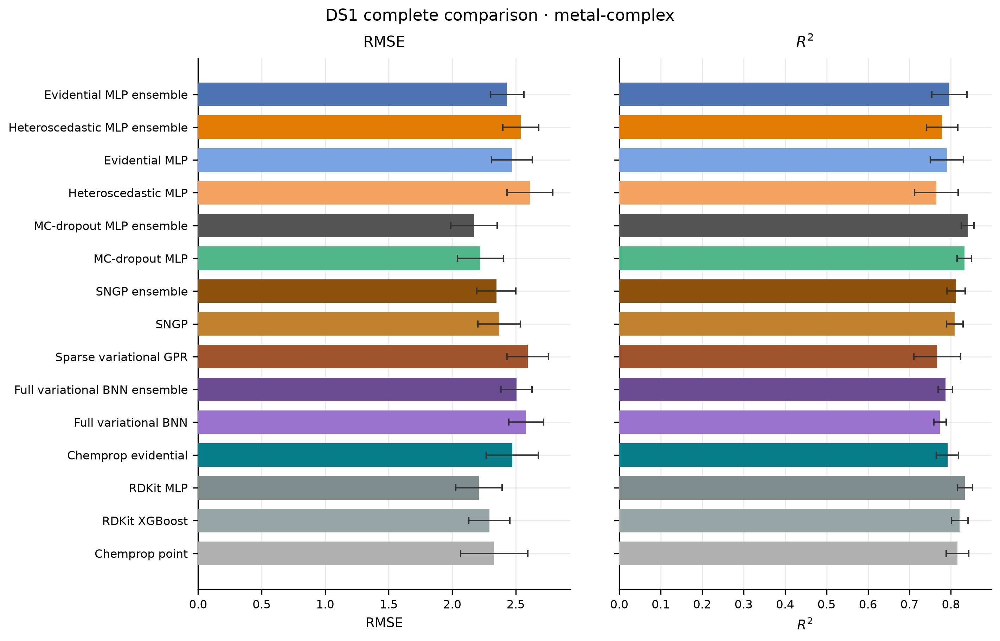

**Supplementary Figure S2. DS1 point-model metal-complex RMSE and $R^2$.**

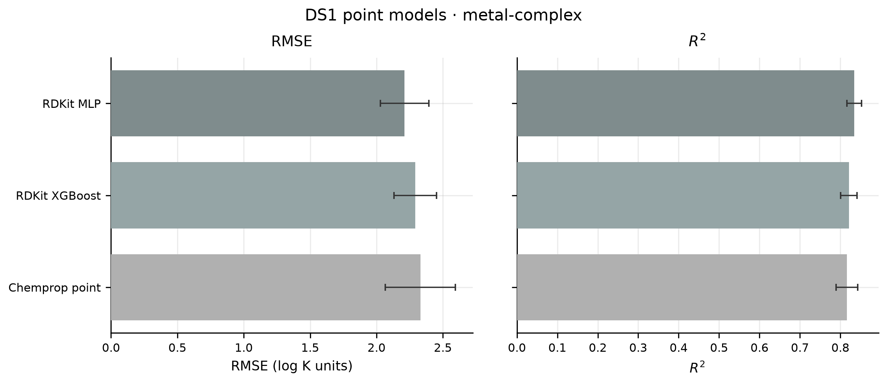

**Supplementary Figure S3. DS1 uncertainty-aware models on held-out metal-complex rows. RMSE and $R^2$ summarize absolute $\log K$ prediction; PICP@90 and ACE summarize row-level calibration of nominal 90% intervals for absolute $\log K$. These are not DS2 pair-level selectivity metrics.**

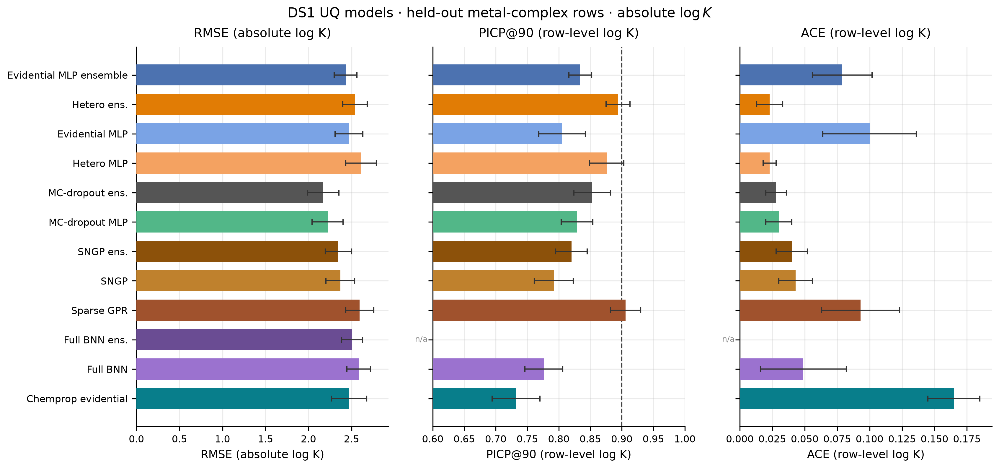

## S4. Complete DS2 model comparison

These tables document the breadth of the evaluated model grid; they are not a claim that the models form a single leaderboard. The main manuscript uses the model grid only to establish that several direct-UQ models are operationally usable and that downstream results are conditional on one representative model. Metric definitions are in S2.

Pair-level and row-level metrics are **not interchangeable**. Full-data DS2 all-pair MoP is the primary application scope. Pair-level tables in this section report MoP PICP@90 and MoP ACE. Row-level PICP@90 and ACE remain the operational screen and are reported with the secondary row-weighted diagnostics in S4.3. Restricted chemical-subset results are deferred to Section S13 and are not used for workhorse selection. Row-level RMSE and $R^2$ are **secondary row-weighted diagnostics** that weight heavily sampled pairs more strongly. Negative and unstable MoP $R^2$ means that pair-specific mean selectivity is poorly explained; the operational route is interval-usable MoP error plus uncertainty-ordered subsetting and ranking, not a high-$R^2$ claim.

### S4.1 Primary all-pair pair-level comparison

**Table S4.1. DS2 all-pair pair-level accuracy and MoP interval calibration.**

> **Aggregation note.** Primary full-data DS2 all-pair scope. All-pair MoP RMSE is the primary accuracy metric. All-pair PICP@90 and ACE here are pair-equal MoP summaries on the same supported pairs. Row-level PICP@90 and ACE used for the operational screen are Table S4.2. All-pair MoP $R^2$ is auxiliary. Scope = `all_pairs`. Source = `manuscripts/final/tables/ds2_all_pairs.csv`.

| model | mop_rmse | All-pair MoP $R^2$ (aux) | sign_accuracy | all-pair MoP PICP@90 | all-pair MoP ACE |
| --- | --- | --- | --- | --- | --- |
| RDKit MLP | 1.989 ± 0.092 | -2.914 ± 1.768 | 0.812 ± 0.026 | NA (no UQ) | NA (no UQ) |
| RDKit XGBoost | 1.921 ± 0.052 | -3.841 ± 2.353 | 0.825 ± 0.020 | NA (no UQ) | NA (no UQ) |
| Chemprop point | 2.072 ± 0.088 | -5.902 ± 3.598 | 0.782 ± 0.022 | NA (no UQ) | NA (no UQ) |
| Evidential MLP | 2.060 ± 0.095 | -4.198 ± 3.308 | 0.818 ± 0.022 | 0.799 ± 0.050 | 0.174 ± 0.021 |
| Evidential MLP ensemble | 2.009 ± 0.112 | -3.156 ± 2.142 | 0.827 ± 0.018 | 0.820 ± 0.044 | 0.168 ± 0.021 |
| Heteroscedastic MLP | 2.104 ± 0.091 | -4.004 ± 2.136 | 0.816 ± 0.019 | 0.835 ± 0.046 | 0.153 ± 0.013 |
| Heteroscedastic MLP ensemble | 2.078 ± 0.130 | -3.633 ± 1.993 | 0.822 ± 0.017 | 0.861 ± 0.034 | 0.153 ± 0.009 |
| MC-dropout MLP | 1.999 ± 0.104 | -3.586 ± 1.947 | 0.808 ± 0.020 | 0.785 ± 0.012 | 0.191 ± 0.008 |
| MC-dropout MLP ensemble | 1.933 ± 0.093 | -2.875 ± 1.962 | 0.817 ± 0.021 | 0.813 ± 0.014 | 0.187 ± 0.007 |
| Full variational BNN | 2.239 ± 0.124 | -4.808 ± 3.374 | 0.783 ± 0.020 | 0.822 ± 0.025 | 0.198 ± 0.005 |
| Full variational BNN ensemble | 2.185 ± 0.144 | -4.299 ± 3.220 | 0.790 ± 0.023 | NA (no UQ) | NA (no UQ) |
| SNGP | 2.112 ± 0.101 | -4.385 ± 1.883 | 0.784 ± 0.022 | 0.750 ± 0.021 | 0.200 ± 0.010 |
| SNGP ensemble | 2.061 ± 0.107 | -4.835 ± 2.476 | 0.794 ± 0.025 | 0.776 ± 0.019 | 0.197 ± 0.009 |
| Sparse variational GPR | 2.030 ± 0.151 | -4.020 ± 2.690 | 0.783 ± 0.020 | 0.870 ± 0.020 | 0.200 ± 0.005 |
| Chemprop evidential | 2.054 ± 0.216 | -5.363 ± 3.760 | 0.815 ± 0.031 | 0.633 ± 0.030 | 0.240 ± 0.015 |

**Supplementary Figure S4. DS2 all-pair pair-level comparison.**

> **Aggregation note.** MoP $R^2$ is an auxiliary diagnostic, not the primary model-selection or downstream-ranking criterion. Negative values indicate poor and unstable within-pair explanatory performance under this aggregation.

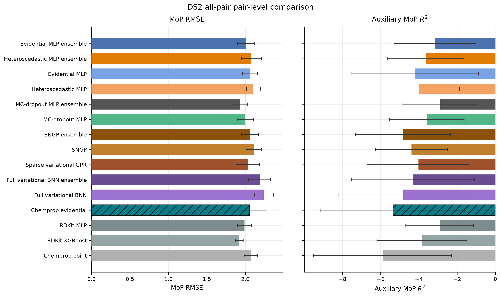

### S4.2 Primary all-pair pair-level comparison: interpretation

Table S4.1 reports the primary all-pair pair-level comparison, and Supplementary Figure S4 plots the same grid so that the compression of the accuracy axis against the spread of the calibration axes is visible at a glance. All-pair MoP RMSE is the headline accuracy metric; MoP $R^2$ is auxiliary, and MoP PICP@90 and ACE provide pair-equal interval diagnostics. The secondary row-weighted diagnostics used for the operational interval-usability screen are reported separately in Section S4.3.

Three features of Table S4.1 are worth stating explicitly, because they shape how the main text uses the grid.

First, **the accuracy spread across the grid is small relative to its uncertainty.** Across all fifteen rows, MoP RMSE runs from $1.921 \pm 0.052$ (RDKit XGBoost, a point model) to $2.239 \pm 0.124$ (full variational BNN); among the twelve uncertainty-bearing models it runs from $1.933 \pm 0.093$ (MC-dropout MLP ensemble) to the same upper end. The total range is $0.318$ across all fifteen rows and $0.306$ across the twelve uncertainty-bearing models, against fold SDs of $0.05$–$0.22$. Neighboring models are therefore separated by well under one fold standard deviation. The two extremes of the grid do differ by more than five folds can absorb, but no model is separated from its immediate competitors, which is what a selection rule would have to act on. This is why the main text treats the grid as evidence that several direct-UQ models are operationally usable rather than as a leaderboard, and why the workhorse is described as representative rather than optimal.

Second, **accuracy and interval quality do not line up here.** The lowest-RMSE uncertainty-bearing model, the MC-dropout MLP ensemble, is excluded by the operational screen on row-level ACE ($0.114 \pm 0.011$ against the $0.10$ limit), and the model whose 90% coverage is closest to nominal from above, sparse variational GPR (row-level PICP@90 $0.923 \pm 0.012$), is excluded on ACE as well ($0.165 \pm 0.022$; Section S2). Selecting on RMSE alone, on PICP@90 alone, and on ACE alone would each pick a different model. This is the reason the selection procedure in S6 is a three-objective Pareto rule rather than a ranking on any single column, and it is also why ACE is defined over nine nominal levels rather than at 90% only (Section S2): a single-level criterion would have admitted the sparse GPR.

Third, **the point models are competitive on MoP RMSE and are still unusable for the downstream analysis.** RDKit XGBoost attains $1.921 \pm 0.052$, the lowest value in the table, yet contributes nothing to retention, risk ordering, or acquisition because it produces no predictive interval. This is the concrete form of the argument the main text makes at the pipeline level: for a task whose deliverable is a prioritized shortlist with a stated reliability, bulk accuracy is necessary but not sufficient, and a model's usefulness is set by whether it emits the quantity the downstream decision consumes.

Negative MoP $R^2$ throughout the table is expected rather than anomalous. Within a supported species-level pair, held-out $\Delta\log K$ values often span a narrow range, so the within-pair variance that $R^2$ normalizes by is small and unstable; a model can predict pair-level selectivity to within roughly 2 $\log K$ units and still explain less of the within-pair scatter than the pair mean does. MoP $R^2$ is retained as an auxiliary diagnostic for exactly this reason and is never used for selection or for a downstream claim.

### S4.3 Secondary row-weighted diagnostics

**Table S4.2. Secondary row-weighted diagnostics, all-pair scope.**

> **Aggregation note.** Secondary row-weighted diagnostics only, including the all-pair row-level PICP@90 and ACE used for the operational screen. Scope = `all_pairs`. Source = `manuscripts/final/tables/ds2_all_pairs.csv`.

| model | row_rmse | row-level $R^2$ | sign_accuracy | row-level PICP@90 | row-level ACE |
| --- | --- | --- | --- | --- | --- |
| RDKit MLP | 1.873 ± 0.145 | 0.774 ± 0.054 | 0.812 ± 0.026 | NA (no UQ) | NA (no UQ) |
| RDKit XGBoost | 1.795 ± 0.114 | 0.793 ± 0.042 | 0.825 ± 0.020 | NA (no UQ) | NA (no UQ) |
| Chemprop point | 1.966 ± 0.134 | 0.753 ± 0.045 | 0.782 ± 0.022 | NA (no UQ) | NA (no UQ) |
| Evidential MLP | 2.054 ± 0.140 | 0.730 ± 0.048 | 0.818 ± 0.022 | 0.841 ± 0.033 | 0.070 ± 0.045 |
| Evidential MLP ensemble | 2.013 ± 0.152 | 0.741 ± 0.049 | 0.827 ± 0.018 | 0.863 ± 0.030 | 0.053 ± 0.037 |
| Heteroscedastic MLP | 2.105 ± 0.181 | 0.719 ± 0.035 | 0.816 ± 0.019 | 0.872 ± 0.030 | 0.032 ± 0.008 |
| Heteroscedastic MLP ensemble | 2.088 ± 0.206 | 0.725 ± 0.031 | 0.822 ± 0.017 | 0.894 ± 0.022 | 0.051 ± 0.015 |
| MC-dropout MLP | 1.892 ± 0.116 | 0.768 ± 0.056 | 0.808 ± 0.020 | 0.867 ± 0.007 | 0.095 ± 0.013 |
| MC-dropout MLP ensemble | 1.847 ± 0.111 | 0.779 ± 0.057 | 0.817 ± 0.021 | 0.887 ± 0.007 | 0.114 ± 0.011 |
| Full variational BNN | 2.132 ± 0.156 | 0.709 ± 0.058 | 0.783 ± 0.020 | 0.896 ± 0.016 | 0.152 ± 0.021 |
| Full variational BNN ensemble | 2.104 ± 0.179 | 0.717 ± 0.055 | 0.790 ± 0.023 | NA (no UQ) | NA (no UQ) |
| SNGP | 2.011 ± 0.107 | 0.740 ± 0.057 | 0.784 ± 0.022 | 0.844 ± 0.014 | 0.081 ± 0.019 |
| SNGP ensemble | 1.961 ± 0.129 | 0.753 ± 0.054 | 0.794 ± 0.025 | 0.864 ± 0.012 | 0.099 ± 0.019 |
| Sparse variational GPR | 1.976 ± 0.145 | 0.750 ± 0.048 | 0.783 ± 0.020 | 0.923 ± 0.012 | 0.165 ± 0.022 |
| Chemprop evidential | 2.063 ± 0.241 | 0.730 ± 0.048 | 0.815 ± 0.031 | 0.665 ± 0.017 | 0.192 ± 0.011 |

**Table S4.3. High-selectivity row-scope metrics for the full model grid.**

> **Aggregation note.** Scope = high_selectivity_row; $\lvert y\rvert>1$ inside pairs with at least three such held-out rows. Monitoring scope, not a selection rule. Pair-equal MoP columns and row-weighted columns are shown side by side; they are different estimands and should not be compared across the divide. Sign accuracy is row-level. Source = `manuscripts/final/tables/ds2_highsel_row.csv`; the pair-membership scope is `ds2_highsel_pair.csv`.

| model | mop_rmse | MoP $R^2$ | MoP PICP@90 | MoP ACE | row_rmse | row-level PICP@90 | row-level ACE | sign_accuracy |
| --- | --- | --- | --- | --- | --- | --- | --- | --- |
| RDKit MLP | 2.275 ± 0.108 | -5.656 ± 3.103 | NA (no UQ) | NA (no UQ) | 2.270 ± 0.160 | NA (no UQ) | NA (no UQ) | 0.930 ± 0.017 |
| RDKit XGBoost | 2.180 ± 0.054 | -5.846 ± 3.117 | NA (no UQ) | NA (no UQ) | 2.151 ± 0.090 | NA (no UQ) | NA (no UQ) | 0.938 ± 0.013 |
| Chemprop point | 2.294 ± 0.087 | -8.535 ± 4.569 | NA (no UQ) | NA (no UQ) | 2.271 ± 0.119 | NA (no UQ) | NA (no UQ) | 0.921 ± 0.016 |
| Evidential MLP | 2.362 ± 0.112 | -8.083 ± 5.144 | 0.759 ± 0.051 | 0.204 ± 0.023 | 2.387 ± 0.117 | 0.800 ± 0.036 | 0.119 ± 0.030 | 0.919 ± 0.022 |
| Evidential MLP ensemble | 2.310 ± 0.127 | -7.222 ± 4.687 | 0.776 ± 0.050 | 0.197 ± 0.024 | 2.330 ± 0.135 | 0.823 ± 0.032 | 0.097 ± 0.029 | 0.925 ± 0.019 |
| Heteroscedastic MLP | 2.389 ± 0.087 | -7.328 ± 3.678 | 0.788 ± 0.072 | 0.177 ± 0.025 | 2.414 ± 0.088 | 0.826 ± 0.049 | 0.034 ± 0.033 | 0.922 ± 0.018 |
| Heteroscedastic MLP ensemble | 2.358 ± 0.111 | -7.357 ± 4.244 | 0.812 ± 0.061 | 0.175 ± 0.020 | 2.379 ± 0.108 | 0.850 ± 0.039 | 0.027 ± 0.017 | 0.925 ± 0.016 |
| MC-dropout MLP | 2.267 ± 0.116 | -6.618 ± 4.028 | 0.741 ± 0.029 | 0.180 ± 0.018 | 2.262 ± 0.146 | 0.786 ± 0.026 | 0.059 ± 0.028 | 0.927 ± 0.015 |
| MC-dropout MLP ensemble | 2.208 ± 0.104 | -5.691 ± 3.436 | 0.771 ± 0.029 | 0.169 ± 0.015 | 2.210 ± 0.144 | 0.814 ± 0.023 | 0.035 ± 0.022 | 0.931 ± 0.017 |
| Full variational BNN | 2.588 ± 0.149 | -9.408 ± 5.825 | 0.779 ± 0.038 | 0.173 ± 0.011 | 2.586 ± 0.183 | 0.824 ± 0.037 | 0.035 ± 0.026 | 0.907 ± 0.012 |
| Full variational BNN ensemble | 2.527 ± 0.175 | -8.376 ± 5.902 | NA (no UQ) | NA (no UQ) | 2.536 ± 0.207 | NA (no UQ) | NA (no UQ) | 0.912 ± 0.017 |
| SNGP | 2.364 ± 0.080 | -7.835 ± 3.460 | 0.704 ± 0.024 | 0.191 ± 0.016 | 2.364 ± 0.124 | 0.758 ± 0.024 | 0.073 ± 0.023 | 0.915 ± 0.017 |
| SNGP ensemble | 2.317 ± 0.103 | -7.307 ± 3.309 | 0.732 ± 0.028 | 0.183 ± 0.015 | 2.317 ± 0.154 | 0.785 ± 0.025 | 0.051 ± 0.017 | 0.922 ± 0.017 |
| Sparse variational GPR | 2.311 ± 0.155 | -8.143 ± 4.489 | 0.842 ± 0.020 | 0.172 ± 0.008 | 2.380 ± 0.153 | 0.876 ± 0.015 | 0.048 ± 0.020 | 0.920 ± 0.011 |
| Chemprop evidential | 2.343 ± 0.243 | -7.292 ± 4.707 | 0.624 ± 0.043 | 0.254 ± 0.020 | 2.378 ± 0.222 | 0.676 ± 0.017 | 0.192 ± 0.013 | 0.924 ± 0.023 |

**Supplementary Figure S5. DS2 high-selectivity scope comparison.**

> **Aggregation note.** Row-scope values. MoP $R^2$ is an auxiliary diagnostic, not the primary model-selection or downstream-ranking criterion. Negative values indicate poor and unstable within-pair explanatory performance under this aggregation.

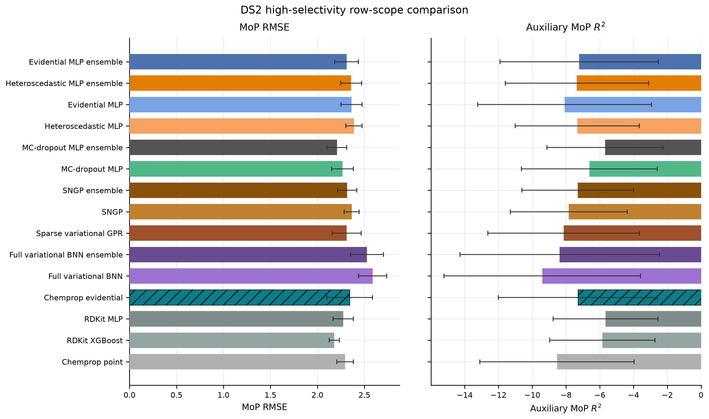

**Table S4.4. Chemprop DS2 native UQ diagnostics.**

| fold_id | n_rows_total | n_point_valid | n_uq_valid | n_uq_invalid | uncertainty_status | checkpoint_unchanged |
| --- | --- | --- | --- | --- | --- | --- |
| fold0 | 17705 | 17705 | 17702 | 3 | partial_invalid_rows | True |
| fold1 | 17705 | 17705 | 17695 | 10 | partial_invalid_rows | True |
| fold2 | 17705 | 17705 | 17705 | 0 | complete | True |
| fold3 | 17705 | 17705 | 17705 | 0 | complete | True |
| fold4 | 17705 | 17705 | 17705 | 0 | complete | True |

Table S4.4 records the per-fold native-interval validity behind that status. Total invalid native NIG rows = 13. Pair-metric status = `complete_5_of_5`. UQ status = `partial_native_invalid_rows`. PICP/ACE are conditional on valid native-UQ rows.

**Table S4.5. Why neither $R^2$ aggregation is a goodness-of-fit statistic here.**

> **Aggregation note.** Selected workhorse, all-pair scope, five held-out folds (mean ± SD, `ddof=1`). The pair-mean predictor returns the mean held-out $\Delta\log K$ of the row's species-level pair and uses no ligand information; its row-level $R^2$ is by construction the between-pair variance share. Within-pair $R^2$ is computed on pairs with at least three held-out rows and a non-zero target spread. Source: `manuscripts/final/tables/iz_r2_aggregation_decomposition.csv`, recomputed from the frozen workhorse fold scores by `manuscript/redraw_figures.py`.

| quantity | fold mean ± SD | n_valid_folds |
| --- | --- | --- |
| Between-pair share of held-out $\Delta\log K$ variance | 0.685 ± 0.033 | 5 |
| Row-level $R^2$ of the pair-mean predictor (no ligand information) | 0.685 ± 0.033 | 5 |
| Row-level $R^2$ of the selected workhorse | 0.725 ± 0.031 | 5 |
| Fraction of supported pairs with within-pair $R^2>0$ | 0.596 ± 0.075 | 5 |
| Median within-pair $R^2$ across supported pairs | 0.149 ± 0.133 | 5 |

The two middle rows are the point. A row-level $R^2$ of $0.725$ looks like a competent model, but $0.685$ of it is available to a predictor that knows only which metal pair it is looking at — the one thing an experimentalist never has to guess. The ligand-level contribution the task actually requires is $0.039$ of pooled variance. In the other direction, the strongly negative fold-mean MoP $R^2$ in Table S4.1 is not evidence that the model loses to a pair mean inside a typical pair: the median within-pair $R^2$ is positive and a clear majority of supported pairs are positive. The negative mean comes from a tail of pairs whose held-out $\Delta\log K$ barely varies, where the normalizing denominator approaches zero. Both aggregations of $R^2$ are therefore auxiliary, and MoP RMSE — in the units of the target, with no denominator to destabilize — is the headline throughout.

### S4.4 High-selectivity scope sensitivity

The two high-selectivity scopes are audit tables documenting scope sensitivity. They are not independent primary outcomes, were not used for workhorse selection, and no claim in the main text rests on them. Both are reported here in one table.

The *row* scope keeps held-out rows with $\lvert y\rvert>1$ inside pairs having at least three such rows. The *pair-membership* scope keeps all held-out rows of any pair that qualifies under the row scope. The two differ only in which rows enter a qualifying pair, and on this grid the difference is immaterial: MoP RMSE, MoP $R^2$, MoP PICP@90 and MoP ACE are identical to three decimals for all fifteen models, and sign accuracy differs by 0.002–0.004 (pair-membership always the lower of the two, because it admits the low-magnitude rows the row scope excludes). Only the row scope is tabulated below; the pair-membership values are recoverable from `manuscripts/final/tables/ds2_highsel_pair.csv`.

The substantive point, shown in Table S4.3 and plotted in Supplementary Figure S5, is that restricting to high selectivity makes the task harder for every model rather than reordering them. Workhorse MoP RMSE rises from $2.078 \pm 0.130$ all-pair to $2.358 \pm 0.111$, and every model's MoP $R^2$ falls, while the model ordering is essentially preserved. Sign accuracy rises to about $0.92$ simply because restricting to $\lvert y\rvert>1$ removes the near-zero rows whose sign is hardest to call; it is not evidence of better performance in the high-selectivity regime.

## S5. Direct-UQ screening and workhorse-selection bridge

This section is the bridge between the complete DS2 model comparison of Section S4 and the selection procedure of Section S6, and it exists only to state the order of operations, because the two steps are often conflated. First, point models are set aside: they provide predictions but no predictive uncertainty and so cannot serve as downstream workhorses at all. Second, the remaining direct-UQ models pass or fail the row-level interval screen defined in main-text Methods 2.4. Third, and only among models that pass, Section S6 applies the prespecified RMSE–PICP–ACE Pareto procedure. Passing the screen is therefore necessary but not sufficient for selection, and the screen is an admission gate on interval sanity rather than a ranking — Table S6.1 records the outcome of both steps for every candidate.

## S6. Representative direct-UQ model context and workhorse choice

This section records how the representative direct-UQ model was chosen. It answers which models passed the operational interval-usability screen and why nearby alternatives were not unique optima. The selected model is carried forward because the downstream analysis requires one fixed model and because it satisfies the study’s operational interval-usability convention. Nearby models are not treated as scientifically inferior. The corresponding scatter plot is main-text Figure 1.

Figure 1A and 1B plot pair-equal MoP ACE and MoP PICP@90 against all-pair MoP RMSE, with fold-SD error bars on both axes; a dashed line in 1B marks nominal coverage. These panels carry no row-level information, and marker shape encodes only role: star = the selected model, open circle = another direct-UQ model, diamond = Chemprop evidential (partial native UQ). Screen outcome is deliberately not encoded, because it is determined from unrounded five-fold **row-level** PICP@90 and ACE ($0.85\le\mathrm{PICP@90}\le0.95$ and $\mathrm{ACE}\le0.10$) and cannot be recovered from MoP coordinates; encoding it on MoP axes in an earlier version of this figure invited exactly the cross-aggregation reading the manuscript avoids elsewhere.

The row-weighted values are not plotted anywhere, by design — an earlier revision of this figure carried them as a third panel, and it invited exactly the cross-aggregation reading described above — but the size of the gap between the two aggregations is worth stating, because it is the quantitative content of the main text's aggregation convention (Methods 2.4). Across the eleven models with both values computed (Tables S4.1 and S4.2), row-level ACE is smaller than MoP ACE for **every** one of them, by a median factor of $2.01$, and row-level PICP@90 sits closer to nominal for every one of them, by a median of $0.043$ in absolute distance from $0.90$. Row weighting is dominated by the densely sampled pairs, where Table S8.3 shows coverage is closest to nominal, so it reports mainly the calibration of the best-supported contexts. The pair-equal value is the conservative one, and it is the one every result in this document is judged on.

Rule file: `results/model_audit/workhorse_selection_rule.json`. Operational selection: `results/manuscript_final/workhorse_selection_accuracy_calibration.json`. Candidates: `results/manuscript_final/workhorse_selection_candidates.csv`.

Procedure: operational interval-usability screen on five-fold mean all-pair row-level PICP@90 and mean all-pair row-level ACE → RMSE–PICP–ACE Pareto. The Pareto comparison treats lower all-pair MoP RMSE, lower row-level ACE, and closer-to-nominal row-level PICP@90 as preferable, subject to the operational screen. Model A dominates model B if it is no worse on all three objectives and strictly better on at least one, where the PICP objective is $|\mathrm{PICP@90}-0.90|$ computed from the same row-level all-pair PICP@90 used by the screen. The selected model is the Pareto-front member with the smallest Euclidean distance to the ideal point after min-max normalization among the Pareto set. Remaining ties use all-pair sign accuracy, then all-pair MoP $R^2$, then a prespecified operational-simplicity ranking. Combined $|\mathrm{PICP@90}-0.90|+\mathrm{ACE}$ is not a selection key. Workhorse selection uses the all-pair scope only. No display-rounding tie-breaker was required for the reported candidates. This is not a formal statistical test. Row-level RMSE cannot enter selection. Complete native UQ is required for operational eligibility; Chemprop remains a scientific comparator. The PICP and ACE limits were study-defined operational conventions, not externally validated universal thresholds.

**Table S6.1. Operational workhorse selection on the all-pair scope.**

> **Aggregation note.** Direct DS2 models only. calibration_usable, all-pair MoP RMSE, all-pair MoP PICP@90 and ACE, all-pair row-level PICP@90 and ACE (operational screen), all-pair MoP $R^2$ (auxiliary), selection status. Main-text Table 2 covers the full direct-DS2 grid plus the ad hoc DS1 comparators, but reports only pair-equal MoP interval columns; the row-level screen columns appear here and in Table S4.2. This table adds the screen outcome and selection status for the direct-DS2 models. The screen uses row-level $\Delta\log K$ coverage. Passing the screen is necessary, not sufficient: `screen-pass, Pareto-dominated` means the model met the interval-usability convention but was dominated on the RMSE–PICP–ACE Pareto front. Source: `manuscripts/final/tables/supplementary_workhorse_selection.csv`.

| model | calibration_usable | all_pair_mop_rmse | MoP PICP@90 | MoP ACE | row-level PICP@90 | row-level ACE | all-pair MoP $R^2$ (aux) | status |
| --- | --- | --- | --- | --- | --- | --- | --- | --- |
| Heteroscedastic MLP ensemble | True | 2.078 ± 0.130 | 0.861 ± 0.034 | 0.153 ± 0.009 | 0.894 ± 0.022 | 0.051 ± 0.015 | -3.633 ± 1.993 | selected |
| Evidential MLP ensemble | True | 2.009 ± 0.112 | 0.820 ± 0.044 | 0.168 ± 0.021 | 0.863 ± 0.030 | 0.053 ± 0.037 | -3.156 ± 2.142 | screen-pass |
| Heteroscedastic MLP | True | 2.104 ± 0.091 | 0.835 ± 0.046 | 0.153 ± 0.013 | 0.872 ± 0.030 | 0.032 ± 0.008 | -4.004 ± 2.136 | screen-pass |
| MC-dropout MLP | True | 1.999 ± 0.104 | 0.785 ± 0.012 | 0.191 ± 0.008 | 0.867 ± 0.007 | 0.095 ± 0.013 | -3.586 ± 1.947 | screen-pass |
| SNGP ensemble | True | 2.061 ± 0.107 | 0.776 ± 0.019 | 0.197 ± 0.009 | 0.864 ± 0.012 | 0.099 ± 0.019 | -4.835 ± 2.476 | screen-pass, Pareto-dominated |
| MC-dropout MLP ensemble | False | 1.933 ± 0.093 | 0.813 ± 0.014 | 0.187 ± 0.007 | 0.887 ± 0.007 | 0.114 ± 0.011 | -2.875 ± 1.962 | screened out |
| Sparse variational GPR | False | 2.030 ± 0.151 | 0.870 ± 0.020 | 0.200 ± 0.005 | 0.923 ± 0.012 | 0.165 ± 0.022 | -4.020 ± 2.690 | screened out |
| Chemprop evidential | False | 2.054 ± 0.216 | 0.633 ± 0.030 | 0.240 ± 0.015 | 0.665 ± 0.017 | 0.192 ± 0.011 | -5.363 ± 3.760 | scientific comparator; partial UQ |
| Evidential MLP | False | 2.060 ± 0.095 | 0.799 ± 0.050 | 0.174 ± 0.021 | 0.841 ± 0.033 | 0.070 ± 0.045 | -4.198 ± 3.308 | screened out |
| SNGP | False | 2.112 ± 0.101 | 0.750 ± 0.021 | 0.200 ± 0.010 | 0.844 ± 0.014 | 0.081 ± 0.019 | -4.385 ± 1.883 | screened out |
| Full variational BNN ensemble | False | 2.185 ± 0.144 | NA (no UQ) | NA (no UQ) | NA (no UQ) | NA (no UQ) | -4.299 ± 3.220 | screened out |
| Full variational BNN | False | 2.239 ± 0.124 | 0.822 ± 0.025 | 0.198 ± 0.005 | 0.896 ± 0.016 | 0.152 ± 0.021 | -4.808 ± 3.374 | screened out |
| RDKit XGBoost | False | 1.921 ± 0.052 | NA (no UQ) | NA (no UQ) | NA (no UQ) | NA (no UQ) | -3.841 ± 2.353 | point baseline; no UQ |
| RDKit MLP | False | 1.989 ± 0.092 | NA (no UQ) | NA (no UQ) | NA (no UQ) | NA (no UQ) | -2.914 ± 1.768 | point baseline; no UQ |
| Chemprop point | False | 2.072 ± 0.088 | NA (no UQ) | NA (no UQ) | NA (no UQ) | NA (no UQ) | -5.902 ± 3.598 | point baseline; no UQ |

The prior manuscript’s obsolete PICP@$90\ge 0.70$ gate was **not re-imposed** and was not used in the corrected analysis. Fold breakdowns for the selected workhorse are in `supplementary_fold_breakdowns.csv` filtered to the selected model id.

**Table S6.2. Fold-wise differences versus the selected workhorse (interval-usable models only).**

> **Aggregation note.** Descriptive fold-wise Δ (comparator − selected full-data workhorse). Positive all-pair MoP RMSE delta means the comparator is worse on that fold. Not a nested significance test and not a selection key. Source = `manuscripts/final/tables/supplementary_fold_paired_differences.csv`.

| model | Δ all-pair MoP RMSE | folds with higher all-pair RMSE | Δ PICP@90 | Δ ACE |
| --- | --- | --- | --- | --- |
| Evidential MLP ensemble | -0.069 ± 0.067 | 1 | -0.031 ± 0.038 | 0.002 ± 0.036 |
| Heteroscedastic MLP | 0.026 ± 0.039 | 4 | -0.022 ± 0.008 | -0.018 ± 0.011 |
| MC-dropout MLP | -0.079 ± 0.121 | 2 | -0.027 ± 0.020 | 0.044 ± 0.020 |
| SNGP ensemble | -0.017 ± 0.076 | 3 | -0.030 ± 0.027 | 0.048 ± 0.026 |

**Supplementary Figure S6. All-pair fold stability of the selected workhorse.**

> **Aggregation note.** Fold-local all-pair MoP RMSE and auxiliary MoP $R^2$ are shown for the five held-out folds of the selected heteroscedastic MLP ensemble. MoP $R^2$ is auxiliary and does not determine workhorse selection.

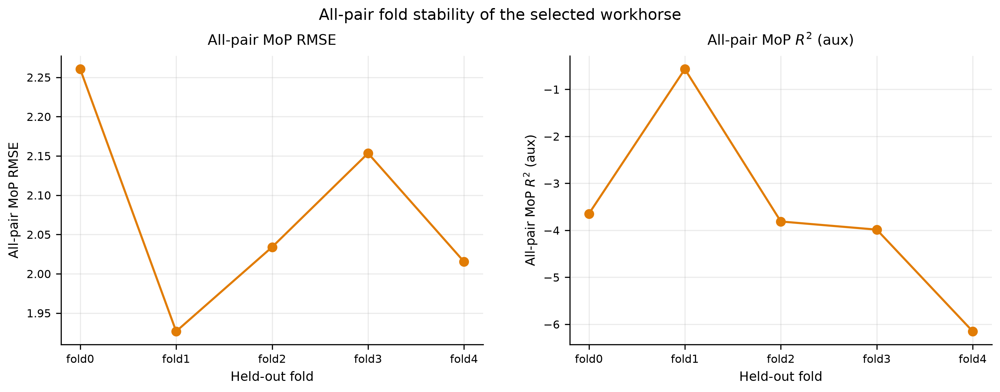

**Table S6.3. Workhorse MoP pair validity (invalid = constant-target pair $R^2$).**

> **Aggregation note.** Source = `manuscripts/final/tables/supplementary_mop_pair_validity.csv`. Displayed MoP $R^2$ values are rounded to three decimals; full precision remains in the artifact. Pair counts are fold-local integers. These unfiltered pair counts are the pairs contributing to full-retention MoP, not the 50% retained-MoP counts reported in main-text Section 3.4 and Figure 2, and not the top-$k$ eligible-pair counts. Scope = `all_pairs`. MoP $R^2$ excludes constant-target pairs only.

| fold_id | scope | n_pairs_retained | n_pairs_valid | n_pairs_invalid | MoP $R^2$ |
| --- | --- | --- | --- | --- | --- |
| fold0 | all_pairs | 870 | 870 | 0 | -3.647 |
| fold1 | all_pairs | 729 | 729 | 0 | -0.569 |
| fold2 | all_pairs | 812 | 812 | 0 | -3.812 |
| fold3 | all_pairs | 760 | 760 | 0 | -3.985 |
| fold4 | all_pairs | 837 | 837 | 0 | -6.150 |

**Supplementary discussion: how firm is the choice?** The three tables of this section and Supplementary Figure S6 are best read as a single answer to that question, and the answer is *firm as an operational decision, weak as a ranking claim*.

Table S6.1 shows that the screen, not the Pareto step, does most of the work. Of fifteen candidates, three are point baselines with no interval to screen, six fail the row-level interval-usability convention, and one (Chemprop evidential) is retained only as a scientific comparator because 13 held-out rows yield invalid native intervals. Five pass the screen, and one of those is Pareto-dominated. The selected model is therefore chosen from an effective field of four near-equivalent alternatives, not from fifteen.

Table S6.2 quantifies how near-equivalent. Against the selected workhorse, the evidential MLP ensemble is better on all-pair MoP RMSE by $0.069 \pm 0.067$ and the MC-dropout MLP by $0.079 \pm 0.121$ — differences whose fold SD is of the same size as, or larger than, the difference itself, and which reverse sign on one and two folds respectively. The heteroscedastic MLP without ensembling is worse on four of five folds by $0.026 \pm 0.039$. No comparator is separated from the selected model by an amount five folds can resolve. What does separate them is the calibration column, and the trade there is systematic. Every comparator's row-level PICP@90 is further from nominal than the selected model's ($\Delta$ between $-0.022$ and $-0.031$, all downward from an already sub-nominal $0.894$). The three comparators that beat the selected model on MoP RMSE are all worse on ACE — by $0.002$, $0.044$, and $0.048$ — and the one comparator that beats it on ACE ($-0.018$, the un-ensembled heteroscedastic MLP) is worse on MoP RMSE on four of five folds. There is no candidate in this table that is better on both. The selected model gives up an unresolvable amount of accuracy and takes calibration, which is the axis the downstream retention and acquisition analyses actually consume.

Supplementary Figure S6 and Table S6.3 close the remaining question, which is whether the selected model's summary rests on a stable pair population. It does: all five folds contribute a valid all-pair MoP summary, with 729 to 870 pairs retained and — importantly — zero pairs discarded as constant-target in any fold, so the fold-to-fold movement in MoP RMSE reflects genuine differences between held-out ligand sets rather than a shifting denominator. The fold-local MoP $R^2$ values in Table S6.3 range from $-0.569$ to $-6.150$, an order-of-magnitude swing across folds on a single fixed model, which is the clearest illustration in this document of why MoP $R^2$ is treated as auxiliary throughout (Section S4.2) and never used for selection or for a downstream claim.

## S7. Retention and risk-ordering diagnostics

This section reports the fold-local retention study. It answers whether model-derived uncertainty orders held-out error better than the tested molecular-distance tools. It supports main-text Figure 2 and Figure 3. The tested distance scores provided weaker empirical risk ordering than $\sigma_{\mathrm{total}}$ in the primary all-pair retention analysis. The RDKit feature-centroid Mahalanobis score produced an intermediate reduction, whereas Tanimoto nearest-neighbor distance was closer to random-retention behavior. The tested distance scores were not sufficiently effective to serve as the primary risk-ordering rule in this task. These analyses are empirical error-ordering diagnostics, not coverage guarantees or certified acceptance boundaries.

Fixed-retention scores rank held-out rows by predicted unreliability (`configs/experiments/ad_retention_spec.yaml`; artifacts in `results/downstream_cv/ad_retention/`). Ranking is performed within each analysis scope; Section S7.2 gives the retention rule and its tie-breaking.

All retention analyses in this document are empirical error-ordering analyses. They do not provide coverage guarantees, accept/reject thresholds, or universal candidate-quality scores.

Chemprop evidential model = the `GRAPH_DMPNN_EVID` checkpoint; Chemprop native UQ = native NIG interval output; Chemprop representation-space score = embedding distance. These three objects are not interchangeable.

**Two different retention models.** The DS2 retention model is the selected DS2 workhorse, the heteroscedastic MLP ensemble `DS2_RDKIT_MLPENS5_HETERO`. The DS1 retention model is a *different* model, the evidential MLP ensemble `DS1_RDKIT_MLPENS5_EVID` (`configs/experiments/ad_retention_spec.yaml`: `workhorse_ds1`). DS1 retention is a supporting diagnostic only and played no part in DS2 workhorse selection; the DS1 and DS2 rows of Table S7.1 are therefore not the same model and should not be read as one model evaluated on two datasets. Table S7.3 tabulates the DS2 all-pair scope only.

**Provenance of the RDKit feature-median Mahalanobis score.** Main-text Figures 2 and 3 both include RDKit feature-median Mahalanobis distance, which is not part of the frozen applicability-domain inventory in `configs/experiments/ad_retention_spec.yaml` and is therefore not written into `results/downstream_cv/ad_retention/`. It is the **median** Ledoit–Wolf Mahalanobis distance to all outer-training rows, whereas the registered `mahalanobis_feature_centroid` score is the distance to the outer-training **centroid**; both use the same fold-local Ledoit–Wolf fit on the same StandardScaled RDKit+metal+medium features, so they differ only in whether the reference is a single centroid or the full training cloud. It was computed after the fact from the frozen fold-local feature arrays (`data/processed/features/rdkit_ds2/<fold>/arrays.npz`) and the frozen workhorse fold scores, by `src/uq_remake/manuscript/iz_risk_ordering_figure.py`, and cached under `manuscripts/final/tables/iz_mahalanobis_feature_median_*.csv`. Its retention and Spearman values are reported in Tables S7.1, S8.1, and S8.4 alongside the registered scores and are flagged there as post-hoc. Treating it as a registered pipeline score would be incorrect; treating it as a sensitivity comparator computed under the identical fold-local fit partition is what the main text does. It is included because the centroid score is a single-point summary of the training distribution, and a median-to-all-rows variant tests whether that summary, rather than descriptor-space distance itself, was limiting the centroid score's error ordering. It was not: the two track each other closely (Table S7.1).

### S7.1 Retention hypothesis

(H1) The selected DS2 workhorse’s predictive uncertainty identifies held-out DS2 subsets with lower prediction error at fixed retention than random retention; DS1 retention analyses are supporting diagnostics. Pair-acquisition hypotheses H2–H5 are stated in S10.

Unless otherwise qualified, $\sigma_{\mathrm{total}}$ is the selected workhorse’s fold-local total predictive uncertainty or total predictive standard deviation, including model-related and input-dependent predictive-variance components as represented by the selected model. Native Chemprop $\sigma_{\mathrm{total}}$ is a separate model-specific output and is not pooled with the workhorse score.

### S7.2 Retention implementation

At retention fraction $r$, the retained set is the $\lfloor r n\rfloor$ lowest-risk rows in the held-out fold, with ties broken by record identifier. Pair-support counts for fixed-retention MoP are the number of pairs with at least three retained rows. The rule counts rows, not distinct ligands (Section S2). The canonical pair identifier is bookkeeping only. Random retention uses 20 repeats with seed 0 inside each held-out fold.

The 13 invalid Chemprop native-NIG rows affect Chemprop native UQ, not necessarily the availability of Chemprop representation-space scores or point predictions. Chemprop distance-based results are therefore reported separately from Chemprop native-UQ results. Chemprop embedding distances are distances in a learned molecular representation. Embeddings were taken from the training-fold Chemprop evidential checkpoint; held-out ligands were scored against that training-fold representation after training-fold standardization.

**Table S7.1. Canonical fold-local retention-curve AUC inventory across DS1 and DS2.**

> **Aggregation note.** Table S7.1 inventories the canonical retention-curve AUC values reported in the manuscript and selected sensitivity analyses. For DS1, the endpoint is row-level RMSE; for DS2, the endpoint is pair-level MoP RMSE. Lower values indicate stronger empirical ordering of lower-error retained subsets. These are not formal risk–coverage AURCs. Grid = $\{0.10,0.20,0.25,0.30,0.40,0.50,0.60,0.70,0.80,0.90,1.00\}$. Distance and pair-density scores use outer-training data only; model-output uncertainty uses the fold-local model output; random retention has no fit partition. Chemprop representation-space scores also use outer-training embeddings after training-fold standardization. Chemprop object types are distinguished as in Section S7. Native Chemprop $\sigma_{\mathrm{total}}$ is not pooled with the workhorse score. Source: `results/downstream_cv/ad_retention/retention_auc_summary.csv`; manuscript rendering copy: `manuscripts/final/tables/retention_auc_summary.csv`.

| dataset | family | scope | score | endpoint | retention-curve AUC | n_valid_folds |
| --- | --- | --- | --- | --- | --- | --- |
| DS1 | Chemprop evidential | metal_complex | Chemprop embedding-centroid Mahalanobis | row-level RMSE | 2.182 ± 0.161 | 5 |
| DS1 | Chemprop evidential | metal_complex | Chemprop Euclidean-NN | row-level RMSE | 2.301 ± 0.120 | 5 |
| DS1 | Chemprop evidential | metal_complex | Chemprop native UQ ($\sigma_{\mathrm{total}}$) | row-level RMSE | 1.394 ± 0.386 | 5 |
| DS1 | Chemprop evidential | metal_complex | Tanimoto nearest-neighbor distance | row-level RMSE | 2.250 ± 0.123 | 5 |
| DS1 | Evidential MLP ensemble | metal_complex | RDKit feature-centroid Mahalanobis distance | row-level RMSE | 1.652 ± 0.088 | 5 |
| DS1 | Evidential MLP ensemble | metal_complex | $\sigma_{\mathrm{total}}$ | row-level RMSE | 1.268 ± 0.185 | 5 |
| DS1 | Evidential MLP ensemble | metal_complex | Tanimoto nearest-neighbor distance | row-level RMSE | 2.185 ± 0.148 | 5 |
| DS2 | Chemprop evidential | all_pairs | Chemprop embedding-centroid Mahalanobis | pair-level MoP RMSE | 1.630 ± 0.190 | 5 |
| DS2 | Chemprop evidential | all_pairs | Chemprop Euclidean-NN | pair-level MoP RMSE | 1.726 ± 0.165 | 5 |
| DS2 | Chemprop evidential | all_pairs | Chemprop native UQ ($\sigma_{\mathrm{total}}$) | pair-level MoP RMSE | 0.907 ± 0.137 | 5 |
| DS2 | Chemprop evidential | all_pairs | Tanimoto nearest-neighbor distance | pair-level MoP RMSE | 1.684 ± 0.170 | 5 |
| DS2 | Heteroscedastic MLP ensemble | all_pairs | RDKit feature-centroid Mahalanobis distance | pair-level MoP RMSE | 1.441 ± 0.116 | 5 |
| DS2 | Heteroscedastic MLP ensemble | all_pairs | RDKit feature-median Mahalanobis distance (post hoc) | pair-level MoP RMSE | 1.439 ± 0.116 | 5 |
| DS2 | Heteroscedastic MLP ensemble | all_pairs | $\sigma_{\mathrm{total}}$ | pair-level MoP RMSE | 0.835 ± 0.061 | 5 |
| DS2 | Heteroscedastic MLP ensemble | all_pairs | Tanimoto nearest-neighbor distance | pair-level MoP RMSE | 1.719 ± 0.102 | 5 |
| DS2 | Heteroscedastic MLP ensemble | all_pairs | pair-density risk | pair-level MoP RMSE | 1.210 ± 0.092 | 5 |
| DS2 | Heteroscedastic MLP ensemble | all_pairs | $\sigma_{\mathrm{aleatoric}}$ | pair-level MoP RMSE | 0.842 ± 0.063 | 5 |
| DS2 | Heteroscedastic MLP ensemble | all_pairs | $\sigma_{\mathrm{epistemic,between}}$ | pair-level MoP RMSE | 0.956 ± 0.050 | 5 |
| DS2 | Heteroscedastic MLP ensemble | all_pairs | $\sigma_{\mathrm{epistemic,within}}$ | pair-level MoP RMSE | 0.864 ± 0.052 | 5 |
| DS2 | Heteroscedastic MLP ensemble | all_pairs | Tanimoto $k$NN mean, $k=10$ | pair-level MoP RMSE | 1.689 ± 0.136 | 5 |
| DS2 | Heteroscedastic MLP ensemble | all_pairs | Tanimoto $k$NN mean, $k=5$ | pair-level MoP RMSE | 1.721 ± 0.120 | 5 |
| DS2 | Heteroscedastic MLP ensemble | all_pairs | Tanimoto median distance | pair-level MoP RMSE | 1.500 ± 0.141 | 5 |

**Table S7.2. Score definitions (fold-local fit partitions).** Here, NN denotes nearest neighbor and $k$NN denotes $k$-nearest neighbor. Chemprop Euclidean-NN and Chemprop embedding-centroid Mahalanobis are Chemprop representation-space scores computed after training-fold standardization. `mahalanobis_feature_centroid` is the machine-readable alias for RDKit feature-centroid Mahalanobis distance (`rdkit_feature_mahalanobis_centroid`); it is not the Chemprop embedding centroid score. The obsolete label `mahalanobis_joint` refers to the same RDKit centroid score. Chemprop native UQ is the native NIG interval output and is distinct from the Chemprop evidential checkpoint.

| score | method_name | display_name | definition | fit_partition | orientation | availability |
| --- | --- | --- | --- | --- | --- | --- |
| sigma_total | sigma_total | sigma_total | predictive total uncertainty from the fold-local model | none_model_output | higher_is_greater_risk | all_uq_models |
| tanimoto_nn_distance | tanimoto_nn_distance | Tanimoto nearest-neighbor distance | 1 - max Tanimoto similarity to outer-training ligands (Morgan r=2, 2048 bits) | outer_train | higher_is_greater_risk | all_models |
| mahalanobis_feature_centroid | rdkit_feature_mahalanobis_centroid | RDKit feature-centroid Mahalanobis | Ledoit-Wolf Mahalanobis distance to the training centroid in fold-local StandardScaled RDKit+metal features. The obsolete label mahalanobis_joint refers to this same centroid score. | outer_train | higher_is_greater_risk | rdkit_feature_space |
| chemprop_std_euclidean_nn | chemprop_embedding_euclidean_nn_standardized | Chemprop Euclidean-NN | nearest-neighbor Euclidean distance in train-standardized Chemprop MPN graph embeddings | outer_train | higher_is_greater_risk | chemprop_only |
| chemprop_std_euclidean_knn_5 | chemprop_embedding_euclidean_knn_mean_standardized_k5 | Chemprop Euclidean-kNN, k=5 | mean Euclidean distance to 5 nearest training-fold Chemprop embeddings after training-fold standardization | outer_train | higher_is_greater_risk | chemprop_only |
| chemprop_std_euclidean_knn_10 | chemprop_embedding_euclidean_knn_mean_standardized_k10 | Chemprop Euclidean-kNN, k=10 | mean Euclidean distance to 10 nearest training-fold Chemprop embeddings after training-fold standardization | outer_train | higher_is_greater_risk | chemprop_only |
| chemprop_mahalanobis_centroid | chemprop_embedding_mahalanobis_centroid | Chemprop embedding-centroid Mahalanobis | Ledoit-Wolf Mahalanobis distance to the training-embedding centroid after train-fold standardization | outer_train | higher_is_greater_risk | chemprop_only |
| chemprop_mahalanobis_nn | chemprop_embedding_mahalanobis_nn | Chemprop embedding Mahalanobis-NN | nearest-embedding Ledoit-Wolf Mahalanobis distance (sensitivity; not the default) | outer_train | higher_is_greater_risk | chemprop_only |
| chemprop_cosine_nn | chemprop_embedding_cosine_nn | Chemprop cosine-NN | 1 - max cosine similarity to training-fold Chemprop embeddings | outer_train | higher_is_greater_risk | chemprop_only |
| pair_density_risk | pair_density_risk | pair-density risk | inverse training-ligand support for the species-level metal pair (higher = greater risk) | outer_train | higher_is_greater_risk | ds2_workhorse |
| random_retention | random_retention | random retention | fold-local repeated random subsets at the same retention fractions | none | not_a_score | baseline |

**Table S7.3. Ten-percent retention error-enrichment versus random retention (DS2 all-pair).**

> **Aggregation note.** Error-enrichment ratio $E_{10}=\mathrm{RMSE}_{\mathrm{random},10\%}/\mathrm{RMSE}_{\mathrm{score},10\%}$ at 10% retention; values above one mean the score retains a lower-error subset than random retention does. This is a ratio, not a percentage change and not a hit-rate enrichment. Random subsets are drawn inside each held-out fold (20 repeats, seed 0) and summarized as fold mean ± SD over five valid folds. Both endpoints are shown: the pair-equal MoP RMSE used throughout the main text, and the row-weighted RMSE. Only the DS2 all-pair scope is tabulated, because that is the scope the manuscript argues about; the DS1 metal-complex and all-heldout enrichment rows remain in the artifact. Chemprop object types are distinguished as in Section S7.  Source: `results/downstream_cv/ad_retention/enrichment_summary.csv`.

| family | score | MoP RMSE enrichment | row RMSE enrichment |
| --- | --- | --- | --- |
| Chemprop evidential | Chemprop Euclidean-$k$NN, $k=10$ | 0.902 ± 0.183 | 0.887 ± 0.239 |
| Chemprop evidential | Chemprop Euclidean-$k$NN, $k=5$ | 0.718 ± 0.142 | 0.818 ± 0.136 |
| Chemprop evidential | Chemprop Euclidean-NN | 0.777 ± 0.138 | 0.868 ± 0.141 |
| Chemprop evidential | Chemprop Euclidean-NN (unstandardized) | 0.826 ± 0.127 | 0.888 ± 0.147 |
| Chemprop evidential | Chemprop cosine-NN | 0.727 ± 0.135 | 0.839 ± 0.143 |
| Chemprop evidential | Chemprop embedding Mahalanobis-NN | 0.653 ± 0.084 | 0.765 ± 0.126 |
| Chemprop evidential | Chemprop embedding-centroid Mahalanobis | 1.067 ± 0.256 | 0.915 ± 0.246 |
| Chemprop evidential | Chemprop native UQ ($\sigma_{\mathrm{total}}$) | 3.737 ± 0.917 | 5.927 ± 1.846 |
| Chemprop evidential | Tanimoto $k$NN mean, $k=10$ | 0.821 ± 0.124 | 0.753 ± 0.186 |
| Chemprop evidential | Tanimoto $k$NN mean, $k=5$ | 0.673 ± 0.136 | 0.772 ± 0.151 |
| Chemprop evidential | Tanimoto median distance | 1.170 ± 0.203 | 1.282 ± 0.121 |
| Chemprop evidential | Tanimoto nearest-neighbor distance | 0.722 ± 0.129 | 0.850 ± 0.150 |
| Heteroscedastic MLP ensemble | $\sigma_{\mathrm{aleatoric}}$ | 4.615 ± 0.584 | 7.356 ± 1.459 |
| Heteroscedastic MLP ensemble | $\sigma_{\mathrm{epistemic,between}}$ | 4.344 ± 0.506 | 6.381 ± 1.011 |
| Heteroscedastic MLP ensemble | $\sigma_{\mathrm{epistemic,within}}$ | 4.674 ± 0.402 | 7.671 ± 1.084 |
| Heteroscedastic MLP ensemble | $\sigma_{\mathrm{total}}$ | 4.609 ± 0.544 | 7.425 ± 1.336 |
| Heteroscedastic MLP ensemble | RDKit feature-centroid Mahalanobis distance | 1.602 ± 0.338 | 1.641 ± 0.525 |
| Heteroscedastic MLP ensemble | Tanimoto $k$NN mean, $k=10$ | 0.876 ± 0.162 | 0.801 ± 0.252 |
| Heteroscedastic MLP ensemble | Tanimoto $k$NN mean, $k=5$ | 0.696 ± 0.152 | 0.783 ± 0.172 |
| Heteroscedastic MLP ensemble | Tanimoto median distance | 1.156 ± 0.167 | 1.273 ± 0.199 |
| Heteroscedastic MLP ensemble | Tanimoto nearest-neighbor distance | 0.768 ± 0.190 | 0.891 ± 0.251 |
| Heteroscedastic MLP ensemble | pair-density risk | 0.949 ± 0.094 | 1.581 ± 0.212 |

Table S7.4 renders the 50% retention point of that inventory, which is the operating point the main text quotes throughout Section 3.4 and in the abstract. Source: `results/downstream_cv/ad_retention/retention_50pct.csv`; manuscript rendering copy: `manuscripts/final/tables/ad_retention_50pct.csv`. The primary all-pair MoP retention summaries are main-text Figure 2 and Supplementary Tables S7.1 and S7.4.

**Table S7.4. All-pair 50% retention comparison for the selected workhorse.**

> **Aggregation note.** Retained-subset all-pair MoP RMSE at nominal 50% retention for every registered score, against the unfiltered workhorse value of $2.078 \pm 0.130$. Within each held-out fold rows are ranked by score and the $\lfloor 0.5n\rfloor$ lowest-risk rows are kept; MoP RMSE is recomputed on pairs retaining at least three rows, so the contributing-pair count differs by score and the retained subsets are not a common pair population (main-text Section 3.4 and Figure 2B). Relative change is against the same unfiltered value. Five valid folds for every row. The magnitude comparator $|\widehat y|$ is Table S10.5 ($1.088 \pm 0.061$). Source: `results/downstream_cv/ad_retention/retention_50pct.csv`; manuscript rendering copy: `manuscripts/final/tables/ad_retention_50pct.csv`. The post-hoc feature-median row is from `manuscripts/final/tables/iz_mahalanobis_feature_median_retention_summary.csv` (Section S7).

| score | retained MoP RMSE@50% | relative change | pairs contributing to retained MoP |
| --- | --- | --- | --- |
| $\sigma_{\mathrm{total}}$ | 0.730 ± 0.084 | -64.9% | 328.2 ± 19.9 |
| $\sigma_{\mathrm{aleatoric}}$ | 0.734 ± 0.095 | -64.7% | 327.2 ± 20.3 |
| $\sigma_{\mathrm{epistemic,within}}$ | 0.767 ± 0.067 | -63.1% | 343.8 ± 23.3 |
| $\sigma_{\mathrm{epistemic,between}}$ | 0.908 ± 0.076 | -56.3% | 366.8 ± 23.8 |
| pair-density risk | 0.956 ± 0.176 | -54.0% | 109.4 ± 4.5 |
| RDKit feature-median Mahalanobis distance (post hoc) | 1.580 ± 0.193 | -23.9% | 548.4 ± 43.7 |
| RDKit feature-centroid Mahalanobis distance | 1.586 ± 0.198 | -23.7% | 549.8 ± 43.8 |
| Tanimoto median distance | 1.697 ± 0.235 | -18.3% | 562.8 ± 45.4 |
| Tanimoto $k$NN mean, $k=10$ | 1.819 ± 0.143 | -12.4% | 596.8 ± 62.0 |
| Tanimoto $k$NN mean, $k=5$ | 1.871 ± 0.128 | -10.0% | 598.4 ± 59.3 |
| Tanimoto nearest-neighbor distance | 1.891 ± 0.129 | -9.0% | 601.4 ± 52.5 |

Table S7.3 provides the ten-percent error-enrichment comparison, while Table S8.1 reports the separate row-level retention diagnostic.

The exploratory predicted-magnitude shortlist-overlap analysis has no canonical completed result and is not reported as a table.

Chemprop embedding distances are distances in a learned molecular representation. Embeddings were taken from the training-fold `GRAPH_DMPNN_EVID` checkpoint; held-out ligands were scored against that training-fold representation after training-fold standardization. DS1 embeddings are complex-graph representations; DS2 embeddings are ligand-graph representations. They are not reported for MLP, SNGP, or GPR models and are not a transferable molecular-distance baseline. Leakage audit: `results/downstream_cv/ad_retention/leakage_audit.csv`.

**Supplementary Figure S7. All-pair representation-space retention sensitivity analysis.**

> **Aggregation note.** Chemprop embedding distances in the learned representation of the DS2 evidential checkpoint, scored against the training-fold embedding after training-fold standardization, against $\sigma_{\mathrm{total}}$ and random retention for reference. These are muted sensitivity analyses and are not pooled with the selected workhorse uncertainty score. Chemprop embedding distances are muted sensitivity analyses and are not pooled with the selected workhorse uncertainty score. The two RDKit descriptor-space Mahalanobis variants differ by $0.006$ $\Delta\log K$ at 50% retention, so main-text Figure 2 plots only the median variant and Table S7.4 carries both.

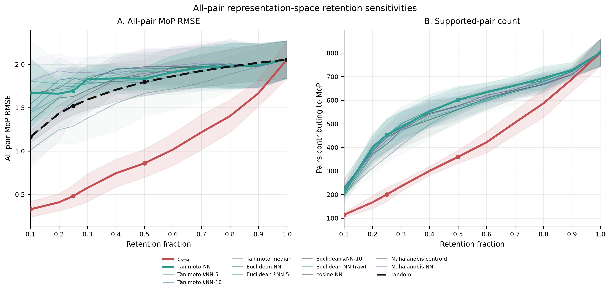

**Supplementary Figure S8. Workhorse uncertainty components; standard-deviation components and variance components.**

> **Aggregation note.** Selected workhorse = Heteroscedastic MLP ensemble (`DS2_RDKIT_MLPENS5_HETERO`). Bars are fold means. The variance identity is applied at the row level before averaging. Panel A standard deviations do not add linearly. Panel B variances add to total predictive variance as defined in Section S2.4.

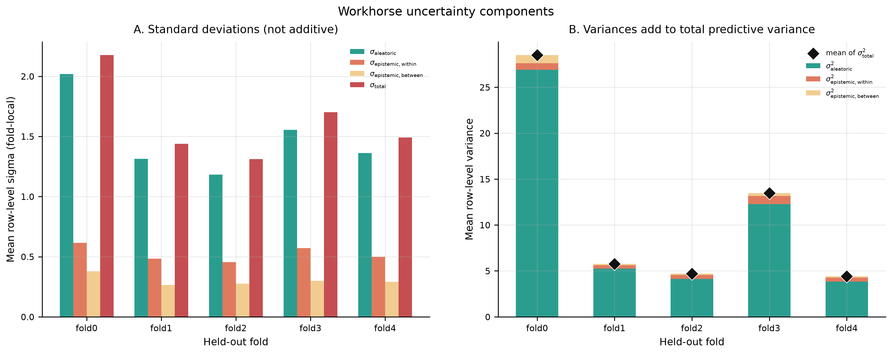

**Supplementary discussion: the score inventory and its two audits.** Table S7.2 is the frozen registry of the primary and representative sensitivity scores: for each, its `method_name`, the exact definition, the partition it is fitted on, and its orientation. It is not the full list of scores appearing in this section: `results/downstream_cv/ad_retention/score_definitions.csv` holds exactly these eleven entries, while the Tanimoto median and $k$NN variants, the unstandardized Chemprop nearest-neighbor score, and the RDKit feature-space extras appear in Tables S7.1, S7.3 and S8.4 under the same conventions without a registry row of their own. Two properties of that registry are load-bearing for the main-text comparison and are audited rather than assumed.

The first is *orientation*. Every score in Table S7.2 is defined so that a larger value means greater predicted risk, which is what makes the retention curves comparable — a retention rule always keeps the lowest-scoring rows. For distance scores this is the natural direction; for $\sigma_{\mathrm{total}}$ and its components it is also natural; but for a mixed inventory assembled from three different sources it is exactly the kind of convention that a single sign error would silently invert, turning a good score into an apparently catastrophic one and vice versa. Supplementary Figure S9 is the audit of that convention, verifying orientation for every registered score before any retention analysis was run. It is reported because the main-text finding includes negative score–residual correlations (main-text Figure 3 and Table S8.6), and a reader is entitled to see that those negative values were not produced by an inverted score.

The second is *fit partition*. Every distance score in the inventory is fitted on `outer_train` — the outer-training plus inner-validation rows of the fold in question — so no held-out information enters any score. $\sigma_{\mathrm{total}}$ is marked `none_model_output` because it is emitted by the fold-local model rather than fitted separately, and `random_retention` is marked `not_a_score` because it is the baseline rather than a candidate. Pair-density risk is the only score in the inventory that uses neither molecular structure nor model output: it is the inverse training-ligand support of the row's species-level metal pair, and it therefore functions as a pure data-coverage control on the comparison.

Supplementary Figure S8 shows the same dominance from the variance side: decomposed row-level variance is overwhelmingly the input-dependent term in every fold, with the within-member and between-member contributions visible only as thin bands at the top of each stacked bar. Supplementary Figure S10 plots the eight non-Chemprop registered scores' all-pair MoP retention curves in one panel, with the primary scores and the random baseline emphasized. It is the wider version of main-text Figure 2A, though not a superset of it: Figure 2A also displays the post-hoc feature-median Mahalanobis curve, which is not in the registered inventory and so does not appear here. Supplementary Figure S7 is the representation-space subset of the same inventory, isolating the Chemprop embedding distances against $\sigma_{\mathrm{total}}$, Tanimoto nearest-neighbor distance, and random retention. Its purpose is to make one negative result legible: the learned-representation distances, which might be expected to outperform fingerprint distance because they are trained on the task, track the random-retention baseline as closely as the fingerprint scores do. Learning the representation does not, on this dataset, produce a distance that knows where the model will fail.

This section answers whether pair support, medium strata, or tested molecular-distance scores explain held-out error. It is supporting context for the main-text risk-ordering result. Pair density is a support diagnostic that helps explain why some pair contexts are harder than others; it is not a validated applicability domain.

S8 reports contextual support diagnostics based on pair support, medium strata, and the association between ligand-level molecular-distance scores and row-level absolute residual. The primary fixed-retention inventory is S7. Pair-level error-ordering metrics (Table S7.1) and row-level retention-error diagnostics are distinguished below.

**Supplementary Figure S9. Risk-score orientation audit; higher values indicate greater predicted risk.**

> **Aggregation note.** All score orientations were verified before retention analysis; higher scores indicate greater predicted risk.

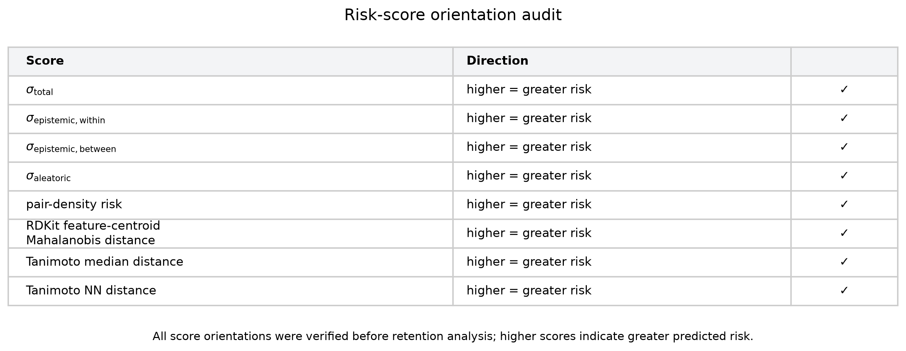

**Supplementary Figure S10. All-pair MoP retention error curves; primary scores emphasized.**

> **Aggregation note.** Eight scores on one axis: the four uncertainty terms, pair-density risk, the RDKit feature-centroid Mahalanobis distance, and the two Tanimoto aggregations. The four Chemprop embedding distances of the registered inventory are plotted separately in Supplementary Figure S7, and the post-hoc RDKit Mahalanobis median and nearest-neighbor variants are tabulated in Tables S7.4 and S7.5 rather than drawn; per-fraction values for every score are in `results/downstream_cv/ad_retention/retention_summary.csv`. Colour encodes score family: red for the predictive-uncertainty components, amber for pair-density support, blue for descriptor-space distance, green for fingerprint distance. Emphasized lines carry a fold-SD band. The random-retention baseline is the black dashed curve; the fingerprint nearest-neighbor curve lies **above** it from 10% to about 70% retention before converging on it, which is the negative result reported in main-text Section 3.4. All scores are oriented so that larger values mean greater predicted risk, and retention keeps the lowest-scoring rows. Empirical error-ordering scores, not out-of-distribution (OOD) detectors.

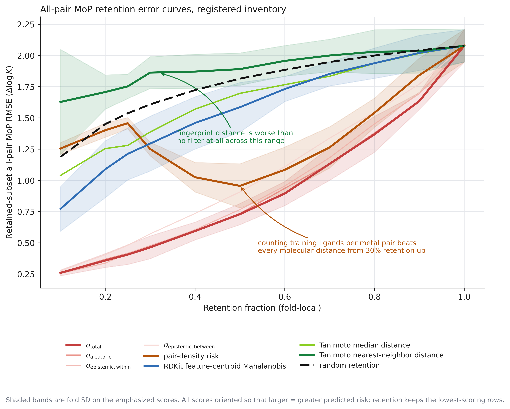

**Table S7.5. 50% retention on a common supported-pair population.**

> **Aggregation note.** Because different scores retain different rows, the pairs that remain MoP-eligible at 50% retention differ by score (Table S7.4, last column), so the free-population comparison is not made on a common denominator. Here every score is additionally restricted to the pairs that **all five** scores keep at 50% retention — 298 ± 16 pairs per fold — and MoP RMSE is recomputed on that shared set. Relative change is against the unfiltered workhorse value of $2.078 \pm 0.130$. Five valid folds. Source: `manuscripts/final/tables/iz_retention_common_population_50pct.csv`.

| score | free population | common population | change vs unfiltered (common) |
| --- | --- | --- | --- |
| sigma_total | 0.730 ± 0.084 | 0.720 ± 0.098 | -65.3% |
| RDKit feature-median Mahalanobis | 1.580 ± 0.193 | 1.046 ± 0.101 | -49.7% |
| RDKit feature Mahalanobis nearest-neighbor | 1.635 ± 0.146 | 1.120 ± 0.070 | -46.1% |
| Tanimoto median distance | 1.697 ± 0.235 | 1.128 ± 0.145 | -45.7% |
| Tanimoto nearest-neighbor distance | 1.891 ± 0.129 | 1.251 ± 0.128 | -39.8% |

The control matters in both directions. The distance scores improve markedly once the pair population is held fixed — feature-median Mahalanobis distance from $1.580$ to $1.046$ — which confirms that part of their apparent weakness in the free comparison was the harder set of pairs they retained, and that quoting only the free numbers overstates the case against them. The workhorse uncertainty barely moves, from $0.730$ to $0.720$, because the pairs it retains are already close to the common set. The ordering is unchanged and the margin remains large: a 65% reduction against 50% for the best distance score. Main-text Section 3.4 quotes the free-population values for continuity with Figure 2 and reports this matched comparison alongside them.

**Table S7.6. 50% retention on a common population that also includes pair-density risk.**

> **Aggregation note.** Table S7.5 matches the five distance-and-uncertainty scores. Pair-density risk retains a far narrower set of pairs than any of them, so including it shrinks the common population from $298 \pm 16$ to $109 \pm 5$ pairs per fold. Every score is restricted to that shared set and MoP RMSE recomputed. The free-population column reproduces Table S7.4; the retained-pair column is the count each score keeps on its own. Relative change is against the unfiltered $2.078 \pm 0.130$. Five valid folds. Computed from the frozen fold scores in `results/downstream_cv/ad_retention/fold_scores/DS2_RDKIT_MLPENS5_HETERO/`; the procedure reproduces every value of Table S7.5 to three decimals, including its $297.6 \pm 16.0$ pair count. Source: `manuscripts/final/tables/iz_retention_common_population_50pct_with_support.csv`.

| score | free population | pairs it retains | common population | change vs unfiltered (common) |
| --- | --- | --- | --- | --- |
| $\sigma_{\mathrm{total}}$ | 0.730 ± 0.084 | 328.2 ± 19.9 | 0.557 ± 0.027 | -73.2% |
| pair-density risk | 0.956 ± 0.176 | 109.4 ± 4.5 | 0.951 ± 0.179 | -54.3% |
| RDKit feature-centroid Mahalanobis | 1.586 ± 0.198 | 549.8 ± 43.8 | 0.721 ± 0.097 | -65.3% |
| RDKit feature Mahalanobis nearest-neighbor | 1.635 ± 0.146 | 544.4 ± 57.1 | 0.768 ± 0.057 | -63.1% |
| Tanimoto median distance | 1.697 ± 0.235 | 562.8 ± 45.4 | 0.821 ± 0.073 | -60.5% |
| Tanimoto nearest-neighbor distance | 1.891 ± 0.129 | 601.4 ± 52.5 | 0.907 ± 0.058 | -56.3% |

**Supplementary discussion: the pair-density result is a population effect, and saying so sharpens it.** On the free population, pair-density risk is the second-strongest score in this work and beats every molecular distance at every retention fraction from 30% to 90% (Section S7 above). Table S7.6 shows that this does not survive the control the rest of this section applies. Pair-density risk keeps only $109.4 \pm 4.5$ MoP-eligible pairs at 50% retention, against $328.2 \pm 19.9$ for $\sigma_{\mathrm{total}}$ and $544$–$601$ for the distances; restricted to the pairs all six scores share, it moves from $0.956$ to $0.951$ — essentially not at all, because it was already being scored on close to that set — while every distance improves sharply and overtakes it. On the shared population it is the **worst** of the six, not the second best.

That is a more interesting statement than the one it replaces, and it is worth being precise about the mechanism. A coverage count does not order error *within* a pair population; it selects a narrow, densely sampled slice of the pair inventory and reports the low error of that slice. Both behaviours reduce retained-subset error, and a retention curve alone cannot tell them apart — which is precisely why the matched-population control exists and why the main text calls it the comparison to quote. The distinction matters operationally: a rule that concentrates on well-supported metal pairs tells an experimentalist to work where the data already is, whereas $\sigma_{\mathrm{total}}$ — which improves from $0.730$ to $0.557$ under the same control, and is best on both populations — orders error among the candidates actually on the table. The pair-support diagnostics of Section S8 are the direct evidence for the first mechanism: held-out error falls monotonically with training-ligand count, so any score that preferentially keeps well-supported pairs inherits that gradient without ordering anything.

**Supplementary discussion: why a counting rule beats a molecular distance, and where it stops doing so.** The weak retention and correlation performance of the molecular distances does not show that structural similarity is irrelevant to this problem; it shows that the tested *definitions* order held-out error weakly at best on this target and validation regime, and the reason is legible in what each definition can and cannot see. A Tanimoto distance describes ligand similarity alone, whereas the prediction depends on the ligand together with the metal species, its oxidation state, and the experimental medium. The RDKit feature-space distances encode more of that context and do order error measurably better, which is consistent with the reading above — but even they describe geometric proximity to the training distribution rather than the behavior of the fitted predictive model, which is the quantity that actually determines whether one prediction is safer than another.

Pair-density risk, plotted in main-text Figure 2A, is the sharpest illustration, because it reads neither structure nor model output: it is $1/(1+n_p)$ on the number of distinct outer-training ligands carrying the row's species-level pair. Two features of its curve are worth recording here rather than in the main text, because both are visible only across the whole grid.

First, the win is broad rather than local. Reading the retention curves of Supplementary Figure S10 fraction by fraction, pair-density risk gives a lower retained-subset MoP RMSE than every distance in the inventory — both Mahalanobis aggregations, all four Tanimoto variants, and the Chemprop embedding scores — at all seven fractions from $0.30$ to $0.90$, and loses to the best distance only at $0.10$, $0.20$ and $0.25$. Second, its curve is non-monotone on a scale no other score here approaches: it rises from $1.255$ at 10% retention to $1.458$ at 25%, falls to a minimum of $0.956$ at 50%, then climbs to the unfiltered value. Several other curves in the inventory wobble, but the largest single reversal among all of them is $0.043$ $\Delta\log K$ (Chemprop standardized Euclidean-NN, $0.25 \to 0.30$), whereas pair-density risk reverses by $0.226$ in one step ($0.30 \to 0.40$) and by $0.502$ across the $0.25 \to 0.50$ interval. A score whose best operating point sits in the middle of the grid rather than at its left edge is not behaving like a continuous risk ranking, which is consistent with the tie-structure explanation given in the main text: below about 30% retention the cut falls inside a single large block of equally supported rows. Neither behavior is available to a ligand-only geometry, and neither displaces $\sigma_{\mathrm{total}}$, whose retained-subset MoP RMSE is lower than both at every fraction of the grid.

## S8. Pair-context and support diagnostics

**Table S8.1. Fold-local row-level retention-curve AUC over the 10–100% grid.**

> **Aggregation note.** Empirical error-ordering summary; see S7 for interpretation. Same fold-local ranking procedure as Table S7.1 and the same 10–100% grid $\{0.10,\ldots,1.00\}$, but the curve is row RMSE rather than MoP RMSE (a different estimand). Scope = all-pair DS2 only. Source: `results/downstream_cv/ad_retention/retention_auc_summary.csv`; manuscript rendering copy: `manuscripts/final/tables/retention_auc_summary.csv`. Endpoint field = `retention_curve_auc_rmse`.

| scope | score | fit_partition | row AUC | row RMSE@50% | n_valid_folds |
| --- | --- | --- | --- | --- | --- |
| all_pairs | mahalanobis_feature_centroid | outer_train | 1.714 ± 0.314 | 1.888 ± 0.319 | 5 |
| all_pairs | mahalanobis_feature_median (post hoc) | outer_train | 1.709 ± 0.313 | 1.883 ± 0.320 | 5 |
| all_pairs | pair_density_risk | outer_train | 1.293 ± 0.054 | 1.209 ± 0.078 | 5 |
| all_pairs | sigma_aleatoric |  | 0.784 ± 0.057 | 0.691 ± 0.071 | 5 |
| all_pairs | sigma_epistemic_between |  | 0.928 ± 0.062 | 0.904 ± 0.066 | 5 |
| all_pairs | sigma_epistemic_within |  | 0.809 ± 0.058 | 0.718 ± 0.065 | 5 |
| all_pairs | sigma_total | none_model_output | 0.781 ± 0.057 | 0.690 ± 0.069 | 5 |
| all_pairs | tanimoto_knn_mean_10 |  | 2.060 ± 0.376 | 2.206 ± 0.389 | 5 |
| all_pairs | tanimoto_knn_mean_5 |  | 2.064 ± 0.353 | 2.216 ± 0.397 | 5 |
| all_pairs | tanimoto_median_distance |  | 1.802 ± 0.241 | 2.129 ± 0.401 | 5 |
| all_pairs | tanimoto_nn_distance | outer_train | 2.049 ± 0.311 | 2.237 ± 0.352 | 5 |

The component that tracks $\sigma_{\mathrm{total}}$ most closely in these summaries is $\sigma_{\mathrm{aleatoric}}$ — retention AUC $0.784 \pm 0.057$ against $0.781 \pm 0.057$, and 50% retained-subset MoP RMSE $0.734 \pm 0.095$ against $0.730 \pm 0.084$ (Table S7.4) — with $\sigma_{\mathrm{epistemic,within}}$ close behind. These remain distinct model outputs; the near-coincidence reflects similar fold-local ordering in this analysis, not an identity of the underlying definitions, and it is the basis of the component argument in main-text Section 3.4. For the selected heteroscedastic-ensemble workhorse, $\sigma_{\mathrm{total}}$ is assembled from the available fold-local predictive components, including a between-member term.

Tanimoto: outer-train ligands only. RDKit feature-centroid Mahalanobis: outer-train Ledoit–Wolf on descriptors that include ligand, metal, medium, solvent, and temperature variables (`mahalanobis_joint` is the same score). Pair density: outer-train pair counts. Chemprop embedding distances are learned-representation scores. Score orientation is higher = greater predicted risk. The tested fingerprint, descriptor-space, and learned-representation distances are tested molecular-distance tools, not operational risk scores.

**Medium strata.** The metal–medium seen/unseen analysis was identifiable, but the unseen stratum was small and was not used as a headline estimate. Electrolyte-seen (`electrolyte_seen`) and ligand–medium-seen (`ligand_medium_seen`) comparisons were non-identifiable / `not_identifiable` under the ligand-disjoint split. **No conclusion about medium novelty was drawn.** The all-pair unseen RMSE is not evidence of general medium extrapolation.

**Table S8.2. Metal–medium seen/unseen (workhorse).**

> **Aggregation note.** Stratum = whether the (species pair, electrolyte) pair was observed in outer-train. Unseen is a small slice. Source: `results/downstream_cv/ad/ad_metal_medium_strata_summary.csv`; manuscript rendering copy: `manuscripts/final/tables/supplementary_metal_medium_strata.csv`.

| scope | stratum | metric | display | n_valid_folds |
| --- | --- | --- | --- | --- |
| all_pairs | seen | mop_rmse | 2.006 ± 0.075 | 5 |
| all_pairs | seen | n_pairs | 1286.4 ± 114.3 | 5 |
| all_pairs | seen | n_rows | 17282.6 ± 143.2 | 5 |
| all_pairs | seen | picp_90 | 0.896 ± 0.022 | 5 |
| all_pairs | seen | rmse | 1.993 ± 0.148 | 5 |
| all_pairs | unseen | mop_rmse | 3.409 ± 1.794 (n_valid=4) | 4 |
| all_pairs | unseen | n_pairs | 362.0 ± 102.4 | 5 |
| all_pairs | unseen | n_rows | 422.4 ± 143.2 | 5 |
| all_pairs | unseen | picp_90 | 0.817 ± 0.049 | 5 |
| all_pairs | unseen | rmse | 4.334 ± 1.020 | 5 |

**Table S8.3. Pair-context support bins (workhorse, all-pairs).** This is a metal-pair data-support breakdown of the data-collection structure, not a formal chemistry analysis and not a validated applicability domain. The first category is **0 training ligands** and is a distinct pair-context extrapolation regime; it is not merged with `1-5` and is not complete chemical novelty. MoP RMSE in that bin is partial (`n_valid_folds=2`) and is not a headline. Counts `n_test_rows` / `n_test_pairs` are fold means of test rows or test pairs assigned to each training-density bin; they are not unique-pair counts pooled across folds and are not retained MoP-pair counts. Source: `results/downstream_cv/pair_density/pair_density_summary.csv`; manuscript rendering copy: `manuscripts/final/tables/supplementary_pair_density_bins.csv`.

| training-ligand bin | test pairs | test rows | MoP RMSE | row RMSE | mean $\sigma_{\mathrm{total}}$ | row-level PICP@90 |
| --- | --- | --- | --- | --- | --- | --- |
| 0 training ligands | 139.4 ± 76.6 | 170.2 ± 115.5 | 2.157 ± 2.031 (n_valid=2) | 4.905 ± 1.157 | 4.130 ± 1.835 | 0.803 ± 0.036 |
| 1-5 | 490.2 ± 120.2 | 758.6 ± 241.5 | 3.001 ± 0.945 | 5.045 ± 0.997 | 3.923 ± 1.416 | 0.813 ± 0.062 |
| 6-10 | 175.2 ± 15.3 | 426.4 ± 77.5 | 2.790 ± 0.575 | 3.534 ± 0.584 | 2.708 ± 0.422 | 0.835 ± 0.038 |
| 11-25 | 289.4 ± 7.3 | 1449.8 ± 66.8 | 2.318 ± 0.141 | 2.643 ± 0.170 | 2.344 ± 0.281 | 0.860 ± 0.052 |
| 26-50 | 153.4 ± 6.4 | 1585.0 ± 129.4 | 2.156 ± 0.208 | 2.345 ± 0.207 | 2.099 ± 0.240 | 0.861 ± 0.041 |
| >50 | 267.2 ± 3.2 | 13315.0 ± 382.5 | 1.418 ± 0.108 | 1.482 ± 0.079 | 1.293 ± 0.256 | 0.909 ± 0.018 |

**Supplementary Figure S11. All-pair pair-support density and workhorse diagnostics.**

> **Aggregation note.** All-pair DS2 workhorse, binned by the number of training ligands available for the held-out row's species-level metal pair. Panel A plots held-out row-level RMSE and mean $\sigma_{\mathrm{total}}$ on a common $\Delta\log K$ axis: both fall by roughly a factor of three across the bins, so the model's own uncertainty tracks pair support although support is never supplied to it as a feature. Panel B plots row-level PICP@90 against nominal coverage; the shaded area is the shortfall. Coverage degrades as support thins — monotonically in the point estimates, though the 11–25 and 26–50 bins differ by only $0.001$ — reaching $0.803 \pm 0.036$ where the metal pair has no training ligands at all. Bin 0 is a pair-context extrapolation regime and is not complete chemical novelty. Fold means with fold SD ($n=5$).

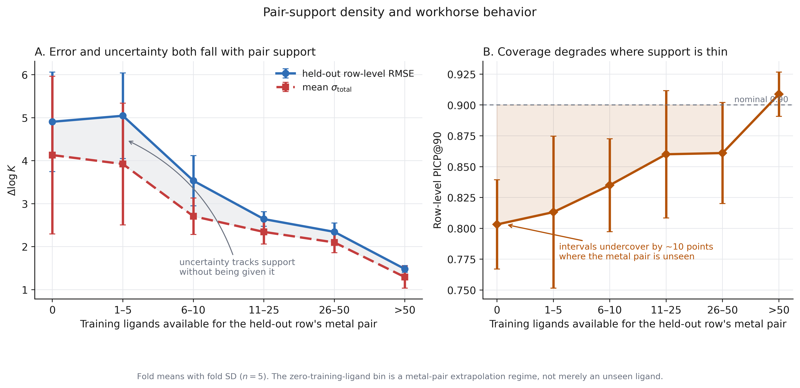

**Supplementary discussion: what pair support costs, and what the model knows about it.** Table S8.3 and Supplementary Figure S11 bin held-out rows by how many training ligands their species-level metal pair carries. Read down the table, the cost of thin support is large and monotone from the `1-5` bin onward: MoP RMSE falls from $3.001 \pm 0.945$ at 1–5 training ligands to $1.418 \pm 0.108$ above 50, a factor of about 2.1, with row-level RMSE following the same path from $5.045 \pm 0.997$ to $1.482 \pm 0.079$. Pair support is therefore a strong axis of difficulty within this design. It cannot be ranked against ligand novelty, because ligand novelty is held constant by construction — every held-out ligand is unseen in every fold — and the contrast that would vary it is listed as `not_computed` in Section S11. What can be said is that pair support is an axis a ligand-only molecular distance cannot see at all, which is a plausible part of why the fingerprint and embedding distances of Table S8.4 fail to order error.

The column that matters most for the main-text argument is the last one. Mean $\sigma_{\mathrm{total}}$ tracks the error down the same bins, from $3.923 \pm 1.416$ at 1–5 training ligands to $1.293 \pm 0.256$ above 50. The model's own uncertainty registers the support structure of the data even though pair support is never given to it as a feature and is never used in its training objective. This is the mechanism behind the retention result of Section S7 and main-text Section 3.4, and it explains the shape of Figure 2B: when rows are retained by $\sigma_{\mathrm{total}}$, the retained set is drawn preferentially from well-supported pairs, so the retained-pair count falls faster than for a distance score while the retained-subset error falls further.

There is a third column worth reading, and it is the least comfortable result in this document. Row-level PICP@90 also tracks pair support, and in the wrong direction for a practitioner: nominal 90% intervals cover $0.909 \pm 0.018$ of held-out rows in the best-supported bin but only $0.803 \pm 0.036$ where the metal pair has no training ligands at all, a monotone drift of about ten coverage points (Supplementary Figure S11B). The intervals are therefore least trustworthy exactly where a user most needs them: on a sparsely sampled metal pair the model is not only less accurate, it is also more confident than it should be. Two things stop this from undermining the retention result. The drift is in coverage, not in ranking — $\sigma_{\mathrm{total}}$ still grows with sparsity, so those rows are still ranked as risky and are still the first discarded by a retention rule. And the all-pair headline calibration is dominated by the well-supported bins. But it does mean the width of an individual interval on a thinly supported pair should be treated as a lower bound, and it is the strongest argument in this work for reporting pair support alongside any individual prediction. Main-text Section 3.6 records this as a limitation.

Two further cautions attach to the table. The `0 training ligands` bin is a distinct extrapolation regime — the metal pair itself is unseen, not merely the ligand — and its MoP RMSE of $2.157 \pm 2.031$ is computed on only two valid folds, so it is not comparable with the rest of the column and is not a headline. Its row-level RMSE of $4.905 \pm 1.157$ and mean $\sigma_{\mathrm{total}}$ of $4.130 \pm 1.835$ are the more trustworthy summary of that regime, and both say the same thing: predictions there are poor, and the model reports them as risky. Second, the bin counts are fold means of test rows and test pairs assigned to each density bin, not pooled unique-pair counts; the `>50` bin holds 13,315 of the roughly 17,705 rows in an average fold, so the all-pair headline is dominated by well-supported pairs even though most *pairs* are thinly supported. That asymmetry is exactly what pair-equal MoP aggregation exists to correct.

**Table S8.4. Fold-wise association between ligand-level molecular-distance score and row-level absolute residual.**

> **Aggregation note.** Descriptive association diagnostic for the selected workhorse (`DS2_RDKIT_MLPENS5_HETERO`) and the Chemprop evidential model (`DS2_GRAPH_DMPNN_EVID`). Each fold computes Pearson $r$ and Spearman $\rho$ between the named molecular-distance score and the row-level absolute residual $|y-\widehat y|$. RDKit feature-space extras (Mahalanobis NN, Mahalanobis $k$NN mean, Euclidean-NN, median Euclidean-to-all) are supplement-only and are not plotted on retention-curve figures. Values are five-fold mean $\pm$ SD. This is not a selection metric, not a retained-subset RMSE, and not a substitute for the fixed-retention error-ordering analysis. The tested molecular-distance associations were weak and did not provide a sufficiently strong basis for replacing the workhorse uncertainty score in the ligand-disjoint DS2 retention analysis. Source: `results/downstream_cv/ad_distance_error_corr/ad_distance_error_corr_summary.csv`; manuscript rendering copy: `manuscripts/final/tables/ad_distance_error_corr.csv`.

| model | scope | score | Pearson $r$ | Spearman $\rho$ | n_valid_folds |
| --- | --- | --- | --- | --- | --- |
| DS2_RDKIT_MLPENS5_HETERO | all_pairs | Tanimoto nearest-neighbor distance | -0.059 ± 0.078 | -0.087 ± 0.070 | 5 |
| DS2_RDKIT_MLPENS5_HETERO | all_pairs | Tanimoto $k$NN mean, $k=5$ | -0.070 ± 0.086 | -0.092 ± 0.076 | 5 |
| DS2_RDKIT_MLPENS5_HETERO | all_pairs | Tanimoto $k$NN mean, $k=10$ | -0.066 ± 0.090 | -0.088 ± 0.084 | 5 |
| DS2_RDKIT_MLPENS5_HETERO | all_pairs | Tanimoto median distance | 0.085 ± 0.076 | 0.102 ± 0.096 | 5 |
| DS2_RDKIT_MLPENS5_HETERO | all_pairs | RDKit feature-centroid Mahalanobis distance | 0.127 ± 0.034 | 0.125 ± 0.076 | 5 |
| DS2_RDKIT_MLPENS5_HETERO | all_pairs | RDKit feature-median Mahalanobis distance (post hoc) | not computed | 0.127 ± 0.075 | 5 |
| DS2_RDKIT_MLPENS5_HETERO | all_pairs | RDKit feature Mahalanobis-NN | 0.089 ± 0.043 | 0.092 ± 0.062 | 5 |
| DS2_RDKIT_MLPENS5_HETERO | all_pairs | RDKit feature Mahalanobis $k$NN mean, $k=5$ | 0.119 ± 0.027 | 0.109 ± 0.062 | 5 |
| DS2_RDKIT_MLPENS5_HETERO | all_pairs | RDKit feature Mahalanobis $k$NN mean, $k=10$ | 0.122 ± 0.034 | 0.118 ± 0.062 | 5 |
| DS2_RDKIT_MLPENS5_HETERO | all_pairs | RDKit feature Euclidean-NN | 0.142 ± 0.051 | 0.158 ± 0.082 | 5 |
| DS2_RDKIT_MLPENS5_HETERO | all_pairs | RDKit feature median Euclidean distance | 0.173 ± 0.032 | 0.250 ± 0.078 | 5 |
| DS2_GRAPH_DMPNN_EVID | all_pairs | Tanimoto nearest-neighbor distance | -0.048 ± 0.080 | -0.073 ± 0.071 | 5 |
| DS2_GRAPH_DMPNN_EVID | all_pairs | Tanimoto $k$NN mean, $k=5$ | -0.060 ± 0.087 | -0.082 ± 0.071 | 5 |
| DS2_GRAPH_DMPNN_EVID | all_pairs | Tanimoto $k$NN mean, $k=10$ | -0.056 ± 0.094 | -0.079 ± 0.078 | 5 |
| DS2_GRAPH_DMPNN_EVID | all_pairs | Tanimoto median distance | 0.102 ± 0.087 | 0.102 ± 0.114 | 5 |
| DS2_GRAPH_DMPNN_EVID | all_pairs | RDKit feature-centroid Mahalanobis distance | 0.078 ± 0.071 | 0.117 ± 0.076 | 5 |
| DS2_GRAPH_DMPNN_EVID | all_pairs | RDKit feature Mahalanobis-NN | 0.077 ± 0.067 | 0.087 ± 0.068 | 5 |
| DS2_GRAPH_DMPNN_EVID | all_pairs | RDKit feature Mahalanobis $k$NN mean, $k=5$ | 0.073 ± 0.073 | 0.104 ± 0.065 | 5 |
| DS2_GRAPH_DMPNN_EVID | all_pairs | RDKit feature Mahalanobis $k$NN mean, $k=10$ | 0.072 ± 0.072 | 0.111 ± 0.064 | 5 |
| DS2_GRAPH_DMPNN_EVID | all_pairs | RDKit feature Euclidean-NN | 0.110 ± 0.065 | 0.138 ± 0.073 | 5 |
| DS2_GRAPH_DMPNN_EVID | all_pairs | RDKit feature median Euclidean distance | 0.113 ± 0.074 | 0.228 ± 0.088 | 5 |
| DS2_GRAPH_DMPNN_EVID | all_pairs | Chemprop Euclidean-NN | -0.008 ± 0.102 | -0.068 ± 0.051 | 5 |
| DS2_GRAPH_DMPNN_EVID | all_pairs | Chemprop Euclidean-$k$NN, $k=5$ | -0.006 ± 0.114 | -0.065 ± 0.077 | 5 |
| DS2_GRAPH_DMPNN_EVID | all_pairs | Chemprop Euclidean-$k$NN, $k=10$ | -0.000 ± 0.116 | -0.054 ± 0.088 | 5 |
| DS2_GRAPH_DMPNN_EVID | all_pairs | Chemprop Euclidean-NN (unstandardized) | -0.002 ± 0.067 | -0.016 ± 0.043 | 5 |
| DS2_GRAPH_DMPNN_EVID | all_pairs | Chemprop cosine-NN | 0.016 ± 0.089 | -0.053 ± 0.035 | 5 |
| DS2_GRAPH_DMPNN_EVID | all_pairs | Chemprop embedding-centroid Mahalanobis | 0.019 ± 0.103 | -0.050 ± 0.081 | 5 |
| DS2_GRAPH_DMPNN_EVID | all_pairs | Chemprop embedding Mahalanobis-NN | -0.020 ± 0.116 | -0.120 ± 0.059 | 5 |

**Table S8.5. Most frequent held-out pairs for the selected workhorse (descriptive).**

> **Aggregation note.** Pairs are ranked by the total number of held-out ligand rows across all five outer folds, using only test-side rows. Per-pair RMSE is an out-of-fold pooled quantity, not MoP RMSE and not a five-fold mean ± SD. Observed high-selectivity counts use held-out labels only. This table is descriptive and label-informed; it is not a selection rule. Source: `results/downstream_cv/pair_event_support/pair_event_support_frequent.csv`; manuscript rendering copy: `manuscripts/final/tables/pair_event_support_frequent.csv`.

| pair | held-out rows | folds | high-sel. events | high-sel. fraction | per_pair RMSE (OOF pooled) | mean $\sigma_{\mathrm{total}}$ |
| --- | --- | --- | --- | --- | --- | --- |
| Cu:2.0--Ni:2.0 | 1878 | 5 | 1404 | 0.748 | 1.411 | 1.672 |
| Cu:2.0--Zn:2.0 | 1663 | 5 | 1383 | 0.832 | 1.508 | 1.708 |
| Ni:2.0--Zn:2.0 | 1525 | 5 | 510 | 0.334 | 1.173 | 1.361 |
| Co:2.0--Ni:2.0 | 1452 | 5 | 485 | 0.334 | 0.834 | 1.366 |
| Co:2.0--Cu:2.0 | 1356 | 5 | 1087 | 0.802 | 1.706 | 1.677 |
| Co:2.0--Zn:2.0 | 1265 | 5 | 178 | 0.141 | 0.897 | 1.232 |
| Cd:2.0--Zn:2.0 | 1019 | 5 | 357 | 0.350 | 1.163 | 1.354 |
| Cd:2.0--Cu:2.0 | 928 | 5 | 754 | 0.812 | 1.856 | 1.872 |
| Cd:2.0--Ni:2.0 | 857 | 5 | 477 | 0.557 | 1.270 | 1.454 |
| Cd:2.0--Co:2.0 | 703 | 5 | 209 | 0.297 | 1.132 | 1.281 |
| Mn:2.0--Zn:2.0 | 658 | 5 | 371 | 0.564 | 1.224 | 1.248 |
| Co:2.0--Mn:2.0 | 629 | 5 | 291 | 0.463 | 1.181 | 1.246 |
| Cu:2.0--Mn:2.0 | 626 | 5 | 533 | 0.851 | 1.866 | 1.733 |
| Mn:2.0--Ni:2.0 | 626 | 5 | 366 | 0.585 | 1.390 | 1.392 |
| Ca:2.0--Mg:2.0 | 624 | 5 | 154 | 0.247 | 0.987 | 1.115 |

**Supplementary Figure S12. Held-out pair support versus high-selectivity event support.**

> **Aggregation note.** Out-of-fold held-out labels only; both axes are logarithmic because the pair inventory spans three orders of magnitude in support. Colour is the observed high-selectivity fraction of each pair, so the tight upper diagonal in Panel A is the population of pairs in which nearly every held-out row is an event, and the separate lower cloud is the near-degenerate pairs. Panel B shows per-pair error falling and tightening toward $1$–$2$ $\Delta\log K$ as support grows; the low-error purple cluster at high support is the near-zero pair family. The plotted pooled per-pair RMSE is not MoP RMSE. Descriptive and label-informed; it describes pair-specific data support and is not a chemical mechanism analysis or a selection rule.

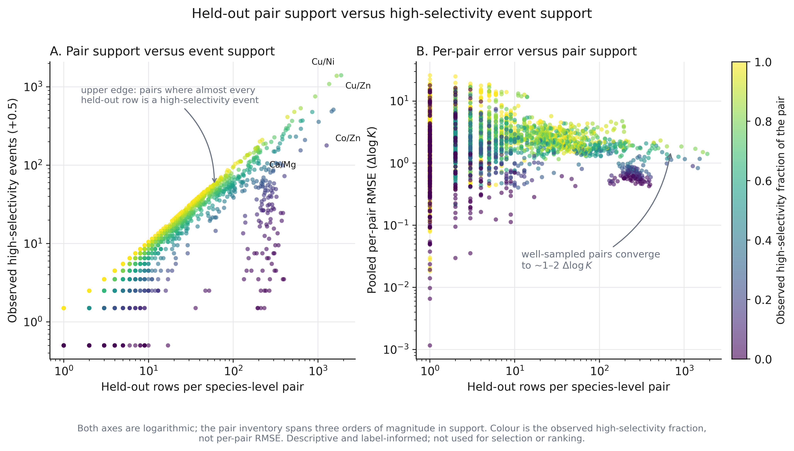

**Supplementary discussion: which pairs the benchmark is actually made of.** Table S8.5 lists the fifteen most frequently held-out species-level pairs and Supplementary Figure S12 plots pair support against high-selectivity event support for all of them. Both are descriptive and label-informed, and neither is used for any selection or ranking; they are included because the all-pair headline is a weighted statement about a pair population, and a reader should be able to see what that population is.

It is narrow. Every one of the fifteen most frequent pairs combines two divalent cations drawn from a single small set — the first-row transition metals Cu, Ni, Zn, Co and Mn, the 4d congener Cd, and the alkaline earths Ca and Mg, all at oxidation state +2 — and together they account for roughly 16,000 held-out rows out of about 88,500. The Irving–Williams series is visible in the event fractions: pairs containing $\mathrm{Cu^{2+}}$ against a weaker binder show high-selectivity fractions of 0.75–0.85 (Cu–Ni 0.748, Cu–Zn 0.832, Co–Cu 0.802, Cd–Cu 0.812, Cu–Mn 0.851), whereas pairs of adjacent, similarly binding metals show much lower fractions (Ni–Zn 0.334, Co–Ni 0.334, Co–Zn 0.141, Ca–Mg 0.247). The dataset therefore contains many easy, chemically well-understood contrasts alongside the genuinely difficult near-degenerate ones.

The per-pair errors separate along the same line, and in the direction one would expect. Pairs with high event fractions carry the larger pooled residuals (Cu–Mn 1.866, Cd–Cu 1.856, Co–Cu 1.706) and the larger mean $\sigma_{\mathrm{total}}$ (1.733, 1.872, 1.677), while near-degenerate pairs carry both smaller errors and smaller uncertainties (Co–Ni 0.834 and 1.366; Ca–Mg 0.987 and 1.115). This is the pair-level shadow of the magnitude–error–uncertainty coupling reported in main-text Figure 4: large selectivity is harder to predict, and the model says so. It is also the reason the acquisition benchmark of Section S10 must be read objective by objective. A high-selectivity campaign is aimed at exactly the pairs where the model is least accurate, whereas a near-zero campaign is aimed at the pairs where it is most accurate — a structural asymmetry between the two objectives that no choice of ranking rule removes.

The rare-earth pairs central to separations practice do not appear in this list at all, which is the concrete form of the coverage limitation stated in main-text Section 3.6 and the reason the REE analysis is confined to the restricted diagnostic of Section S13.

Across the pooled out-of-fold labels, 2,503 species-level pairs had held-out rows and 1,603 had more than 1 high-selectivity event when canonical ($y>1$) and reversed ($y<-1$) events were counted together. The descriptive pooled counts come from the registered pair-event-support artifacts. Source: `results/downstream_cv/pair_event_support/pair_event_support_summary.csv`. Per-pair event counts use `n_high_selectivity_events` in `results/downstream_cv/pair_event_support/pair_event_support_pooled.csv`. This pooled species-level count is not the fold-local ranking denominator in Table S10.1.

Pair-level full-grid retention-curve AUC remains in Table S7.1.

**Table S8.6. Fold-mean Spearman correlation between risk score and absolute residual (all twenty-three scores).**

> **Aggregation note.** Each entry is the five-fold mean ± SD of the fold-local Spearman rank correlation between the named score and the absolute residual $|y-\widehat y|$ on held-out DS2 rows (17,705 rows per fold). All listed scores are oriented so that larger values indicate greater predicted risk. These are the values plotted in main-text Figure 3, tabulated here because the figure is the argument and the table is the record. Primary scores are the three operational risk-ordering variables of the frozen inventory (main-text Methods 2.5). The remaining rows are sensitivity analyses. Uncertainty-component and pair-density correlations are recomputed from the frozen workhorse fold scores by `manuscript/iz_risk_score_table.py`; the distance rows are also in Table S8.4, which adds the Pearson coefficients and the DS1 scope. Learned-representation distances use the Chemprop evidential checkpoint, matching Table S8.4. Source: `manuscripts/final/tables/iz_risk_score_spearman.csv`, verified by `manuscript/iz_risk_score_table.py`.

| role | model | score | Spearman $\rho$ |
| --- | --- | --- | --- |
| primary | workhorse (direct DS2) | $\sigma_{\mathrm{total}}$ | 0.648 ± 0.020 |
| sensitivity | workhorse (direct DS2) | $\sigma_{\mathrm{aleatoric}}$ | 0.646 ± 0.020 |
| sensitivity | workhorse (direct DS2) | $\sigma_{\mathrm{epistemic,within}}$ | 0.635 ± 0.025 |
| sensitivity | workhorse (direct DS2) | $\sigma_{\mathrm{epistemic,between}}$ | 0.589 ± 0.019 |
| sensitivity | workhorse (direct DS2) | pair-density risk | 0.274 ± 0.024 |
| sensitivity | workhorse (direct DS2) | RDKit feature median Euclidean distance | 0.250 ± 0.078 |
| sensitivity | workhorse (direct DS2) | RDKit feature Euclidean-NN | 0.158 ± 0.082 |
| sensitivity | workhorse (direct DS2) | RDKit feature-median Mahalanobis distance | 0.127 ± 0.075 |
| primary | workhorse (direct DS2) | RDKit feature-centroid Mahalanobis distance | 0.125 ± 0.076 |
| sensitivity | workhorse (direct DS2) | RDKit feature Mahalanobis $k$NN mean, $k=10$ | 0.118 ± 0.062 |
| sensitivity | workhorse (direct DS2) | RDKit feature Mahalanobis $k$NN mean, $k=5$ | 0.109 ± 0.062 |
| sensitivity | workhorse (direct DS2) | Tanimoto median distance | 0.102 ± 0.096 |
| sensitivity | workhorse (direct DS2) | RDKit feature Mahalanobis-NN | 0.092 ± 0.062 |
| sensitivity | Chemprop evidential (learned representation) | Chemprop Euclidean-NN (unstandardized) | -0.016 ± 0.043 |
| sensitivity | Chemprop evidential (learned representation) | Chemprop embedding-centroid Mahalanobis | -0.050 ± 0.081 |
| sensitivity | Chemprop evidential (learned representation) | Chemprop cosine-NN | -0.053 ± 0.035 |
| sensitivity | Chemprop evidential (learned representation) | Chemprop Euclidean-$k$NN, $k=10$ | -0.054 ± 0.088 |
| sensitivity | Chemprop evidential (learned representation) | Chemprop Euclidean-$k$NN, $k=5$ | -0.065 ± 0.077 |
| sensitivity | Chemprop evidential (learned representation) | Chemprop Euclidean-NN | -0.068 ± 0.051 |
| primary | workhorse (direct DS2) | Tanimoto nearest-neighbor distance | -0.087 ± 0.070 |
| sensitivity | workhorse (direct DS2) | Tanimoto $k$NN mean, $k=10$ | -0.088 ± 0.084 |
| sensitivity | workhorse (direct DS2) | Tanimoto $k$NN mean, $k=5$ | -0.092 ± 0.076 |
| sensitivity | Chemprop evidential (learned representation) | Chemprop embedding Mahalanobis-NN | -0.120 ± 0.059 |

## S9. Sign stability and interval interpretation

This section answers whether 90% intervals resolve selectivity sign. It is supporting interpretation for the main-text claim that uncertainty ranks risk without certifying sign.

Most 90% intervals overlap zero, so the intervals are not sign-certifying. Table S9.1 gives the fractions, per-category RMSE, and sign accuracy for the three interval categories, and Supplementary Figure S13 plots them.

The magnitudes in Table S9.1 matter for how the workhorse can be used. Only $0.109 \pm 0.008$ of held-out rows have an interval lying entirely above zero and $0.149 \pm 0.020$ entirely below; the remaining $0.742 \pm 0.024$ straddle it. In other words, for roughly three of every four held-out predictions the model's own 90% interval does not exclude the possibility that the ligand prefers the other metal. That is the honest operational statement, and it is why the main text describes $\sigma_{\mathrm{total}}$ as a risk-ordering signal rather than a selectivity-direction certificate.

The interval categories nonetheless behave as they should. Where the interval does exclude zero, the point prediction's sign is almost always right: sign accuracy is $0.972 \pm 0.009$ for entirely-positive intervals and $0.981 \pm 0.007$ for entirely-negative intervals, against $0.768 \pm 0.016$ for the overlapping category. Sign resolution is therefore informative when it is available; it is simply available for a minority of predictions. The 0.97 figure is a held-out sign accuracy within a stratum defined by a label-free interval property, not a calibrated confidence attached to a new prediction: no threshold was tuned and the stratification was never validated as a decision rule.

Two cautions follow. First, the sign categories are not ordered by accuracy: RMSE is *higher* in the non-overlapping categories ($2.459 \pm 0.174$ entirely positive, $2.190 \pm 0.200$ entirely negative) than in the overlapping one ($2.006 \pm 0.254$), because intervals exclude zero mainly when $|\widehat y|$ is large, and large $|\widehat y|$ is where absolute error is largest (Section S10.1). Sign resolution and magnitude accuracy are different properties and improve in opposite directions here. Second, this is a descriptive stratification of held-out predictions by an interval property, not a calibrated decision rule: no threshold was tuned, and the categories were not used to select or filter anything reported in the main text. The restricted rare-earth-element subset shows the same pattern more sharply — $0.889 \pm 0.011$ of REE–REE rows overlap zero (Table S13.2) — consistent with the smaller selectivity magnitudes within that chemically similar family.

**Table S9.1. 90% interval sign categories (workhorse, all-pair scope).**

| scope | category | metric | fold mean ± SD | n_valid_folds |
| --- | --- | --- | --- | --- |
| all_pairs | entirely_negative | fraction_rows | 0.149 ± 0.020 | 5 |
| all_pairs | entirely_negative | rmse | 2.190 ± 0.200 | 5 |
| all_pairs | entirely_negative | sign_accuracy | 0.981 ± 0.007 | 5 |
| all_pairs | entirely_positive | fraction_rows | 0.109 ± 0.008 | 5 |
| all_pairs | entirely_positive | rmse | 2.459 ± 0.174 | 5 |
| all_pairs | entirely_positive | sign_accuracy | 0.972 ± 0.009 | 5 |
| all_pairs | overlaps_zero | fraction_rows | 0.742 ± 0.024 | 5 |
| all_pairs | overlaps_zero | rmse | 2.006 ± 0.254 | 5 |
| all_pairs | overlaps_zero | sign_accuracy | 0.768 ± 0.016 | 5 |

**Supplementary Figure S13. All-pair interval sign stability.**

> **Aggregation note.** Categories are based on whether the nominal 90% interval is entirely negative, entirely positive, or overlaps zero. The overlap-zero category dominates the all-pair scope.

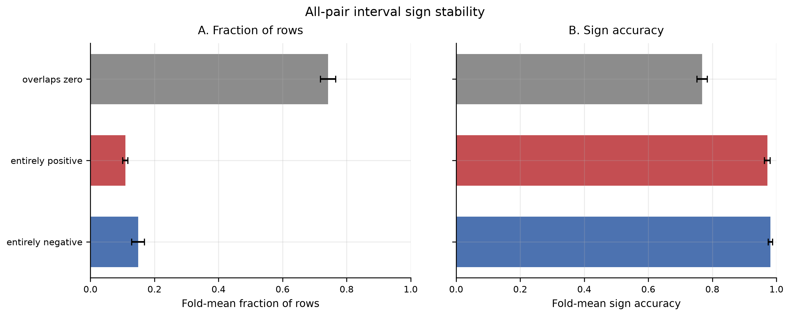

## S10. Pair-acquisition analysis

This section reports the sigma-only pair-acquisition study. This analysis does not ask whether the model is globally accurate. It asks whether, within a pair-specific candidate list, a ranking rule places useful event candidates near the top. The ranking is a retrospective held-out ranking simulation, not prospective experimental validation. Event precision@$k$ and true hit@$k$ are never interchangeable except at $k=1$. Retrospective regret@$k$ is reported on the same shortlists because those event metrics treat all events equally and do not measure the leftover gap to the best available ligand in a pair-task.

Primary pair-acquisition comparisons. (H2) at least one prespecified sigma-only ranking rule, particularly the threshold-margin rule, recovers high-selectivity events ($\Delta\log K>1$) at higher event precision@$k$ and true hit@$k$ than random selection on the eligible pair-tasks. (H3) the prespecified sigma-only ranking rules improve near-zero event precision@$k$ and true hit@$k$ relative to random selection on the eligible pair-tasks, with the magnitude of improvement depending on the ranking rule and shortlist size. (H4) aggressive LCB-labeled uncertainty-penalty scores can help the near-zero task and hurt high-selectivity recovery because $\sigma_{\mathrm{total}}$ increases with $|\widehat y|$; the threshold-margin rule, which divides by $\sigma_{\mathrm{total}}$ rather than subtracting it, was prespecified alongside them and is not subject to that mechanism. (H5) pair-tasks are eligible only when they have more than 1 held-out event, so reported event precision@$k$, true hit@$k$, and regret@$k$ exclude pair-tasks with at most 1 event. Regret@$k$ is tabulated in Table S10.3 and plotted in Figure 5 E--F. Negative results are retained. No top-$k$ threshold is optimized on outer-test event precision@$k$, true hit@$k$, or regret@$k$. Legacy CSV field `hit_rate_at_k` is event precision@$k$; true hit@$k$ is `any_hit_at_k`. The threshold-margin rule is likewise stored under the legacy `strategy` value `expected_improvement`; the implementation computes the standardized threshold margin $(\widehat y^\star-\tau)/\sigma$ and never a Gaussian expected-improvement integral, and the released spec lists `full_gaussian_expected_improvement_integral` explicitly under `not:`. Both legacy names are recorded in `results/downstream_cv/pair_acquisition/pair_acquisition_metric_migration.json`. Retention hypothesis H1 is stated in S7. A supporting event-threshold sensitivity with high-selectivity events at $\Delta\log K>2$ and near-zero events at $|\Delta\log K|<1/2$ is Section S10.2 and Supplementary Figure S14; it does not replace Table 3 or Figure 5.

Experiment artifacts: `configs/experiments/pair_acquisition_spec.yaml`; `results/downstream_cv/pair_acquisition/`.

### S10.1 Sigma-only pair acquisition

Experiment `sigma_pair_acquisition` ranks ligands inside each held-out metal-species pair using only $\widehat y$ and $\sigma_{\mathrm{total}}$. Distance scores are not used as ranking inputs. A pair-task is eligible only if it has more than 1 held-out event: target-direction $\Delta\log K>1$ for high selectivity (canonical $y>1$ and reversed $y<-1$ as separate tasks) and $|\Delta\log K|<1$ for near-zero selectivity. Top-$k$ is $k\in\{1,5,10\}$. A pair-task contributes to Precision@$k$, Hit@$k$, and retrospective regret@$k$ only when it has at least $k$ held-out rows. All ranking functions are oriented so that larger score values are ranked first; “more favorable” therefore means more favorable for the stated objective, not necessarily larger signed $\Delta\log K$. Ranking scores follow Methods 2.6. For an oriented high-selectivity task, the ranking scores are oriented predicted selectivity $\widehat y^\star$, oriented lower confidence bounds (LCB) $\widehat y^\star-z\sigma_{\mathrm{total}}$ with $z=1,2,3$, and the standardized threshold-margin score $(\widehat y^\star-1)/\sigma_{\mathrm{total}}$. For near-zero selection, candidates are ranked from low to high predicted magnitude. The predicted-magnitude score is $-|\widehat y|$, the uncertainty-penalty variants are $-(|\widehat y|+z\sigma_{\mathrm{total}})$, and the standardized margin is $(1-|\widehat y|)/\sigma_{\mathrm{total}}$. In tables and figures, the prespecified LCB-labeled uncertainty-penalty rules appear as LCB-1, LCB-2, and LCB-3. The threshold-margin score is that specified standardized margin, not the Gaussian expected-improvement integral. Aggregation is a pair-equal mean inside each fold, then fold mean ± SD. We evaluate a retrospective held-out ranking simulation. Candidates are ranked before their held-out labels are used for scoring, but observed held-out event support is used to define eligibility; no prospective experiment is performed. Retrospective regret@$k$ is scored after ranking on the same shortlists (Methods 2.6); it does not change the ranking rule. The phrase “prospective-style” is used only as a structural analogy for that ranking-before-label-scoring design; this analysis does not constitute prospective experimental validation.

**Table S10.1. Eligible pair counts.**

> **Aggregation note.** High-selectivity rows count metal-species pairs with more than 1 held-out event in that orientation. `high_both_orientations` counts pair-tasks (a pair can contribute both orientations). Low-selectivity has one task per pair because $|y|$ is orientation-invariant. Source: `results/downstream_cv/pair_acquisition/pair_acquisition_eligibility_summary.csv`; manuscript rendering copy: `manuscripts/final/tables/pair_acquisition_eligibility_summary.csv`.

| cohort | metric | fold mean ± SD | n_valid_folds |
| --- | --- | --- | --- |
| high_canonical | n_eligible_pairs | 438.8 ± 18.6 | 5 |
| high_reversed | n_eligible_pairs | 506.2 ± 58.0 | 5 |
| low_selectivity | n_eligible_pairs | 463.0 ± 56.2 | 5 |
| high_both_orientations | n_eligible_pair_tasks | 945.0 ± 66.6 | 5 |

**Table S10.2. True hit@$k$ and event precision@$k$ at $k=1,5,10$.**

> **Aggregation note.** True hit@$k$ is $1[\sum_{j=1}^{k}I_j>0]$: whether the top-$k$ shortlist contains at least one observed event. Event precision@$k$ is the fraction of that shortlist that are events (the legacy `hit_rate_at_k` field). The two coincide at $k=1$ by definition and are reported together for that reason. High-selectivity event = observed target-direction $\Delta\log K>1$; near-zero event = observed $\lvert\Delta\log K\rvert<1$. Random is 20 within-pair permutations (seed 0). A pair-task contributes to a given $k$ only if it has at least $k$ held-out rows; $n@k$ is that denominator. Eligible pair-task counts at $k=1$ are Table S10.1. Retrospective regret@$k$ on the same shortlists is Table S10.3. Aggregation = pair-equal mean inside each fold, then fold mean ± SD. Source: `results/downstream_cv/pair_acquisition/pair_acquisition_hit_and_precision.csv`; manuscript rendering copy: `manuscripts/final/tables/pair_acquisition_hit_and_precision.csv`.

| task | strategy | hit@1 | prec@1 | hit@5 | prec@5 | hit@10 | prec@10 | n@1 | n@5 | n@10 |
| --- | --- | --- | --- | --- | --- | --- | --- | --- | --- | --- |
| high_selectivity | threshold-margin score | 0.831 ± 0.059 | 0.831 ± 0.059 | 0.962 ± 0.021 | 0.716 ± 0.051 | 0.977 ± 0.011 | 0.596 ± 0.048 | 945.0 ± 66.6 | 675.0 ± 35.2 | 454.6 ± 24.3 |
| high_selectivity | LCB-1 | 0.795 ± 0.049 | 0.795 ± 0.049 | 0.899 ± 0.018 | 0.675 ± 0.043 | 0.902 ± 0.019 | 0.554 ± 0.049 | 945.0 ± 66.6 | 675.0 ± 35.2 | 454.6 ± 24.3 |
| high_selectivity | LCB-2 | 0.732 ± 0.047 | 0.732 ± 0.047 | 0.854 ± 0.012 | 0.626 ± 0.034 | 0.861 ± 0.014 | 0.509 ± 0.043 | 945.0 ± 66.6 | 675.0 ± 35.2 | 454.6 ± 24.3 |
| high_selectivity | LCB-3 | 0.669 ± 0.050 | 0.669 ± 0.050 | 0.813 ± 0.016 | 0.574 ± 0.030 | 0.821 ± 0.016 | 0.455 ± 0.040 | 945.0 ± 66.6 | 675.0 ± 35.2 | 454.6 ± 24.3 |
| high_selectivity | random | 0.639 ± 0.035 | 0.639 ± 0.035 | 0.852 ± 0.021 | 0.542 ± 0.019 | 0.893 ± 0.027 | 0.427 ± 0.035 | 945.0 ± 66.6 | 675.0 ± 35.2 | 454.6 ± 24.3 |
| high_selectivity | predicted selectivity | 0.823 ± 0.067 | 0.823 ± 0.067 | 0.943 ± 0.021 | 0.702 ± 0.049 | 0.953 ± 0.017 | 0.583 ± 0.052 | 945.0 ± 66.6 | 675.0 ± 35.2 | 454.6 ± 24.3 |
| low_selectivity | threshold-margin score | 0.799 ± 0.026 | 0.799 ± 0.026 | 0.980 ± 0.007 | 0.704 ± 0.015 | 0.994 ± 0.005 | 0.694 ± 0.023 | 463.0 ± 56.2 | 383.0 ± 26.2 | 313.8 ± 14.3 |
| low_selectivity | LCB-1 | 0.806 ± 0.026 | 0.806 ± 0.026 | 0.979 ± 0.012 | 0.703 ± 0.015 | 0.995 ± 0.005 | 0.697 ± 0.023 | 463.0 ± 56.2 | 383.0 ± 26.2 | 313.8 ± 14.3 |
| low_selectivity | LCB-2 | 0.811 ± 0.029 | 0.811 ± 0.029 | 0.977 ± 0.014 | 0.703 ± 0.013 | 0.996 ± 0.004 | 0.695 ± 0.023 | 463.0 ± 56.2 | 383.0 ± 26.2 | 313.8 ± 14.3 |
| low_selectivity | LCB-3 | 0.802 ± 0.027 | 0.802 ± 0.027 | 0.976 ± 0.015 | 0.700 ± 0.016 | 0.996 ± 0.004 | 0.693 ± 0.023 | 463.0 ± 56.2 | 383.0 ± 26.2 | 313.8 ± 14.3 |
| low_selectivity | random | 0.569 ± 0.027 | 0.569 ± 0.027 | 0.913 ± 0.018 | 0.522 ± 0.025 | 0.974 ± 0.007 | 0.536 ± 0.037 | 463.0 ± 56.2 | 383.0 ± 26.2 | 313.8 ± 14.3 |
| low_selectivity | predicted selectivity | 0.748 ± 0.020 | 0.748 ± 0.020 | 0.978 ± 0.007 | 0.676 ± 0.013 | 0.995 ± 0.004 | 0.675 ± 0.026 | 463.0 ± 56.2 | 383.0 ± 26.2 | 313.8 ± 14.3 |

**Table S10.3. Retrospective regret@$k$ at $k=1,5,10$.**

> **Aggregation note.** Regret@$k$ is the leftover objective gap between the best ligand in the pair-task pool $\mathcal{P}$ and the best ligand in the selected shortlist $B_k$ (Methods 2.6). High-selectivity regret uses target-direction $\Delta\log K$ (canonical $y$, reversed $-y$). Near-zero regret uses $|\Delta\log K|$. Lower is better. Zero means the shortlist contains a pool-optimal ligand, including tied optima. Contains optimum@$k$ is the pair-task fraction of those shortlists (equivalently, the fraction with regret@$k$=0). Pool optimum is the pair-equal mean of those best pool values and does not depend on the ranking rule. Rankings are the same shortlists as main-text Table 3 and Table S10.2. Event metrics treat all events equally; regret measures the leftover gap. A pair-task contributes to a given $k$ only if it has at least $k$ held-out rows; $n@k$ is that pair-task count. Aggregation = pair-equal mean inside each fold, then fold mean ± SD. Fold-level pair-equal means: `pair_acquisition_regret_fold.csv`. Source: `results/downstream_cv/pair_acquisition/pair_acquisition_regret.csv`; manuscript rendering copy: `manuscripts/final/tables/pair_acquisition_regret.csv`.

| task | strategy | regret@1 | regret@5 | regret@10 | contains opt@1 | contains opt@5 | contains opt@10 | pool optimum | n@1 | n@5 | n@10 |
| --- | --- | --- | --- | --- | --- | --- | --- | --- | --- | --- | --- |
| high_selectivity | threshold-margin score | 2.508 ± 0.244 | 0.754 ± 0.198 | 0.473 ± 0.124 | 0.288 ± 0.029 | 0.662 ± 0.060 | 0.739 ± 0.064 | 7.535 ± 0.909 | 945.0 ± 66.6 | 675.0 ± 35.2 | 454.6 ± 24.3 |
| high_selectivity | LCB-1 | 2.116 ± 0.279 | 0.901 ± 0.162 | 0.818 ± 0.184 | 0.313 ± 0.034 | 0.585 ± 0.036 | 0.605 ± 0.081 | 7.535 ± 0.909 | 945.0 ± 66.6 | 675.0 ± 35.2 | 454.6 ± 24.3 |
| high_selectivity | LCB-2 | 2.973 ± 0.285 | 1.509 ± 0.094 | 1.259 ± 0.158 | 0.207 ± 0.028 | 0.460 ± 0.021 | 0.481 ± 0.061 | 7.535 ± 0.909 | 945.0 ± 66.6 | 675.0 ± 35.2 | 454.6 ± 24.3 |
| high_selectivity | LCB-3 | 3.746 ± 0.370 | 2.018 ± 0.150 | 1.756 ± 0.257 | 0.139 ± 0.028 | 0.376 ± 0.033 | 0.374 ± 0.053 | 7.535 ± 0.909 | 945.0 ± 66.6 | 675.0 ± 35.2 | 454.6 ± 24.3 |
| high_selectivity | random | 4.211 ± 0.255 | 1.710 ± 0.142 | 1.256 ± 0.176 | 0.166 ± 0.015 | 0.415 ± 0.023 | 0.459 ± 0.027 | 7.535 ± 0.909 | 945.0 ± 66.6 | 675.0 ± 35.2 | 454.6 ± 24.3 |
| high_selectivity | predicted selectivity | 1.738 ± 0.376 | 0.540 ± 0.152 | 0.422 ± 0.144 | 0.387 ± 0.047 | 0.690 ± 0.050 | 0.735 ± 0.073 | 7.535 ± 0.909 | 945.0 ± 66.6 | 675.0 ± 35.2 | 454.6 ± 24.3 |
| low_selectivity | threshold-margin score | 0.583 ± 0.051 | 0.103 ± 0.010 | 0.050 ± 0.011 | 0.180 ± 0.036 | 0.476 ± 0.048 | 0.607 ± 0.040 | 0.141 ± 0.008 | 463.0 ± 56.2 | 383.0 ± 26.2 | 313.8 ± 14.3 |
| low_selectivity | LCB-1 | 0.515 ± 0.038 | 0.103 ± 0.024 | 0.047 ± 0.015 | 0.187 ± 0.035 | 0.483 ± 0.060 | 0.608 ± 0.051 | 0.141 ± 0.008 | 463.0 ± 56.2 | 383.0 ± 26.2 | 313.8 ± 14.3 |
| low_selectivity | LCB-2 | 0.520 ± 0.056 | 0.110 ± 0.025 | 0.048 ± 0.014 | 0.184 ± 0.028 | 0.469 ± 0.053 | 0.597 ± 0.046 | 0.141 ± 0.008 | 463.0 ± 56.2 | 383.0 ± 26.2 | 313.8 ± 14.3 |
| low_selectivity | LCB-3 | 0.532 ± 0.067 | 0.117 ± 0.026 | 0.050 ± 0.013 | 0.182 ± 0.023 | 0.466 ± 0.051 | 0.588 ± 0.044 | 0.141 ± 0.008 | 463.0 ± 56.2 | 383.0 ± 26.2 | 313.8 ± 14.3 |
| low_selectivity | random | 1.585 ± 0.144 | 0.273 ± 0.041 | 0.117 ± 0.011 | 0.116 ± 0.024 | 0.319 ± 0.026 | 0.423 ± 0.018 | 0.141 ± 0.008 | 463.0 ± 56.2 | 383.0 ± 26.2 | 313.8 ± 14.3 |
| low_selectivity | predicted selectivity | 0.708 ± 0.094 | 0.108 ± 0.011 | 0.047 ± 0.013 | 0.170 ± 0.022 | 0.476 ± 0.039 | 0.618 ± 0.051 | 0.141 ± 0.008 | 463.0 ± 56.2 | 383.0 ± 26.2 | 313.8 ± 14.3 |

The fold-aggregated high-selectivity pool optimum is 7.535 ± 0.909, well above the event threshold of 1, so high-selectivity regret measures the gap to the strongest available observed candidate rather than merely the gap to threshold qualification. Near-zero regret is the excess absolute selectivity relative to the closest-to-zero ligand in the eligible pool. Both regret quantities are expressed in $\Delta\log K$ units.

The corresponding ranking figure is main-text Figure 5 (`fig05_pair_acquisition.png`), a three-by-two panel with high selectivity in the left column (A, C, E) and near-zero selectivity in the right (B, D, F); the rows are true hit@$k$, event precision@$k$, and retrospective regret@$k$. All three metrics are both plotted there and tabulated here at $k=1,5,10$. Main-text Table 3 reports the compact $k=1,5$ subset, including regret@$k$. Eligible pair-tasks have more than 1 held-out event. Ranking uses only predicted selectivity and $\sigma_{\mathrm{total}}$. Error bars are fold SD after a pair-equal mean. Source = `results/downstream_cv/pair_acquisition/pair_acquisition_summary.csv`.

**Table S10.4. Workhorse RMSE and $\sigma_{\mathrm{total}}$ versus $|\widehat y|$.**

> **Aggregation note.** Held-out rows are binned by predicted selectivity magnitude $\lvert\widehat y\rvert$. Row RMSE of a bin is $\sqrt{\mathrm{mean}(y-\widehat y)^2}$ over the rows in that bin within each fold, then fold mean ± SD; it is a within-bin row-level quantity and is **not** pair-level MoP RMSE. The last two rows are the two operational regimes and are not additional bins. Row counts are fold means. Source: `results/downstream_cv/pair_acquisition/pair_acquisition_calibration_bin_summary.csv`; manuscript rendering copy: `manuscripts/final/tables/pair_acquisition_calibration_bin_summary.csv`.

| $\lvert\widehat y\rvert$ bin | rows | row RMSE | mean $\sigma_{\mathrm{total}}$ | PICP@90 |
| --- | --- | --- | --- | --- |
| $[0,0.5)$ | 6,530 ± 605 | 0.906 ± 0.071 | 0.676 ± 0.080 | 0.901 ± 0.016 |
| $[0.5,1)$ | 2,750 ± 140 | 1.391 ± 0.115 | 1.104 ± 0.073 | 0.885 ± 0.028 |
| $[1,2)$ | 2,994 ± 101 | 1.752 ± 0.188 | 1.509 ± 0.097 | 0.878 ± 0.037 |
| $[2,4)$ | 2,694 ± 107 | 2.298 ± 0.159 | 1.999 ± 0.124 | 0.888 ± 0.032 |
| $[4,8)$ | 1,814 ± 370 | 3.209 ± 0.225 | 3.473 ± 1.079 | 0.900 ± 0.019 |
| $[8,\infty)$ | 923 ± 373 | 5.112 ± 0.343 | 5.224 ± 0.653 | 0.925 ± 0.017 |
| **all $\lvert\widehat y\rvert<1$** | 9,280 ± 698 | 1.074 ± 0.056 | 0.802 ± 0.074 | 0.897 ± 0.019 |
| **all $\lvert\widehat y\rvert\ge 1$** | 8,425 ± 698 | 2.807 ± 0.261 | 2.508 ± 0.499 | 0.891 ± 0.029 |

Because $\sigma_{\mathrm{total}}$ increases with predicted selectivity magnitude, we compared its rank association with absolute residuals against the corresponding association for $|\widehat y|$. Across held-out rows, $\sigma_{\mathrm{total}}$ had a stronger association with $|y-\widehat y|$ than $|\widehat y|$ did. This supports interpreting $\sigma_{\mathrm{total}}$ as a composite predictive-risk score, while not implying that it is a purely epistemic uncertainty measure.

**Table S10.5. Magnitude-adjusted risk ordering for the selected workhorse.**

> **Aggregation note.** Primary estimand: fold-local partial rank correlation $\rho(\sigma_{\mathrm{total}},|y-\widehat y|\mid|\widehat y|)$ on the same held-out fold-local predictions used for the primary retention analysis. Concatenated held-out rows are not used as a headline. The pairwise rank correlations in the first three rows and the observed-magnitude row are recomputed from the same fold scores; `pair_acquisition_calibration_rho_summary.csv` carries the same four values. The residual on row $i$ is $e_i=y_i-\widehat y_i$ with $y=\Delta\log K$, so $\lvert e_i\rvert$ is a per-row quantity and not an RMSE. The 50% retained-subset MoP RMSE by $|\widehat y|$ (higher $|\widehat y|$ = greater predicted risk) is a sensitivity comparator only; it is not a canonical retention score and is not written into `fold_retention.csv`. The association is treated as remaining substantial when the five-fold mean partial correlation is at least 0.20 and the mean minus one fold SD remains positive. This does not establish causal independence. Source: `results/downstream_cv/pair_acquisition/magnitude_adjusted_risk_summary.csv`; manuscript rendering copy: `manuscripts/final/tables/magnitude_adjusted_risk_summary.csv`.

| quantity | fold mean ± SD | n_valid_folds |
| --- | --- | --- |
| $\rho(\sigma_{\mathrm{total}},\lvert y-\widehat y\rvert)$ | 0.648 ± 0.020 | 5 |
| $\rho(\sigma_{\mathrm{total}},\lvert\widehat y\rvert)$ | 0.786 ± 0.019 | 5 |
| $\rho(\sigma_{\mathrm{total}},\lvert y\rvert)$ | 0.705 ± 0.027 | 5 |
| $\rho(\lvert\widehat y\rvert,\lvert y-\widehat y\rvert)$ | 0.541 ± 0.029 | 5 |
| $\rho(\sigma_{\mathrm{total}},\lvert y-\widehat y\rvert\mid\lvert\widehat y\rvert)$ | 0.428 ± 0.026 | 5 |
| all-pair MoP RMSE at 50% retention by $\lvert\widehat y\rvert$ | 1.088 ± 0.061 | 5 |
| MoP RMSE retention-curve AUC by $\lvert\widehat y\rvert$ | 1.061 ± 0.040 | 5 |

Ranking held-out rows by $|\widehat y|$ reduced 50% retained-subset all-pair MoP RMSE relative to full retention ($1.088 \pm 0.061$), but $\sigma_{\mathrm{total}}$ remained the lower-error ranking ($0.730 \pm 0.084$; main-text Section 3.4 and Figure 2). Combined with the partial rank correlation, this supports an additional empirical risk-ordering contribution from $\sigma_{\mathrm{total}}$ under the present task without implying universal independence of $|\widehat y|$.

The corresponding magnitude figure is main-text Figure 4 (`fig04_predicted_magnitude.png`).

Near-zero recovery is easier than high-selectivity recovery mainly because row-level RMSE is smaller at low predicted magnitude (Table S10.4: RMSE 1.074 ± 0.056 for $|\widehat y|<1$ versus 2.807 ± 0.261 for $|\widehat y|\ge 1$) and because eligible low-selectivity pairs already have a high event rate. $\sigma_{\mathrm{total}}$ increases with $|\widehat y|$ and is associated with the row-level absolute residual $|y-\widehat y|$ (Table S10.5). The magnitude-adjusted partial rank correlation remains in Table S10.5. That scaling helps lower-confidence-bound scores on the near-zero task, where a large $\sigma$ correctly marks a predicted-near-zero ligand as unreliable. The same scaling hurts aggressive LCB-$2$/$3$ on the high-selectivity task, because large $\sigma$ at large $|\widehat y|$ demotes true high-selectivity ligands. The threshold-margin rule avoids the trade because it is dimensionless: dividing $(\widehat y^\star-\tau)$ by $\sigma_{\mathrm{total}}$ leaves a large predicted selectivity with a proportionately large uncertainty ranked on how far it clears the threshold in units of its own spread, rather than penalized in units of the target. This is why it is the only uncertainty-aware rule in Table S10.2 that never falls materially below the value-only baseline on an event metric in either objective: it is at or above that baseline on eleven of the twelve event metrics, and its one shortfall is a $0.001$ deficit on low-selectivity true hit@10 ($0.994 \pm 0.005$ against $0.995 \pm 0.004$), well inside the fold SDs. It is the basis of the recommendation in main-text Section 3.5.3. Interval ACE is not uniformly better at low $|y|$; the operational advantage is lower row-level RMSE plus $\sigma$–magnitude coupling rather than a molecular-distance applicability domain. These RMSE values are not pair-level MoP RMSE.

### S10.2 Event-threshold sensitivity ($\Delta\log K>2$ and $|\Delta\log K|<1/2$)

Experiment `pair_acquisition_threshold_2_half` repeats the sigma-only ranking protocol on the same stored fold-local scores after changing only the event definitions. High-selectivity events are target-direction $\Delta\log K>2$ (canonical $y>2$, reversed $y<-2$). Near-zero events are $|\Delta\log K|<1/2$. Eligibility, event labels, and the threshold-margin ranking use these cutoffs, so the threshold-margin scores are $(\widehat y-2)/\sigma$ and $(1/2-|\widehat y|)/\sigma$. Predicted-value and LCB rankings do not use the event cutoff directly; they change only through the revised eligible pair-task pools. The threshold-margin ranking uses the revised cutoff explicitly. This supporting sensitivity does not replace Table 3 or Figure 5. Artifacts: `configs/experiments/pair_acquisition_threshold_sensitivity_spec.yaml`; `results/downstream_cv/pair_acquisition_tau_2_0p5/`.

**Table S10.6. True hit@$k$, event precision@$k$, and retrospective regret@$k$ at the stricter event thresholds (fold mean ± SD).**

> **Aggregation note.** Compact $k=1,5$ subset in the same layout as main-text Table 3. High-selectivity event = observed target-direction $\Delta\log K>2$. Near-zero event = observed $|\Delta\log K|<1/2$. The threshold-margin score is $(\widehat y-2)/\sigma$ or $(1/2-|\widehat y|)/\sigma$. Rankings, splits, and stored fold scores are otherwise the same as the primary study. A pair-task contributes to a given $k$ only if it has at least $k$ held-out rows; $n@k$ is that pair-task count. Aggregation = pair-equal mean inside each fold, then fold mean ± SD. This supporting sensitivity does not replace Table 3 or Figure 5. Source: `results/downstream_cv/pair_acquisition_tau_2_0p5/pair_acquisition_hit_and_precision.csv` and `results/downstream_cv/pair_acquisition_tau_2_0p5/pair_acquisition_regret.csv`; manuscript rendering copies: `manuscripts/final/tables/pair_acquisition_tau2_half_hit_and_precision.csv` and `manuscripts/final/tables/pair_acquisition_tau2_half_regret.csv`.

| task | strategy | true hit@1 | event precision@1 | true hit@5 | event precision@5 | regret@1 | regret@5 | n@1 | n@5 |
| --- | --- | --- | --- | --- | --- | --- | --- | --- | --- |
| high selectivity | predicted selectivity | 0.830 ± 0.061 | 0.830 ± 0.061 | 0.946 ± 0.033 | 0.673 ± 0.046 | 1.813 ± 0.394 | 0.520 ± 0.141 | 739.0 ± 69.8 | 532.6 ± 23.5 |
| high selectivity | threshold-margin score | 0.833 ± 0.063 | 0.833 ± 0.063 | 0.967 ± 0.026 | 0.688 ± 0.047 | 2.534 ± 0.396 | 0.610 ± 0.182 | 739.0 ± 69.8 | 532.6 ± 23.5 |
| high selectivity | random | 0.600 ± 0.032 | 0.600 ± 0.032 | 0.833 ± 0.022 | 0.496 ± 0.018 | 4.657 ± 0.259 | 1.875 ± 0.180 | 739.0 ± 69.8 | 532.6 ± 23.5 |
| near-zero selectivity | predicted selectivity | 0.628 ± 0.017 | 0.628 ± 0.017 | 0.943 ± 0.012 | 0.584 ± 0.006 | 0.634 ± 0.086 | 0.096 ± 0.008 | 346.4 ± 35.5 | 308.0 ± 18.9 |
| near-zero selectivity | LCB-2 | 0.705 ± 0.020 | 0.705 ± 0.020 | 0.937 ± 0.022 | 0.602 ± 0.010 | 0.434 ± 0.029 | 0.100 ± 0.017 | 346.4 ± 35.5 | 308.0 ± 18.9 |
| near-zero selectivity | random | 0.455 ± 0.025 | 0.455 ± 0.025 | 0.833 ± 0.016 | 0.410 ± 0.016 | 1.381 ± 0.102 | 0.247 ± 0.020 | 346.4 ± 35.5 | 308.0 ± 18.9 |

**Table S10.7. Eligible pair counts at the stricter event thresholds.**

> **Aggregation note.** Same eligibility rule as Table S10.1 ($n_{\mathrm{event}}>1$), with high-selectivity events at target-direction $\Delta\log K>2$ and near-zero events at $|\Delta\log K|<1/2$. `high_both_orientations` counts oriented pair-tasks. This table does not replace Table S10.1. Source: `results/downstream_cv/pair_acquisition_tau_2_0p5/pair_acquisition_eligibility_summary.csv`; manuscript rendering copy: `manuscripts/final/tables/pair_acquisition_tau2_half_eligibility_summary.csv`.

| cohort | metric | fold mean ± SD | n_valid_folds |
| --- | --- | --- | --- |
| high_canonical | n_eligible_pairs | 339.4 ± 19.8 | 5 |
| high_reversed | n_eligible_pairs | 399.6 ± 53.4 | 5 |
| low_selectivity | n_eligible_pairs | 346.4 ± 35.5 | 5 |
| high_both_orientations | n_eligible_pair_tasks | 739.0 ± 69.8 | 5 |

**Supplementary Figure S14. Supporting event-threshold sensitivity for pair acquisition.**

> **Aggregation note.** High-selectivity events are target-direction $\Delta\log K>2$; near-zero events are $|\Delta\log K|<1/2$. The plotted ranking families match Figure 5 and the columns carry the same two objectives (left high selectivity, right near-zero). This supporting figure uses the same three-row layout as the redrawn main-text Figure 5: true hit@$k$, event precision@$k$, and retrospective regret@$k$. This supporting sensitivity does not replace Figure 5 or Table 3. Table S10.6 reports the compact $k=1,5$ subset.

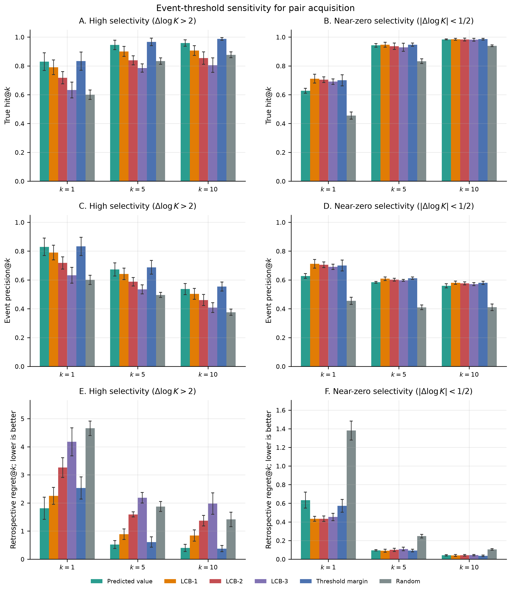

## S11. Analyses not reported as completed results

This section states which requested diagnostics cannot support a scientific claim, and why. The three kinds of gap below are named in prose because a reader should be able to see what was not done without cross-walking a 31-row table; the per-experiment status, canonical artifact and known limitation for each is the matching row of **Table S12.2**, which also covers the completed experiments.

Three kinds of gap exist, and they are not interchangeable.

**Not computed.** The analysis was never run on the corrected grid, so no artifact exists and no claim is made. These are: the CMI competitor grid under ligand-disjoint CV; feature-group ablations; the Gaussian expected-improvement integral as an alternative to the standardized threshold margin; unseen metal-pair extrapolation; pair acquisition on the other Pareto-front models; post-hoc scalar variance calibration; a prospective acquisition campaign; a random-row versus ligand-disjoint DS2 comparison; a combined rare-earth-element and high-selectivity CV scope; repeated ligand-disjoint split assignments; restricted pooled MAPE; source-tag generalization; and a Tanimoto-stratified versus ligand-disjoint split comparison. Composition counts such as the number of rare-earth-element rows that also exceed the high-selectivity threshold exist, but a composition count is not a CV estimand and is not reported as one.

**Not identifiable.** The split design forecloses the analysis. Replicate spread versus predictive uncertainty cannot be estimated under ligand-disjoint folds, because the replicate structure and the fold structure are not independent. The electrolyte-seen and ligand–medium-seen strata are empty under the same split. The metal–medium seen/unseen slice in Table S8.2 is computable but small, and is reported there as a diagnostic rather than as a medium-extrapolation result.

**Excluded.** Exact GPR was computationally infeasible at this data size and carries no performance numbers anywhere in the manuscript; the exclusion stubs are `checkpoints/active/DS1_RDKIT_GPR/` and `DS2_RDKIT_GPR/` `infeasible.json`.

Negative and absent results are retained rather than quietly dropped, because the alternative — reporting only what worked — is what makes a model grid look more decisive than it is.

## S12. Reproducibility and artifact inventory

This section lists canonical artifacts and figure files. Path prose is reduced to this inventory; earlier sections use short source notes. The remaining section is a restricted diagnostic (S13). It does not reopen the primary all-pair evaluation.

Canonical pipeline entrypoint: `src/uq_remake/run_full_pipeline.py`. This manuscript rebuild does not retrain; full retraining is supported via `run_full_pipeline.py` (or `scripts/run_pipeline.py`). Environment: Python 3.11, pinned RDKit 2023.09.6 and Chemprop 1.6.1. Grid: `shared_ds1_ds2_uq_v3`.

**Two steps in the rebuild are ordering-sensitive and are recorded here because getting them wrong changes displayed numbers.** First, the fold-matched ad hoc DS1 retraining (`downstream/run_ad_hoc_foldmatched.py`) must run *after* `downstream/run_downstream_cv.py`, because the latter rewrites `ad_hoc_selectivity_{summary,comparison,fold_metrics}.csv` from the independently folded DS1 checkpoints and the former patches the fold-matched rows back in. It is now an explicit pipeline step for exactly this reason; run out of order, main-text Table 2 and Section S13 revert to the superseded alignment whose DS1 training ligands could intersect the DS2 test fold. Second, `manuscript/generate_figures.py` is frozen and emits the historical figure identifiers, so `manuscript/finalize_main_figures.py` runs after it to map them onto the identifiers the manuscript references; it is called from `run_manuscript_rebuild.py` and its output is checked by `release/validate_release.py`.

**Table provenance.** Every displayed table is regenerated from the artifacts below with two exceptions, both flagged here rather than left implicit. Supplementary Table S8.6, which carries the values plotted in main-text Figure 3, is rebuilt and verified by `manuscript/iz_risk_score_table.py`, which recomputes all 23 rows from the frozen workhorse fold scores, the registered distance–residual summary, and the post-hoc feature-median cache; the rebuild verifies rather than overwrites, and the check runs as part of `run_manuscript_rebuild.py`. The within-condition disagreement counts quoted in main-text Section 3.2 and in Section S1 above (3,048 nominally matching metal-complex groups, 1,234 disagreeing, 368 hard disagreements) come from `manuscripts/final/tables/iz_duplicate_measurement_summary.csv`, which was produced during dataset construction and has no standalone regenerator; it is derivable from `data/processed/ds1.csv` by grouping on ligand, metal, oxidation state, temperature, ionic strength and electrolyte, and is retained as a frozen input.

**How to use the three inventories below.** Table S12.1 maps the multi-artifact results back to the canonical files that produce them, so a reader who wants to check a number in either document can go directly to it rather than searching the results tree; where several files share a role, only the one actually consumed by the figure or table is listed, and companions appear only when their role differs. Table S12.2 lists the artifacts that a rebuild writes. Table S12.3 is the complete figure inventory, mapping every displayed figure — main text and Supporting Information — to its identifier and PNG path.

Two conventions in Table S12.3 are worth stating because they are the kind of thing a reader is likeliest to trip over. First, Supplementary Figures S15–S18 are grouped together in Section S13.4 rather than appearing at their first mention, because all four belong to the restricted rare-earth-element diagnostic and separating them would invite the restricted results being read as part of the primary all-pair analysis. Second, the figure files carry the manuscript's numbering rather than the generator's: `generate_figures.py` is frozen and emits historical identifiers, so two of its outputs — a study-design schematic and a three-score version of the risk-ordering panel — are not displayed in either document and are recorded in `_deprecated/MANIFEST.md`, while the risk-ordering figure that *is* displayed is the four-score version described in Section S7. Table S12.3 lists what is displayed; anything absent from it is not part of the submission.

**Table S12.1. Canonical manuscript artifact roles.** Paths below are the files used for the displayed figures and tables. Companion files are listed only when they have a distinct role.

| role | canonical artifact | used for |
| --- | --- | --- |
| Representative direct-UQ model context | results/manuscript_final/workhorse_selection_accuracy_calibration.json (csv companion) | Figure 1; Table S6.1 |
| Ad hoc versus direct selectivity summary | results/downstream_cv/ad_hoc_selectivity/ad_hoc_selectivity_summary.csv | Supplementary Figure S17; Table S13.3; Section S13 |
| Ad hoc versus direct fold-level metrics | results/downstream_cv/ad_hoc_selectivity/ad_hoc_selectivity_fold_metrics.csv | Table S13.4 |
| All-pair retention | results/downstream_cv/ad_retention/fold_retention.csv | Figure 2; Section 3.4; Supplementary Figure S10 |
| Fold-mean retention curves (plotted) | results/downstream_cv/ad_retention/retention_summary.csv | Figure 2 and Supplementary Figure S10 plotted means |
| Derived retention-curve AUC | results/downstream_cv/ad_retention/retention_auc_summary.csv | Tables S7.1, S8.1, S13.1 |
| Molecular-distance score versus residual | results/downstream_cv/ad_distance_error_corr/ad_distance_error_corr_summary.csv | Table S8.4 |
| 50% retention summary | results/downstream_cv/ad_retention/retention_50pct.csv | Section 3.4; Tables S7.4 and S13.1 |
| Held-out pair-event support (pooled pairs) | results/downstream_cv/pair_event_support/pair_event_support_pooled.csv | Supplementary Figure S12 |
| Held-out pair-event support (summary counts) | results/downstream_cv/pair_event_support/pair_event_support_summary.csv | Section S8 |
| Most frequent held-out pairs | results/downstream_cv/pair_event_support/pair_event_support_frequent.csv | Table S8.5 |
| Uncertainty-only pair acquisition | results/downstream_cv/pair_acquisition/pair_acquisition_summary.csv | Figure 5; Table 3; Tables S10.1–S10.3 |
| Magnitude/error calibration by predicted-magnitude bin | results/downstream_cv/pair_acquisition/pair_acquisition_calibration_bin_summary.csv | Figure 4A; Table S10.4 |
| True hit@k and event precision@k | results/downstream_cv/pair_acquisition/pair_acquisition_hit_and_precision.csv | Table 3; Table S10.2; Figure 5 |
| Retrospective regret@k | results/downstream_cv/pair_acquisition/pair_acquisition_regret.csv | Figure 5; Table 3; Table S10.3 |
| Pair-acquisition metric migration note | results/downstream_cv/pair_acquisition/pair_acquisition_metric_migration.json | legacy hit_rate is event precision; true hit is any_hit |
| Rank correlations of sigma and magnitude with residual | results/downstream_cv/pair_acquisition/pair_acquisition_calibration_rho_summary.csv | Table S10.5 |
| Magnitude-adjusted risk ordering | results/downstream_cv/pair_acquisition/magnitude_adjusted_risk_summary.csv | Section 3.4; Table S10.5; Figure 4B |
| Pair-acquisition event-threshold sensitivity (summary) | results/downstream_cv/pair_acquisition_tau_2_0p5/pair_acquisition_summary.csv | Supplementary Figure S14; Tables S10.6–S10.7 |
| Pair-acquisition event-threshold sensitivity (hit/precision) | results/downstream_cv/pair_acquisition_tau_2_0p5/pair_acquisition_hit_and_precision.csv | Table S10.6 |
| Pair-acquisition event-threshold sensitivity (regret) | results/downstream_cv/pair_acquisition_tau_2_0p5/pair_acquisition_regret.csv | Table S10.6 |
| All-pair retention-analysis validation | results/manuscript_final/ad_retention_validation.json | retention-analysis validation |

**Table S12.2. Experiment completeness.** `computation_status` records whether the artifact exists; `interpretation_status` records scientific interpretability (`canonical` or `supporting` only when a completed or partial result is reported). The underlying artifact also carries a `status` field identical to `computation_status` in every row; it is dropped here rather than printed twice. The retention study is fold-local empirical error-ordering (`ad_retention_study`) on the canonical 10–100% grid, not a coverage guarantee.

| experiment_id | computation_status | interpretation_status | canonical_artifact | aggregation_method | known_limitations |
| --- | --- | --- | --- | --- | --- |
| ad_distance_error_corr | complete | canonical | results/downstream_cv/ad_distance_error_corr/ad_distance_error_corr_summary.csv | fold_mean_plus_sd | descriptive association between molecular-distance scores and row-level absolute residual $\lvert y-\widehat y\rvert$; not a selection metric; not a substitute for fixed-retention error ordering |
| ad_retention_study | complete | canonical | results/downstream_cv/ad_retention/fold_retention.csv | fold_mean_plus_sd | canonical 10–100% fold-local study; plotted means in retention_summary.csv; AUC in retention_auc_summary.csv; 50% table in retention_50pct.csv |
| adhoc_differencing | complete | canonical | results/downstream_cv/ad_hoc_selectivity/ad_hoc_selectivity_summary.csv | fold_mean_plus_sd | aligned DS2-fold comparison; independent-error propagation of two absolute-binding predictive standard deviations; restricted formulation diagnostic; not a pair-acquisition study |
| chemprop_ds2_five_fold_reevaluation | partial | canonical | results/cv_metrics/chemprop_evidential_status_v2.csv | fold_mean_plus_sd | 13 invalid native NIG rows; pair_metric_status complete_5_of_5 |
| cmi_competitor_ligand_disjoint_grid | not_computed | not_computed |  |  | not_computed; only Chemprop point has an official-split retrain |
| ds1_point_model_comparison | complete | canonical | results/cv_metrics/fold_metric_summary.csv | fold_mean_plus_sd |  |
| ds1_uq_model_comparison | complete | canonical | results/cv_metrics/fold_metric_summary.csv | fold_mean_plus_sd |  |
| ds2_application_scopes | complete | canonical | results/cv_metrics/fold_metrics.csv | fold_mean_plus_sd |  |
| ds2_point_uq_grid | complete | canonical | results/cv_metrics/fold_metric_summary.csv | fold_mean_plus_sd | DS2_GRAPH_DMPNN_EVID native UQ partial |
| exact_gpr | excluded | excluded | checkpoints/active/*/infeasible.json |  | computationally_infeasible |
| feature_ablations | not_computed | not_computed |  |  | no canonical ablation artifacts in active_grid |
| gaussian_expected_improvement_integral | not_computed | not_computed |  |  | not_computed; current score is the standardized threshold-margin (yhat-threshold)/sigma |
| mahalanobis_ad | complete | canonical | results/downstream_cv/ad/ad_covariance_diagnostics.csv | fold_mean_plus_sd |  |
| medium_ligand_medium_strata | not_identifiable | not_identifiable | results/downstream_cv/ad/ad_medium_identifiability.csv | fold_mean_plus_sd | electrolyte_seen and ligand_medium_seen empty under ligand-disjoint split; metal-medium seen/unseen is reported in Table S8.2 as a small-slice diagnostic |
| metal_pair_extrapolation | not_computed | not_computed |  |  | no canonical metal/pair holdout artifacts |
| pair_acquisition_on_pareto_neighbors | not_computed | not_computed |  |  | not_computed; workhorse was not selected for the ranking task |
| pair_acquisition_threshold_2_half | complete | supporting | results/downstream_cv/pair_acquisition_tau_2_0p5/pair_acquisition_summary.csv | pair_equal_then_fold_mean_plus_sd | supporting sensitivity; high-selectivity event y>2; near-zero event $\lvert y\rvert<0.5$; does not replace Figure 5 or Table 3 |
| pair_density_ad | complete | canonical | results/downstream_cv/pair_density/pair_density_summary.csv | fold_mean_plus_sd | missing bins recorded as missing_in_fold |
| posthoc_variance_calibration | not_computed | not_computed |  |  | no canonical post-hoc calibration experiment |
| prospective_pair_acquisition_campaign | not_computed | not_computed |  |  | not_computed; current metrics are retrospective held-out ranking |
| random_vs_ligand_disjoint | not_computed | not_computed |  |  | no canonical random-split DS2 comparison on the corrected grid |
| ree_highselectivity_combined_scope | not_computed | not_computed |  |  | composition counts exist; no combined CV estimand |
| repeated_ligand_disjoint_cv | not_computed | not_computed |  |  | no canonical repeated-split retraining on the corrected grid |
| replicate_spread | not_identifiable | not_identifiable | results/downstream_cv/replicate_spread/replicate_spread_summary.csv | fold_mean_plus_sd | not_identifiable_under_ligand_disjoint_split |
| restricted_mape_pooled | not_computed | not_computed |  |  | not computed in canonical fold metrics |
| sigma_pair_acquisition | complete | canonical | results/downstream_cv/pair_acquisition/pair_acquisition_summary.csv | pair_equal_then_fold_mean_plus_sd | n_event>1; sigma-only ranking; event precision@k and true hit@k; distance scores not used as ranking inputs; not prospective experimental validation |
| sign_stability | complete | canonical | results/downstream_cv/sign_stability/sign_stability_summary.csv | fold_mean_plus_sd |  |
| source_tag_holdout | not_computed | not_computed |  |  | no canonical source-holdout artifacts |
| tanimoto_ad | complete | canonical | results/downstream_cv/ad/ad_fold_scores.csv | fold_mean_plus_sd |  |
| tanimoto_stratified_vs_ligand_disjoint | not_computed | not_computed |  |  | not_computed; current Tanimoto–residual association is already near zero |
| workhorse_reproduction | complete | canonical | results/downstream_cv/upstream_validation_report.csv | fold_mean_plus_sd |  |

The per-model status excerpt that previously appeared here duplicated the `status`, `uq_status` and `manuscript_role` columns of **Table S2.1** for the DS2 half of the grid, and added only the invalid-native-NIG row count, which is 13 for Chemprop evidential and 0 for every other model (Section S4). It has been removed rather than maintained in two places. The machine-readable inventory is `manuscripts/final/tables/model_status_final.csv`.

**Table S12.3. Figure inventory.** Every displayed figure is listed, including the graphical abstract. Main-text figures are numbered 0–5 and use filenames `fig00_`–`fig05_`. Supplementary figures are numbered S1–S18 in document order; filenames match those numbers. Figures S15–S18 are grouped in Section S13.4, as stated in the preamble. Figures generated by earlier revisions under the superseded numbering — a study-design schematic (`fig01_study_design`) and the old ids `fig02_workhorse_selection` and `fig03_risk_ordering` — have been removed from the figure directory; the record is `_deprecated/MANIFEST.md`. The ids `fig04_predicted_magnitude` and `fig05_pair_acquisition` are live and carry main-text Figures 4 and 5. The displayed risk-ordering figure is the four-score version described in Section S7.

| figure_id | panel | purpose | png |
| --- | --- | --- | --- |
| fig01_workhorse_selection | main (Figure 1) | All-pair direct-UQ model context and workhorse choice | manuscripts/final/figures/fig01_workhorse_selection.png |
| fig00_graphical_abstract | main (Figure 0) | Graphical abstract; duplicates values plotted in Figures 2 and 5 | manuscripts/final/figures/fig00_graphical_abstract.png |
| fig02_risk_ordering | main (Figure 2) | DS2 workhorse all-pair fixed-retention risk ordering, four scores plus a random baseline, all with fold-SD bands | manuscripts/final/figures/fig02_risk_ordering.png |
| fig03_score_residual_inventory | main (Figure 3) | Score–residual association across all 23 candidate risk scores | manuscripts/final/figures/fig03_score_residual_inventory.png |
| fig04_predicted_magnitude | main (Figure 4) | Predicted magnitude, error, and uncertainty | manuscripts/final/figures/fig04_predicted_magnitude.png |
| fig05_pair_acquisition | main (Figure 5) | Objective-specific pair acquisition: true hit@k, event precision@k and regret@k on two objectives (six panels A–F) | manuscripts/final/figures/fig05_pair_acquisition.png |
| figS1_ds1_complete | si | DS1 complete model RMSE/R2 on metal_complex | manuscripts/final/figures/figS1_ds1_complete.png |
| figS2_ds1_point | si | DS1 metal-complex point RMSE and R2 | manuscripts/final/figures/figS2_ds1_point.png |
| figS3_ds1_uq | si | DS1 UQ models on held-out metal-complex rows for absolute log K | manuscripts/final/figures/figS3_ds1_uq.png |
| figS4_ds2_all_pairs | si | DS2 all-pair pair-level comparison | manuscripts/final/figures/figS4_ds2_all_pairs.png |
| figS5_ds2_highsel_row | si | DS2 high-selectivity row-scope comparison | manuscripts/final/figures/figS5_ds2_highsel_row.png |
| figS6_workhorse_fold_stability | si | All-pair fold stability of the selected workhorse | manuscripts/final/figures/figS6_workhorse_fold_stability.png |
| figS7_chemprop_embedding_retention | si | All-pair representation-space retention sensitivity analysis | manuscripts/final/figures/figS7_chemprop_embedding_retention.png |
| figS8_uncertainty_decomposition | si | Workhorse uncertainty components; standard-deviation components and variance components | manuscripts/final/figures/figS8_uncertainty_decomposition.png |
| figS9_ad_orientation | si | Risk-score orientation audit; higher values indicate greater predicted risk | manuscripts/final/figures/figS9_ad_orientation.png |
| figS10_retention_all_pairs | si | All-pair MoP retention error curves; primary scores emphasized | manuscripts/final/figures/figS10_retention_all_pairs.png |
| figS11_pair_density | si | All-pair pair-support density and workhorse diagnostics | manuscripts/final/figures/figS11_pair_density.png |
| figS12_pair_event_support | si | Held-out pair support versus high-selectivity event support | manuscripts/final/figures/figS12_pair_event_support.png |
| figS13_sign_stability_detail | si | All-pair interval sign stability | manuscripts/final/figures/figS13_sign_stability_detail.png |
| figS14_pair_acquisition_threshold_sensitivity | si | Supporting event-threshold sensitivity for pair acquisition (high >2, near-zero <1/2) | manuscripts/final/figures/figS14_pair_acquisition_threshold_sensitivity.png |
| figS15_ad_hoc_interval_calibration | si | Restricted rare-earth-element pair interval calibration | manuscripts/final/figures/figS15_ad_hoc_interval_calibration.png |
| figS16_retention_ree | si | Restricted rare-earth-element pair MoP retention curves; diagnostic only | manuscripts/final/figures/figS16_retention_ree.png |
| figS17_direct_vs_ad_hoc_selectivity | si | Restricted direct-versus-propagated uncertainty diagnostic | manuscripts/final/figures/figS17_direct_vs_ad_hoc_selectivity.png |
| figS18_ree_fold_stability | si | Restricted rare-earth-element pair fold stability | manuscripts/final/figures/figS18_ree_fold_stability.png |

## S13. Supplementary formulation and pair-frequency diagnostics

The analyses in this section are restricted diagnostics. They appear after the all-pair model, retention, support, sign, acquisition, additional-diagnostic, and artifact-inventory sections. They are not the primary DS2 evaluation and do not reopen that argument. The primary evaluation uses all eligible metal pairs and MoP metrics. These restricted analyses illustrate pair-frequency structure and examine a formulation-specific direct-versus-propagated uncertainty comparison. Figure callouts for this section are collected in S13.4 in numerical order.

A rare-earth-element pair is a pair in which both metal species are rare-earth elements. We use “REE–REE” as shorthand for this restricted subset below.

### S13.1 Restricted rare-earth-element pair definition

The restricted rare-earth-element pair (REE–REE) subset contains 26,779 DS2 rows and 159 species-level pairs. 3,800 of those rows also satisfy $|y|>1$ (composition count only; combined REE∩high-selectivity CV is `not_computed`). These counts describe a chemically restricted family and are not a second general benchmark.

On this restricted subset the selected workhorse gives MoP RMSE $0.704 \pm 0.256$, auxiliary MoP $R^2$ $-1.938 \pm 2.644$, sign accuracy $0.765 \pm 0.019$, MoP PICP@90 $0.895 \pm 0.020$ and MoP ACE $0.124 \pm 0.018$; the row-weighted counterparts are row RMSE $0.696 \pm 0.280$, row $R^2$ $0.373 \pm 0.382$, row-level PICP@90 $0.912 \pm 0.020$ and row-level ACE $0.077 \pm 0.026$. Minimum pair support for MoP is three held-out rows and fold aggregation is mean ± SD. These are single-model values on a restricted scope, reported as a formulation diagnostic; they were not used for workhorse selection and are not a second general benchmark. The complete all-model rare-earth grid, including the pair-equal and row-weighted columns for every model, is `manuscripts/final/tables/ds2_ree_pairs.csv`. Fold-local MoP RMSE and auxiliary MoP $R^2$ for the selected workhorse on this subset are Supplementary Figure S18.

### S13.2 Pair-frequency, support, retention, and sign-stability statistics

The restricted rare-earth-element pair subset is useful for illustrating the uneven frequency and support structure of particular chemical pair families. These examples are descriptive and should not be substituted for the all-pair MoP analysis. Workhorse REE retained-pair counts at full retention are 119 / 120 / 120 / 113 / 122. Restricted MoP retention curves are Supplementary Figure S16.

The subset is markedly easier than the all-pair benchmark, and it is important not to read that as better generalization. Workhorse MoP RMSE on REE–REE pairs is $0.704 \pm 0.256$ against $2.078 \pm 0.130$ all-pair (Tables S13.3 and S4.1) — roughly a third of the error. This is consistent with rare-earth elements in the same oxidation state having closely similar coordination behavior, so that $\Delta\log K$ between two of them is small and a model predicting near zero is already close. We did not run an analysis separating that chemical explanation from the composition and support differences noted below, so it is offered as the plausible reading rather than as a demonstrated cause. The same structure appears in the sign diagnostics, where $0.889 \pm 0.011$ of REE–REE intervals overlap zero (Table S13.2) against $0.742 \pm 0.024$ all-pair, and in the auxiliary MoP $R^2$, which remains negative ($-1.938 \pm 2.644$) despite the low RMSE. Low absolute error on a low-variance target is not the same as explaining that target.

Two further cautions apply to this subset. Its fold-to-fold spread is large relative to its mean (SD $0.256$ on a mean of $0.704$, and Supplementary Figure S18 shows the fold-level detail), because 159 species-level pairs distributed over five folds leave each fold with limited support. And the retention ordering, while qualitatively the same as all-pair — $\sigma_{\mathrm{total}}$ reduces MoP RMSE by 57.2% at 50% retention against 32.2% for the centroid Mahalanobis score and 23.8% for Tanimoto nearest-neighbor distance (computed from the RMSE@50% column of Table S13.1 against the unfiltered $0.704 \pm 0.256$) — is measured on a subset whose composition was fixed by chemical family rather than by the eligibility rules used for the primary analysis. The subset corroborates the all-pair conclusion; it does not independently establish it, and it was not used to select the workhorse.

**Table S13.1. Restricted rare-earth-element pair-level retention diagnostics.**

> **Aggregation note.** Pair-level retention-curve AUC in the REE–REE scope. Restricted diagnostic. Empirical pair-level error-ordering summary; see S7 for interpretation. Not used for workhorse selection and not a second general benchmark. Sources: `results/downstream_cv/ad_retention/retention_auc_summary.csv` (field `retention_curve_auc_mop_rmse`) for the AUC column and `results/downstream_cv/ad_retention/retention_50pct.csv` for the 50% column; manuscript rendering copy: `manuscripts/final/tables/retention_auc_summary.csv`.

| score | MoP RMSE retention-curve AUC | MoP RMSE@50% | n_valid_folds |
| --- | --- | --- | --- |
| RDKit feature-centroid Mahalanobis distance | 0.451 ± 0.067 | 0.477 ± 0.066 | 5 |
| pair-density risk | 0.524 ± 0.259 | 0.555 ± 0.272 | 5 |
| $\sigma_{\mathrm{aleatoric}}$ | 0.305 ± 0.034 | 0.306 ± 0.053 | 5 |
| $\sigma_{\mathrm{epistemic,between}}$ | 0.310 ± 0.024 | 0.305 ± 0.026 | 5 |
| $\sigma_{\mathrm{epistemic,within}}$ | 0.303 ± 0.031 | 0.294 ± 0.026 | 5 |
| $\sigma_{\mathrm{total}}$ | 0.301 ± 0.031 | 0.301 ± 0.047 | 5 |
| Tanimoto $k$NN mean, $k=10$ | 0.576 ± 0.194 | 0.545 ± 0.090 | 5 |
| Tanimoto $k$NN mean, $k=5$ | 0.576 ± 0.200 | 0.536 ± 0.086 | 5 |
| Tanimoto median distance | 0.506 ± 0.126 | 0.522 ± 0.089 | 5 |
| Tanimoto nearest-neighbor distance | 0.552 ± 0.166 | 0.536 ± 0.091 | 5 |

The retained-pair populations behind those three numbers are comparable, so the REE ordering is not an artifact of differing denominators: at 50% retention $\sigma_{\mathrm{total}}$ keeps $106.6 \pm 3.6$ REE pairs, the centroid Mahalanobis score $112.2 \pm 6.1$, and Tanimoto nearest-neighbor distance $109.8 \pm 5.8$, against an unfiltered REE–REE workhorse MoP RMSE of $0.704 \pm 0.256$ (`results/downstream_cv/ad_retention/retention_50pct.csv`).

**Table S13.2. Restricted rare-earth-element pair 90% interval sign categories.**

> **Aggregation note.** Descriptive interval-sign diagnostic for the restricted rare-earth-element pair subset. The entirely-positive category is 3.6% of REE–REE rows. This table is not a primary accuracy result and is not used for workhorse selection. Source = `manuscripts/final/tables/sign_stability_summary.csv`.

| scope | category | metric | fold mean ± SD | n_valid_folds |
| --- | --- | --- | --- | --- |
| ree_pairs | entirely_negative | fraction_rows | 0.075 ± 0.009 | 5 |
| ree_pairs | entirely_negative | mop_rmse | 0.703 ± 0.111 | 5 |
| ree_pairs | entirely_negative | rmse | 1.030 ± 0.326 | 5 |
| ree_pairs | entirely_negative | sign_accuracy | 0.974 ± 0.013 | 5 |
| ree_pairs | entirely_positive | fraction_rows | 0.036 ± 0.002 | 5 |
| ree_pairs | entirely_positive | mop_rmse | 0.721 ± 0.177 | 5 |
| ree_pairs | entirely_positive | rmse | 0.845 ± 0.244 | 5 |
| ree_pairs | entirely_positive | sign_accuracy | 0.974 ± 0.020 | 5 |
| ree_pairs | overlaps_zero | fraction_rows | 0.889 ± 0.011 | 5 |
| ree_pairs | overlaps_zero | mop_rmse | 0.668 ± 0.283 | 5 |
| ree_pairs | overlaps_zero | rmse | 0.641 ± 0.320 | 5 |
| ree_pairs | overlaps_zero | sign_accuracy | 0.739 ± 0.019 | 5 |

### S13.3 Direct versus propagated interval comparison

Experiment `adhoc_differencing` compares direct DS2 selectivity modeling with ad hoc differencing of DS1 absolute-binding predictions. The comparison is a formulation diagnostic aligned on DS2 ligand-disjoint outer folds, held-out ligands, the three-row pair-support rule, and five-fold mean ± SD aggregation. The numerical inventory uses the restricted rare-earth-element pair subset and is not a second general model-selection grid. Older manuscript numbers are not reused.

> **Protocol footnote.** Ad hoc DS1 models in Tables S13.3–S13.4 and Figures S15 and S17, including the four Table 2 comparators, are retrained on DS2 fold-matched DS1 subsets: for each DS2 outer fold, DS1 training and validation exclude every ligand in that fold’s DS2 test partition.

#### S13.3.1 Ad hoc difference construction

For each held-out DS2 pair $(X,Y,L)$, the ad hoc estimate is $\widehat{\Delta\log K}_{\mathrm{ad\,hoc}}=\widehat{\log K}(X,L)-\widehat{\log K}(Y,L)$, using the DS1 checkpoint that held ligand $L$ out. The reverse orientation is $\widehat{\Delta\log K}_{Y>X}=-\widehat{\Delta\log K}_{X>Y}$. Held-out targets are not used in fitting or in forming the difference. DS1 and DS2 fold identifiers are not interchangeable; alignment is by ligand identity.

The ad hoc uncertainty comparison is restricted to DS1 models with complete fold-local predictive uncertainty. Propagated difference uncertainty is $\sigma_{\Delta}=\sqrt{\sigma_X^2+\sigma_Y^2}$ from total predictive standard deviations. This independent-error expression does not include a covariance term. It is a diagnostic uncertainty for the difference of two absolute-binding predictions. It is not assumed to be calibrated uncertainty for a directly modeled selectivity target, and it is not called DS2 uncertainty. No covariance term is invented.

Point-model ad hoc differencing is a contextual baseline only and is not pooled with uncertainty-aware models. Note that this restricted comparison carries three of the four ad hoc comparators in main-text Table 2: the Chemprop point ad hoc row is an all-pair result and has no counterpart in this REE-restricted scope. The operational CSV carries the ad hoc comparators on the same held-out ligands as the direct DS2 grid: twelve uncertainty-aware DS1 models, whose MoP PICP and ACE are those of the propagated $\sqrt{\sigma_X^2+\sigma_Y^2}$ intervals, and two point models (RDKit XGBoost and RDKit MLP) with no PICP or ACE. All are listed in Table S13.3. Those restricted-subset MoP PICP/ACE values live in the operational CSV, not in Table S13.3, which reports only MoP RMSE, MoP $R^2$ and sign accuracy; the row-weighted propagated interval diagnostics are plotted in Supplementary Figure S15. Neither is a workhorse-selection metric.

#### S13.3.2 Summary results

**Table S13.3. Direct versus propagated uncertainty summary.**

> **Aggregation note.** Grouped by method class. Not a workhorse-selection grid. Primary metric = MoP RMSE on the aligned comparison subset. Supporting = MoP $R^2$ and sign accuracy. Propagated interval diagnostics are not tabulated here; they are plotted in Supplementary Figure S15. Source: `results/downstream_cv/ad_hoc_selectivity/ad_hoc_selectivity_comparison.csv`; manuscript rendering copy: `manuscripts/final/tables/ad_hoc_selectivity_comparison.csv`. Ad hoc rows use the same DS2 fold-matched DS1 protocol as Table 2.

| method class | model | MoP RMSE | MoP $R^2$ | sign accuracy |
| --- | --- | --- | --- | --- |
| direct DS2 | Evidential MLP ensemble | 0.603 ± 0.059 | -0.775 ± 1.742 | 0.784 ± 0.018 |
| direct DS2 | Heteroscedastic MLP | 0.635 ± 0.086 | -1.164 ± 2.069 | 0.756 ± 0.022 |
| direct DS2 | MC-dropout MLP | 0.663 ± 0.084 | -0.987 ± 1.360 | 0.724 ± 0.023 |
| direct DS2 | Heteroscedastic MLP ensemble | 0.704 ± 0.256 | -1.938 ± 2.644 | 0.765 ± 0.019 |
| direct DS2 | SNGP ensemble | 0.735 ± 0.079 | -2.186 ± 2.538 | 0.692 ± 0.028 |
| ad hoc DS1 UQ | Chemprop evidential | 0.668 ± 0.056 | -0.908 ± 1.169 | 0.723 ± 0.030 |
| ad hoc DS1 UQ | MC-dropout MLP ensemble | 0.672 ± 0.066 | -1.026 ± 1.124 | 0.704 ± 0.027 |
| ad hoc DS1 UQ | MC-dropout MLP | 0.709 ± 0.080 | -1.322 ± 1.140 | 0.685 ± 0.027 |
| ad hoc DS1 UQ | SNGP ensemble | 0.745 ± 0.076 | -1.975 ± 2.282 | 0.685 ± 0.032 |
| ad hoc DS1 UQ | Evidential MLP | 0.750 ± 0.104 | -1.682 ± 1.947 | 0.698 ± 0.032 |
| ad hoc DS1 UQ | Evidential MLP ensemble | 0.755 ± 0.113 | -1.733 ± 2.167 | 0.712 ± 0.022 |
| ad hoc DS1 UQ | SNGP | 0.771 ± 0.084 | -2.311 ± 2.694 | 0.683 ± 0.037 |
| ad hoc DS1 UQ | Sparse variational GPR | 0.814 ± 0.108 | -2.835 ± 3.485 | 0.658 ± 0.059 |
| ad hoc DS1 UQ | Heteroscedastic MLP ensemble | 0.843 ± 0.123 | -2.355 ± 2.495 | 0.687 ± 0.045 |
| ad hoc DS1 UQ | Full variational BNN ensemble | 0.875 ± 0.106 | -3.077 ± 3.397 | 0.678 ± 0.024 |
| ad hoc DS1 UQ | Heteroscedastic MLP | 0.888 ± 0.131 | -2.879 ± 2.911 | 0.672 ± 0.050 |
| ad hoc DS1 UQ | Full variational BNN | 0.890 ± 0.101 | -2.876 ± 2.764 | 0.665 ± 0.032 |
| ad hoc DS1 point | RDKit XGBoost | 0.613 ± 0.037 | -0.831 ± 1.494 | 0.711 ± 0.028 |
| ad hoc DS1 point | RDKit MLP | 0.685 ± 0.069 | -0.954 ± 0.952 | 0.689 ± 0.037 |

Under this restricted rare-earth-element pair comparison, uncertainty-aware ad hoc models did not consistently outperform the selected direct DS2 workhorse. This result is a formulation diagnostic and is not an all-pair DS2 model comparison. The strongest ad hoc uncertainty-aware model was Chemprop evidential (0.668 ± 0.056); the ad hoc Evidential MLP ensemble was 0.755 ± 0.113. Row-weighted propagated ad hoc 90% intervals were poorly calibrated (PICP@90 near 1; ACE typically $>0.3$). That is an empirical result for this independent-error diagnostic, not a hidden failure. Supplementary Figure S17 summarizes the aligned direct-versus-propagated comparison and Supplementary Figure S15 the corresponding interval calibration.

#### S13.3.3 Fold-level results

**Table S13.4. Fold-level direct/ad hoc results.**

> **Aggregation note.** Each cell is one ligand-disjoint outer fold. Full metric inventory, including sign accuracy, MoP $R^2$, row RMSE, and propagated PICP/ACE, is in `results/downstream_cv/ad_hoc_selectivity/ad_hoc_selectivity_fold_metrics.csv`. Ad hoc rows use the same DS2 fold-matched DS1 protocol as Table 2.

| model | model id | method class | fold0 | fold1 | fold2 | fold3 | fold4 |
| --- | --- | --- | --- | --- | --- | --- | --- |
| Chemprop evidential | DS1_GRAPH_DMPNN_EVID | ad_hoc_ds1_uncertainty | 0.756 | 0.660 | 0.615 | 0.628 | 0.681 |
| Evidential MLP | DS1_RDKIT_MLP_EVID | ad_hoc_ds1_uncertainty | 0.855 | 0.750 | 0.615 | 0.684 | 0.848 |
| Evidential MLP ensemble | DS1_RDKIT_MLPENS5_EVID | ad_hoc_ds1_uncertainty | 0.894 | 0.714 | 0.595 | 0.750 | 0.819 |
| Full variational BNN | DS1_RDKIT_MLP_BAYES_FULL | ad_hoc_ds1_uncertainty | 1.047 | 0.854 | 0.783 | 0.844 | 0.923 |
| Full variational BNN ensemble | DS1_RDKIT_MLPENS5_BAYES_FULL | ad_hoc_ds1_uncertainty | 1.040 | 0.818 | 0.767 | 0.838 | 0.916 |
| Heteroscedastic MLP | DS1_RDKIT_MLP_HETERO | ad_hoc_ds1_uncertainty | 1.015 | 0.755 | 0.738 | 0.959 | 0.972 |
| Heteroscedastic MLP ensemble | DS1_RDKIT_MLPENS5_HETERO | ad_hoc_ds1_uncertainty | 0.973 | 0.756 | 0.678 | 0.881 | 0.925 |
| MC-dropout MLP | DS1_RDKIT_MLP_MCDROPOUT | ad_hoc_ds1_uncertainty | 0.818 | 0.720 | 0.603 | 0.670 | 0.736 |
| MC-dropout MLP ensemble | DS1_RDKIT_MLPENS5_MCDROPOUT | ad_hoc_ds1_uncertainty | 0.729 | 0.673 | 0.583 | 0.635 | 0.740 |
| RDKit MLP | DS1_RDKIT_MLP_POINT | ad_hoc_ds1_point | 0.744 | 0.753 | 0.601 | 0.626 | 0.702 |
| RDKit XGBoost | DS1_RDKIT_XGB_POINT | ad_hoc_ds1_point | 0.613 | 0.571 | 0.598 | 0.611 | 0.671 |
| SNGP | DS1_RDKIT_SNGP | ad_hoc_ds1_uncertainty | 0.893 | 0.710 | 0.676 | 0.780 | 0.794 |
| SNGP ensemble | DS1_RDKIT_SNGPENS5 | ad_hoc_ds1_uncertainty | 0.861 | 0.720 | 0.649 | 0.757 | 0.738 |
| Sparse variational GPR | DS1_RDKIT_GPR_SPARSE | ad_hoc_ds1_uncertainty | 0.954 | 0.718 | 0.692 | 0.853 | 0.854 |

### S13.4 Restricted-figure block

The following figures belong to this restricted diagnostic and are placed here in document order as Supplementary Figures S15–S18. They are not part of the primary all-pair Results sequence.

The four figures answer four separate questions about the restricted subset. Figure S15 compares the *calibration* of direct DS2 intervals against propagated ad hoc intervals — the coverage-versus-nominal view of the same comparison that Section S13.3 tabulates. Figure S17 compares the two constructions on *accuracy and interval width* rather than coverage, and is the figure behind the summary statement in Table S13.3: the propagated intervals are systematically wider without being correspondingly more accurate, which is the concrete form of the overconservatism reported in main-text Section 3.5.4. Figure S16 shows that the retention ordering of Section S7 survives on this subset, and Figure S18 shows the fold-level scatter behind the restricted MoP summary. Figures S15 and S17 are the two halves of one argument and should be read together; neither is a general benchmark, and the restricted scope of all four is stated in Section S13.5.

**Supplementary Figure S15. Direct DS2 intervals versus propagated ad hoc intervals on the restricted REE–REE diagnostic.**

> **Aggregation note.** Direct intervals are native intervals for $\Delta\log K$; ad hoc intervals are propagated diagnostics from two absolute-binding predictions under an independent-error assumption. This restricted diagnostic is descriptive and is not used for workhorse selection or the primary all-pair conclusions. Ad hoc series use the same DS2 fold-matched DS1 protocol as Table 2.

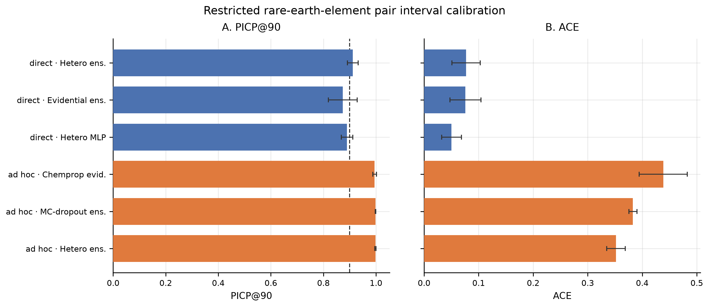

**Supplementary Figure S16. Restricted REE–REE diagnostic MoP retention curves.**

> **Aggregation note.** Fold-local retained-subset MoP RMSE against retention fraction on the restricted REE–REE subset, for the scores of Table S13.1. Restricted diagnostic: not the primary all-pair retention result, not used for workhorse selection, and measured on a subset whose composition was fixed by chemical family rather than by the eligibility rules of the primary analysis. The all-pair equivalent is main-text Figure 2 and Supplementary Figure S10.

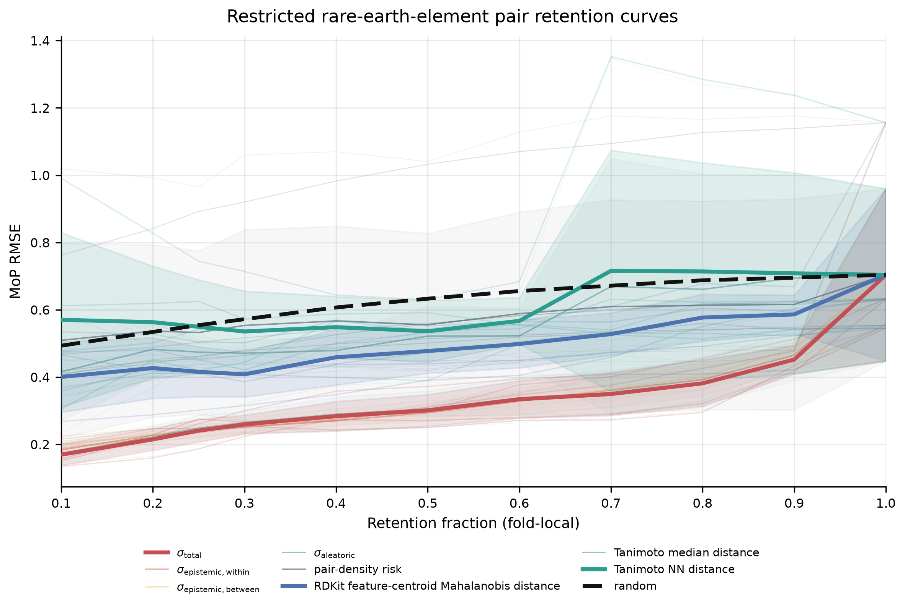

**Supplementary Figure S17. Direct versus propagated intervals on the restricted REE–REE diagnostic.**

> **Aggregation note.** Direct DS2 intervals and propagated ad hoc intervals are compared here as a restricted diagnostic. The analysis is not the primary performance evaluation, does not replace all-pair MoP metrics, and is not used to select the workhorse or establish the all-pair risk-ordering result. Ad hoc series use the same DS2 fold-matched DS1 protocol as Table 2.

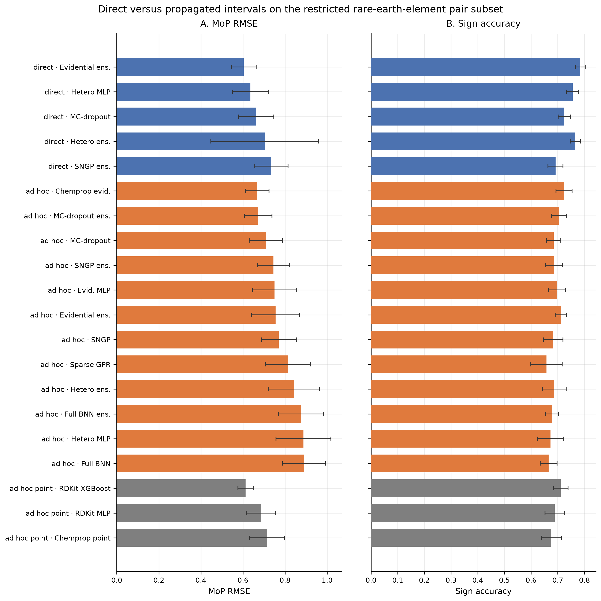

**Supplementary Figure S18. Fold stability on the restricted REE–REE diagnostic.**

> **Aggregation note.** Fold-local MoP RMSE and auxiliary MoP $R^2$ for the selected workhorse. This restricted diagnostic is not used for workhorse selection or for the primary all-pair conclusions.

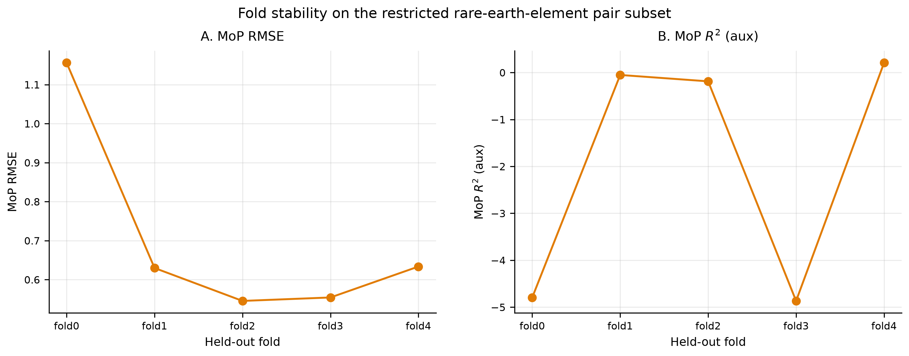

### S13.5 Interpretation and limitations

The restricted rare-earth-element pair diagnostic is consistent with the motivation for attaching uncertainty directly to $\Delta\log K$, but it should be interpreted only as a formulation-specific diagnostic. Direct DS2 training changes the target and its representation; it does not guarantee removal of the underlying measurement variability. The primary conclusions come from the all-pair DS2 MoP and downstream ranking analyses. Chemprop REE–REE PICP or ACE values are not part of the main Results sequence.

Complete all-model REE grids remain in `manuscripts/final/tables/ds2_ree_pairs.csv` and fold-level ad hoc metrics in `results/downstream_cv/ad_hoc_selectivity/ad_hoc_selectivity_fold_metrics.csv`.
