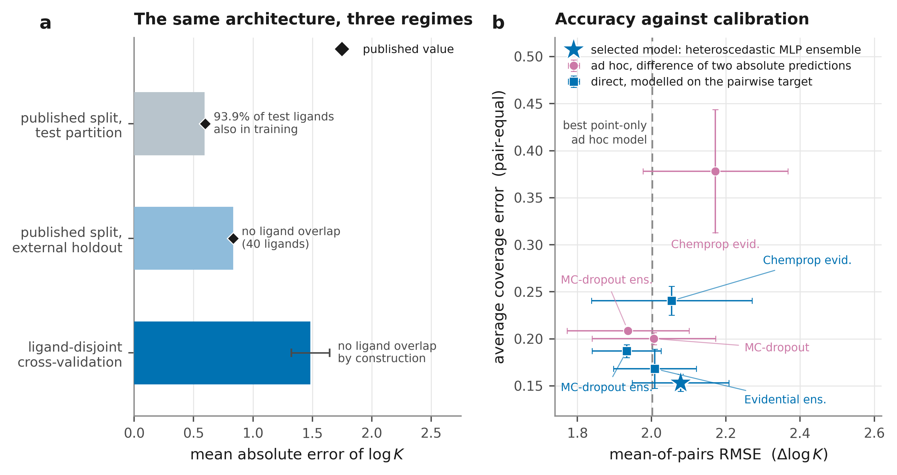
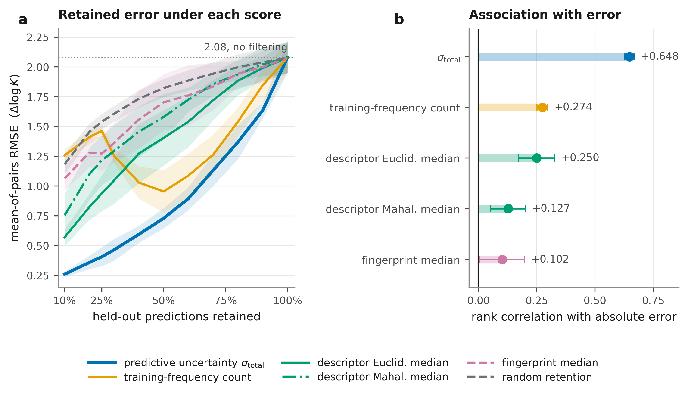
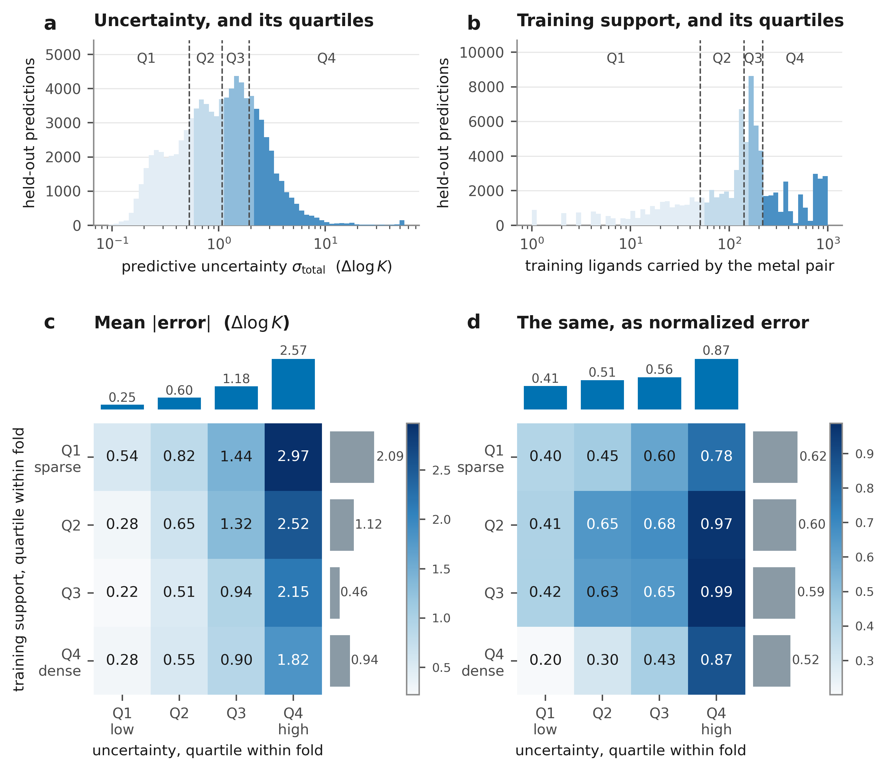
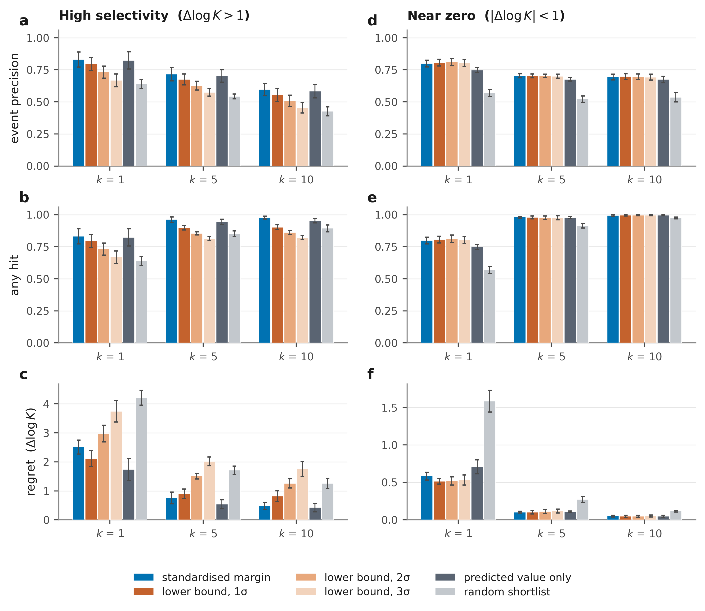

# Applicability domains as testable claims: predictive uncertainty against molecular similarity for metal–ligand selectivity

*[Author list, affiliations and corresponding author to be inserted.]*

## Abstract

In molecular property prediction, what vouches for a prediction is almost always an applicability domain: a region of resemblance to the training set, computed from the molecule alone. The same idea decides how benchmarks are split, so if it is wrong it is wrong twice. Yet resemblance is rarely checked against the error it claims to bound, and it cannot see the measurement context most real targets depend on. We recast the domain as a testable claim: a criterion earns standing only when the predictions it calls safe prove more accurate than an equally sized random selection, on a population it did not itself choose. On metal–ligand selectivity the standard similarity criteria fail that test and the model's own predictive uncertainty passes it, cutting held-out error by two thirds at half retention and raising a one-ligand experiment's yield from 64% to 83%. The test needs only held-out predictions.

---

A deployed model is asked about inputs its developers never saw and could not have enumerated. The question that follows is therefore not how accurate the model is on average, but whether this particular input is one it can be trusted on. Versions of it are asked throughout machine learning, where under distribution shift predictive uncertainty is known to degrade as the input distribution moves away from the training one, and to degrade at different rates for different uncertainty methods.1 For language models it takes the form of asking whether a model can recognise what it does not know, and whether that self-assessment survives a change of domain.2 Each field that deploys a model has had to answer some version of the question, and the answers have largely been developed locally rather than shared.

In the molecular sciences the answer has taken a particular form. Machine learning is now routine across that field, from proteome-scale structure prediction3 and the proposal of hundreds of thousands of stable inorganic materials4 to closed-loop laboratories in which a model chooses the next experiment and a robot performs it,5 and the accompanying statement of trust is almost always an applicability domain: a region of input space defined by resemblance to the training set. Its inventory has been stable for two decades, spanning leverage and the Williams plot, Euclidean and Mahalanobis distance in descriptor space, Tanimoto similarity on fingerprints, and bounding-box checks,6,7 and surveys still present these as the toolkit, stating that a domain "delineates the chemical space where predictions are reliable" without requiring the boundary to be checked against realized error.8 The device is used wherever molecules are modelled, including sequence models screened by identity to the nearest training homologue,9 and it is built into evaluation as much as into deployment, since distance-based selection algorithms assign the extremes of descriptor space to the training set by construction10 and scaffold splits are offered as the realistic benchmark because they separate training from test structurally.11 An assumption of this kind, if wrong, is wrong both in how a model is fenced and in how the field measures its own progress.

Nor is resemblance a single assumption. The measures in that inventory are different functions of the same input, they disagree with one another, none is derived from the error it is meant to bound, and the choice among them is rarely defended beyond convention. The looseness has known consequences: activity cliffs place near-identical molecules at opposite ends of a property range,12 scaffold splits leave unrealistically high train–test similarity,13 and these datasets contain large uncovered regions that similarity measures do not reveal.14 For the tasks practitioners actually face the difficulty is sharper than looseness. A Tanimoto distance is a function of one molecule and the training molecules and can see nothing else, whereas in most practical prediction the target is a property of a molecule together with its context: the performance of a C–N cross-coupling depends on the ligand together with the base and the additive,15 the solubility of a solute depends on which solvent it is measured in,16 and a suitable set of reaction conditions is itself a standard prediction target,17 with the same structure recurring in catalysis, formulation and protein–ligand affinity. A case may therefore be novel in its molecule and familiar in its context, or the reverse, and a criterion computed on the molecule alone sees only one of those axes. That is a limitation of what the criterion is a function of, not of how carefully it is tuned.

A different response to the same problem has developed outside cheminformatics, in which no region of input space is drawn and a statement is instead attached to the prediction that refers to error and can be checked against it. Conformal prediction entered this literature explicitly as "a transparent and flexible alternative to applicability domain determination",18 and has since been generalised from coverage guarantees to the control of arbitrary risks.19 Deep ensembles and heteroscedastic output heads attach a per-prediction uncertainty to the quantity being predicted,20 and in materials informatics a domain of applicability has been redefined as a region in which error is measured to be lower.21 Acting on such estimates is by now ordinary practice, since self-driving laboratories choose the next measurement with an acquisition function built on them22 and interatomic potentials are deployed behind an uncertainty threshold and retrained where it is exceeded.23 None of this has displaced distance-based practice in molecular property prediction, and the two approaches are seldom brought to the same task and compared.

Metal–ligand selectivity offers a test bed with the properties this requires. Complex stability depends on the ligand, on the metal and its oxidation state, and on the medium, and the practical objective is selective rather than absolute binding, which is the central problem of hydrometallurgical recovery, rare-earth refining and nuclear-waste partitioning. Only one of those axes is designed: a chemist chooses the ligand, whereas the metals are set by the feedstock and the medium by the process. A criterion computed on the ligand alone is therefore asked to speak for a problem in which the ligand is one input among several, and holding ligands out of training matches the only act of design the model supports.

We hold both traditions to the same test. A criterion earns standing only when the predictions it calls safe are measurably more accurate than a random selection of the same size, and only when that is shown on a population the criterion did not itself choose; the second condition is not a formality, because a criterion that assigns high risk to whole regions of a problem lowers the retained error by selecting an easier population as much as by ordering candidates. We fix a single uncertainty-bearing model, freeze it before any of the analysis below was designed, and treat twenty-three candidate criteria, drawn from fingerprint, descriptor-space, learned-embedding and model-uncertainty families, as hypotheses about that model's held-out error.

---

## Results

### Validation of the existing model

The measurements available for this problem are aqueous stability constants, curated as a single compilation by the Critical Materials Institute, and a predictive model fitted to them already exists, reporting a mean absolute error of 0.599 in $\log K$ with an $R^2$ of 0.934 on its test partition.24 We recover that figure: the released weights give a fold-mean MAE of 0.592 and an architecture-matched retraining 0.595 (Fig. 1a).

What that number describes is a regime rather than a capability. The published train/test assignment is random over records rather than over ligands, so 1,568 of its 1,670 test ligands also occur in training and 97.5% of test rows carry a ligand the model has already been fitted on with some other metal or under some other condition; it measures interpolation across chemical contexts for familiar ligands. That is not the situation a chemist designs in, where the metals are fixed by the feedstock, the medium by the process and the temperature by the plant, and the only new object is the ligand. A ligand-disjoint split is the one partition of these data that poses the question a prospective user actually asks (Supplementary Section S3.1), and under it, with no test ligand appearing in training for any metal or in any medium, the same architecture reaches $1.484 \pm 0.161$.

The compilation's own external set points the same way at 0.834, and how it was assembled is worth noting, because it is this paper's argument in miniature. Its forty ligands were chosen by a distance criterion, a Mahalanobis centroid distance in a principal-component space of the descriptors, on the premise that geometric remoteness makes a test hard. Scored below against realized error, that criterion reaches a rank correlation of $+0.125 \pm 0.076$, under two fold standard deviations from zero and half the association of the best descriptor distance. A held-out set built from it is remote in a space with no demonstrated relation to the model's error.

Part of the remaining error belongs to the record rather than to the model. Stability constants for one system, reported by different laboratories under nominally identical conditions, routinely disagree, since a determination depends on the speciation model assumed and on how the ionic medium, the temperature and the titration were actually handled; exact reproduction between laboratories is the exception in this chemistry, and some internal inconsistency is therefore in the nature of the data (Supplementary Sections S2.6 and S2.7). It is not, however, the size of the gap above.

**Fig. 1 | Regime and construction.** **a**, Mean absolute error of $\log K$ for the same graph-neural-network architecture under three evaluation regimes; bars are our recomputation, diamonds the published values,24 and the annotation the train–test ligand overlap of each regime. **b**, Mean-of-pairs RMSE against average coverage error, both pair-equal, for selectivity composed from two absolute-binding predictions and for selectivity modelled directly; the dashed rule is the best ad hoc model that predicts a point and no interval, and the star is the model fixed for the rest of the paper. Error bars are fold s.d. ($n = 5$, $\mathrm{ddof} = 1$). All twenty-three interval-bearing models are in Supplementary Fig. S4; both panels are tabulated in Supplementary Sections S3.3 and S4.5.

### The selectivity target and the fixed model

Absolute binding is not the quantity a separation consumes. For one ligand competing for two metals under matched conditions the decision variable is $\Delta\log K = \log K(X,L) - \log K(Y,L)$, the base-ten logarithm of the separation factor, so $\Delta\log K = 1$ is a tenfold preference for one metal over the other. That is what a ligand designer moves, and what the remaining analysis predicts across 88,525 records, 2,503 species-level metal pairs and 2,187 ligands (Methods; Supplementary Fig. S1).

How those records are averaged decides what a score means. Pairing is combinatorial in the metals a ligand has been measured against, so a few well-studied ligands and metal pairs contribute a large share of the rows, and a statistic weighting rows equally is largely a report on them. Every quantity here is therefore computed inside a metal pair and then averaged over pairs with equal weight, which we write as mean-of-pairs, or MoP: MoP RMSE for accuracy, MoP ACE for calibration, ACE being the average coverage error, the mean gap between the nominal and the realised coverage of a prediction interval across nine nominal levels. The distinction is worth the notation, because on the pairwise target the frozen model reaches a row-weighted $R^2$ of $0.725 \pm 0.031$, which reads as a serviceable regression, while the same predictions give a negative $R^2$ once each pair is weighted alike: on a typical pair the model loses to a chemist who guesses that pair's average selectivity, its error standing at $0.974 \pm 0.256$ of the pair's own spread. A row-weighted score on this task measures how well frequent pairs are remembered.

The obvious route to selectivity is to subtract two absolute-binding predictions for the same ligand, and on accuracy that route gives up nothing: composed, direct and even point models with no uncertainty at all land within about one fold s.d. of each other (Fig. 1b). They separate on the interval instead. Uncertainties propagated through a difference are badly calibrated, since the propagation discards a covariance the two endpoint predictions do not lack, and the resulting intervals are wide enough to flag almost nothing as risky; modelling the pairwise target directly attaches the uncertainty to the quantity the decision consumes and is better calibrated in nine of eleven cases (Fig. 1b; Supplementary Section S4.5 and Fig. S4).

The model carried forward is a five-member heteroscedastic multilayer-perceptron ensemble on RDKit descriptors with Monte-Carlo dropout at inference, chosen from eleven candidates by a prespecified rule on MoP RMSE, 90% interval coverage and ACE, and frozen before any of the analysis below was designed (Methods; Supplementary Section S4). Alongside each prediction it reports a predictive standard deviation, $\sigma_{\mathrm{total}}$, and its unfiltered MoP error is $2.078 \pm 0.130$ over 801.6 pairs per fold against a selectivity threshold of one $\Delta\log K$ unit (Supplementary Fig. S2). A model of that accuracy cannot be used to predict every candidate and act on all of them, and no point predictor rescues it, because what is missing is not accuracy but a statement of *where* the accuracy is. That statement is the one an applicability domain claims to supply, which makes uncertainty quantification the property that makes this model usable at all rather than a refinement of it.

### Risk ordering: uncertainty against molecular distance

Each distance family is taken at its best aggregation, the median distance to the training set, which is the most favourable comparison the distances admit and beats the nearest neighbour on which published domains are usually drawn (Supplementary Sections S6.1 and S7.1).

At half retention the ordering is unambiguous (Fig. 2a). Ranking by predictive uncertainty cuts the MoP error by 65%, to $0.730 \pm 0.084$; the best molecular distance manages 32% and the best ligand-only one 18%. One criterion falls on the wrong side of the random baseline, and it is the one in most common use: half the predictions retained by fingerprint nearest-neighbour distance are marginally *less* accurate than half retained at random.

A rank correlation asks the same question one prediction at a time and agrees (Fig. 2b). The objection that the uncertainty is only the predicted magnitude restated does not survive the control: after residualising both on predicted magnitude the association holds at $+0.428 \pm 0.026$, against $+0.648$ raw (Supplementary Section S8.3). Widening the screen to all twenty-three candidates adds no usable criterion, and the ten that are negative form a set rather than an assortment, comprising every learned-embedding distance and every fingerprint nearest-neighbour variant (Supplementary Fig. S6); their fold spreads support not anti-correlation with error but the absence of usable information about it. Even scored against the errors of the very model that produced them, the embedding distances stay above the random baseline (Supplementary Fig. S8). A domain drawn as "reject the predictions furthest from the training set in fingerprint or embedding space" would here discard predictions no more error-prone than the ones it keeps.

What divides the distances that work from those that do not is the space they are measured in, not how they are aggregated. All seven computed in the joint descriptor space, which encodes the metal and the medium alongside the ligand, are positive whatever the aggregation; of the eleven computed on the ligand alone or on a learned representation of it, ten are negative. A plausible reading is that ligands far from the training set in ligand-only space are often simple, well-characterised chelators measured under common conditions, while the hard cases are ordinary ligands in sparsely sampled metal and medium contexts that no ligand-space geometry can see.

One control decides how much of this to believe. A training-frequency count, the number of training ligands the row's metal pair carries, uses no molecular structure and no model output yet beats every molecular distance, and it does so by selecting rather than ordering: constant within a metal pair, it keeps or discards whole pairs, and on the pairs every score keeps it falls to the worst of the seven (Supplementary Section S7.2). Judged on that common population the distances improve substantially, uncertainty barely moves and stays ahead of the best descriptor distance by $0.123$ (95% cluster bootstrap over metal pairs, $0.095$ to $0.152$), and fingerprint nearest-neighbour distance becomes indistinguishable from random.

**Fig. 2 | Risk ordering against held-out error.** Six criteria: predictive uncertainty, a training-frequency count, each distance family at its best aggregation, and a random baseline. **a**, Retained mean-of-pairs RMSE against the fraction of predictions kept. **b**, Fold-mean Spearman correlation with the absolute held-out error, oriented so that a positive value is the sign a usable criterion must have; random retention induces no ordering and is the line at zero. Bands and whiskers are fold s.d. ($n = 5$, $\mathrm{ddof} = 1$). Protocol in Methods; every aggregation of every score in Supplementary Section S7.1 and Fig. S6.

### Chemical content of the uncertainty

A score that works invites the question of what it has learned, and the comparison that matters is with the quantity practitioners reach for instead. Stratified by quartile of uncertainty and of training support, the two axes behave quite differently (Fig. 3a,b): uncertainty is smooth over two orders of magnitude, so its quartiles cut a continuum, whereas support is lumpy, a property of the metal pair rather than of the prediction. Error rises more than tenfold along the uncertainty axis and falls by a factor of two, non-monotonically, along the support axis (Fig. 3c), and uncertainty stays informative at every level of support. Read in normalized error the uncertainty axis keeps its shape while the support axis reverses (Fig. 3d), so the apparent benefit of coverage is partly a statement about which pairs are thinly measured; we report the interaction and claim nothing from it (Supplementary Section S8.1).

Nor is the uncertainty a rarity detector. Holding the metal pair fixed, its partial rank correlation with the favoured metal's binding constant is $+0.682$, positive in 99.91% of the 1,124 eligible cells, and $+0.547 \pm 0.066$ across pairs once training support is controlled (Supplementary Section S8.3). The model is least reliable where the metals bind most strongly and a ligand can therefore produce the widest range of selectivity, which is a statement about bonding rather than about sampling. The confident region is correspondingly coherent: adjacent lanthanides separated only by the slow 4f contraction, whose shielded f orbitals contribute negligible ligand-field discrimination,25 electrostatically bound alkaline-earth pairs, and first-row transition-metal pairs away from the stability maximum,26,27 all cases in which the accessible range of selectivity is compressed and therefore easier to predict (Supplementary Section S8.2). Its axes are the familiar ones of coordination chemistry: after binding strength come the differences in oxidation state, electronegativity and covalent radius between the two metals, in that order, and the same ordering governs the error itself (Supplementary Section S8.3).

That is what separates this criterion from a distance threshold. A threshold is a hard boundary in a space with no relationship to the target, and a molecule outside it is refused; the uncertainty is a graded statement along the axes that govern the chemistry, so it marks a strongly binding, sharply discriminating pair as difficult while still ranking it against its peers. The corollary is that the score is comparative rather than an absolute trigger, since the region the model is least sure of is the region a campaign exists to enter, and a loop that simply buys wherever uncertainty is largest would spend its budget on the hardest chemistry rather than the most informative.

**Fig. 3 | Uncertainty and training support as risk axes.** **a**,**b**, Distributions of the predictive uncertainty and of training support over all held-out predictions, shaded by quartile, with the within-fold quartile boundaries dashed. **c**, Mean absolute held-out error in $\Delta\log K$ over the sixteen cells of the two quartile axes, with each axis's marginal alongside. **d**, The same in normalized error. Values are means over the five folds; marginals are tabulated per axis rather than averaged over cells, which are not equally populated. All sixteen cells in both units are in Supplementary Section S8.1.

### Prospective-style batch selection

The question a separation chemist brings to a model is narrower than the one a retention curve answers: two metals have to be separated, a pool of candidate ligands exists, and there is budget to make and test a handful, so which handful? We put the ranking to that question in the prospective-style form the design allows. Within one held-out metal pair at a time, candidates are ranked on the prediction and its uncertainty alone, before any held-out label is read; the top $k$ are taken as the batch, and only then are the labels used to score what the batch contained. It is a replay and not an experiment, but the ranking never sees the answer. The objective is the one campaigns are run for, a ligand preferring the target metal by more than a factor of ten, and it is common enough that a randomly chosen candidate meets it about six times in ten, so the bar is already high.

The three metrics answer three different questions, and a rule can be excellent on one and mediocre on another. **Event precision** is the fraction of the batch that works, so one minus it is the wasted synthesis: the number a budget is spent against. **Any hit** is whether the batch contains at least one ligand that works, which is what matters when a single lead unlocks the next stage. **Regret** is how far the batch's best ligand falls short of the pool's best, which is what matters when the goal is not a working ligand but the strongest available. Which to read is a property of the campaign rather than of the model.

On wasted synthesis, ranking by how confidently a candidate clears the bar wins at every batch size, raising the success rate of a single-ligand batch from $0.639 \pm 0.035$ to $0.831 \pm 0.059$: roughly one first experiment in three is wasted without the model and one in six with it. How the uncertainty enters the rule matters more than whether it enters, and the two natural ways of using it point in opposite directions (Fig. 4a,d). Subtracting it as a lower confidence bound is the conservative reflex and is here the wrong move, because uncertainty rises with predicted selectivity, making a lower bound a penalty aimed at exactly the candidates a high-selectivity campaign exists to find. Dividing by it asks a dimensionless question instead, how many of its own standard deviations a candidate clears the threshold by, so scale is neither rewarded nor punished.

Inverting the objective inverts the conclusion, which is the sharpest evidence that this mechanism and not some property of the rules is responsible. Asked for ligands that do *not* discriminate, the lower bounds lead and the penalty that hurt most now helps, since a large uncertainty on a prediction near zero is a correct warning that the ligand may in fact be selective. Non-selectivity is rarely a campaign in its own right and we report it as a regime check, but it establishes that no ranking rule is safe to adopt by default: the right rule follows from the direction of the objective, and only the standardised margin is at or near the best on both.

The other two metrics reorder the rules informatively rather than in contradiction (Fig. 4b,e,c,f). Any hit saturates, so a campaign needing one lead per problem is served by almost anything, and the exception is the result worth noting: the two heaviest uncertainty penalties are *worse than random*, because in demoting the high-selectivity tail they discard successes a random draw would sometimes catch. Regret is lowest for ranking on the predicted value alone, which reaches for the largest number rather than the most confidently qualified one; against a pool whose best candidate averages $7.54$ in $\Delta\log K$, a top-ten batch chosen that way or by the standardised margin holds the single best ligand about three times in four, against fewer than half the time at random. Reaching for the maximum and clearing a bar reliably are different objectives and no rule is best at both, which is why three metrics are reported rather than one. Doubling the selectivity threshold leaves every one of these orderings intact (Supplementary Section S9.4).

**Fig. 4 | Batch selection from the prediction and its uncertainty.** Candidates are ranked within one metal pair at a time and the top $k$ taken, for six ranking rules and two objectives. Top row, high selectivity ($\Delta\log K > 1$), the campaign objective; bottom row, near zero ($|\Delta\log K| < 1$), the inverted objective. **a**,**d**, Event precision. **b**,**e**, Any hit. **c**,**f**, Regret; lower is better. Bars are fold means with fold s.d. ($n = 5$, $\mathrm{ddof} = 1$). Rules and metrics are defined in Methods and Supplementary Section S1.8, tabulated in S9, and repeated at stricter event thresholds in S9.4.

---

## Limitations

Three constraints bound what has been shown, and the first is a property of the record rather than of the analysis.

**The data contains only systems that bind.** Stability constants are published for complexes that form, so the compilation holds essentially no measurements of a metal and a ligand that fail to associate; the external set released with the published model24 contains not one lanthanide record at or below $\log K = 1$ (Supplementary Fig. S1b), and the censoring is worst for the actinides. A large predicted selectivity can arise either because the favoured metal binds strongly or because the disfavoured one barely binds at all, and only the first case is represented. On a genuinely novel ligand, where neither metal has been measured with anything similar, the false-positive risk therefore sits precisely where the model looks most attractive, and no criterion tested here, the uncertainty included, detects it, because the missing evidence is missing from the target rather than from the input. Predictions in that regime rank candidates within a chemistry known to complex; they are not evidence that a new ligand will discriminate.

**The record disagrees with itself.** More than a third of the repeated measurement groups disagree, some by more than a full log unit (Supplementary Section S2.6), so part of the residual error is irreducible on this data at any model capacity. Absolute error thresholds derived here should not be read across to a cleaner dataset.

**The replacement is not yet general.** What has been shown is that on one context-rich task an uncertainty-based domain orders error and the standard distances do not. The uncertainty criterion has not been run against distance criteria across the breadth of molecular property prediction, and a class of problems remains where the argument favouring it here does not apply: for a target that is a property of the molecule alone, for a chemically narrow training set that test molecules genuinely leave, or where no calibrated uncertainty exists, a structural distance may well be the better instrument. We are not in a position to say otherwise, because that comparison has not been made. The asymmetry we do claim is narrower: a distance criterion is currently adopted without a test, an uncertainty criterion here passes one, and the same test is available to settle any other case. Within this task the ordering of the score families survives a change of error unit, a relaxation of the cell-eligibility rule from twenty held-out ligands to five, a second architecturally unrelated model scored on its own errors and its own learned embedding, and three further frozen models spanning a range of skill (Supplementary Sections S7.5, S7.6 and S8.5).

---

## Discussion

An applicability domain is a claim about error, and this study asked what happens when it is treated as one. On a context-rich task the answer was not close: every fingerprint nearest-neighbour variant and every learned-embedding distance tested ordered the error in the wrong direction, the most common criterion of all left a retained set no more accurate than a random subset of the same size, and the model's own predictive uncertainty cut the held-out error by two thirds at the same retention. A distance from the training set is not a bound on the error, and a criterion that inverts the ordering discards the predictions worth keeping while reporting that it is being careful.

Two properties of that comparison should become routine wherever a domain is asserted. The first is the direction of the association with error, since a criterion with no predictive power merely wastes data whereas one with inverted power destroys value the model already had, and neither the fraction excluded nor the model's aggregate accuracy distinguishes them. The second is the population the comparison is made on, since a criterion that assigns high risk to whole regions of a problem lowers the retained error by choosing an easier population as much as by ordering candidates. Both controls cost one additional analysis and neither is standard practice.

The consequence that reaches furthest concerns evaluation rather than deployment. Held-out sets in this field are routinely built by structural distance, in scaffold splits, cluster splits and distance-defined external sets such as the one audited here, on the premise that structural remoteness is what makes a test hard. Where that premise fails the split does not measure what it is taken to measure, and a scaffold-split score becomes a statement about structural novelty rather than about predictive difficulty, with the field's record of progress inheriting the error. The alternative costs nothing extra, because a fitted model with a calibrated uncertainty already ranks its own held-out cases by expected difficulty: a hold-out drawn from the high-uncertainty tail is hard in the sense that matters, and it can be audited against realized error in the way a distance-defined split cannot. As a minimum standard, any split offered as a difficulty stratification should report whether its held-out set is in fact less accurately predicted than a random one of the same size, and where a calibrated uncertainty exists it is the better instrument for building that set.

One further consequence is algebraic rather than empirical. An estimate computed on the *context* of a prediction rather than on the object being chosen takes a single value across the candidates in a decision, so it cannot discriminate among them however strong its aggregate association with error may be. That applies to a sequence model screened on the organism a protein came from while variants within that organism are ranked, to a materials model gated on the crystal system while compositions inside it are compared, and to a clinical model gated on the site that produced the sample: the estimate can report that a whole problem is poorly covered but cannot rank one decision inside it. The practice is not hypothetical, since the published model on this compilation attributes elevated error for high-oxidation-state ions to their being "underrepresented (∼4%) in the initial training set" and infers restricted applicability from the scarcity of large ligands, while reporting, without connecting the two, that oversampling those ions from roughly 1.7% to 12% of the training set left "the performance of the model ... essentially unchanged".24

What follows is inexpensive. Any study that fences a model with an applicability domain, splits train from test by descriptor distance, or attributes error to underrepresentation is making a testable claim, and the test needs only held-out predictions: rank them by the criterion, report whether the safe subset is measurably more accurate than a random subset of the same size, and report it again on a population held common to the criteria compared. Where that statement cannot be produced, the criterion is a hypothesis, and it should serve neither as a filter nor as a benchmark.

## Methods

**Data and target.** Aqueous metal–ligand stability constants were curated from the Critical Materials Institute compilation. Records were grouped by ligand, metal element, oxidation state, temperature, ionic strength and background electrolyte, and replicate $\log K$ values within a group were replaced by their median. Pairwise selectivity targets were formed within matched conditions as $\Delta\log K = \log K(X,L) - \log K(Y,L)$, giving 88,525 rows over 2,503 species-level metal pairs and 2,187 distinct ligands. The full curation rules, the condition-matching criteria and the resulting distributions are given in Supplementary Section S2.

**The measurement floor.** Some systems carry more than one reported measurement under identical stated conditions. Pooling those repeats gives a repeatability standard deviation and a distribution-free mean absolute deviation of a single report, which bound any model's achievable error; the estimator, the two brackets and the resulting floors are in Supplementary Section S2.7, with formulas in S1.5.

**Validation protocol.** Ligands were partitioned into five groups by `GroupKFold` on ligand identity and each group held out in turn, so that no test ligand appears in the corresponding training set in any medium or for any metal pair. All reported quantities are fold means ± standard deviation over the five folds ($\mathrm{ddof} = 1$), and no pooled-row statistic is reported as a headline.

**Model and the fixed-model protocol.** Eleven candidate architectures, spanning descriptor- and graph-based representations with heteroscedastic, ensemble, evidential and Monte-Carlo-dropout uncertainty, were trained under the same protocol; the candidate grid and the screen are described in Supplementary Section S4. MoP RMSE, ACE and PICP@90 are defined in Supplementary Section S1, together with the row-equal and pair-equal weightings; which weighting applies is stated wherever a value is given. A model was eligible if it produced native uncertainty for every held-out row, achieved row-equal PICP@90 between 0.85 and 0.95, and a row-equal ACE no greater than 0.10. The workhorse was then chosen by a prespecified three-objective Pareto rule on MoP RMSE, row-equal ACE and $|\mathrm{PICP@90} - 0.90|$. The selected model is a five-member heteroscedastic multilayer-perceptron ensemble on RDKit descriptors with Monte-Carlo dropout at inference, following the deep-ensemble construction.20 Selection concluded before any applicability-domain analysis was designed or run, and no model, hyperparameter or preprocessing choice was revisited afterwards. The predictive uncertainty $\sigma_{\mathrm{total}}$ is the standard deviation of the resulting predictive distribution for a single row, and decomposes into aleatoric and epistemic components (Supplementary Section S4.4).

**Error statistic and its unit.** Errors are reported in $\Delta\log K$, the units the measurement is made in, and aggregated as a mean of pairs (Supplementary Section S1.2). Unfiltered, this gives $2.078 \pm 0.130$ over $801.6$ metal pairs per fold. Metal pairs differ by more than an order of magnitude in the range of selectivity they span, so where that weighting is itself at issue we also report the *normalized error*, the same statistic divided by the standard deviation of the observed target in its own cell (Supplementary Section S1.4). Because the divisor is fixed inside a cell, the normalisation changes no rank statistic and no retained subset; it changes only the weight each pair carries in a cross-pair average. Absolute error is the primary unit throughout and the normalized error is a probe of the aggregation. How far the two diverge, and why, is in Supplementary Fig. S5 and Sections S5.2, S7.5 and S8.1.

**Retention protocol and baselines.** Within each held-out fold, rows are ranked by the score under test safest-first, the lowest-risk fraction is retained over an eleven-point grid, and the mean-of-pairs error is recomputed on the pairs that keep at least three retained rows (Supplementary Section S1.6). Each score is therefore evaluated on the population it selects for itself, which is the protocol in common use. Because a score can lower the retained error by discarding whole pairs rather than by ordering candidates, every comparison is repeated on the pairs that all compared scores retain, the *matched population*, where paired per-fold differences and a cluster bootstrap over metal pairs are available (Supplementary Section S7.2). The random baseline is the mean over 20 independent permutations (seed 0) of the same fold statistic, so it is scored exactly as the other scores are. A score constant within the unit of comparison is recorded as undefined rather than as zero. The decision-level limiting case, in which the fraction is retained inside each cell so the compared populations are identical by construction, is in Supplementary Section S7.4 with the caveats it carries.

**Unit of the within-cell analyses.** Analyses that hold the metal pair fixed are computed within the (metal pair, fold) cell, the held-out ligands measured for one metal pair in one fold, retained where the cell holds $n \geq 20$ ligands, the observed target has non-zero standard deviation, and the score under test takes at least five distinct values. In total 1,124 cells qualify, and the eligible set is common to all non-constant scores (Supplementary Section S5.1).

**Candidate reliability estimates.** The scores comprise fingerprint distances (nearest-neighbour, median, and $k$-nearest-neighbour means at $k = 5$ and $k = 10$ on Morgan fingerprints); descriptor-space Euclidean and Mahalanobis distances to the training centroid, to the nearest neighbour and to $k$-neighbour means; a training-frequency count, defined as the number of distinct training ligands for the row's metal pair; the model's uncertainty and its components; learned-embedding distances taken from a separately trained directed message-passing network; and $-|\hat y|$ as a predicted-magnitude comparator. Every score is oriented so that larger values mean greater predicted risk. The 23 candidates are defined in Supplementary Section S1.10 and screened in S6.1.

**Pair acquisition.** The shortlisting exercise is run on pair tasks: a (metal pair, fold) unit in which the held-out ligands are the candidates and more than one candidate meets the objective. Two objectives are scored separately, because they are not interchangeable: high selectivity, target-direction $\Delta\log K > 1$, giving $945 \pm 67$ pair tasks per fold, and near zero, $|\Delta\log K| < 1$, giving $463 \pm 56$. Ranking rules use only the prediction $\hat y$ and its uncertainty $\sigma_{\mathrm{total}}$: the predicted value alone; lower confidence bounds $\hat y - z\sigma$ at $z \in \{1, 2, 3\}$; and a standardised margin $(\hat y - t)/\sigma$, the predicted distance past the objective threshold $t$ divided by the uncertainty. Event precision, any hit and regret are reported at $k = 1$, $5$ and $10$, each computed with every pair task weighted equally and then averaged over folds; the three are defined in Supplementary Section S1.8, which also records the two legacy column names in the deposited tables. Ranking happens before any held-out label is read, which is the sense in which the exercise is prospective-style; it remains a replay of fixed data and not an experiment. Event thresholds are conventions, and the whole benchmark is repeated at $\Delta\log K > 2$ and $|\Delta\log K| < 1/2$ in Supplementary Section S9.4. The full inventory is in Supplementary Section S9.

**Statistics.** Rank associations, partial rank correlations, rank regressions and the cluster bootstraps are specified in Supplementary Section S1.7, and the regression specifications with their variance-inflation factors in Supplementary Section S8.3. Alongside every interval we report the fraction of pairs, or of cells, in which the first score of a contrast attains the lower error, so that a difference of means is never the only evidence. The uncertainty $\sigma_{\mathrm{total}}$ tracks binding strength somewhat more strongly than the realized error does; the dependence is monotone and the ordering of chemical terms is identical for both responses, so rank-based use is unaffected, and the magnitudes are tabulated in Supplementary Section S8.4.

**Reproducibility.** Every reported value is regenerated by validation scripts that recompute it from the frozen fold-level predictions along a code path independent of the one that produced it, and assert agreement to three decimals: the eligibility rules, the unfiltered baselines, every (score, retention) value in both protocols and both units, the retention-curve areas, the pair counts each score retains, the undefined-by-construction count, the matched-population contrasts, the acquisition metrics and every number quoted in this text and in the Supplementary Information. Three modules assert 264 checks in total, and all pass (Supplementary Section S10.1). The main-text and supplementary figures are regenerated from the deposited tables by two scripts that load no model.

**Data availability.** The curated datasets, frozen fold-level predictions and all derived tables are deposited at [repository DOI].

**Code availability.** Analysis code, the model-selection pipeline and the validation scripts are available at [repository URL].

---

## References

1. Ovadia, Y., Fertig, E., Ren, J., Nado, Z., Sculley, D., Nowozin, S., Dillon, J. V., Lakshminarayanan, B. & Snoek, J. Can you trust your model's uncertainty? Evaluating predictive uncertainty under dataset shift. *Adv. Neural Inf. Process. Syst.* **32** (2019). arXiv:1906.02530.

2. Kadavath, S. et al. Language models (mostly) know what they know. Preprint at arXiv:2207.05221 (2022).

3. Jumper, J. et al. Highly accurate protein structure prediction with AlphaFold. *Nature* **596**, 583–589 (2021). DOI 10.1038/s41586-021-03819-2.

4. Merchant, A., Batzner, S., Schoenholz, S. S., Aykol, M., Cheon, G. & Cubuk, E. D. Scaling deep learning for materials discovery. *Nature* **624**, 80–85 (2023). DOI 10.1038/s41586-023-06735-9.

5. Boiko, D. A., MacKnight, R., Kline, B. & Gomes, G. Autonomous chemical research with large language models. *Nature* **624**, 570–578 (2023). DOI 10.1038/s41586-023-06792-0.

6. Sahigara, F. et al. Comparison of different approaches to define the applicability domain of QSAR models. *Molecules* **17**, 4791–4810 (2012). DOI 10.3390/molecules17054791.

7. Netzeva, T. I., Worth, A. P., Aldenberg, T., Benigni, R., Cronin, M. T. D., Gramatica, P., Jaworska, J. S., Kahn, S., Klopman, G., Marchant, C. A., Myatt, G., Nikolova-Jeliazkova, N., Patlewicz, G. Y., Perkins, R., Roberts, D. W., Schultz, T. W., Stanton, D. T., van de Sandt, J. J. M., Tong, W., Veith, G. & Yang, C. Current status of methods for defining the applicability domain of (quantitative) structure–activity relationships. *Altern. Lab. Anim.* **33**, 155–173 (2005). DOI 10.1177/026119290503300209.

8. Koirala, M., Yan, L., Mohamed, Z. & DiPaola, M. AI-integrated QSAR modeling for enhanced drug discovery: from classical approaches to deep learning and structural insight. *Int. J. Mol. Sci.* **26**, 9384 (2025). DOI 10.3390/ijms26199384.

9. Ferrer Florensa, A., Almagro Armenteros, J. J., Nielsen, H., Aarestrup, F. M. & Clausen, P. T. L. C. SpanSeq: similarity-based sequence data splitting method for improved development and assessment of deep learning projects. *NAR Genom. Bioinform.* **6**, lqae106 (2024). DOI 10.1093/nargab/lqae106.

10. Kennard, R. W. & Stone, L. A. Computer aided design of experiments. *Technometrics* **11**, 137–148 (1969). DOI 10.1080/00401706.1969.10490666.

11. Wu, Z. et al. MoleculeNet: a benchmark for molecular machine learning. *Chem. Sci.* **9**, 513–530 (2018). DOI 10.1039/C7SC02664A.

12. Maggiora, G. M. On outliers and activity cliffs — why QSAR often disappoints. *J. Chem. Inf. Model.* **46**, 1535 (2006). DOI 10.1021/ci060117s.

13. Guo, J., Hernandez-Hernandez, S. & Ballester, P. J. Scaffold splits overestimate virtual screening performance. In *Artificial Neural Networks and Machine Learning — ICANN 2024*, Lecture Notes in Computer Science (Springer, 2024). DOI 10.1007/978-3-031-72359-9_5.

14. Kretschmer, F., Seipp, J., Ludwig, M., Klau, G. W. & Böcker, S. Coverage bias in small molecule machine learning. *Nat. Commun.* **16**, 554 (2025). DOI 10.1038/s41467-024-55462-w.

15. Ahneman, D. T., Estrada, J. G., Lin, S., Dreher, S. D. & Doyle, A. G. Predicting reaction performance in C–N cross-coupling using machine learning. *Science* **360**, 186–190 (2018). DOI 10.1126/science.aar5169.

16. Boobier, S., Hose, D. R. J., Blacker, A. J. & Nguyen, B. N. Machine learning with physicochemical relationships: solubility prediction in organic solvents and water. *Nat. Commun.* **11**, 5753 (2020). DOI 10.1038/s41467-020-19594-z.

17. Gao, H., Struble, T. J., Coley, C. W., Wang, Y., Green, W. H. & Jensen, K. F. Using machine learning to predict suitable conditions for organic reactions. *ACS Cent. Sci.* **4**, 1465–1476 (2018). DOI 10.1021/acscentsci.8b00357.

18. Norinder, U., Carlsson, L., Boyer, S. & Eklund, M. Introducing conformal prediction in predictive modeling. A transparent and flexible alternative to applicability domain determination. *J. Chem. Inf. Model.* **54**, 1596–1603 (2014). DOI 10.1021/ci5001168.

19. Angelopoulos, A. N., Bates, S., Fisch, A., Lei, L. & Schuster, T. Conformal risk control. In *International Conference on Learning Representations* (2024). arXiv:2208.02814.

20. Lakshminarayanan, B., Pritzel, A. & Blundell, C. Simple and scalable predictive uncertainty estimation using deep ensembles. *Adv. Neural Inf. Process. Syst.* **30**, 6402–6413 (2017). arXiv:1612.01474.

21. Sutton, C. et al. Identifying domains of applicability of machine learning models for materials science. *Nat. Commun.* **11**, 4428 (2020). DOI 10.1038/s41467-020-17112-9.

22. Abolhasani, M. & Kumacheva, E. The rise of self-driving labs in chemical and materials sciences. *Nat. Synth.* **2**, 483–492 (2023). DOI 10.1038/s44160-022-00231-0.

23. Zaverkin, V. et al. Uncertainty-biased molecular dynamics for learning uniformly accurate interatomic potentials. *npj Comput. Mater.* **10**, 83 (2024). DOI 10.1038/s41524-024-01254-1.

24. Karunaratne, E., Zahariev, F. & Pérez García, M. A comprehensive machine learning model for metal–ligand binding prediction: applications in chemistry and biology. *J. Chem. Inf. Model.* **65**, 11532–11542 (2025). DOI 10.1021/acs.jcim.5c01546.

25. Cheisson, T. & Schelter, E. J. Rare earth elements: Mendeleev's bane, modern marvels. *Science* **363**, 489–493 (2019). DOI 10.1126/science.aau7628.

26. Irving, H. & Williams, R. J. P. Order of stability of metal complexes. *Nature* **162**, 746–747 (1948). DOI 10.1038/162746a0.

27. Irving, H. & Williams, R. J. P. The stability of transition-metal complexes. *J. Chem. Soc.* 3192–3210 (1953). DOI 10.1039/JR9530003192.
