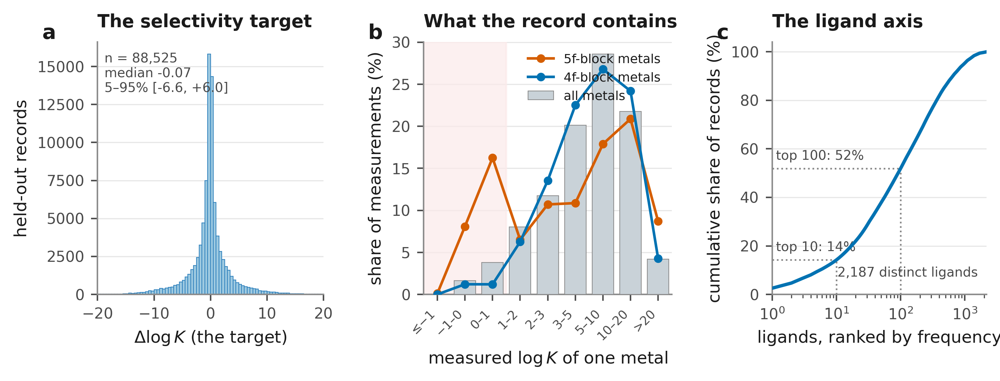
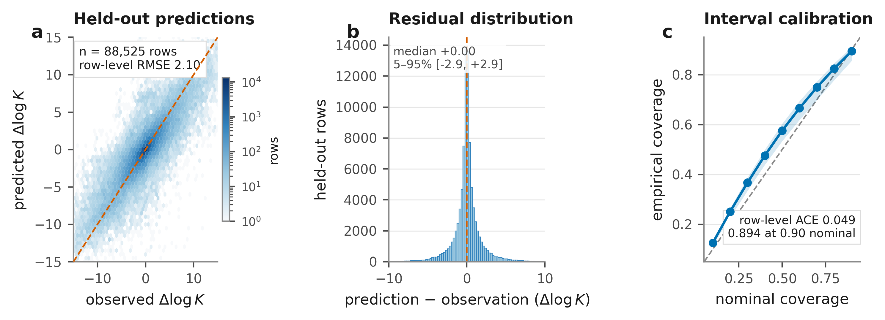
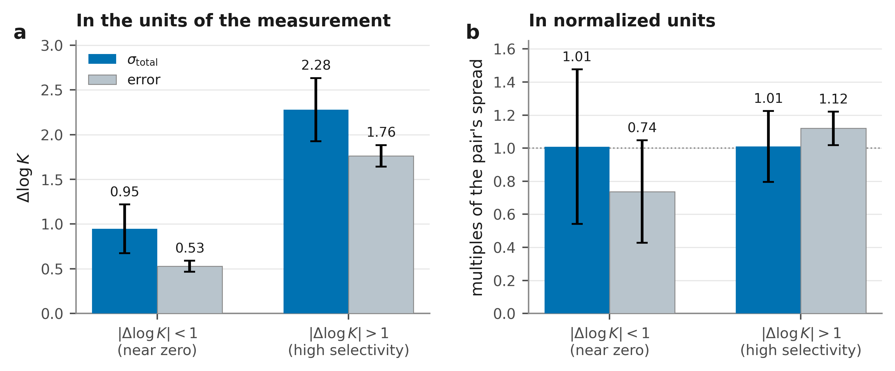
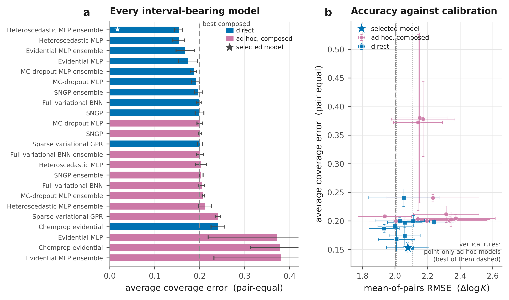
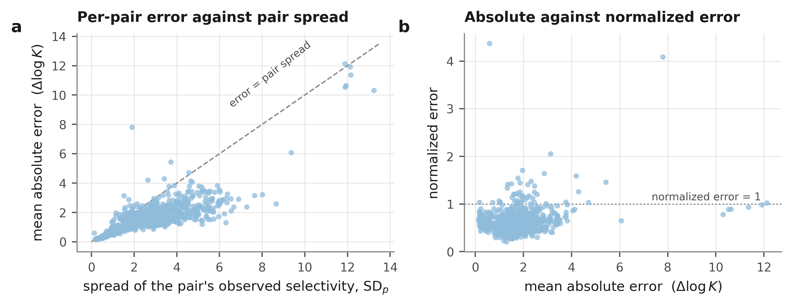
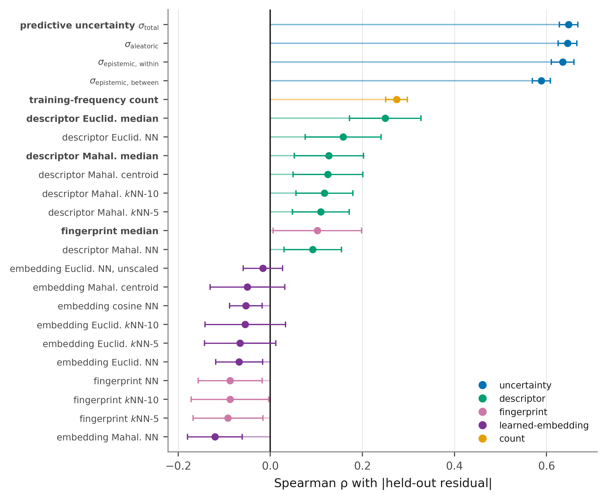
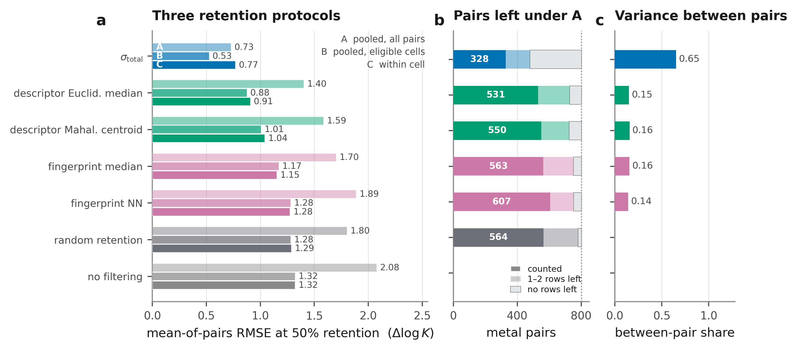
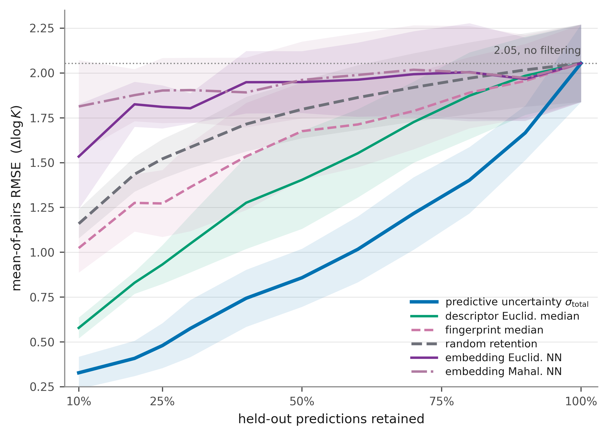
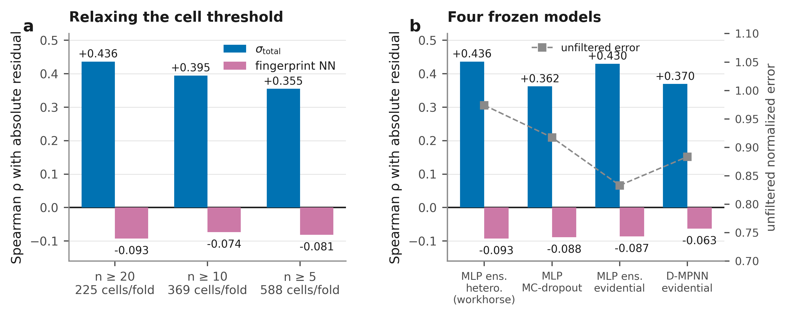
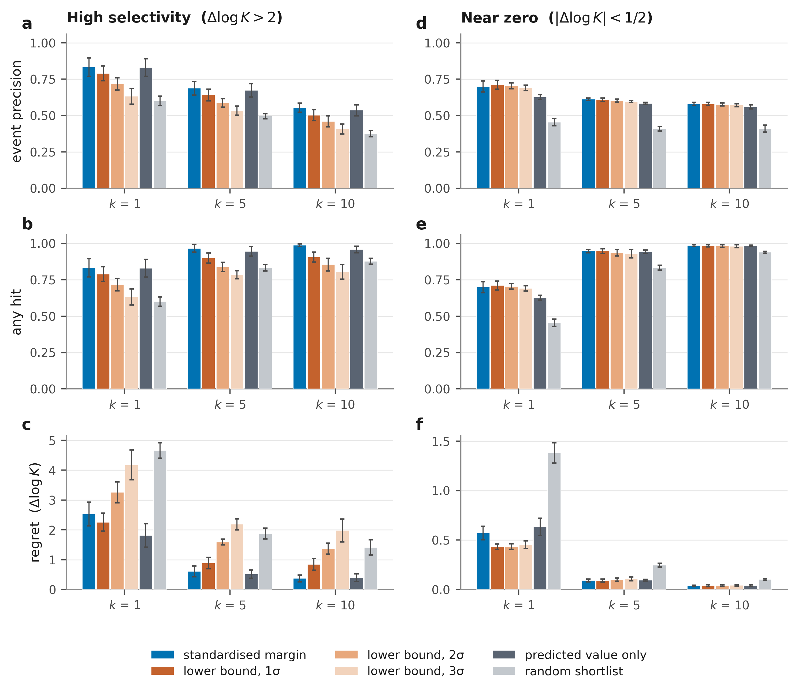

# Supplementary Information

**Applicability domains as testable claims: predictive uncertainty against molecular similarity for metal–ligand selectivity**

Section numbering is referenced from the main text as "Supplementary Section S*n*". **S1 collects every definition, protocol and formula the rest of the document uses**, so that no later section has to restate one; sections S2 to S9 then follow the analysis in the order it was carried out, and S10 records how each number is regenerated and where it is deposited.

---

## S1. Methods: definitions, protocols and formulas

Every quantity the main text and the sections below use, written out once. The main-text Methods give the condensed version and point here for the formulas; nothing in this section is new analysis.

### S1.1 Notation

A held-out fold $f$ contains rows $i$, each belonging to one metal pair $p$. Write $y_i$ for the observed target, $\hat y_i$ for the prediction and $\sigma_i$ for the predictive standard deviation. $n_p$ is the number of held-out rows for pair $p$ in that fold, and $P_f$ the set of pairs with at least the required support. Unless stated otherwise every statistic is computed inside a fold, then averaged over the five folds, and reported as fold mean ± fold s.d. with $\mathrm{ddof} = 1$.

### S1.2 Accuracy: mean-of-pairs

Per-pair error and its pair-equal mean,

$$\mathrm{RMSE}_p=\sqrt{\frac{1}{n_p}\sum_{i\in p}\left(y_i-\hat y_i\right)^2},
\qquad
\mathrm{MoP\ RMSE}=\frac{1}{|P_f|}\sum_{p\in P_f}\mathrm{RMSE}_p .$$

$P_f$ requires $n_p \ge 3$. The support rule counts rows, not distinct ligands: the uniqueness key is (ligand, medium, species pair), so one ligand contributes several rows to a pair through different temperature, ionic-strength or electrolyte conditions. Row-weighted RMSE and $R^2$ are computed over all held-out rows of the fold; MoP $R^2$ is the pair-equal mean of within-pair $R^2$ and is reported only to make the contrast of S4.3 explicit, since a within-pair $R^2$ is unbounded below and its mean is heavy-tailed.

### S1.3 Calibration: coverage, PICP and ACE

For a nominal level $q$ the model's two-sided Gaussian interval is $\hat y_i \pm z_{(1+q)/2}\,\sigma_i$. Empirical coverage is the fraction of observations it contains,

$$\widehat C(q)=\frac{1}{n}\sum_{i}\mathbf{1}\!\left[\,|y_i-\hat y_i| \le z_{(1+q)/2}\,\sigma_i\,\right],
\qquad
\mathrm{PICP@90}=\widehat C(0.90),$$

and the average coverage error is the mean absolute miss over the nine-level grid,

$$\mathrm{ACE}=\frac{1}{9}\sum_{q\in\{0.1,\ldots,0.9\}}\left|\,\widehat C(q)-q\,\right| .$$

Both come in two weightings, and which one applies is stated wherever a value is given. **Row-equal** evaluates the sums above over all held-out rows, so heavily measured pairs contribute more observations; this is the weighting the eligibility screen of S4.2 was applied at. **Pair-equal**, written MoP PICP@90 and MoP ACE, computes $\widehat C(q)$ inside each pair and takes the unweighted mean over the same supported-pair set used for MoP RMSE; this is the weighting reported for every model comparison.

### S1.4 Normalized error

Within a (metal pair, fold) cell,

$$\mathrm{NE}_p=\frac{\mathrm{RMSE}_p}{\mathrm{SD}_p(y)},
\qquad
\mathrm{SD}_p(y)=\sqrt{\frac{1}{n_p-1}\sum_{i\in p}\left(y_i-\bar y_p\right)^2},$$

averaged over eligible cells with equal weight and then over folds. $\mathrm{NE}_p = 1$ is the accuracy of predicting that pair's mean selectivity. Because the divisor is constant inside a cell, the normalisation changes no rank statistic and no retained subset; it changes only the weight each pair carries in a cross-pair average. Cell eligibility requires $n_p \ge 20$ held-out ligands, $\mathrm{SD}_p(y) > 0$, and at least five distinct values of the score under test; 1,124 cells qualify (S5.1).

### S1.5 The measurement floor

For condition group $i$ holding $n_i \ge 2$ reported values $x_{ij}$,

$$\hat\sigma^2=\frac{\sum_i\sum_j\left(x_{ij}-\bar x_i\right)^2}{\sum_i\left(n_i-1\right)},
\qquad
\widehat{\mathbb{E}}|\varepsilon|=\operatorname{mean}_{ij}\left|\left(x_{ij}-\bar x_i\right)\sqrt{\tfrac{n_i}{n_i-1}}\right| ,$$

the second being distribution-free rather than a Gaussian conversion of the first. The implied ceiling on $R^2$ is $1-\hat\sigma^2/\mathrm{Var}(y)$ on the partition in question. For the pairwise target the floor is $\hat\sigma\sqrt{2\,\mathbb{E}[1/n]}$, the expectation taken over the empirical distribution of condition-cell sizes. Values and the two brackets are in S2.7.

### S1.6 Retention

Within a fold, rows are sorted ascending by the score under test, safest first, ties broken by record identifier. At fraction $r$ the retained set is the first $\lfloor rn \rfloor$ rows and MoP RMSE is recomputed on it over the pairs that keep at least three retained rows. The grid is $r \in \{0.10, 0.20, 0.25, 0.30, 0.40, 0.50, 0.60, 0.70, 0.80, 0.90, 1.00\}$ and curve areas are plain trapezoidal integrals over it. The random baseline is the mean of 20 independent permutations (seed 0) of the same fold statistic, so it is scored exactly as the other scores are. In the **free-population** protocol each score is scored on the pairs it retains for itself; in the **matched-population** control every score is scored on $\bigcap_s P_f^{(s)}(r)$, the pairs retained by all compared scores, where paired per-fold differences and a cluster bootstrap over metal pairs are available (S7.2).

### S1.7 Rank statistics

Score–error associations are Spearman correlations computed inside the unit of analysis and averaged over folds. A partial rank correlation residualises both ranked variables on the ranked control by ordinary least squares before correlating,

$$\rho_{a b \cdot c}=\operatorname{corr}\!\left(R_a-\hat R_a(R_c),\; R_b-\hat R_b(R_c)\right),$$

with $R$ the within-fold rank. Multiple rank regressions are fitted per fold on standardised ranks and variance-inflation factors are reported (S8.3). Cluster bootstraps resample metal pairs with replacement, 2,000 resamples for pooled contrasts and 1,000 for cell-level ones; alongside every interval we report the fraction of pairs or cells in which the first score of a contrast attains the lower error.

### S1.8 Acquisition rules and metrics

A pair task is a (metal pair, fold) unit whose held-out ligands are the candidates and in which more than one candidate meets the objective. Let $\hat y^\star$ be the prediction oriented so that larger is more favourable for the stated objective and $\tau$ the event threshold. The six ranking rules are

$$\hat y^\star,
\qquad
\hat y^\star - z\,\sigma_{\mathrm{total}}\ \ (z=1,2,3),
\qquad
\frac{\hat y^\star-\tau}{\sigma_{\mathrm{total}}},
\qquad
\text{random},$$

the fifth being the standardised threshold margin. For the near-zero objective the oriented prediction is $-|\hat y|$, the penalties are $-(|\hat y| + z\sigma_{\mathrm{total}})$ and the margin is $(\tau - |\hat y|)/\sigma_{\mathrm{total}}$. With $S_k$ the top-$k$ shortlist of a task, $E$ the set of candidates meeting the objective and $\mathcal{P}$ the whole candidate pool,

$$\text{event precision@}k=\frac{|S_k\cap E|}{k},
\qquad
\text{any hit@}k=\mathbf{1}\!\left[\,S_k\cap E\neq\emptyset\,\right],
\qquad
\text{regret@}k=\max_{i\in\mathcal{P}} y^\star_i-\max_{i\in S_k} y^\star_i .$$

Each is averaged over pair tasks with equal weight inside a fold, then over folds. A task contributes at a given $k$ only if it holds at least $k$ held-out rows. Regret is retrospective: it uses the observed pool optimum and no deployed rule can compute it. Ranking uses only $\hat y$ and $\sigma_{\mathrm{total}}$ and happens before any held-out label is read, which is the sense in which the exercise is prospective-style; it remains a replay of fixed data and not an experiment.

**Two legacy column names.** The standardised margin is stored under `expected_improvement`; the implementation computes $(\hat y^\star-\tau)/\sigma$ and never a Gaussian expected-improvement integral. Event precision is stored under `hit_rate_at_k`, and any hit under `any_hit_at_k`.

### S1.9 Predictive uncertainty

For ensemble member $m$ with $T = 30$ Monte-Carlo dropout passes, let $\mu_{m,t}(x)$ be the predicted mean on pass $t$ and $s_{m,t}(x)$ the corresponding clamped log observation variance. Writing $\mu_m = T^{-1}\sum_t \mu_{m,t}$, $v_m = T^{-1}\sum_t \exp(s_{m,t})$ and $\bar\mu = M^{-1}\sum_m \mu_m$ over the $M = 5$ members, the law of total variance gives

$$\sigma_{\mathrm{aleatoric}}^{2}=\frac{1}{M}\sum_{m}v_m,
\qquad
\sigma_{\mathrm{epi,within}}^{2}=\frac{1}{MT}\sum_{m}\sum_{t}\left(\mu_{m,t}-\mu_m\right)^{2},
\qquad
\sigma_{\mathrm{epi,between}}^{2}=\frac{1}{M}\sum_{m}\left(\mu_m-\bar\mu\right)^{2},$$

$$\sigma_{\mathrm{total}}^{2}=\sigma_{\mathrm{aleatoric}}^{2}+\sigma_{\mathrm{epi,within}}^{2}+\sigma_{\mathrm{epi,between}}^{2}.$$

The reported $\sigma_{\mathrm{total}}$ is the square root. It is a composite predictive-risk score. The aleatoric term is a learned, input-dependent output of the heteroscedastic head and is not a measured laboratory-noise variance; it should not be equated with the within-condition disagreement of S2.6, and the caveats on reading it are in S4.4.

### S1.10 The candidate reliability estimates

Twenty-three candidate criteria are screened. All distances are computed from each held-out ligand to the training ligands of its own fold, and every score is oriented so that a larger value means greater predicted risk.

| score | definition |
|---|---|
| $\sigma_{\mathrm{total}}$, $\sigma_{\mathrm{aleatoric}}$, $\sigma_{\mathrm{epi,within}}$, $\sigma_{\mathrm{epi,between}}$ | model uncertainty and its components (S4.4) |
| fingerprint NN / median / $k$NN-mean ($k$ = 5, 10) | Tanimoto distance on Morgan fingerprints to the nearest, median, or mean of $k$ nearest training ligands |
| descriptor Euclidean NN / median | Euclidean distance in standardised RDKit descriptor space |
| descriptor Mahalanobis centroid / median / NN / $k$NN-mean | Mahalanobis distance under the training covariance |
| learned-embedding Euclidean / std-Euclidean / cosine / Mahalanobis | distances in the penultimate-layer representation of a separately trained directed message-passing network |
| training-frequency count | number of distinct training ligands carried by the metal pair |
| $-|\hat y|$ | predicted-magnitude comparator, oriented as risk |

The learned-embedding distances are the only ones that cannot be computed for the workhorse: they are read from the penultimate layer of a separately trained network, so they enter the row-level screen of S6.1 for every model and the retention curves of S7.6 only for the model that produced them.

---

## S2. Data and target construction

### S2.1 Source compilation and curation

Aqueous metal–ligand stability constants were curated from the Critical Materials Institute compilation. Ligand structures are represented as SMILES; metals are represented as element–oxidation-state species. Records were grouped by ligand identity, metal element, oxidation state, temperature, ionic strength and background electrolyte, and replicate $\log K$ values within a group replaced by their median. Electrolyte identity was decoded and retained as a categorical field rather than as the surrogate numerical descriptors used in some prior treatments of this compilation.

### S2.2 Condition matching and the pairwise reduction

Selectivity targets were formed only between measurements sharing ligand, temperature, ionic strength and background electrolyte, as

$$\Delta\log K = \log K(X,L) - \log K(Y,L),$$

for the ordered species pair $(X, Y)$. Pairs are species-level (element plus oxidation state), not element-level: 2,503 species-level pairs correspond to 1,848 unordered element pairs, and the two counts must not be interchanged. The reduction yields **88,525 rows** over **2,503 species pairs** and **2,187 distinct ligands**, drawing on **177,050** individual $\log K$ measurements (each row is a difference of two of them).

### S2.3 Axis coverage

The axes along which a held-out case can differ from training are not comparable in kind:

| axis | kind | concentration of the record |
|---|---|---|
| ligand | open set of structures | 2,187 distinct; the ten most frequent cover **14.19%** of records |
| background electrolyte | categorical, 6 media | the five most frequent cover 97.17% of records |
| temperature | continuous, in practice near-discrete | 25 °C alone covers 74.07% of records |
| ionic strength | continuous | the five most frequently reported values cover 92.71% of records |

Temperature and ionic strength are continuous variables and are not treated as categories anywhere in the analysis; the counts above describe how concentrated the literature record is on a handful of conventional working values, not a level structure. The ligand axis is the only open design space and the only axis a chemist selects; metals are fixed by the feedstock. This is the basis for ligand-disjoint validation (S3.1) rather than random or stratified splitting.

### S2.4 Reporting censorship by metal block

Stability constants are published for systems that form complexes; a non-binding combination produces no record. The target distribution is therefore censored from below, and unevenly. Over the 177,050 individual measurements: 1.71% at or below $\log K = 0$, 5.52% at or below 1, 13.56% at or below 2; median 5.50; minimum −2.65.

| metal block | measurements ≤ 1 (%) |
|---|---|
| 4f (lanthanide) | 2.41 |
| 4d–5d | 4.13 |
| p-block | 4.72 |
| 3d | 6.30 |
| s-block | 11.68 |
| **5f (actinide)** | **24.45** |

The external validation set released with the published model on this compilation contains 76 lanthanide records, **none** of which falls at or below $\log K = 1$, and none at or below 0. The corresponding absolute-binding dataset shows the same pattern more mildly (4.47% overall; 3.00% for 4f, 20.84% for 5f). Deposited as `logk_censoring.csv`.

### S2.5 Dataset breakdown

The selectivity target is sharply peaked at zero and heavy-tailed: 49.21% of all rows lie within $|\Delta\log K| < 1$ and the median $|\Delta\log K|$ is 1.02, which is why the two acquisition objectives of S9 are scored separately rather than as one regression. On the ligand axis (S2.3) the hundred most frequent ligands carry 51.87% of records, so the tail a ligand-disjoint split removes is a genuinely unfamiliar structure rather than a re-decoration of a common one.

**Fig. S1 | The dataset the analysis is computed on.** **a**, Distribution of the selectivity target $\Delta\log K$ over the 88,525 held-out records. **b**, Distribution of the individual $\log K$ measurements that the pairwise targets are formed from, each row of the dataset being a difference of two of them, as a share of all 177,050 such measurements, and separately for the 4f and 5f metals. Stability constants are published for systems that form complexes, so the record is censored from below (shaded region) and unevenly between blocks, most severely for the actinides. **c**, Cumulative share of records against ligands ranked by frequency; the ligand axis is long-tailed, which is what makes it the axis worth holding out.

### S2.6 Internal disagreement among nominally matching measurements

Stability constants reported for the same system by different laboratories can disagree, and the compilation carries that disagreement forward. Grouping the metal-complex records on the full condition key -- ligand, metal, oxidation state, temperature, ionic strength and background electrolyte -- gives 27,409 groups, of which 3,048 hold more than one record. Among those, 1,234 have a within-group $\log K$ range greater than 0.20 and 368 a range greater than one full unit. The median within-group range is 0.11 and the ninetieth percentile 1.16, which is the same size as the selectivity threshold the decisions in S9 are scored against.

Two of the largest cases both involve 2,3-diaminobutane-$N,N,N',N'$-tetraacetic acid at $20\,^\circ\mathrm{C}$ in $0.1\,\mathrm{M}$ $\mathrm{KNO_3}$: five $\mathrm{Cd^{2+}}$ reports span 12.02 to 19.09, and two $\mathrm{Sr^{2+}}$ reports are 4.42 and 11.00. A $\log K$ of 11.00 for $\mathrm{Sr^{2+}}$ with an aminopolycarboxylate is well outside the range typical of that cation and may be a transcription or assignment error upstream. We did not trace these values to the primary literature and did not adjudicate between conflicting reports; every record is retained exactly as received, and replicates within a group are reduced to their median when the pairwise target is formed (S2.1).

This is a descriptive diagnostic, not an estimated laboratory-noise variance, and it is not identifiable as one here: replicate structure and fold structure are not independent under a ligand-disjoint split, so a replicate-spread-versus-uncertainty decomposition cannot be run on this design. Its role in the argument is narrower and does not require identification. It establishes that part of the held-out error is irreducible on this record, which is consistent with the high aleatoric share reported in S4.4 and with the model's unfiltered accuracy being what it is, and it is the reason the paper asks where a model is reliable rather than proposing to make it uniformly more accurate. Read from `iz_duplicate_measurement_summary.csv`, produced during dataset construction and retained frozen.

### S2.7 How accurate could any model be? A floor from the repeated measurements

S2.6 counts the disagreement; this section turns it into a bound. A model that recovered the consensus value of a system exactly would still be scored against one reported measurement, and would still register the difference as error. The spread among repeats is therefore a floor under any model's error on this compilation, and it is worth knowing before a reported accuracy is interpreted.

**Construction.** The estimator is in S1.5. It is deliberately distribution-free, because the errors here are nowhere near Gaussian: the median absolute deviation is 0.07 while the standard deviation is 0.50.

**Two brackets rather than one number.** A handful of groups disagree by many log units and are more plausibly transcription or assignment errors upstream than measurement scatter (S2.6), and a variance is dominated by them. The inclusive estimate uses every group; the trimmed estimate repeats the calculation on the 88% of groups whose full range is at most one log unit. The truth for a well-behaved system is near the trimmed value and the truth for the compilation as a whole is near the inclusive one, so both are quoted.

| | inclusive (3,048 groups) | trimmed, range ≤ 1 (2,680 groups) |
|---|---|---|
| repeatability SD of $\log K$ | 0.496 | 0.190 |
| MAE floor, $\log K$ | 0.241 | 0.113 |
| ceiling on $R^2$, published test partition | 0.9897 | 0.9985 |
| RMSE floor, $\Delta\log K$ | 0.680 | 0.260 |

The selectivity floor is larger because a pairwise target is a difference of two condition-cell consensus values; the factor of 1.369 is taken over the empirical distribution of cell sizes rather than assumed, 89% of which hold a single record (S1.5).

**What it says.** The published MAE of 0.599 lies two to five times above the floor and the published $R^2$ of 0.934 well below the ceiling, so that result is real predictive skill and not a model fitted to reporting noise; the question it raises is only which regime it was obtained in (S3.3). The ligand-disjoint MAE of 1.484 lies six to thirteen times above the floor, so the gap between a familiar ligand and a new one is a modelling gap and not a limit imposed by the data. On the pairwise target, the unfiltered MoP RMSE of 2.078 is three to eight times the floor, and the 0.730 reached by retaining half the predictions on predictive uncertainty (S7.1) is within 8% of the inclusive floor and about 2.8 times the trimmed one.

**Two biases, neither corrected.** Systems that were remeasured are not a random sample: they are the well-studied ones. And records agreeing to the digit may be re-entries of a single primary source rather than independent determinations, which would make the floor an underestimate. Both push in the direction of a floor that is too low, so the statements above, which all take the form *the observed error is well above the floor*, are conservative. Emitted by `noise_floor.py`; deposited as `noise_floor.csv`.

---

## S3. Validation protocol

### S3.1 Ligand-disjoint splitting

Ligands were partitioned into five groups by `GroupKFold` on ligand identity; each group is held out in turn. No test ligand appears in the corresponding training partition in any medium, for any metal pair, at any condition. This is stricter than a scaffold split (which permits the same scaffold in both partitions under different decorations) and than a random row split (which places the same ligand in both partitions in the large majority of cases).

**Why this split and not another.** A validation split encodes an assumption about what a future case will look like, and for this problem the assumption is unusually well constrained. A separation process presents the chemist with the metals it has to separate, an aqueous medium set by the leach or the raffinate, and an operating temperature set by the plant; none of the three is a design variable. What the chemist designs is the ligand. A prospective use of this model is therefore almost always the same question, *how will a ligand I have not measured behave for the metals and the medium I already have*, and a ligand-disjoint split is the only partition of these data that poses it. A random split over records asks a question no one has, since it supplies test cases whose ligand the model has already been fitted on with some other metal. A metal-pair-disjoint or medium-disjoint split poses a real question but a rarer one, and the record supports it poorly: 2,503 species-level pairs collapse to 1,848 unordered element pairs, and 97% of rows sit in five background electrolytes (S2.3), so holding out a metal pair or a medium removes a large and structurally distinctive block rather than a sample. The split is not claimed to be the hardest available; it is claimed to be the one whose novelty a user actually creates. Fold sizes and the zero-overlap audit are in S3.2.

### S3.2 Aggregation conventions

Fold-level-first computation and pair-equal weighting are defined in S1.1 and S1.2 and applied without exception; the validators assert both. One further convention is worth stating on its own, because the alternative is a silent bias: **undefined is not zero.** A score that takes a single value inside a cell is recorded as undefined for that cell and excluded, never imputed as a null association. This is what keeps the training-frequency count out of the within-cell tables (S7.4) instead of crediting it with a correlation of zero.

### S3.3 What the published split measures, and what it does not

A machine-learning model for this compilation was published before this work, and its reported accuracy has to be reconciled with the premise of this paper. It is reproducible. Against a published mean absolute error of 0.599 in $\log K$ with $R^2 = 0.934$ on the official test partition, scoring the released weights on the same files gives a fold-mean MAE of $0.592$ ($R^2$ $0.943$) and retraining from scratch with the architecture recovered from the released checkpoints gives $0.595$ ($R^2$ $0.942$). Our released-weight values are an independent recomputation that rounds onto the published ones rather than a copy of them.

The published assignment is a random split over *records*, not over ligands, taken after a small ligand-held-out external file. Its train and test partitions therefore share ligands heavily:

| quantity | value |
|---|---|
| training rows / test rows / external rows | 39,050 / 4,338 / 398 |
| training ligands / test ligands / external ligands | 4,245 / 1,670 / 40 |
| test ligands also present in training | **1,568 of 1,670 (93.9%)** |
| test rows involving a ligand seen in training | **4,228 of 4,338 (97.5%)** |
| external ligands present in training | 0 |

A test record can therefore carry a ligand the model has already been fitted on, paired with a different metal or measured under different conditions. That estimates interpolation across chemical contexts for familiar ligands, which is a legitimate quantity and the one the published model reports; it is not an estimate of performance for a ligand that was unavailable when the model was fitted.

The three regimes give three different answers, and the ordering is the point rather than any single value:

| regime | ligand overlap | published MAE | released weights | architecture retrain |
|---|---|---|---|---|
| official test partition | 93.9% of test ligands | 0.599 | 0.592 | 0.595 |
| official external holdout | none, 40 ligands | 0.834 | 0.834 | 0.881 |
| ligand-disjoint cross-validation | none by construction | — | — | **1.484 ± 0.161** |

**How the external set was built.** Its forty ligands were not sampled at random. They were selected by a distance criterion applied to the descriptor space, a Mahalanobis centroid distance computed after a principal-component reduction, on the standard premise that the geometrically most remote ligands make the most demanding test. That premise is exactly what this paper tests, and the criterion in question is one we score directly: the Mahalanobis centroid distance reaches a rank correlation with held-out absolute error of $+0.125 \pm 0.076$ (S6.1), 1.65 fold standard deviations from zero and half the $+0.250$ of the best descriptor distance in the same screen. The external set is therefore remote in a space with no demonstrated relation to the model's error, which is a comment on the split design rather than on the model fitted to it, and it is the reason the ligand-disjoint regime rather than that file is used as the reference throughout.

The external file released with the model already shows the direction; ligand-disjoint cross-validation, which holds out 869–870 ligands per fold with zero train–test, train–validation and validation–test ligand overlap in every fold, shows the size. The ligand-disjoint value is the same graph architecture as the published baseline, chosen for this row because it matches that baseline rather than because it is the best model available here. It fixes which question the rest of this work is answering. Deposited as `benchmark_reproduction.csv`; drawn as main-text Fig. 1a.

---

## S4. Model selection and the fixed-model protocol

### S4.1 The candidate grid

Eleven architectures were trained under an identical protocol, spanning descriptor-based and graph-based representations and four families of uncertainty: heteroscedastic output heads, deep ensembles, evidential regression, and Monte-Carlo dropout. Both direct pairwise models (trained on $\Delta\log K$) and composed models (trained on absolute $\log K$, with selectivity and its interval obtained by propagation) were included.

### S4.2 Eligibility screen and the three-objective rule

A candidate was eligible only if it produced native uncertainty for every held-out row, achieved row-equal PICP@90 between 0.85 and 0.95, and a row-equal ACE no greater than 0.10 (S1.3). These limits are conventions defined for this study, not externally validated thresholds.

Among eligible candidates the workhorse was chosen by a prespecified three-objective Pareto rule on MoP RMSE, row-equal ACE, and $|\mathrm{PICP@90} - 0.90|$. The screen is not decorative: the lowest-error direct-UQ candidate (an MC-dropout ensemble) was excluded by the ACE limit before the Pareto step.

### S4.3 The selected model

A five-member heteroscedastic multilayer-perceptron ensemble on RDKit descriptors with Monte-Carlo dropout at inference (30 passes), backbone [512, 512, 256]. All-pair MoP RMSE $2.078 \pm 0.130$, MoP PICP@90 $0.861 \pm 0.034$, MoP ACE $0.153 \pm 0.009$.

The model's held-out behaviour is shown in Fig. S2. Pooled over the five ligand-disjoint folds, the 88,525 held-out rows give a row-level RMSE of 2.096 in $\Delta\log K$, a residual distribution centred at 0.00 with a 5–95% range of $[-2.9, +2.9]$, and Gaussian prediction intervals whose empirical coverage is 0.894 at the 0.90 nominal level, with a row-equal ACE of 0.049 over the nine nominal levels used by the eligibility screen (S4.2). These row-equal figures are the ones the screen was applied to; the MoP values quoted above weight each metal pair equally and are therefore not directly comparable.

**Fig. S2 | Held-out predictions of the frozen model.** **a**, Observed against predicted $\Delta\log K$ for all held-out rows of the five ligand-disjoint folds, binned hexagonally with a logarithmic count scale; the dashed line is the identity. **b**, Distribution of prediction minus observation. **c**, Empirical against nominal coverage of the model's Gaussian prediction intervals at the nine nominal levels of the eligibility screen; the shaded band spans the five folds and the dashed line is perfect calibration. Panels are recomputed from the deposited fold-level prediction files and load no model.

**Selection concluded before any applicability-domain analysis was designed.** No model, hyperparameter, feature or preprocessing choice was revisited afterwards, and no candidate reliability estimate entered the selection criteria. Every result in the main text is therefore an out-of-sample evaluation of scores against a model that could not have been tuned to favour any of them.

### S4.4 Uncertainty decomposition

$\sigma_{\mathrm{total}}$ is the standard deviation of the predictive distribution for a single row, decomposed as

$$\sigma_{\mathrm{total}}^2 = \underbrace{\overline{\sigma^2_{\text{head}}}}_{\text{aleatoric}} + \underbrace{\overline{\mathrm{Var}_{\text{dropout}}(\hat y)}}_{\text{epistemic, within-member}} + \underbrace{\mathrm{Var}_{\text{members}}(\hat y)}_{\text{epistemic, between-member}}$$

with the aleatoric term the ensemble mean of the predicted variance head, the within-member epistemic term the mean dropout variance, and the between-member term the variance of member means.

**Regime decomposition.** In the high-selectivity region ($|\Delta\log K| > 1$) $\sigma_{\mathrm{total}} = 2.279 \pm 0.354$; near zero ($|\Delta\log K| < 1$) it is $0.946 \pm 0.273$. Mean absolute errors are $1.762 \pm 0.122$ and $0.528 \pm 0.063$. The aleatoric share of predictive variance is $0.894 \pm 0.038$ and $0.917 \pm 0.034$ respectively, so the additional uncertainty where selectivity is large is predominantly irreducible on this representation, reflecting measurement scatter and unmodelled condition dependence in the literature record rather than a shortage of examples. Deposited as `uncertainty_by_regime.csv`.

**How far to trust that split.** Not very far, and it is reported here rather than in the main text for that reason. The aleatoric term is the ensemble mean of the model's own predicted-variance head, so it is what one architecture has learned to call irreducible on one representation, not a measured property of the data. Nothing in this design identifies it against an external estimate of measurement noise: a replicate-spread analysis is not available under a ligand-disjoint split (S2.6), because the fold structure and the replicate structure are not independent. What the split is consistent with is the internal disagreement documented in S2.6 and the normalized-unit result below, and that is the whole of the claim made from it. No main-text conclusion depends on the decomposition.

**How much of that is scale.** Most of it, for the uncertainty; not all of it, for the error. Expressed in normalized units, that is, the regime's RMSE inside an eligible cell divided by that cell's own spread of the target and averaged over cells and then over folds, the uncertainty is indistinguishable between the two regimes, $1.010 \pm 0.214$ against $1.009 \pm 0.467$, while the error still separates them, $1.120 \pm 0.101$ against $0.737 \pm 0.310$. The uncertainty therefore scales almost exactly with the range of selectivity a pair spans, which is the same behaviour quantified in S8.4; the excess error where selectivity is large is not only a matter of scale. A row-level ratio is not used here because it is dominated by the few pairs whose spread is near zero. Deposited as `regime_normalized_error.csv`.

**Fig. S3 | Uncertainty and error by selectivity regime, in both units.** **a**, Predictive uncertainty $\sigma_{\mathrm{total}}$ and mean absolute error in the near-zero ($|\Delta\log K| < 1$) and high-selectivity ($|\Delta\log K| > 1$) regimes, in $\Delta\log K$. **b**, The same two quantities in normalized units, each divided by the spread of the target in its own cell; the dotted line marks one, where a quantity equals that spread. Bars are fold means, error bars fold s.d. ($n = 5$, $\mathrm{ddof} = 1$).

### S4.5 Composed versus direct selectivity modelling

Selectivity can be composed from two absolute-binding predictions for the same ligand, subtracting the prediction for the disfavoured metal from that for the favoured one and propagating the two uncertainties into the difference under an independent-error approximation. That construction is the obvious first attempt and it gives the absolute-binding models a fair hearing. All values below are all-pair scope, fold mean ± s.d. over the five ligand-disjoint folds, and every model that yields a usable interval on the pairwise target appears.

Three absolute-binding models produce a point prediction and no interval. They cannot enter the calibration comparison, but they fix the accuracy this construction reaches when nothing is asked of the uncertainty, which is the reference the interval-bearing models have to be read against: 2.002 ± 0.182 for the RDKit MLP, 2.007 ± 0.204 for XGBoost and 2.109 ± 0.121 for the point Chemprop. Every interval-bearing model on either side of the comparison lands within roughly one fold s.d. of that figure, so attaching an uncertainty to this task costs nothing in accuracy. The choice between the two constructions is decided entirely on the interval.

**Composed, as a difference of two absolute-binding predictions**

| source model | MoP RMSE | MoP PICP@90 | MoP ACE |
|---|---|---|---|
| MC-dropout MLP | 2.006 ± 0.166 | 0.888 ± 0.013 | 0.200 ± 0.006 |
| SNGP | 2.196 ± 0.153 | 0.839 ± 0.015 | 0.200 ± 0.003 |
| full variational BNN ensemble | 2.337 ± 0.229 | 0.819 ± 0.019 | 0.201 ± 0.007 |
| heteroscedastic MLP | 2.344 ± 0.241 | 0.941 ± 0.029 | 0.203 ± 0.013 |
| SNGP ensemble | 2.141 ± 0.154 | 0.864 ± 0.016 | 0.204 ± 0.004 |
| full variational BNN | 2.373 ± 0.243 | 0.889 ± 0.021 | 0.205 ± 0.006 |
| MC-dropout MLP ensemble | 1.937 ± 0.165 | 0.909 ± 0.014 | 0.208 ± 0.002 |
| heteroscedastic MLP ensemble | 2.314 ± 0.201 | 0.946 ± 0.029 | 0.212 ± 0.014 |
| sparse variational GPR | 2.233 ± 0.283 | 0.943 ± 0.017 | 0.240 ± 0.006 |
| evidential MLP | 2.141 ± 0.151 | 0.959 ± 0.060 | 0.372 ± 0.154 |
| Chemprop evidential | 2.172 ± 0.195 | 0.963 ± 0.043 | 0.378 ± 0.066 |
| evidential MLP ensemble | 2.150 ± 0.170 | 0.969 ± 0.046 | 0.380 ± 0.149 |

**Direct, modelled on the pairwise target**

| model | MoP RMSE | MoP PICP@90 | MoP ACE |
|---|---|---|---|
| **heteroscedastic MLP ensemble (selected)** | **2.078 ± 0.130** | **0.861 ± 0.034** | **0.153 ± 0.009** |
| heteroscedastic MLP | 2.104 ± 0.091 | 0.835 ± 0.046 | 0.153 ± 0.013 |
| evidential MLP ensemble | 2.009 ± 0.112 | 0.820 ± 0.044 | 0.168 ± 0.021 |
| evidential MLP | 2.060 ± 0.095 | 0.799 ± 0.050 | 0.174 ± 0.021 |
| MC-dropout MLP ensemble | 1.933 ± 0.093 | 0.813 ± 0.014 | 0.187 ± 0.007 |
| MC-dropout MLP | 1.999 ± 0.104 | 0.785 ± 0.012 | 0.191 ± 0.008 |
| SNGP ensemble | 2.061 ± 0.107 | 0.776 ± 0.019 | 0.197 ± 0.009 |
| full variational BNN | 2.239 ± 0.124 | 0.822 ± 0.025 | 0.198 ± 0.005 |
| SNGP | 2.112 ± 0.101 | 0.750 ± 0.021 | 0.200 ± 0.010 |
| sparse variational GPR | 2.030 ± 0.151 | 0.870 ± 0.020 | 0.200 ± 0.005 |
| Chemprop evidential | 2.054 ± 0.216 | 0.633 ± 0.030 | 0.240 ± 0.015 |

**What separates them is the interval, not the point.** The two constructions overlap almost completely in accuracy: composed spans 1.937 to 2.373 in MoP RMSE, direct spans 1.933 to 2.239, and no composed model is disqualified on that axis. On calibration they separate. The best-calibrated composed model reaches ACE 0.200; nine of the eleven direct models beat that, a tenth matches it, and only the graph model is worse. The gap is widest for the evidential family, where propagation produces 90% intervals covering 96 to 97% of observations at ACE 0.372 to 0.380 — intervals so wide that almost nothing is ever flagged as risky, which is precisely the failure mode that makes an uncertainty useless as a filter.

The reason is structural. Uncertainty learned for absolute $\log K$ does not transfer to a difference of two predictions: the target changes, the error structure changes, and the propagation discards the covariance between the two endpoints, which for one ligand measured against two metals is exactly the term that would cancel. Training on the pairwise target attaches the uncertainty to the quantity the decision consumes and additionally cancels the ligand's overall binding strength, a large nuisance term for selectivity. Deposited as `selectivity_construction.csv`. Main-text Fig. 1b shows a readable subset of these models; Fig. S4 shows the whole grid.

**Fig. S4 | Every model that predicts pairwise selectivity, under both constructions.** **a**, Average coverage error, pair-equal, for all twenty-three models that produce a usable interval, ordered worst to best, coloured by construction; the dashed rule is the best composed model and the star marks the model carried through the rest of the paper. Model names repeat between constructions because the same architectures were run on both. **b**, The same models as accuracy against calibration, which is the plane main-text Fig. 1b subsets. Vertical rules are the three point-only ad hoc models, which have no interval and therefore no position on the vertical axis; the best of them is dashed. Error bars are fold s.d. ($n = 5$, $\mathrm{ddof} = 1$) on both axes.

---

## S5. The unit of analysis and the error statistic

### S5.1 Cell definition and eligibility

The unit is the **(metal pair, fold) cell**: held-out ligands measured for one species pair within one fold. A cell is eligible when it contains at least 20 held-out ligands, the observed target has non-zero standard deviation, and the score under test takes at least five distinct values. **1,124 cells** qualify, and the eligible set is identical for every non-constant score, so all scores are compared on the same population.

### S5.2 What the normalized companion is for

The two statistics are defined in S1.2 and S1.4 and both are deposited in `decision_level_retention.csv`. What needs saying here is why the second exists, since a reader is entitled to suspect a second unit of being a second chance.

It is not a competing analysis. Because $\mathrm{SD}_p$ is constant inside a cell, the ordering a score induces, the subset it retains and every rank statistic computed on it are *identical* with or without the normalisation, which changes only the weight each pair carries in the cross-pair average and the units the result is read in. Its function is to ask whether a conclusion drawn in $\Delta\log K$ is a statement about the scores or about the pairs that happen to span the widest ranges. It is used twice, both times as a check rather than a headline: confirming that the ordering of scores is unchanged when pairs are equalised (S7.2), and reading the between-group contrast of S8.2 in the conservative unit. Where a conclusion holds in one unit and not the other we report it as unit-dependent and do not claim it (S8.1).

### S5.3 Why a raw-unit statistic would mislead

Selectivity is strongly heteroscedastic: pairs whose members differ widely in binding strength show both larger $|\Delta\log K|$ and larger absolute errors, so a pair's absolute error is largely a statement about the range its selectivity spans (Fig. S5a). The two units therefore rank the pairs differently (Fig. S5b): the hardest pairs in $\Delta\log K$ are among the easiest once their spread is divided out, and pairs at every level of absolute error are found on both sides of a normalized error of one. One concrete instance, kept because it is the sharpest: comparing rare-earth/rare-earth pairs against all others, the ratio of absolute mean error is **3.734**, implying rare-earth pairs are far easier, while the same comparison in normalized error gives **0.877** and the ordering reverses. Any cross-pair comparison in raw $\log K$ units is confounded in this way, which is why the analysis is posed inside cells. Deposited as `scale_free_error.csv`, `per_pair_difficulty.csv`.

**Fig. S5 | Absolute and normalized error are not the same comparison.** Each point is one metal pair. **a**, Mean absolute error against the spread of that pair's observed selectivity; the dashed line marks error equal to the spread. **b**, The same pairs, absolute against normalized error; the dotted line marks a normalized error of one, at which the model is no more accurate than predicting the pair's mean.

---

## S6. Candidate reliability estimates

### S6.1 The wider screen at pooled level, 23 scores

*Referenced from the main text where the wider screen is mentioned.* At the pooled row level, across all held-out rows and all 23 candidate scores, the Spearman correlation with $|y - \hat y|$ is:

| score | family | fold mean ± SD |
|---|---|---|
| chemprop Mahalanobis-NN | learned-embedding | −0.120 ± 0.059 |
| fingerprint $k$NN-5 | fingerprint | −0.092 ± 0.076 |
| fingerprint $k$NN-10 | fingerprint | −0.088 ± 0.084 |
| fingerprint NN | fingerprint | −0.087 ± 0.070 |
| chemprop std-Euclidean NN | learned-embedding | −0.068 ± 0.051 |
| chemprop std-Euclidean $k$NN-5 | learned-embedding | −0.065 ± 0.077 |
| chemprop std-Euclidean $k$NN-10 | learned-embedding | −0.054 ± 0.088 |
| chemprop cosine NN | learned-embedding | −0.053 ± 0.035 |
| chemprop Mahalanobis centroid | learned-embedding | −0.050 ± 0.081 |
| chemprop Euclidean NN | learned-embedding | −0.016 ± 0.043 |
| descriptor Mahalanobis NN | descriptor | +0.092 ± 0.062 |
| fingerprint median | fingerprint | +0.102 ± 0.096 |
| descriptor Mahalanobis $k$NN-5 | descriptor | +0.109 ± 0.062 |
| descriptor Mahalanobis $k$NN-10 | descriptor | +0.118 ± 0.062 |
| descriptor Mahalanobis centroid | descriptor | +0.125 ± 0.076 |
| descriptor Mahalanobis median | descriptor | +0.127 ± 0.075 |
| descriptor Euclidean NN | descriptor | +0.158 ± 0.082 |
| descriptor Euclidean median | descriptor | +0.250 ± 0.078 |
| training-frequency count | count | +0.274 ± 0.024 |
| $\sigma_{\mathrm{epi,between}}$ | uncertainty | +0.589 ± 0.019 |
| $\sigma_{\mathrm{epi,within}}$ | uncertainty | +0.635 ± 0.025 |
| $\sigma_{\mathrm{aleatoric}}$ | uncertainty | +0.646 ± 0.020 |
| $\sigma_{\mathrm{total}}$ | uncertainty | +0.648 ± 0.020 |

**Ten of the twenty-three are negative**, and the negative set is not an assortment: it comprises *every* learned-embedding distance tested (all seven, on a representation architecturally unrelated to the workhorse) and *every* fingerprint nearest-neighbour variant. Only the fingerprint median distance is positive among fingerprint measures. Main-text Fig. 2b shows the six scores the main text compares; the whole screen is drawn here. Deposited as `iz_risk_score_spearman.csv`, which is read from the frozen submission tables (`manuscripts/final/tables/`) and never rewritten.

**Aggregation is not what separates the families.** Within each family the median distance to the training set is the best or joint-best aggregation on this criterion, with descriptor Euclidean median $+0.250$ against $+0.158$ for its nearest-neighbour variant, Mahalanobis median $+0.127$ against $+0.125$ for the centroid and $+0.092$ for the nearest neighbour, and fingerprint median $+0.102$ against $-0.087$ for the nearest neighbour. The same ordering holds on retained error (S7.1). Main-text Fig. 2 therefore shows each family at its best aggregation, which is the comparison most favourable to the distances. The nearest-neighbour variant, on which published domains are usually drawn, is the worst member of the descriptor Euclidean and fingerprint families; in the Mahalanobis family every neighbour-based aggregation (nearest neighbour 1.635, $k$NN-5 1.637, $k$NN-10 1.643 at half retention) is worse than both global ones (median 1.580, centroid 1.586), so what helps there is summarising the training set rather than reaching for its closest member.

**Fig. S6 | Association with error, all twenty-three candidate scores.** Fold-mean Spearman $\rho$ between each score and the absolute held-out residual, with fold s.d. as whiskers ($n = 5$, $\mathrm{ddof} = 1$), sorted and coloured by score family. Every score is oriented so that larger values mean greater predicted risk, so a positive $\rho$ is the sign a usable risk score must have and the rule at zero is the line that matters. The six scores carried into main-text Fig. 2 are set in bold. Ten of the twenty-three fall on the negative side, comprising every learned-embedding distance and every fingerprint nearest-neighbour variant. Learned-embedding scores are computed on a separately trained directed message-passing network; all others use the frozen workhorse.

### S6.2 What this level does and does not settle

The row-level association is the broadest view available, and the only level at which the learned-embedding scores, computed on a second and architecturally unrelated model, can be placed alongside the rest; it is where the ten negative scores are visible as a set rather than one at a time. It is also where the training-frequency count outranks every molecular distance at $+0.274$, and that is the observation the rest of the paper has to interpret rather than accept: the count is constant within a metal pair, so the association here is carried entirely by differences *between* pairs and is undefined once the pair is fixed. An aggregate association and a usable ordering are different properties, and this table cannot separate them (S7.2, S7.4).

---

## S7. Retention protocols and results

Two retention protocols are used in this paper and they answer different questions. **Pooled** retention (S7.1) ranks every held-out prediction in a fold and keeps the lowest-risk fraction, so each score is evaluated on the population it selects for itself, its own retained pairs. This is the question an applicability domain is usually asked, it is the protocol in common use, and it is the one reported in the main text, always alongside the matched-population control of S7.2. **Within-cell** retention (S7.4) keeps the lowest-risk fraction inside each metal pair separately, which fixes the population by construction but also removes the largest real axis of difficulty in this dataset; it is reported here as a limiting case, with the cautions it carries, and it is not the basis of any main-text claim.

### S7.1 Pooled retention, free population

Protocol in S1.6. Against an unfiltered $2.078 \pm 0.130$ over $801.6$ pairs per fold:

| score | $r = 0.50$ | pairs retained | AUC |
|---|---|---|---|
| $\sigma_{\mathrm{total}}$ | **0.730 ± 0.084** | 328.2 | **0.835** |
| $\sigma_{\mathrm{aleatoric}}$ | 0.734 ± 0.095 | 327.2 | 0.842 |
| training-frequency count | 0.955 ± 0.178 | 109.4 | 1.212 |
| descriptor Euclidean median | 1.404 ± 0.233 | 530.6 | 1.301 |
| descriptor Euclidean NN | 1.532 ± 0.150 | 540.2 | 1.388 |
| descriptor Mahalanobis median | 1.580 ± 0.193 | 548.4 | 1.439 |
| descriptor Mahalanobis centroid | 1.586 ± 0.198 | 549.8 | 1.441 |
| descriptor Mahalanobis NN | 1.635 ± 0.146 | 544.4 | 1.459 |
| fingerprint median | 1.702 ± 0.236 | 562.8 | 1.499 |
| **random retention** | **1.823 ± 0.077** | 561.0 | **1.612** |
| fingerprint NN | 1.888 ± 0.131 | 606.6 | 1.717 |
| predicted magnitude $|\hat y|$ | 2.361 ± 0.175 | 647.0 | 2.157 |

AUC is the trapezoid of the curve over the retention grid; lower means low-error predictions are concentrated at low retention. The values reproduce those reported for this dataset previously to within 0.002 ($\sigma_{\mathrm{total}}$ 0.835, Mahalanobis centroid 1.441, fingerprint median 1.499, fingerprint NN 1.717), which is the check that the protocol is the same one. Deposited as `pooled_retention.csv`.

### S7.2 The matched-population control

Retention changes which pairs are averaged over, so the free-population comparison confounds risk ordering with population selection. Restricting to the pairs that all five distance-and-uncertainty scores retain at the same fraction gives a shared population of $296.4$ pairs at $r = 0.50$:

| score | free population | matched population |
|---|---|---|
| $\sigma_{\mathrm{total}}$ | 0.730 ± 0.084 | **0.720 ± 0.094** |
| descriptor Euclidean median | 1.404 ± 0.233 | 0.843 ± 0.101 |
| descriptor Mahalanobis centroid | 1.586 ± 0.198 | 1.045 ± 0.101 |
| fingerprint median | 1.702 ± 0.236 | 1.130 ± 0.152 |
| random retention | 1.823 ± 0.077 | 1.247 ± 0.065 |
| fingerprint NN | 1.888 ± 0.131 | 1.249 ± 0.128 |

The distances improve substantially and the uncertainty barely moves, because it was already being scored on close to the pairs it retains. Including the training-frequency count shrinks the shared population to $109.2$ pairs, where the ordering is $\sigma_{\mathrm{total}}$ 0.557 ± 0.027, descriptor Euclidean median 0.627 ± 0.075, descriptor Mahalanobis centroid 0.721 ± 0.097, fingerprint median 0.820 ± 0.077, fingerprint NN 0.905 ± 0.056, random 0.926 ± 0.144, training-frequency count 0.949 ± 0.181, so the count is the worst of the seven on the population it selects for itself. Paired differences on the shared population, with a cluster bootstrap over metal pairs (2,000 resamples) and the fraction of pairs in which the first score retains the lower error:

| contrast, matched population | $r = 0.50$ | 95% CI | pairs won |
|---|---|---|---|
| $\sigma_{\mathrm{total}}$ − descriptor Euclidean median | −0.123 | −0.152 to −0.095 | 58% |
| $\sigma_{\mathrm{total}}$ − descriptor Mahalanobis centroid | −0.325 | −0.361 to −0.286 | 74% |
| $\sigma_{\mathrm{total}}$ − random | −0.527 | −0.570 to −0.482 | 85% |
| descriptor Euclidean median − random | −0.404 | −0.434 to −0.374 | 88% |
| descriptor Mahalanobis centroid − random | −0.202 | −0.223 to −0.183 | 69% |
| fingerprint median − random | −0.117 | −0.140 to −0.097 | 58% |
| **fingerprint NN − random** | **+0.001** | **−0.019 to +0.020** | **46%** |

At $r = 0.30$ fingerprint nearest-neighbour distance is worse than random by $+0.153$ (CI $+0.130$ to $+0.194$), winning in 39% of pairs. Deposited as `pooled_retention_matched.csv`, `pooled_contrasts.csv`.

### S7.3 Where the pairs go

Pooled retention keeps the globally lowest-risk half of *rows*, not half of each pair's rows, so a pair leaves the average either because all of its rows fall above the cut or because fewer than three survive. Per fold, of the 801.6 pairs carrying at least three held-out rows:

| score, pooled $r = 0.50$ | lose every row | left with 1–2 rows | counted | median fraction of the pair kept | share of the score's rank variance lying between pairs |
|---|---|---|---|---|---|
| training-frequency count | 692.2 | 0.0 | 109.4 | 0.00 | 1.000 |
| $\sigma_{\mathrm{total}}$ | 321.8 | 151.6 | 328.2 | 0.21 | 0.653 ± 0.039 |
| descriptor Euclidean median | 73.6 | 197.4 | 530.6 | 0.49 | 0.150 ± 0.052 |
| descriptor Mahalanobis centroid | 77.2 | 174.6 | 549.8 | 0.52 | 0.157 ± 0.032 |
| fingerprint median | 50.6 | 188.2 | 562.8 | 0.52 | 0.156 ± 0.049 |
| random retention | 21.4 | 216.6 | 563.6 | 0.50 | — |
| fingerprint NN | 49.2 | 145.8 | 606.6 | 0.53 | 0.143 ± 0.037 |

The last column is the mechanism, and it is decomposed in `aggregation_decomposition.csv`. A training-frequency count is constant inside a pair, so a global cut keeps or drops whole pairs and 692 disappear. Two-thirds of the uncertainty's variation is also between pairs, because a hard pair carries a uniformly high $\sigma$, so a global cut removes entire hard pairs: the median pair keeps 21% of its rows and 322 keep none. Every molecular distance is a property of the ligand and carries only 14–16% of its variation between pairs, so a global cut thins each pair by about half and almost all survive. Deposited as `pooled_retention_pair_loss.csv`.

**Fig. S7 | Pooled and decision-level retention are not the same measurement.** **a**, Mean-of-pairs RMSE at 50% retention for the same scores under three protocols: A, pooled over all pairs; B, pooled but restricted to the cells eligible for the decision-level analysis; C, the decision-level statistic of S7.4. **b**, What happens to the 801.6 pairs under protocol A: counted in the average, left with one or two rows and discarded, or left with no rows at all. **c**, The share of each score's rank variance that lies between metal pairs rather than within them, which is what determines panel b.

### S7.4 The decision-level limiting case, and how far to trust it

Fixing the metal pair asks the narrower question of which ligand to choose for one separation. Retention is applied inside each eligible cell (S5.1) rather than across the fold, keeping $k = \max(2, \mathrm{round}(rn))$ ligands, so every score is scored on the identical population at every fraction and no population selection is possible.

Three cautions apply, and they are why this analysis supports the main text rather than leading it. Fixing the pair removes the between-pair axis of difficulty, which is the largest real axis in this dataset and one a deployed filter does see. The eligibility rule confines the comparison to well-measured pairs, which is not where a domain filter is usually invoked. And the resulting margins are much smaller than the pooled ones, so the analysis is best read as a bound on what candidate ordering alone can deliver, not as a general statement about model reliability.

With that said, the ordering of the score families is unchanged. Against an unfiltered $1.323 \pm 0.138$ in $\Delta\log K$ on this population:

| score | $r = 0.50$ | $r = 0.30$ |
|---|---|---|
| $\sigma_{\mathrm{total}}$ | **0.771 ± 0.054** | **0.660 ± 0.047** |
| $\sigma_{\mathrm{aleatoric}}$ | 0.776 ± 0.063 | 0.668 ± 0.050 |
| descriptor Euclidean median | 0.909 ± 0.081 | 0.790 ± 0.044 |
| descriptor Mahalanobis centroid | 1.042 ± 0.079 | 0.909 ± 0.059 |
| descriptor Euclidean NN | 1.046 ± 0.095 | 0.991 ± 0.100 |
| descriptor Mahalanobis $k$NN-10 | 1.084 ± 0.071 | 1.001 ± 0.103 |
| descriptor Mahalanobis $k$NN-5 | 1.091 ± 0.071 | 1.002 ± 0.102 |
| descriptor Mahalanobis NN | 1.096 ± 0.076 | 1.004 ± 0.089 |
| fingerprint median | 1.154 ± 0.145 | 1.106 ± 0.105 |
| fingerprint $k$NN-10 | 1.236 ± 0.126 | 1.287 ± 0.194 |
| fingerprint $k$NN-5 | 1.249 ± 0.133 | 1.312 ± 0.183 |
| fingerprint NN | 1.276 ± 0.134 | 1.325 ± 0.129 |
| **random retention** | **1.288 ± 0.112** | **1.255 ± 0.096** |
| predicted magnitude $|\hat y|$ | 1.509 ± 0.222 | 1.618 ± 0.286 |
| training-frequency count | *undefined* | *undefined* |

Paired differences, with a cluster bootstrap over metal pairs and the fraction of the 1,124 cells in which the first score retains the lower error:

| contrast, $r = 0.50$ | difference | 95% CI | cells won |
|---|---|---|---|
| $\sigma_{\mathrm{total}}$ − no filtering | −0.552 | −0.589 to −0.511 | 96% |
| $\sigma_{\mathrm{total}}$ − random | −0.518 | −0.554 to −0.477 | 95% |
| $\sigma_{\mathrm{total}}$ − descriptor Euclidean median | −0.138 | −0.159 to −0.114 | 76% |
| $\sigma_{\mathrm{total}}$ − fingerprint NN | −0.505 | −0.562 to −0.453 | 89% |
| descriptor Euclidean median − random | −0.380 | −0.412 to −0.348 | 90% |
| descriptor Mahalanobis centroid − random | −0.247 | −0.273 to −0.218 | 76% |
| fingerprint median − random | −0.134 | −0.160 to −0.107 | 62% |
| **fingerprint NN − random** | **−0.012** | **−0.028 to +0.016** | **47%** |
| predicted magnitude − random | +0.221 | +0.193 to +0.240 | 15% |
| predicted magnitude − no filtering | +0.187 | +0.160 to +0.206 | 16% |

At $r = 0.30$ fingerprint nearest-neighbour distance turns against random retention, at $+0.070$ (CI $+0.042$ to $+0.109$), though the per-fold differences do not all share that sign. Deposited as `decision_level_retention.csv`, `decision_level_contrasts.csv` and `decision_level_rho.csv`.

### S7.5 The same analysis in units of each cell's spread

Repeating S7.4 in normalized units (S1.4) equalises pairs that differ enormously in the range of selectivity they span. Against an unfiltered $0.974 \pm 0.256$:

| score | $r = 0.50$ | $r = 0.30$ |
|---|---|---|
| $\sigma_{\mathrm{total}}$ | **0.516 ± 0.072** | **0.436 ± 0.043** |
| $\sigma_{\mathrm{aleatoric}}$ | 0.520 ± 0.079 | 0.444 ± 0.050 |
| descriptor Euclidean median | 0.608 ± 0.054 | 0.523 ± 0.057 |
| descriptor Euclidean NN | 0.686 ± 0.030 | 0.651 ± 0.046 |
| descriptor Mahalanobis centroid | 0.714 ± 0.038 | 0.641 ± 0.019 |
| descriptor Mahalanobis $k$NN-10 | 0.749 ± 0.048 | 0.686 ± 0.034 |
| descriptor Mahalanobis NN | 0.754 ± 0.050 | 0.686 ± 0.035 |
| descriptor Mahalanobis $k$NN-5 | 0.753 ± 0.047 | 0.686 ± 0.036 |
| fingerprint median | 0.779 ± 0.035 | 0.743 ± 0.036 |
| fingerprint NN | 0.859 ± 0.065 | 0.899 ± 0.048 |
| fingerprint $k$NN-10 | 0.861 ± 0.049 | 0.902 ± 0.092 |
| fingerprint $k$NN-5 | 0.884 ± 0.075 | 0.901 ± 0.066 |
| **random retention** | **0.928 ± 0.186** | **0.891 ± 0.147** |
| predicted magnitude $|\hat y|$ | 1.167 ± 0.402 | 1.302 ± 0.542 |
| training-frequency count | *undefined* | *undefined* |

At $r = 0.30$ all three fingerprint nearest-neighbour variants sit at or above the random baseline. Read from the single-curve spreads alone the fine ordering among the poor performers is not resolved, which is why every comparison in this paper is made with the paired statistics of S7.2 instead.

Every magnitude changes and no conclusion does. Every contrast keeps its cell win fraction and only the magnitudes change; one sign differs, and it is a null: fingerprint nearest-neighbour distance against no filtering at $r = 0.30$ is $+0.003$ in $\Delta\log K$ with an interval spanning zero, and $-0.075$ in normalized units. Deposited as `within_pair_retention_scalefree.csv` and `within_pair_score_residual.csv`.

### S7.6 A second model, and its own learned embedding

The learned-embedding distances of S1.10 are computed on the penultimate layer of a separately trained evidential D-MPNN, so they can only be put on a retention curve against *that* model's errors. Doing so is the strongest form of the main-text comparison available here: one model, its own uncertainty, the classic molecular distances, and distances measured in the representation the model itself learned. Against an unfiltered $2.054 \pm 0.216$ over the same pair population:

| score, D-MPNN | $r = 0.50$ | pairs retained | AUC |
|---|---|---|---|
| $\sigma_{\mathrm{total}}$ (this model's own) | **0.858 ± 0.162** | 359.6 | **0.907** |
| descriptor Euclidean median | 1.404 ± 0.273 | 530.6 | 1.301 |
| fingerprint median | 1.676 ± 0.273 | 562.8 | 1.471 |
| **random retention** | **1.798 ± 0.161** | 561.0 | **1.592** |
| embedding std-Euclidean NN | 1.950 ± 0.173 | 569.4 | 1.725 |
| embedding Mahalanobis NN | 1.961 ± 0.214 | 597.2 | 1.756 |

Both learned-embedding distances sit above the random baseline at every retention fraction from 10% to 80%, by $+0.15$ to $+0.65$ $\Delta\log K$, and converge on it thereafter as the retained set approaches the whole fold (at 90% they are $0.05$ *below* random, well inside the fold s.d. of $0.16$). The ordering at half retention reproduces the workhorse's: the model's own uncertainty first by a wide margin, the descriptor distance second, the fingerprint distance third, and the distances taken in the learned representation last, behind retaining at random. A learned representation does not rescue a distance-based domain; on this task it is the worst of the criteria tested, on the very model that produced it. Deposited as `embedding_retention.csv`.

**Fig. S8 | Retention on a second model, including distances in its own learned embedding.** Pooled retention against the held-out errors of the evidential D-MPNN, under its own predictive uncertainty, the two classic molecular distances at their best aggregation, two distances measured in that model's penultimate-layer embedding, and random retention. Bands are the fold s.d. ($n = 5$, $\mathrm{ddof} = 1$); the dotted line is the unfiltered value. The descriptor Mahalanobis median is not available for this model's deposited score set and is omitted rather than substituted.

---

## S8. What the uncertainty tracks

### S8.1 Coverage × uncertainty grid

Held-out ligands are stratified by quartile of training support and of $\sigma_{\mathrm{total}}$, assigned within fold. In the normalized error (rows sparse → dense support, columns low → high uncertainty):

| | σ Q1 | σ Q2 | σ Q3 | σ Q4 |
|---|---|---|---|---|
| support Q1 (sparse) | 0.400 | 0.448 | 0.596 | 0.783 |
| Q2 | 0.413 | 0.650 | 0.678 | 0.968 |
| Q3 | 0.418 | 0.628 | 0.646 | 0.988 |
| Q4 (dense) | **0.201** | 0.305 | 0.434 | **0.872** |

Overall 0.586. Marginals: uncertainty 0.407 / 0.509 / 0.558 / 0.872 (span 2.14, monotone); training support 0.622 / 0.605 / 0.593 / 0.525 (span 1.18, monotone).

**This interaction is unit-dependent and is not claimed as a result.** Normalized, dense support halves the error down the low-uncertainty column (0.201 against 0.400) and confers nothing down the high-uncertainty one (0.872 against 0.783), which would make coverage a conditional good, real where the model is already confident. In $\Delta\log K$ the same column falls monotonically with support (2.974, 2.524, 2.150, 1.817), which makes coverage a general one. Thinly measured pairs also span wider ranges of selectivity, so dividing by each pair's spread removes most of what coverage was tracking. What survives both units is the weaker and more useful statement that the apparent value of coverage is largely explained by the chemistry of the pairs that are thinly measured (S8.3).

The same sixteen cells in absolute $\Delta\log K$, which is what main-text Fig. 3c draws:

| | σ Q1 | σ Q2 | σ Q3 | σ Q4 |
|---|---|---|---|---|
| support Q1 (sparse) | 0.545 | 0.821 | 1.438 | 2.974 |
| Q2 | 0.280 | 0.650 | 1.321 | 2.524 |
| Q3 | 0.223 | 0.509 | 0.940 | 2.150 |
| Q4 (dense) | 0.275 | 0.545 | 0.898 | 1.817 |

Overall 1.152. Marginals: uncertainty 0.252 / 0.604 / 1.182 / 2.569 (span 10.2×, monotone); training support 2.087 / 1.116 / 0.456 / 0.936 (span 2.2×, **not** monotone). The unit dependence shows in the margins too, the normalized support marginal falling monotonically where the absolute one rises again in the best-covered quartile. Cluster-bootstrap intervals over metal pairs (1,000 resamples) on the two highlighted normalized cells exclude the overall mean in both cases. Deposited as `scale_free_coverage_grid.csv`, `coverage_override_grid.csv`; drawn as main-text Fig. 3c,d.

### S8.2 Flagged-region composition

Within the best-covered support quartile, splitting by uncertainty gives 34 species pairs in the high-σ half, of which **33 also occur** in the low-σ half, accounting for **98.9%** and **96.7%** of the two halves' rows. The uncertainty therefore partitions *within* pairs rather than selecting rare ones. That is the argument this section rests on, and a quantity that would have falsified it had the overlap been small.

| quantity | high-σ half | low-σ half |
|---|---|---|
| favoured $\log K$ | 12.88 ± 5.14 | 2.86 ± 2.19 |
| $|\Delta\log K|$ | 4.15 ± 3.34 | 0.43 ± 0.44 |
| $|\Delta$oxidation state$|$ | 0.00 | 0.00 |
| $\Delta$electronegativity | 0.220 ± 0.260 | 0.157 ± 0.212 |
| $\Delta$covalent radius (pm) | 18.2 ± 17.1 | 14.8 ± 15.3 |
| normalized error | **0.872 ± 0.051** | **0.201 ± 0.060** |

All pairs in both halves are isovalent, so oxidation-state mismatch cannot be the operative variable. Background electrolyte composition is not identical between the halves (KNO₃ 35.9% vs 32.2%; Me₄NCl 16.6% vs 6.7%; KCl 18.7% vs 6.6%), so medium is controlled by the within-cell analyses but not by this contrast. Deposited as `flagged_region_composition.csv`.

### S8.3 Regression specifications

Partial rank correlations residualise both ranked variables on the ranked control before correlating. Multiple rank regressions are fitted per fold on standardised ranks. Variance-inflation factors lie between 1.05 and 1.92, so no collinearity among the metal-property differences is concealing an effect.

| quantity | absolute units | normalized units |
|---|---|---|
| ρ(σ, favoured log K \| support) | +0.547 ± 0.066 | +0.552 ± 0.054 |
| ρ(σ, support \| favoured log K) | −0.221 ± 0.058 | — |
| ρ(error, favoured log K \| support) | +0.390 ± 0.053 | +0.367 ± 0.045 |
| ρ(error, support \| favoured log K) | −0.228 ± 0.050 | **−0.009 ± 0.057** |
| within-pair ρ(σ, favoured log K) | +0.682 (99.91% of 1,124 cells positive) | invariant |

**Is the uncertainty only a restatement of the predicted magnitude?** No, though the objection is the right one to raise, since $\sigma_{\mathrm{total}}$ rises with $|\hat y|$ by construction of the heteroscedastic head. Across held-out rows the association with absolute error is $+0.648 \pm 0.020$ for $\sigma_{\mathrm{total}}$ and $+0.541 \pm 0.029$ for $|\hat y|$ alone. Residualising both ranked variables on ranked $|\hat y|$ within each fold leaves the association at $+0.428 \pm 0.026$, so most of the risk signal is not the predicted magnitude re-expressed. This is a statement about ordering, and carries no claim of causal independence or of a unique physical source of error; $\sigma_{\mathrm{total}}$ is a composite whose practical value is that its ranking tracks held-out error. The corresponding retention comparison, in which $|\hat y|$ is scored as a candidate risk criterion in its own right, is in S7.1 and S7.5.

Standardised coefficients on $\sigma_{\mathrm{total}}$: favoured $\log K$ +0.503 ± 0.074; $\Delta$oxidation state +0.212 ± 0.021; $\Delta$electronegativity +0.204 ± 0.016; $\Delta$covalent radius +0.128 ± 0.025; $\log(1+\text{support})$ +0.074 ± 0.064. On $|$error$|$: favoured $\log K$ +0.354 ± 0.059; $\log(1+\text{support})$ −0.017 ± 0.039.

The within-pair partial correlation is invariant to any per-cell rescaling, since the divisor is constant inside a cell; it is therefore not a scale artifact under any normalisation, and the σ–binding-strength terms are stable between the two units (+0.547 and +0.552). The support term is not: ρ(error, support | favoured log K) is −0.228 ± 0.050 in absolute units and −0.009 ± 0.057 in normalized units. We therefore claim only what both units support, namely that training support carries no association with error once the chemical variables are present in the unit that equalises pairs, and that its association in raw units is confounded with the wider spreads of thinly measured pairs. Deposited as `sigma_chemical_axes.csv`.

### S8.4 σ over-weights binding strength relative to error

*Referenced from the main-text Methods.* The uncertainty's dependence on interaction strength exceeds the error's dependence on the same variable:

| comparison | σ | $|$error$|$ | ratio |
|---|---|---|---|
| partial ρ with favoured log K, controlling support | +0.547 | +0.390 | 1.40 |
| within-pair partial ρ with favoured log K | +0.682 | +0.384 | 1.78 |
| standardised regression coefficient | +0.503 | +0.354 | 1.42 |
| normalized partial ρ | +0.552 | +0.367 | 1.50 |

The over-weighting is roughly 40–80%. The dependence is monotone and the ordering of chemical terms is identical for both responses, so rank-based uses, meaning the retention and ordering results in the main text, are unaffected. It is consequential only if $\sigma_{\mathrm{total}}$ is read as a calibrated error *magnitude* along the binding-strength axis, where intervals will be conservative in strongly binding systems.

### S8.5 Robustness to cell threshold and to model skill

*Referenced from the main text.* Two choices could plausibly have manufactured the reported ordering: the cell-eligibility threshold, which excludes sparse pairs, and the identity of the single frozen model. Both were tested by re-running the analysis; neither changes the conclusion. Deposited as `robustness_threshold_and_model.csv`.

**(A) Cell threshold.** Workhorse model, normalized error:

| minimum ligands per cell | cells per fold | unfiltered | ρ(σ) | ρ(fingerprint NN) | σ at r = 0.50 | random at r = 0.50 |
|---|---|---|---|---|---|---|
| 20 (reported) | 225 | 0.974 | +0.436 | −0.093 | 0.516 | 0.928 |
| 10 | 369 | 0.920 | +0.395 | −0.074 | 0.541 | 0.884 |
| 5 | 588 | 0.936 | +0.355 | −0.081 | 0.608 | 0.894 |

Admitting 2.6 times as many cells attenuates the uncertainty's association modestly and leaves fingerprint nearest-neighbour distance negative at every threshold. The uncertainty's retention advantage over random narrows as sparser, noisier cells enter but does not close.

**(B) Model skill and architecture.** Same analysis, n ≥ 20, on every frozen DS2 model with native uncertainty:

| model | uncertainty type | unfiltered | ρ(σ) | ρ(fingerprint NN) | σ at r = 0.50 | random |
|---|---|---|---|---|---|---|
| RDKit MLP ensemble, heteroscedastic *(workhorse)* | heteroscedastic + MC-dropout | 0.974 | +0.436 | −0.093 | 0.516 | 0.928 |
| RDKit MLP, MC-dropout | MC-dropout | 0.917 | +0.362 | −0.088 | 0.570 | 0.899 |
| RDKit MLP ensemble, evidential | evidential | 0.833 | +0.430 | −0.087 | 0.514 | 0.818 |
| Graph D-MPNN, evidential | evidential | 0.884 | +0.370 | −0.063 | 0.571 | 0.866 |

The four models span unfiltered errors from 0.833 to 0.974 and three uncertainty formalisms across two representations. The second is the candidate the calibration screen rejected (S4.2) despite lower point error than the workhorse; the fourth uses a graph representation sharing no features with the others. In all four the uncertainty is positively associated with error and fingerprint nearest-neighbour distance is negatively associated with it. The most accurate model in the set, at an unfiltered 0.833 and appreciably better than the workhorse, shows fingerprint nearest-neighbour distance at −0.087, so the failure of similarity is not an artifact of modest model skill. Descriptor Euclidean median distance is available in the graph model's score set (+0.207, consistent with the workhorse's +0.225) and absent from the two RDKit ensembles' deposited columns.

**Fig. S9 | Robustness of the decision-level result.** **a**, Association of the model's uncertainty and of fingerprint nearest-neighbour distance with the absolute held-out residual, as the cell-eligibility threshold is relaxed from twenty held-out ligands to ten and to five. **b**, The same two associations for the four frozen models with native uncertainty, with each model's unfiltered error on the right-hand axis. The sign of both associations is preserved at every threshold and for every model, including the most accurate one.

---

## S9. Pair acquisition: acting on the ranking

### S9.1 The pair-task inventory

The retention analyses ask which predictions to keep; this section asks the adjacent question a campaign faces, which ligands to measure for one separation. The unit is the **pair task**, a (metal pair, fold) unit in which the held-out ligands are the candidates and more than one candidate satisfies the objective, so that a shortlist can succeed or fail. The six ranking rules and the three metrics are defined in S1.8; only the inventory is new here.

| objective | event | pair tasks per fold |
|---|---|---|
| high selectivity | target-direction $\Delta\log K > 1$ | $945 \pm 67$ |
| near zero | $\lvert\Delta\log K\rvert < 1$ | $463 \pm 56$ |

For the high-selectivity objective, ordered pairs are scored in both orientations, which is the reported figure; restricting to the canonical orientation gives $438.8 \pm 18.6$ tasks and the same ordering of rules throughout. Deposited as `pair_acquisition_hit_and_precision.csv`, `pair_acquisition_comparison.csv`, `pair_acquisition_regret.csv`.

### S9.2 Event precision

| rule | high selectivity, $k = 1$ | $k = 5$ | $k = 10$ | near zero, $k = 1$ | $k = 5$ | $k = 10$ |
|---|---|---|---|---|---|---|
| standardised margin | **0.831 ± 0.059** | **0.716 ± 0.051** | **0.596 ± 0.048** | 0.799 ± 0.026 | 0.704 ± 0.015 | 0.694 ± 0.023 |
| lower bound, $1\sigma$ | 0.795 ± 0.049 | 0.675 ± 0.043 | 0.554 ± 0.049 | 0.806 ± 0.026 | 0.703 ± 0.015 | 0.697 ± 0.023 |
| lower bound, $2\sigma$ | 0.732 ± 0.047 | 0.626 ± 0.034 | 0.509 ± 0.043 | **0.811 ± 0.029** | 0.703 ± 0.016 | 0.695 ± 0.023 |
| lower bound, $3\sigma$ | 0.669 ± 0.050 | 0.574 ± 0.030 | 0.455 ± 0.040 | 0.802 ± 0.027 | 0.700 ± 0.017 | 0.693 ± 0.023 |
| predicted value only | 0.823 ± 0.067 | 0.702 ± 0.049 | 0.583 ± 0.052 | 0.748 ± 0.020 | 0.676 ± 0.019 | 0.675 ± 0.021 |
| **random shortlist** | **0.639 ± 0.035** | **0.542 ± 0.019** | **0.427 ± 0.035** | **0.569 ± 0.027** | **0.522 ± 0.022** | **0.536 ± 0.021** |

Two readings matter. First, every rule that uses the model beats a random shortlist by a wide margin in both objectives, which is the margin the model is worth at all. Second, the *direction* in which the uncertainty enters decides the outcome, and it decides it oppositely on the two objectives. Dividing by $\sigma$ leads on the high-selectivity objective at every $k$; subtracting $\sigma$ leads on the near-zero objective, where the three penalties are within one fold s.d. of one another and of the standardised margin. The mechanism is the result of S8: $\sigma_{\mathrm{total}}$ rises with predicted selectivity, so a lower bound penalises exactly the candidates a high-selectivity campaign exists to find, while near zero the same penalty is a mild and largely harmless shrinkage toward the objective.

### S9.3 Any-hit and regret

Any-hit at $k$ saturates and separates the rules only weakly: at $k = 5$ the standardised margin reaches $0.962 \pm 0.021$ against $0.852 \pm 0.021$ for a random shortlist on the high-selectivity objective, and near zero every model-based rule exceeds $0.975$ against $0.913$ for random. A campaign that only needs one success per problem is served by almost any of these rules; the differences above are about how much of the budget is wasted.

Regret ranks the rules differently, and the difference is informative rather than contradictory. On the high-selectivity objective, against a pool optimum of $7.535 \pm 0.909$ $\Delta\log K$:

| rule | regret@1 | regret@5 | regret@10 | contains the pool optimum at $k = 10$ |
|---|---|---|---|---|
| predicted value only | **1.738 ± 0.376** | **0.540** | **0.422** | 74% |
| lower bound, $1\sigma$ | 2.116 ± 0.279 | 0.901 | 0.818 | 60% |
| standardised margin | 2.508 ± 0.244 | 0.754 | 0.473 | **74%** |
| lower bound, $2\sigma$ | 2.973 ± 0.285 | 1.509 | 1.259 | 48% |
| lower bound, $3\sigma$ | 3.746 ± 0.370 | 2.018 | 1.756 | 37% |
| random shortlist | 4.211 ± 0.255 | 1.710 | 1.256 | 46% |

Ranking on the predicted value alone attains the lowest regret, because regret rewards reaching for the single largest value, whereas the uncertainty penalty, in either direction, pulls the shortlist toward candidates that are confidently past the threshold rather than extreme. The two metrics therefore answer different questions: event precision asks what fraction of a measured batch was not wasted, and regret asks how close the batch came to the best thing available in hindsight. We report event precision in the main text because it is the quantity a campaign controls and pays for, and we report regret here because it is where the value-only rule wins and it would be misleading to omit it. On the near-zero objective the rules are much closer (regret@1 from $0.515$ for the $1\sigma$ lower bound to $0.708$ for the value-only rule, against $1.585$ for random) and the ordering follows event precision.

### S9.4 Event-threshold sensitivity ($\Delta\log K > 2$ and $|\Delta\log K| < 1/2$)

The event definitions in S9.1 are conventions. Doubling the high-selectivity threshold to $\Delta\log K > 2$, a hundredfold preference, and halving the near-zero window to $|\Delta\log K| < 1/2$ repeats the whole protocol on the same stored fold-level scores, changing only the event labels, the eligibility of a pair task, and the threshold that the standardised margin is measured against, which becomes $(\hat y^\star - 2)/\sigma_{\mathrm{total}}$ and $(1/2 - |\hat y|)/\sigma_{\mathrm{total}}$. Rankings on the predicted value and on the lower bounds do not use the cutoff directly and change only through the revised pools. No model is retrained and no ranking is refitted.

The task becomes harder, as it should: $739 \pm 70$ high-selectivity pair tasks per fold survive against $945 \pm 67$ at the primary threshold, $346 \pm 36$ near-zero tasks against $463 \pm 56$, and a randomly chosen candidate now meets the high-selectivity objective $0.600 \pm 0.032$ of the time rather than $0.639 \pm 0.035$.

| rule | event precision@1 | any hit@10 | regret@1 |
|---|---|---|---|
| standardised margin | **0.833 ± 0.063** | **0.988 ± 0.009** | 2.534 ± 0.396 |
| predicted value only | 0.830 ± 0.061 | 0.959 ± 0.016 | **1.813 ± 0.394** |
| lower bound, $1\sigma$ | 0.790 ± 0.051 | 0.906 ± 0.034 | 2.255 ± 0.301 |
| lower bound, $2\sigma$ | 0.718 ± 0.042 | 0.855 ± 0.043 | 3.260 ± 0.351 |
| lower bound, $3\sigma$ | 0.633 ± 0.055 | 0.805 ± 0.050 | 4.176 ± 0.497 |
| random shortlist | 0.600 ± 0.032 | 0.877 ± 0.036 | 4.657 ± 0.259 |

Every conclusion drawn in the main text survives. The standardised margin is again the best rule on event precision at every $k$; the lower bounds again degrade monotonically with the size of the penalty on the high-selectivity objective and again lead on the inverted one; the two heaviest penalties are again below the random shortlist on any hit at $k = 10$; and regret is again lowest for ranking on the predicted value alone, against a pool optimum that rises to $8.770 \pm 0.833$ because the eligible pools are now restricted to pairs with strongly selective members. The model's margin over random selection widens rather than narrows as the objective is made stricter, which is what one would expect if the ranking carries real information rather than exploiting a high base rate. Drawn as Fig. S10; deposited as `pair_acquisition_tau2_half_hit_and_precision.csv`, `pair_acquisition_tau2_half_regret.csv` and `pair_acquisition_tau2_half_eligibility_summary.csv`, all read from the frozen submission tables and never rewritten.

**Fig. S10 | The acquisition benchmark at stricter event thresholds.** The layout of main-text Fig. 4, recomputed with high-selectivity events defined as $\Delta\log K > 2$ and near-zero events as $|\Delta\log K| < 1/2$. Top row, high selectivity; bottom row, near zero. **a**,**d**, Event precision. **b**,**e**, Any hit. **c**,**f**, Regret, lower is better. Bars are fold means with fold s.d. ($n = 5$, $\mathrm{ddof} = 1$). Note the changed vertical scale on the regret panels relative to Fig. 4: both pools are harder and their optima are further away.

---

## S10. Reproducibility

### S10.1 Validation

Three independent modules assert **264 checks**, all passing:

| module | checks | scope |
|---|---|---|
| `validate_jacs_analyses.py` | 56 | aggregation conventions, model-selection artifacts, within-pair rank statistics, censoring, coverage grid, bootstrap intervals, flagged-region overlap |
| `validate_scalefree_central.py` | 22 | the central statistic: cell eligibility, all 154 (score, retention) values to three decimals, the unfiltered baseline, the undefined-by-construction count, the coverage interaction |
| `validate_manuscript_values.py` | 186 | every remaining number quoted in the main text: dataset counts and the breakdown of S2.5, axis coverage, per-score associations, flagged-region chemistry, normalized partial correlations, block-level censoring, regime decomposition, the threshold and model-skill robustness values of S8.5, the row-level accuracy and calibration of Fig. S2, every decision-level retention value and paired contrast, the pooled retention values and AUCs of S7.1, the matched-population control and its paired contrasts in S7.2, the pair-loss accounting of S7.3, both marginals and the highlighted cells of the absolute coverage grid in main-text Fig. 3, every acquisition value in main-text Fig. 4 and S9, both coverage grids in full, the structural claims about which score families are positive, that the median is the best aggregation in every distance family, the second-model retention of S7.6, the normalized regime contrast of S4.4, the published-split reproduction and ligand overlap of S3.3, the composed-versus-direct comparison of S4.5 including the point-only reference models, the internal-disagreement counts of S2.6, the interpretive acquisition claims of the main text, every value and ordering of the event-threshold sensitivity in S9.4, the measurement floor of S2.7, the row-weighted against mean-of-pairs contrast, and the magnitude-controlled uncertainty association of S8.3 |
| `robustness_threshold_and_model.py` | — | emits S8.5; re-runs the analysis at three cell thresholds and across four frozen models |
| `pooled_risk_ordering.py` | — | emits S7.1–S7.2: pooled retention curves and AUC on each score's own population, the matched-population control and its paired contrasts. The shared-pair set is ordered before the cluster bootstrap draws from it, so the interval endpoints do not depend on the interpreter's string hash seed |
| `decision_level_statistics.py` | — | emits S7.3–S7.5: the decision-level retention in both units, its paired contrasts, the within-cell rank associations, the protocol decomposition and the pair-loss accounting |
| `validate_pair_acquisition.py` | — | emits S9: the pair-task inventory, event precision, any-hit and regret for every ranking rule and objective |
| `embedding_retention.py` | — | emits S7.6 and the normalized regime contrast of S4.4: pooled retention on the evidential D-MPNN including distances in its own learned embedding, and the regime split in normalized units |
| `noise_floor.py` | — | emits S2.7: the repeatability of the compilation and the error floor it sets for absolute $\log K$ and for the pairwise target |
| `benchmark_context.py` | — | emits S3.3 and S4.5: the published model reproduced under its own split and under ligand-disjoint validation with the ligand overlap of each regime, and selectivity composed from two absolute predictions against selectivity modelled directly, on a common all-pair scope |

The second and third modules recompute values from the frozen fold-level predictions along code paths that do not import the modules which produced the deposited tables, so agreement is an independent reproduction rather than a consistency check. Each asserts agreement to three decimals and exits non-zero on any mismatch. Reports are deposited as `validate_*.json`.

Three assertions are deliberately adversarial and would have falsified main-text claims had they failed: that both cluster-bootstrap intervals exclude the overall mean; that the flagged-region overlap is non-trivial (a small overlap would refute "σ partitions within pairs"); and that σ's dependence on binding strength exceeds the error's (recorded as a caveat, S8.4, rather than suppressed).

### S10.2 Artifact inventory

`pooled_retention.csv` · `pooled_retention_matched.csv` · `pooled_contrasts.csv` · `pooled_retention_pair_loss.csv` · `decision_level_retention.csv` · `decision_level_contrasts.csv` · `decision_level_rho.csv` · `aggregation_decomposition.csv` · `within_pair_score_residual.csv` · `within_pair_retention_scalefree.csv` (+ fold-level) · `scale_free_coverage_grid.csv` · `coverage_override_grid.csv` (+ fold-level) · `flagged_region_composition.csv` · `sigma_chemical_axes.csv` · `scale_free_error.csv` · `per_pair_difficulty.csv` · `uncertainty_by_regime.csv` · `logk_censoring.csv` · `iz_duplicate_measurement_summary.csv` · `robustness_threshold_and_model.csv` · `noise_floor.csv` · `benchmark_reproduction.csv` · `selectivity_construction.csv` · `embedding_retention.csv` · `regime_normalized_error.csv` · `iz_risk_score_spearman.csv` · `pair_acquisition_hit_and_precision.csv` · `pair_acquisition_comparison.csv` · `pair_acquisition_regret.csv` · `pair_acquisition_tau2_half_hit_and_precision.csv` · `pair_acquisition_tau2_half_regret.csv` · `pair_acquisition_tau2_half_eligibility_summary.csv` · three `validate_*.json` reports. Each carries a provenance sidecar naming its input files, the git commit, and the aggregation rule applied. The graphical abstract and the four main-text figures are regenerated by `manuscripts/natcompsci/figures/build_figures.py`. The ten supplementary figures are regenerated by `manuscripts/natcompsci/figures/build_si_figures.py`, which reads the same tables and, for Figs. S1 and S3 only, the deposited fold-level prediction files. Main-text Fig. 3a,b likewise reads the deposited fold-level score files, which are the only place the within-fold quartile boundaries can be recovered from. Neither script loads, trains or rescores a model.

### S10.3 Analyses conducted and not reported

For completeness, and to make clear that the reported results are not a favourable subset: a per-metal analysis of uncertainty across the divalent first-row series was conducted and **is not reported as a result**, because the apparent effect in absolute units did not survive the normalisation of S5.2, since the metal carrying the highest absolute uncertainty carried none of the highest normalized error in any fold. An emulation of a distance-defined external test set was also conducted and is not reported, because its effect is dominated by subset size rather than by the selection criterion. A single-pair version of the acquisition benchmark of S9 is likewise not reported: on the most-measured metal pairs the selectivity objective is saturated, so every ranking rule including random selection succeeds, and only the multi-task form of S9, which spans $945$ and $463$ pair tasks per fold, separates the rules. None of these bears on the results in the main text, and no main-text claim was altered by their outcome.
